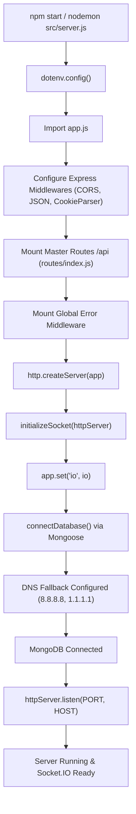
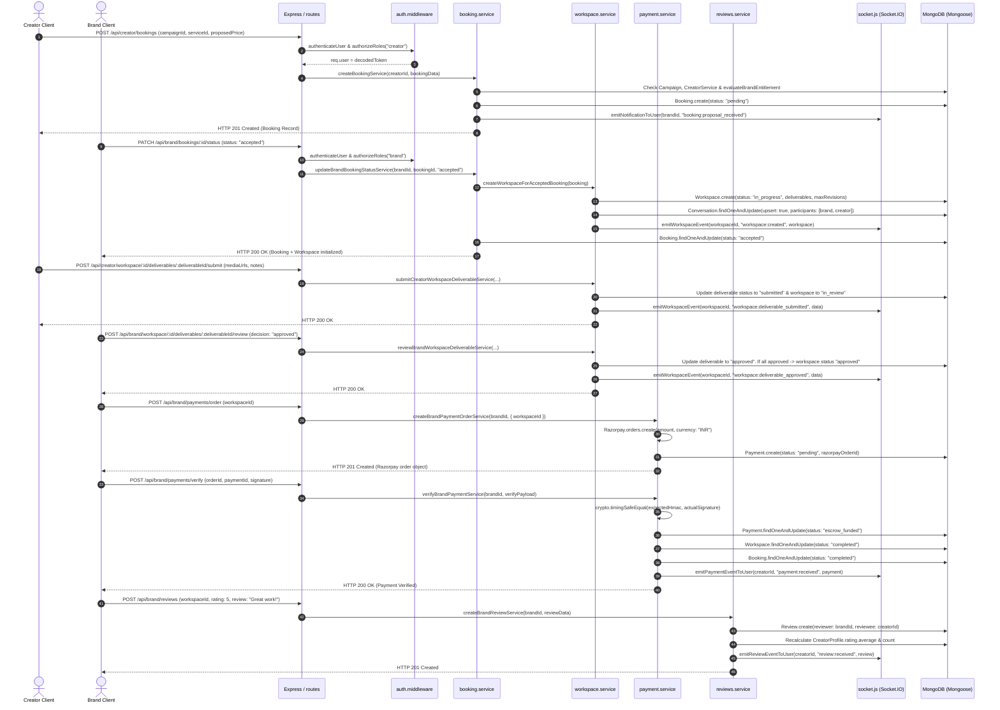
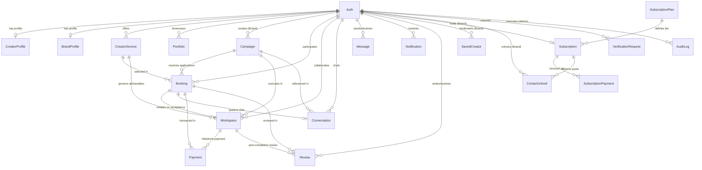
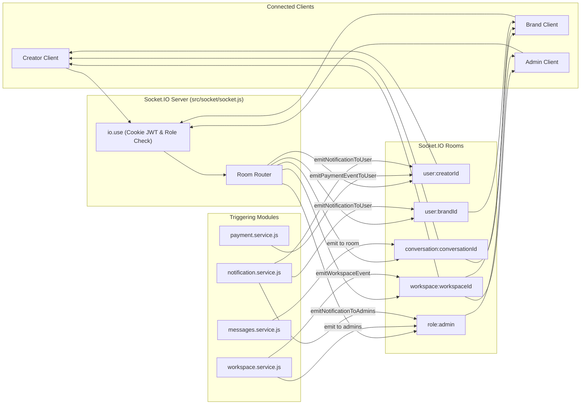

# CreatorLink Backend – Complete Architecture & Code Flow Audit

> **Document Type:** Senior Node.js Backend Architectural Audit & System Reference  
> **Target Project:** CreatorLink Backend (`backend/`)  
> **Runtime Environment:** Node.js (ES Modules), Express.js 5.2.1, MongoDB / Mongoose 9.10.2, Socket.IO 4.8.4  
> **Audit Status:** Read-Only Analysis Complete (Zero source code modifications performed)  
> **Generated:** November 10, 2026

---

## 1. Project Overview

CreatorLink is a two-sided creator economy platform connecting **Brands** and **Content Creators**, overseen by a platform **Administrator**. The backend architecture is implemented as an enterprise-grade, modular Node.js REST API and real-time WebSocket server.

### 1.1 Technical Stack

| Layer | Technology | Version | Purpose |
| :--- | :--- | :--- | :--- |
| **Runtime** | Node.js | v20+ (ES Modules: `"type": "module"`) | Asynchronous server execution |
| **HTTP Framework** | Express.js | `^5.2.1` | REST API routing and middleware pipeline |
| **Database & ODM** | MongoDB with Mongoose | `^9.10.2` | Document database, schemas, indexes, hooks |
| **Real-Time WebSockets**| Socket.IO | `^4.8.4` | Bi-directional messaging, live notifications, collaboration telemetry |
| **Authentication** | JSON Web Tokens (`jsonwebtoken`) & `bcryptjs` | `^9.0.3` / `^3.0.3` | Dual-token auth (short-lived access + rotating refresh tokens in HttpOnly cookies) |
| **Google Auth** | Google Auth Library (`google-auth-library`)| `^11.3.2` | OAuth2 Google login & registration token verification |
| **Media Processing** | Sharp & Multer | `^0.35.5` / `^2.4.0` | Memory buffer handling, progressive compression to WebP (<=2MB) |
| **Cloud Storage** | Cloudinary SDK | `^2.11.0` | Secure streaming uploads for optimized images and video assets |
| **Email Delivery** | Nodemailer | `^10.2.1` | Transactional email notifications and 6-digit SHA-256 hashed OTP delivery |
| **Payment Gateway** | Razorpay Node SDK | `^2.9.8` | Test-mode escrow order creation, webhook verification, and payment capture |
| **Rate Limiting** | Express Rate Limit (`express-rate-limit`)| `^8.7.1` | Anti-brute-force defense for authentication, OTP, and password operations |

### 1.2 Core Architectural Principles

1. **Modular Architecture (Controller-Service-Model Pattern):**
   - Each business capability is encapsulated within `backend/src/modules/<domain>/` containing its own `.route.js`, `.controller.js`, `.service.js`, `.validation.js`, and `.model.js`.
2. **Strict Context & Role Isolation:**
   - Platform Administrators use isolated endpoints (`/api/admin/*`), separate HttpOnly cookies (`adminAccessToken`, `adminRefreshToken`), and dedicated WebSocket authentication scopes. Standard Creators and Brands use `/api/creator/*` and `/api/brand/*` with standard `accessToken` and `refreshToken` cookies.
3. **Escrow Collaboration Lifecycle:**
   - Campaign Publishing -> Creator Application / Brand Proposal (Booking) -> Accepted Booking -> Automatic Workspace Initialization -> Structured Deliverable Submissions -> Brand Multi-Stage Reviews -> Milestone Approval -> Razorpay Escrow Payment -> Collaboration Review & Rating.
4. **Subscription & Entitlement Engine:**
   - Dynamic evaluation of brand access rights (trialing, active, past_due with 3-day grace period, complimentary, expired) gating campaign publication, creator discovery, and contact unlocks.
5. **Real-Time Integration:**
   - Synchronous database transactions trigger asynchronous Socket.IO room events (`conversation:<id>`, `workspace:<id>`, `user:<id>`, `role:admin`) and persistent in-app notifications.

---

## 2. Complete Backend Folder Structure

### 2.1 File Tree

```
backend/
├── .env                                       # Local environment configuration (Secrets excluded from report)
├── .env.example                               # Environment template defining all required variables
├── .gitignore                                 # Git ignore definitions
├── package.json                               # Dependencies, project metadata, and execution scripts
├── package-lock.json                          # Exact dependency tree lockfile
├── README.md                                  # Project readme (0 bytes, empty placeholder)
├── scripts/                                   # Database migration, backfill, and seed scripts
│   ├── backfill-brand-onboarded.js            # Migration setting onboarded status for legacy brands
│   ├── complete-existing-creators.js          # Backfills missing creator profile metadata
│   ├── migrate-verification-architecture.js   # Migrates legacy verification flags to VerificationRequest collection
│   ├── seed-demo-creators.js                  # Populates development database with mock creators
│   └── backups/
│       └── existing-creators-backup-*.json    # Historical backup snapshot from creator migration
├── src/                                       # Core application source code
│   ├── server.js                              # Application entry point: HTTP & Socket.IO server startup
│   ├── app.js                                 # Express application configuration, CORS, parsers, route mounting
│   ├── config/                                # Third-party SDK and infrastructure initialization
│   │   ├── cloudinary.js                      # Cloudinary SDK credentials and configuration
│   │   ├── database.js                        # Mongoose MongoDB connection handler with DNS SRV fallback
│   │   ├── env.js                             # (0 bytes, empty placeholder)
│   │   └── nodemailer.js                      # Nodemailer SMTP transporter builder and validation
│   ├── middleware/                            # Express pipeline interceptors
│   │   ├── auth.middleware.js                 # JWT access token & password-version revocation verification
│   │   ├── error.middleware.js                # Centralized global API error handler
│   │   ├── rateLimiter.middleware.js          # Rate limiters for signup, OTP, password reset, and auth
│   │   ├── role.middleware.js                 # Role-based access control (RBAC) guard
│   │   └── upload.middleware.js               # Multer memory storage filters for images (<=5MB) and video (<=50MB)
│   ├── modules/                               # Modular business domains
│   │   ├── admin/                             # Administrative portal backend
│   │   │   ├── audit/                         # Immutable administrative action logging (AuditLog model)
│   │   │   ├── auth/                          # Dedicated admin authentication (adminLogin, cookie rotation)
│   │   │   ├── campaigns/                     # Admin campaign moderation, stats, pausing, and closing
│   │   │   ├── collaborations/                # Admin collaboration monitoring, deadline extension, status override
│   │   │   ├── content/                       # (5 empty placeholder files: controller, model, route, service, val)
│   │   │   ├── dashboard/                     # Admin telemetry overview (users, campaigns, revenue, stats)
│   │   │   ├── disputes/                      # (5 empty placeholder files)
│   │   │   ├── payments/                      # (5 empty placeholder files)
│   │   │   ├── reports/                       # Platform reporting and metric aggregation
│   │   │   ├── reviews/                       # (5 empty placeholder files)
│   │   │   ├── settings/                      # Admin profile management, avatar upload, password change
│   │   │   ├── users/                         # Admin user directory, role filtering, and user deep-inspection
│   │   │   └── verification/                  # Creator and brand identity badge verification workflow
│   │   ├── auth/                              # Primary user authentication (Register, OTP, Login, Refresh, Google)
│   │   ├── booking/                           # Applications and direct collaboration proposals
│   │   ├── brand/                             # Brand panel specific submodules
│   │   │   ├── campaigns/                     # Brand campaign creation, draft, publishing, and editing
│   │   │   ├── creators/                      # Discovery catalog, advanced search, filtering, and bookmarks
│   │   │   ├── dashboard/                     # Brand metrics, active bookings, spends, campaign status
│   │   │   └── profile/                       # Brand company profile, logo, social links, bio
│   │   ├── creator/                           # Creator panel specific submodules
│   │   │   ├── campaigns/                     # Public campaign discovery, application tracking
│   │   │   ├── dashboard/                     # Creator earnings, pending deliverables, stats
│   │   │   ├── portfolio/                     # Creator showcase items, past work links, category tagging
│   │   │   ├── profile/                       # Creator public bio, avatar, social handles, pricing, niches
│   │   │   └── services/                      # Creator packaged service offerings and pricing tiers
│   │   ├── homepage/                          # Public landing page featured creators and campaigns
│   │   ├── messages/                          # Real-time conversations and chat messages
│   │   ├── notifications/                     # In-app persistent notification storage and real-time delivery
│   │   ├── payments/                          # Razorpay escrow payments for completed workspaces
│   │   ├── Public/                            # (5 empty placeholder files)
│   │   ├── reviews/                           # 2-way post-collaboration reviews and star ratings
│   │   ├── subscriptions/                     # Brand subscription plans, Razorpay recurring billing, contact unlock
│   │   ├── upload/                            # Standalone media upload routes (Cloudinary + WebP processing)
│   │   └── workspace/                         # Active collaboration management, deliverables, revisions
│   ├── routes/                                # Global routing registry
│   │   └── index.js                           # Master route mounting file aggregating all sub-routers
│   ├── scripts/                               # Maintenance and ad-hoc verification test scripts
│   ├── seed/                                  # Seed utilities (e.g. initial superadmin user)
│   ├── socket/                                # Socket.IO server engine
│   │   └── socket.js                          # Socket connection middleware, authentication, room management, emitters
│   └── utils/                                 # Shared cross-cutting utility functions
│       ├── ApiError.js                        # Custom error class formatting statusCode and message
│       ├── asyncHandler.js                    # Wrapper catching async promise rejections for Express
│       ├── constants.js                       # (0 bytes, empty placeholder)
│       ├── pagination.js                      # Standard pagination calculator and metadata builder
│       ├── response.js                        # Uniform JSON API response envelope
│       ├── validation.js                      # (0 bytes, empty placeholder)
│       └── helpers/                           # Specialized utility helpers
│           ├── cloudinary.helper.js           # Cloudinary buffer upload streams with concurrency management
│           ├── email.helper.js                # Nodemailer sendMail wrapper
│           ├── image.helper.js                # Sharp WebP compression ladder enforcing <= 2MB size
│           ├── password.helper.js             # Bcryptjs hashing and comparison
│           ├── search.helper.js               # Mongoose case-insensitive regex query builder
│           ├── time.helper.js                 # Millisecond duration parser ("15m", "7d", "24h")
│           └── token.helper.js                # JWT sign, verify, and SHA-256 refresh token hasher
└── tests/                                     # Unit and integration test suites
    └── helpers/
        ├── cloudinary.helper.test.js          # Unit tests for Cloudinary upload helper
        └── image.helper.test.js               # Unit tests for Sharp WebP image compression
```

*Note on exclusions: As instructed, `node_modules`, `.git`, temporary log artifacts, and build directories are excluded from detailed source-code analysis.*

---

## 3. Every File Explanation

Below is the exhaustive catalog of every file in `backend/` and its verified architectural responsibility:

| File Path | Type / Layer | Verified Architectural Purpose & Responsibility |
| :--- | :--- | :--- |
| `backend/package.json` | Configuration | Defines project metadata, ES Module declaration (`"type": "module"`), startup scripts (`start`, `dev`, `seed:admin`, `seed:demo`), and dependencies. |
| `backend/package-lock.json` | Configuration | Locks deterministic dependency versions for reproducibility across build environments. |
| `backend/.env.example` | Configuration | Documents all required environment variables: ports, hostnames, Mongo URI, JWT secrets, Cloudinary, Nodemailer, and Razorpay keys. |
| `backend/.gitignore` | Configuration | Prevents local environment files (`.env`), dependency folders (`node_modules`), logs, and temporary dumps from entering version control. |
| `backend/README.md` | Documentation | **Empty file (0 bytes).** |
| `backend/scripts/backfill-brand-onboarded.js` | Migration Script | Database migration ensuring all existing `BrandProfile` documents have `isOnboarded: true`. |
| `backend/scripts/complete-existing-creators.js` | Migration Script | Fills default biography, pricing, and category values on legacy creator profiles. |
| `backend/scripts/migrate-verification-architecture.js` | Migration Script | Migrates legacy boolean verification flags on `Auth` and `CreatorProfile` into structured `VerificationRequest` records. |
| `backend/scripts/seed-demo-creators.js` | Seeding Script | Generates mock creator accounts, profiles, portfolios, and services for staging and frontend testing. |
| `backend/src/server.js` | Entry Point | Application startup: loads environment via `dotenv`, creates HTTP server, initializes Socket.IO via `initializeSocket(httpServer)`, binds `io` instance to Express (`app.set("io", io)`), establishes MongoDB connection, and binds listener to `HOST:PORT`. |
| `backend/src/app.js` | Express Setup | Configures Express instance: registers CORS with origin whitelisting and credentials, JSON/URL-encoded body parsers, cookie parser, mounts `/` health-check, mounts `/api` master router, and registers global `errorMiddleware`. |
| `backend/src/config/database.js` | Configuration | Connects Mongoose to MongoDB using `MONGO_URI`. Overrides DNS servers to `8.8.8.8` and `1.1.1.1` to prevent SRV record lookup failures on certain ISPs. |
| `backend/src/config/env.js` | Configuration | **Empty placeholder file (0 bytes).** Environment parsing is handled directly in individual modules. |
| `backend/src/config/cloudinary.js` | Configuration | Initializes Cloudinary v2 SDK using `CLOUDINARY_CLOUD_NAME`, `CLOUDINARY_API_KEY`, and `CLOUDINARY_API_SECRET`. |
| `backend/src/config/nodemailer.js` | Configuration | Reads SMTP configuration dynamically (`SMTP_HOST`, `SMTP_PORT`, `SMTP_USER`, `SMTP_PASS`, `SMTP_SECURE`, `SMTP_SERVICE`) and builds reusable Nodemailer transport. |
| `backend/src/middleware/auth.middleware.js` | Middleware | Authenticates incoming HTTP requests by reading `accessToken` (or `adminAccessToken` on `/admin` routes) from HttpOnly cookies, verifies signature, verifies user existence in MongoDB, and validates `passwordVersion` against token version to reject revoked sessions immediately. Populates `req.user`. |
| `backend/src/middleware/role.middleware.js` | Middleware | RBAC authorization guard: verifies that `req.user.role` is included in the allowed roles list; throws 403 ApiError if forbidden. |
| `backend/src/middleware/error.middleware.js` | Middleware | Centralized error interceptor: catches uncaught errors from controllers, defaults status to 500 if missing, and formats response using `sendResponse(res, statusCode, message, null)`. |
| `backend/src/middleware/rateLimiter.middleware.js` | Middleware | Exposes configured rate limiters (`signupLimiter`, `verifyOtpLimiter`, `resendOtpLimiter`, `changePasswordLimiter`, `forgotPasswordLimiter`, `resetPasswordLimiter`) using `express-rate-limit`. |
| `backend/src/middleware/upload.middleware.js` | Middleware | Multer configuration storing files in RAM (`memoryStorage`) with MIME type validation and file size restrictions (5MB for images, 50MB for videos). |
| `backend/src/routes/index.js` | Route Aggregator | Master router mounting all module routers under `/api/*` prefixes with appropriate middleware boundaries. |
| `backend/src/socket/socket.js` | WebSocket Engine | Socket.IO server: performs cookie authentication (with strict admin/standard candidate isolation), registers connection rooms (`user:<id>`, `role:admin`, `conversation:<id>`, `workspace:<id>`), handles join/leave events, and exports helper emitters (`emitNotificationToUser`, `emitWorkspaceEvent`, etc.). |
| `backend/src/utils/ApiError.js` | Utility | Factory function creating standardized `Error` objects with `statusCode` and `success: false`. |
| `backend/src/utils/asyncHandler.js` | Utility | Higher-order wrapper wrapping async controller functions to pass rejected promises into Express `next(error)`. |
| `backend/src/utils/constants.js` | Utility | **Empty placeholder file (0 bytes).** |
| `backend/src/utils/pagination.js` | Utility | Helper functions `getPagination` (calculates `skip` and `limit`) and `getPaginationData` (constructs total pages and boolean hasNext/hasPrev flags). |
| `backend/src/utils/response.js` | Utility | Formats standard JSON API response envelope: `{ success, statusCode, message, data }`. |
| `backend/src/utils/validation.js` | Utility | **Empty placeholder file (0 bytes).** Validations are implemented modularly in each module's `*.validation.js`. |
| `backend/src/utils/helpers/token.helper.js` | Helper | Generates access tokens (15m standard, 24h admin), refresh tokens (7d), verifies JWT signatures, and hashes refresh tokens with SHA-256 before DB persistence. |
| `backend/src/utils/helpers/password.helper.js` | Helper | Bcrypt wrapper for hashing passwords (10 salt rounds) and comparing plaintext passwords against stored hashes. |
| `backend/src/utils/helpers/email.helper.js` | Helper | Dispatches transactional emails via Nodemailer transporter with validation for sender, recipient, subject, and text/html bodies. |
| `backend/src/utils/helpers/cloudinary.helper.js` | Helper | Converts image buffers to WebP via `image.helper.js` and streams them to Cloudinary. Provides concurrency pool for batch uploads and streams video buffers directly. |
| `backend/src/utils/helpers/image.helper.js` | Helper | Uses Sharp to auto-orient images, preserve PNG transparency, convert to WebP, and execute a 10-step progressive dimension and quality reduction ladder to enforce a strict <= 2MB size limit. |
| `backend/src/utils/helpers/search.helper.js` | Helper | Constructs Mongoose `$or` arrays with case-insensitive `$regex` matching across specified schema fields. |
| `backend/src/utils/helpers/time.helper.js` | Helper | Parses string durations (e.g. `"15m"`, `"7d"`, `"2h"`) into integer millisecond counts for cookie `maxAge`. |
| `backend/src/seed/admin.seed.js` | Seeding Script | Command-line script to bootstrap the initial administrative account in `Auth` collection if no admin exists. |

*(For module-specific files, see Section 4 and Section 6 below).*

---

## 4. Backend Startup Flow

### 4.1 Startup Execution Sequence

1. **Process Launch:**
   - Command `npm run dev` or `npm start` executes `node src/server.js`.
2. **Environment Hydration:**
   - `server.js` calls `dotenv.config()` (Line 36), loading environment key-value pairs into `process.env`.
3. **Application Instantiation:**
   - `server.js` imports `app` from `./app.js`.
   - `app.js` initializes `const app = express()` and attaches global middleware:
     - CORS middleware with origin whitelist validation and `credentials: true`.
     - `express.json()` and `express.urlencoded({ extended: true })`.
     - `cookieParser()`.
     - Health route: `GET /` -> returns `{ success: true, message: "CreatorLink API is running" }`.
     - Master router: `app.use("/api", routes)` from `./routes/index.js`.
     - Global error middleware: `app.use(errorMiddleware)` from `./middleware/error.middleware.js`.
4. **HTTP Server & Socket.IO Coupling:**
   - `server.js` wraps Express in Node's HTTP module: `const httpServer = http.createServer(app)`.
   - `server.js` initializes WebSockets: `const io = initializeSocket(httpServer)`.
   - `initializeSocket` configures CORS on WebSockets, attaches authentication middleware (`io.use`), registers event handlers on connection, and stores singleton instance in `ioInstance`.
   - `app.set("io", io)` exposes the Socket.IO instance to Express routes.
5. **Database Connection:**
   - Inside async function `startServer()`, `connectDatabase()` from `./config/database.js` executes.
   - Sets DNS servers to Google (`8.8.8.8`, `8.8.4.4`) and Cloudflare (`1.1.1.1`) to guarantee SRV resolution.
   - Calls `mongoose.connect(process.env.MONGO_URI)`.
6. **Port Binding & Listener Activation:**
   - `httpServer.listen(PORT, HOST)` binds to configured network interface (default `0.0.0.0:5005`).
   - Logs confirmation to console: `Server is running on http://0.0.0.0:5005` and `Socket.IO server is ready`.

### 4.2 Startup Flow Diagram



---

## 5. Complete API Route Inventory

Below is the verified inventory of all **160 active API endpoints** defined in the CreatorLink backend, traced from `server.js` -> `app.js` -> `routes/index.js` down to their underlying route files, controllers, and middlewares.

### 5.1 Public & Homepage Routes
*Mounted at `/api/homepage` in `routes/index.js:52`*

| Method | Full Endpoint | Route File | Controller Function | Middleware & Validation | Auth / Role |
| :--- | :--- | :--- | :--- | :--- | :--- |
| **GET** | `/api/homepage/featured` | `modules/homepage/homepage.route.js:7` | `getFeaturedData` | None | Public |

---

### 5.2 Authentication Module Routes
*Mounted at `/api/auth` in `routes/index.js:55`*

| Method | Full Endpoint | Route File | Controller Function | Middleware & Validation | Auth / Role |
| :--- | :--- | :--- | :--- | :--- | :--- |
| **POST** | `/api/auth/register` | `modules/auth/auth.route.js:43` | `register` | `signupLimiter`, `validateRegister` | Public |
| **POST** | `/api/auth/verify-email-otp`| `modules/auth/auth.route.js:51` | `verifyEmailOtp` | `verifyOtpLimiter`, `validateVerifyOtp` | Public |
| **POST** | `/api/auth/resend-email-otp`| `modules/auth/auth.route.js:59` | `resendVerificationOtp` | `resendOtpLimiter`, `validateResendOtp` | Public |
| **POST** | `/api/auth/login` | `modules/auth/auth.route.js:68` | `login` | `validateLogin` | Public |
| **POST** | `/api/auth/refresh` | `modules/auth/auth.route.js:76` | `refreshToken` | `validateRefreshToken` | Refresh Token Cookie |
| **GET** | `/api/auth/me` | `modules/auth/auth.route.js:83` | `getMe` | `authenticateUser` | Authenticated (Any Role) |
| **POST** | `/api/auth/logout` | `modules/auth/auth.route.js:90` | `logout` | `validateRefreshToken` | Refresh Token Cookie |
| **PATCH** | `/api/auth/change-password` | `modules/auth/auth.route.js:97` | `changePassword` | `authenticateUser`, `changePasswordLimiter`, `validateChangePassword` | Authenticated (Any Role) |
| **POST** | `/api/auth/forgot-password` | `modules/auth/auth.route.js:106` | `forgotPassword` | `forgotPasswordLimiter`, `validateForgotPassword` | Public |
| **POST** | `/api/auth/reset-password` | `modules/auth/auth.route.js:114` | `resetPassword` | `resetPasswordLimiter`, `validateResetPassword` | Public |
| **POST** | `/api/auth/google` | `modules/auth/auth.route.js:122` | `googleAuth` | `validateGoogleAuth` | Public |
| **GET** | `/api/auth/google/client-id`| `modules/auth/auth.route.js:129` | `getGoogleClientId` | None | Public |

---

### 5.3 Creator Panel Routes
*Mounted under `/api/creator/*` in `routes/index.js:63-72`*

#### Creator Profile (`/api/creator/profile`)
| Method | Full Endpoint | Route File | Controller Function | Middleware & Validation | Auth / Role |
| :--- | :--- | :--- | :--- | :--- | :--- |
| **GET** | `/api/creator/profile/me` | `modules/creator/profile/profile.route.js:33` | `getMyProfile` | `authenticateUser`, `authorizeRoles("creator")` | Creator |
| **POST** | `/api/creator/profile` | `modules/creator/profile/profile.route.js:40` | `createMyProfile` | `authenticateUser`, `authorizeRoles("creator")`, `validateCreateProfile` | Creator |
| **PUT** | `/api/creator/profile` | `modules/creator/profile/profile.route.js:48` | `updateMyProfile` | `authenticateUser`, `authorizeRoles("creator")`, `validateUpdateProfile` | Creator |
| **POST** | `/api/creator/profile/verification`| `modules/creator/profile/profile.route.js:56` | `submitVerification` | `authenticateUser`, `authorizeRoles("creator")`, `validateVerification` | Creator |
| **GET** | `/api/creator/profile/verification/status`| `modules/creator/profile/profile.route.js:64` | `getVerificationStatus` | `authenticateUser`, `authorizeRoles("creator")` | Creator |
| **GET** | `/api/creator/profile/contact-consent`| `modules/creator/profile/profile.route.js:71` | `getContactConsent` | `authenticateUser`, `authorizeRoles("creator")` | Creator |
| **PATCH** | `/api/creator/profile/contact-consent`| `modules/creator/profile/profile.route.js:78` | `updateContactConsent` | `authenticateUser`, `authorizeRoles("creator")` | Creator |
| **GET** | `/api/creator/profile/:id` | `modules/creator/profile/profile.route.js:86` | `getPublicProfileById` | None | Public |

#### Creator Portfolio (`/api/creator/portfolio`)
| Method | Full Endpoint | Route File | Controller Function | Middleware & Validation | Auth / Role |
| :--- | :--- | :--- | :--- | :--- | :--- |
| **POST** | `/api/creator/portfolio` | `modules/creator/portfolio/portfolio.route.js:31` | `createPortfolioItem` | `authenticateUser`, `authorizeRoles("creator")`, `validateCreatePortfolio` | Creator |
| **GET** | `/api/creator/portfolio` | `modules/creator/portfolio/portfolio.route.js:39` | `getMyPortfolio` | `authenticateUser`, `authorizeRoles("creator")` | Creator |
| **GET** | `/api/creator/portfolio/:id` | `modules/creator/portfolio/portfolio.route.js:46` | `getPortfolioItemById` | `authenticateUser`, `authorizeRoles("creator")` | Creator |
| **PUT** | `/api/creator/portfolio/:id` | `modules/creator/portfolio/portfolio.route.js:53` | `updatePortfolioItem` | `authenticateUser`, `authorizeRoles("creator")`, `validateUpdatePortfolio` | Creator |
| **DELETE** | `/api/creator/portfolio/:id` | `modules/creator/portfolio/portfolio.route.js:61` | `deletePortfolioItem` | `authenticateUser`, `authorizeRoles("creator")` | Creator |

#### Creator Services (`/api/creator/services`)
| Method | Full Endpoint | Route File | Controller Function | Middleware & Validation | Auth / Role |
| :--- | :--- | :--- | :--- | :--- | :--- |
| **POST** | `/api/creator/services` | `modules/creator/services/services.route.js:30` | `createService` | `authenticateUser`, `authorizeRoles("creator")`, `validateCreateService` | Creator |
| **GET** | `/api/creator/services` | `modules/creator/services/services.route.js:38` | `getMyServices` | `authenticateUser`, `authorizeRoles("creator")` | Creator |
| **GET** | `/api/creator/services/public/:creatorId`| `modules/creator/services/services.route.js:45` | `getPublicServicesByCreatorId`| None | Public |
| **GET** | `/api/creator/services/:id` | `modules/creator/services/services.route.js:52` | `getServiceById` | `authenticateUser`, `authorizeRoles("creator")` | Creator |
| **PUT** | `/api/creator/services/:id` | `modules/creator/services/services.route.js:59` | `updateService` | `authenticateUser`, `authorizeRoles("creator")`, `validateUpdateService` | Creator |
| **DELETE** | `/api/creator/services/:id` | `modules/creator/services/services.route.js:67` | `deleteService` | `authenticateUser`, `authorizeRoles("creator")` | Creator |

#### Creator Campaigns Discovery (`/api/creator/campaigns`)
| Method | Full Endpoint | Route File | Controller Function | Middleware & Validation | Auth / Role |
| :--- | :--- | :--- | :--- | :--- | :--- |
| **GET** | `/api/creator/campaigns/discover`| `modules/creator/campaigns/campaigns.route.js:28` | `getDiscoverCampaigns` | `authenticateUser`, `authorizeRoles("creator")` | Creator |
| **GET** | `/api/creator/campaigns/applied` | `modules/creator/campaigns/campaigns.route.js:35` | `getAppliedCampaigns` | `authenticateUser`, `authorizeRoles("creator")` | Creator |
| **GET** | `/api/creator/campaigns/:id` | `modules/creator/campaigns/campaigns.route.js:42` | `getDiscoverCampaignById` | `authenticateUser`, `authorizeRoles("creator")` | Creator |

#### Creator Dashboard (`/api/creator/dashboard`)
| Method | Full Endpoint | Route File | Controller Function | Middleware & Validation | Auth / Role |
| :--- | :--- | :--- | :--- | :--- | :--- |
| **GET** | `/api/creator/dashboard` | `modules/creator/dashboard/dashboard.route.js:14` | `getCreatorDashboard` | `authenticateUser`, `authorizeRoles("creator")` | Creator |

#### Creator Bookings (`/api/creator/bookings`)
| Method | Full Endpoint | Route File | Controller Function | Middleware & Validation | Auth / Role |
| :--- | :--- | :--- | :--- | :--- | :--- |
| **POST** | `/api/creator/bookings` | `modules/booking/booking.route.js:31` | `createBooking` | `authenticateUser`, `authorizeRoles("creator")`, `validateCreateBooking` | Creator |
| **GET** | `/api/creator/bookings` | `modules/booking/booking.route.js:39` | `getCreatorBookings` | `authenticateUser`, `authorizeRoles("creator")`, `validateGetBookingsQuery` | Creator |
| **GET** | `/api/creator/bookings/:id` | `modules/booking/booking.route.js:47` | `getCreatorBookingById` | `authenticateUser`, `authorizeRoles("creator")` | Creator |
| **PATCH** | `/api/creator/bookings/:id/status`| `modules/booking/booking.route.js:54` | `updateCreatorBookingStatus`| `authenticateUser`, `authorizeRoles("creator")`, `validateUpdateBookingStatus`| Creator |
| **POST** | `/api/creator/bookings/:id/cancel`| `modules/booking/booking.route.js:62` | `cancelCreatorBooking` | `authenticateUser`, `authorizeRoles("creator")` | Creator |

#### Creator Workspace (`/api/creator/workspace`)
| Method | Full Endpoint | Route File | Controller Function | Middleware & Validation | Auth / Role |
| :--- | :--- | :--- | :--- | :--- | :--- |
| **GET** | `/api/creator/workspace` | `modules/workspace/workspace.route.js:34` | `getCreatorWorkspaces` | `authenticateUser`, `authorizeRoles("creator")`, `validateGetWorkspacesQuery` | Creator |
| **GET** | `/api/creator/workspace/:id` | `modules/workspace/workspace.route.js:41` | `getCreatorWorkspaceById` | `authenticateUser`, `authorizeRoles("creator")` | Creator |
| **POST** | `/api/creator/workspace/:id/submit`| `modules/workspace/workspace.route.js:47` | `submitCreatorWorkspaceWork`| `authenticateUser`, `authorizeRoles("creator")`, `validateCreatorSubmission` | Creator |
| **POST** | `/api/creator/workspace/:id/deliverables/:deliverableId/submit`| `modules/workspace/workspace.route.js:54` | `submitCreatorWorkspaceDeliverable`| `authenticateUser`, `authorizeRoles("creator")`, `validateCreatorSubmission`| Creator |

#### Creator Messages (`/api/creator/messages`)
| Method | Full Endpoint | Route File | Controller Function | Middleware & Validation | Auth / Role |
| :--- | :--- | :--- | :--- | :--- | :--- |
| **GET** | `/api/creator/messages/conversations`| `modules/messages/messages.route.js:32` | `getCreatorConversations` | `authenticateUser`, `authorizeRoles("creator")` | Creator |
| **GET** | `/api/creator/messages/conversations/:id`| `modules/messages/messages.route.js:39` | `getCreatorConversationById`| `authenticateUser`, `authorizeRoles("creator")` | Creator |
| **POST** | `/api/creator/messages/send` | `modules/messages/messages.route.js:46` | `sendCreatorMessage` | `authenticateUser`, `authorizeRoles("creator")`, `validateSendMessage` | Creator |
| **PATCH** | `/api/creator/messages/conversations/:id/read`| `modules/messages/messages.route.js:54`| `markCreatorConversationRead`| `authenticateUser`, `authorizeRoles("creator")` | Creator |

#### Creator Payments (`/api/creator/payments`)
| Method | Full Endpoint | Route File | Controller Function | Middleware & Validation | Auth / Role |
| :--- | :--- | :--- | :--- | :--- | :--- |
| **GET** | `/api/creator/payments` | `modules/payments/payment.route.js:67` | `getCreatorPayments` | `authenticateUser`, `authorizeRoles("creator")` | Creator |
| **GET** | `/api/creator/payments/:id` | `modules/payments/payment.route.js:73` | `getCreatorPaymentById` | `authenticateUser`, `authorizeRoles("creator")` | Creator |

#### Creator Reviews (`/api/creator/reviews`)
| Method | Full Endpoint | Route File | Controller Function | Middleware & Validation | Auth / Role |
| :--- | :--- | :--- | :--- | :--- | :--- |
| **POST** | `/api/creator/reviews` | `modules/reviews/reviews.route.js:62` | `createCreatorReview` | `authenticateUser`, `authorizeRoles("creator")`, `validateCreateReview` | Creator |
| **GET** | `/api/creator/reviews` | `modules/reviews/reviews.route.js:69` | `getCreatorReviews` | `authenticateUser`, `authorizeRoles("creator")`, `validateGetReviewsQuery` | Creator |
| **GET** | `/api/creator/reviews/workspace/:workspaceId`| `modules/reviews/reviews.route.js:76`| `getWorkspaceReview` | `authenticateUser`, `authorizeRoles("creator")`, `validateWorkspaceIdParam` | Creator |

---

### 5.4 Brand Panel Routes
*Mounted under `/api/brand/*` in `routes/index.js:79-87`*

#### Brand Profile (`/api/brand/profile`)
| Method | Full Endpoint | Route File | Controller Function | Middleware & Validation | Auth / Role |
| :--- | :--- | :--- | :--- | :--- | :--- |
| **GET** | `/api/brand/profile/me` | `modules/brand/profile/profile.route.js:33` | `getMyBrandProfile` | `authenticateUser`, `authorizeRoles("brand")` | Brand |
| **POST** | `/api/brand/profile` | `modules/brand/profile/profile.route.js:40` | `createBrandProfile` | `authenticateUser`, `authorizeRoles("brand")`, `validateCreateBrandProfile` | Brand |
| **PUT** | `/api/brand/profile` | `modules/brand/profile/profile.route.js:48` | `updateBrandProfile` | `authenticateUser`, `authorizeRoles("brand")`, `validateUpdateBrandProfile` | Brand |
| **POST** | `/api/brand/profile/verification`| `modules/brand/profile/profile.route.js:56` | `submitBrandVerification`| `authenticateUser`, `authorizeRoles("brand")`, `validateVerification` | Brand |
| **GET** | `/api/brand/profile/verification/status`| `modules/brand/profile/profile.route.js:64` | `getBrandVerificationStatus`| `authenticateUser`, `authorizeRoles("brand")`| Brand |
| **GET** | `/api/brand/profile/:id` | `modules/brand/profile/profile.route.js:71` | `getPublicBrandProfileById`| None | Public |

#### Brand Campaigns (`/api/brand/campaigns`)
| Method | Full Endpoint | Route File | Controller Function | Middleware & Validation | Auth / Role |
| :--- | :--- | :--- | :--- | :--- | :--- |
| **POST** | `/api/brand/campaigns` | `modules/brand/campaigns/campaign.route.js:31` | `createCampaign` | `authenticateUser`, `authorizeRoles("brand")`, `validateCreateCampaign` | Brand |
| **GET** | `/api/brand/campaigns` | `modules/brand/campaigns/campaign.route.js:39` | `getMyCampaigns` | `authenticateUser`, `authorizeRoles("brand")`, `validateGetCampaignsQuery` | Brand |
| **GET** | `/api/brand/campaigns/:id` | `modules/brand/campaigns/campaign.route.js:47` | `getCampaignById` | `authenticateUser`, `authorizeRoles("brand")` | Brand |
| **PUT** | `/api/brand/campaigns/:id` | `modules/brand/campaigns/campaign.route.js:54` | `updateCampaign` | `authenticateUser`, `authorizeRoles("brand")`, `validateUpdateCampaign` | Brand |

#### Brand Creator Discovery & Bookmarks (`/api/brand/creators`)
| Method | Full Endpoint | Route File | Controller Function | Middleware & Validation | Auth / Role |
| :--- | :--- | :--- | :--- | :--- | :--- |
| **GET** | `/api/brand/creators/discover` | `modules/brand/creators/creators.route.js:34` | `getDiscoverCreators` | `authenticateUser`, `authorizeRoles("brand")`, `validateDiscoverQuery` | Brand |
| **GET** | `/api/brand/creators/saved` | `modules/brand/creators/creators.route.js:42` | `getSavedCreators` | `authenticateUser`, `authorizeRoles("brand")` | Brand |
| **GET** | `/api/brand/creators/saved/ids`| `modules/brand/creators/creators.route.js:49` | `getSavedCreatorIds` | `authenticateUser`, `authorizeRoles("brand")` | Brand |
| **GET** | `/api/brand/creators/:id` | `modules/brand/creators/creators.route.js:56` | `getDiscoverCreatorById` | `authenticateUser`, `authorizeRoles("brand")`, `validateCreatorIdParam` | Brand |
| **POST** | `/api/brand/creators/:id/save` | `modules/brand/creators/creators.route.js:64` | `saveCreator` | `authenticateUser`, `authorizeRoles("brand")`, `validateCreatorIdParam` | Brand |
| **DELETE** | `/api/brand/creators/:id/save` | `modules/brand/creators/creators.route.js:72` | `unsaveCreator` | `authenticateUser`, `authorizeRoles("brand")`, `validateCreatorIdParam` | Brand |

#### Brand Dashboard (`/api/brand/dashboard`)
| Method | Full Endpoint | Route File | Controller Function | Middleware & Validation | Auth / Role |
| :--- | :--- | :--- | :--- | :--- | :--- |
| **GET** | `/api/brand/dashboard` | `modules/brand/dashboard/dashboard.route.js:14` | `getBrandDashboard` | `authenticateUser`, `authorizeRoles("brand")` | Brand |

#### Brand Bookings (`/api/brand/bookings`)
| Method | Full Endpoint | Route File | Controller Function | Middleware & Validation | Auth / Role |
| :--- | :--- | :--- | :--- | :--- | :--- |
| **POST** | `/api/brand/bookings` | `modules/booking/booking.route.js:79` | `createBrandBooking` | `authenticateUser`, `authorizeRoles("brand")`, `validateCreateBrandBooking` | Brand |
| **GET** | `/api/brand/bookings` | `modules/booking/booking.route.js:87` | `getBrandBookings` | `authenticateUser`, `authorizeRoles("brand")`, `validateGetBookingsQuery` | Brand |
| **GET** | `/api/brand/bookings/:id` | `modules/booking/booking.route.js:95` | `getBrandBookingById` | `authenticateUser`, `authorizeRoles("brand")` | Brand |
| **PATCH** | `/api/brand/bookings/:id/status`| `modules/booking/booking.route.js:102` | `updateBrandBookingStatus` | `authenticateUser`, `authorizeRoles("brand")`, `validateUpdateBookingStatus` | Brand |

#### Brand Workspace (`/api/brand/workspace`)
| Method | Full Endpoint | Route File | Controller Function | Middleware & Validation | Auth / Role |
| :--- | :--- | :--- | :--- | :--- | :--- |
| **GET** | `/api/brand/workspace` | `modules/workspace/workspace.route.js:71` | `getBrandWorkspaces` | `authenticateUser`, `authorizeRoles("brand")`, `validateGetWorkspacesQuery` | Brand |
| **GET** | `/api/brand/workspace/:id` | `modules/workspace/workspace.route.js:78` | `getBrandWorkspaceById` | `authenticateUser`, `authorizeRoles("brand")` | Brand |
| **POST** | `/api/brand/workspace/:id/review`| `modules/workspace/workspace.route.js:84` | `reviewBrandWorkspace` | `authenticateUser`, `authorizeRoles("brand")`, `validateBrandReview` | Brand |
| **POST** | `/api/brand/workspace/:id/deliverables/:deliverableId/review`| `modules/workspace/workspace.route.js:91` | `reviewBrandWorkspaceDeliverable`| `authenticateUser`, `authorizeRoles("brand")`, `validateBrandReview`| Brand |

#### Brand Messages (`/api/brand/messages`)
| Method | Full Endpoint | Route File | Controller Function | Middleware & Validation | Auth / Role |
| :--- | :--- | :--- | :--- | :--- | :--- |
| **GET** | `/api/brand/messages/conversations`| `modules/messages/messages.route.js:71` | `getBrandConversations` | `authenticateUser`, `authorizeRoles("brand")` | Brand |
| **GET** | `/api/brand/messages/conversations/:id`| `modules/messages/messages.route.js:78` | `getBrandConversationById` | `authenticateUser`, `authorizeRoles("brand")` | Brand |
| **POST** | `/api/brand/messages/send` | `modules/messages/messages.route.js:85` | `sendBrandMessage` | `authenticateUser`, `authorizeRoles("brand")`, `validateSendMessage` | Brand |
| **PATCH** | `/api/brand/messages/conversations/:id/read`| `modules/messages/messages.route.js:93` | `markBrandConversationRead` | `authenticateUser`, `authorizeRoles("brand")` | Brand |

#### Brand Payments (`/api/brand/payments`)
| Method | Full Endpoint | Route File | Controller Function | Middleware & Validation | Auth / Role |
| :--- | :--- | :--- | :--- | :--- | :--- |
| **POST** | `/api/brand/payments/order` | `modules/payments/payment.route.js:27` | `createBrandPaymentOrder` | `authenticateUser`, `authorizeRoles("brand")` | Brand |
| **POST** | `/api/brand/payments/verify` | `modules/payments/payment.route.js:33` | `verifyBrandPayment` | `authenticateUser`, `authorizeRoles("brand")` | Brand |
| **POST** | `/api/brand/payments/report-failed`| `modules/payments/payment.route.js:39` | `reportBrandPaymentFailure`| `authenticateUser`, `authorizeRoles("brand")` | Brand |
| **GET** | `/api/brand/payments` | `modules/payments/payment.route.js:45` | `getBrandPayments` | `authenticateUser`, `authorizeRoles("brand")` | Brand |
| **GET** | `/api/brand/payments/:id` | `modules/payments/payment.route.js:51` | `getBrandPaymentById` | `authenticateUser`, `authorizeRoles("brand")` | Brand |

#### Brand Reviews (`/api/brand/reviews`)
| Method | Full Endpoint | Route File | Controller Function | Middleware & Validation | Auth / Role |
| :--- | :--- | :--- | :--- | :--- | :--- |
| **POST** | `/api/brand/reviews` | `modules/reviews/reviews.route.js:31` | `createBrandReview` | `authenticateUser`, `authorizeRoles("brand")`, `validateCreateReview` | Brand |
| **GET** | `/api/brand/reviews` | `modules/reviews/reviews.route.js:38` | `getBrandReviews` | `authenticateUser`, `authorizeRoles("brand")`, `validateGetReviewsQuery` | Brand |
| **GET** | `/api/brand/reviews/workspace/:workspaceId`| `modules/reviews/reviews.route.js:45`| `getWorkspaceReview` | `authenticateUser`, `authorizeRoles("brand")`, `validateWorkspaceIdParam` | Brand |

---

### 5.5 Subscriptions & Entitlements Module
*Mounted at `/api/subscriptions` and `/api/brand/subscriptions` in `routes/index.js:75-76`*

| Method | Full Endpoint | Route File | Controller Function | Middleware & Validation | Auth / Role |
| :--- | :--- | :--- | :--- | :--- | :--- |
| **GET** | `/api/subscriptions/plans` | `modules/subscriptions/subscription.route.js:26` | `getAvailablePlans` | None | Public |
| **GET** | `/api/subscriptions/current` | `modules/subscriptions/subscription.route.js:29` | `getCurrentSubscription`| `authenticateUser`, `authorizeRoles("brand")` | Brand |
| **GET** | `/api/subscriptions/status` | `modules/subscriptions/subscription.route.js:30` | `getSubscriptionStatus` | `authenticateUser`, `authorizeRoles("brand")` | Brand |
| **GET** | `/api/subscriptions/usage` | `modules/subscriptions/subscription.route.js:31` | `getSubscriptionUsage` | `authenticateUser`, `authorizeRoles("brand")` | Brand |
| **GET** | `/api/subscriptions/history` | `modules/subscriptions/subscription.route.js:32` | `getSubscriptionHistory`| `authenticateUser`, `authorizeRoles("brand")` | Brand |
| **GET** | `/api/subscriptions/billing` | `modules/subscriptions/subscription.route.js:33` | `getSubscriptionBilling`| `authenticateUser`, `authorizeRoles("brand")` | Brand |
| **GET** | `/api/subscriptions/payments`| `modules/subscriptions/subscription.route.js:34` | `getSubscriptionPayments`| `authenticateUser`, `authorizeRoles("brand")`| Brand |
| **GET** | `/api/subscriptions/unlocks` | `modules/subscriptions/subscription.route.js:37` | `getBrandUnlockedCreators`| `authenticateUser`, `authorizeRoles("brand")`| Brand |
| **GET** | `/api/subscriptions/unlocks/check/:creatorId`| `modules/subscriptions/subscription.route.js:38` | `checkCreatorUnlockStatus`| `authenticateUser`, `authorizeRoles("brand")`| Brand |
| **POST** | `/api/subscriptions/unlocks/:creatorId`| `modules/subscriptions/subscription.route.js:39` | `unlockCreatorContact` | `authenticateUser`, `authorizeRoles("brand")` | Brand |
| **POST** | `/api/subscriptions/payment/order`| `modules/subscriptions/subscription.route.js:42` | `createSubscriptionOrder`| `authenticateUser`, `authorizeRoles("brand")`| Brand |
| **POST** | `/api/subscriptions/payment/verify`| `modules/subscriptions/subscription.route.js:43` | `verifySubscriptionPayment`| `authenticateUser`, `authorizeRoles("brand")`| Brand |
| **POST** | `/api/subscriptions/payment/webhook`| `modules/subscriptions/subscription.route.js:44` | `handleSubscriptionWebhook`| None (HMAC webhook verification) | Public / Razorpay Webhook |

---

### 5.6 Notifications Module
*Mounted at `/api/notifications`, `/api/creator/notifications`, and `/api/brand/notifications` in `routes/index.js:58-60`*

| Method | Full Endpoint | Route File | Controller Function | Middleware & Validation | Auth / Role |
| :--- | :--- | :--- | :--- | :--- | :--- |
| **GET** | `/api/notifications` | `modules/notifications/notification.route.js:24` | `getNotifications` | `authenticateUser` | Authenticated (Any Role) |
| **GET** | `/api/notifications/unread-count`| `modules/notifications/notification.route.js:30` | `getUnreadNotificationCount`| `authenticateUser` | Authenticated (Any Role) |
| **PATCH** | `/api/notifications/:id/read` | `modules/notifications/notification.route.js:36` | `markNotificationRead` | `authenticateUser` | Authenticated (Any Role) |
| **PATCH** | `/api/notifications/read-all` | `modules/notifications/notification.route.js:42` | `markAllNotificationsRead`| `authenticateUser` | Authenticated (Any Role) |

---

### 5.7 Upload Module
*Mounted at `/api/upload` in `routes/index.js:103`*

| Method | Full Endpoint | Route File | Controller Function | Middleware & Validation | Auth / Role |
| :--- | :--- | :--- | :--- | :--- | :--- |
| **POST** | `/api/upload/image` | `modules/upload/upload.route.js:21` | `uploadSingleImageHandler` | `authenticateUser`, `uploadSingleImage` | Authenticated (Any Role) |
| **POST** | `/api/upload/images`| `modules/upload/upload.route.js:28` | `uploadMultipleImagesHandler`| `authenticateUser`, `uploadMultipleImages` | Authenticated (Any Role) |
| **POST** | `/api/upload/video` | `modules/upload/upload.route.js:35` | `uploadSingleVideoHandler` | `authenticateUser`, `uploadSingleVideo` | Authenticated (Any Role) |

---

### 5.8 Admin Portal Routes
*Mounted under `/api/admin/*` in `routes/index.js:90-100`*

#### Admin Authentication (`/api/admin/auth`)
| Method | Full Endpoint | Route File | Controller Function | Middleware & Validation | Auth / Role |
| :--- | :--- | :--- | :--- | :--- | :--- |
| **POST** | `/api/admin/auth/login` | `modules/admin/auth/admin.auth.route.js:17` | `adminLogin` | `validateAdminLogin` | Public |
| **POST** | `/api/admin/auth/refresh` | `modules/admin/auth/admin.auth.route.js:24` | `adminRefreshToken` | None (reads adminRefreshToken cookie)| Admin Cookie |
| **GET** | `/api/admin/auth/me` | `modules/admin/auth/admin.auth.route.js:30` | `getAdminMe` | `authenticateUser`, `authorizeRoles("admin")` | Admin |
| **POST** | `/api/admin/auth/logout` | `modules/admin/auth/admin.auth.route.js:38` | `adminLogout` | `authenticateUser`, `authorizeRoles("admin")` | Admin |

#### Admin Dashboard Overview (`/api/admin/dashboard`)
| Method | Full Endpoint | Route File | Controller Function | Middleware & Validation | Auth / Role |
| :--- | :--- | :--- | :--- | :--- | :--- |
| **GET** | `/api/admin/dashboard/overview`| `modules/admin/dashboard/dashboard.route.js:18` | `getAdminDashboardOverview`| `authenticateUser`, `authorizeRoles("admin")`, `validateGetAdminDashboardQuery`| Admin |
| **GET** | `/api/admin/dashboard` | `modules/admin/dashboard/dashboard.route.js:25` | `getAdminDashboardOverview`| `authenticateUser`, `authorizeRoles("admin")`, `validateGetAdminDashboardQuery`| Admin |

#### Admin User Management (`/api/admin/users`)
| Method | Full Endpoint | Route File | Controller Function | Middleware & Validation | Auth / Role |
| :--- | :--- | :--- | :--- | :--- | :--- |
| **GET** | `/api/admin/users` | `modules/admin/users/users.route.js:22` | `getAdminUsers` | `authenticateUser`, `authorizeRoles("admin")`, `validateGetUsersQuery` | Admin |
| **GET** | `/api/admin/users/:id` | `modules/admin/users/users.route.js:29` | `getAdminUserById` | `authenticateUser`, `authorizeRoles("admin")`, `validateUserIdParam` | Admin |

#### Admin Verification Management (`/api/admin/verification` & `/api/admin/verifications`)
| Method | Full Endpoint | Route File | Controller Function | Middleware & Validation | Auth / Role |
| :--- | :--- | :--- | :--- | :--- | :--- |
| **GET** | `/api/admin/verification` | `modules/admin/verification/verification.route.js:28` | `getAdminVerifications` | `authenticateUser`, `authorizeRoles("admin")`, `validateGetVerificationsQuery` | Admin |
| **GET** | `/api/admin/verification/:id` | `modules/admin/verification/verification.route.js:35` | `getAdminVerificationById` | `authenticateUser`, `authorizeRoles("admin")`, `validateVerificationIdParam` | Admin |
| **PATCH** | `/api/admin/verification/:id/approve`| `modules/admin/verification/verification.route.js:42`| `approveVerification` | `authenticateUser`, `authorizeRoles("admin")`, `validateVerificationIdParam`, `validateApproveVerificationBody` | Admin |
| **PATCH** | `/api/admin/verification/:id/reject` | `modules/admin/verification/verification.route.js:50`| `rejectVerification` | `authenticateUser`, `authorizeRoles("admin")`, `validateVerificationIdParam`, `validateRejectVerificationBody` | Admin |
| **PATCH** | `/api/admin/verification/:id/revoke` | `modules/admin/verification/verification.route.js:58`| `revokeVerification` | `authenticateUser`, `authorizeRoles("admin")`, `validateVerificationIdParam`, `validateRevokeVerificationBody` | Admin |

#### Admin Campaign Moderation (`/api/admin/campaigns`)
| Method | Full Endpoint | Route File | Controller Function | Middleware & Validation | Auth / Role |
| :--- | :--- | :--- | :--- | :--- | :--- |
| **GET** | `/api/admin/campaigns/stats` | `modules/admin/campaigns/campaigns.route.js:29` | `getAdminCampaignStats` | `authenticateUser`, `authorizeRoles("admin")` | Admin |
| **GET** | `/api/admin/campaigns` | `modules/admin/campaigns/campaigns.route.js:35` | `getAdminCampaigns` | `authenticateUser`, `authorizeRoles("admin")`, `validateGetCampaignsQuery` | Admin |
| **GET** | `/api/admin/campaigns/:id` | `modules/admin/campaigns/campaigns.route.js:42` | `getAdminCampaignById` | `authenticateUser`, `authorizeRoles("admin")`, `validateCampaignIdParam` | Admin |
| **POST** | `/api/admin/campaigns/:id/pause` | `modules/admin/campaigns/campaigns.route.js:49` | `moderateCampaignPause` | `authenticateUser`, `authorizeRoles("admin")`, `validateCampaignIdParam`, `validateModerationPauseBody` | Admin |
| **POST** | `/api/admin/campaigns/:id/resume`| `modules/admin/campaigns/campaigns.route.js:57` | `moderateCampaignResume`| `authenticateUser`, `authorizeRoles("admin")`, `validateCampaignIdParam`, `validateModerationActionBody` | Admin |
| **POST** | `/api/admin/campaigns/:id/close` | `modules/admin/campaigns/campaigns.route.js:65` | `moderateCampaignClose` | `authenticateUser`, `authorizeRoles("admin")`, `validateCampaignIdParam`, `validateModerationActionBody` | Admin |
| **PATCH** | `/api/admin/campaigns/:id/status`| `modules/admin/campaigns/campaigns.route.js:73` | Router inline dispatcher | `authenticateUser`, `authorizeRoles("admin")`, `validateCampaignIdParam` | Admin |
| **DELETE**| `/api/admin/campaigns/:id` | `modules/admin/campaigns/campaigns.route.js:91` | `safeDeleteAdminCampaign`| `authenticateUser`, `authorizeRoles("admin")`, `validateCampaignIdParam` | Admin |

#### Admin Collaborations Monitoring (`/api/admin/collaborations`)
| Method | Full Endpoint | Route File | Controller Function | Middleware & Validation | Auth / Role |
| :--- | :--- | :--- | :--- | :--- | :--- |
| **GET** | `/api/admin/collaborations/stats`| `modules/admin/collaborations/collaborations.route.js:27` | `getAdminCollaborationsStats`| `authenticateUser`, `authorizeRoles("admin")` | Admin |
| **GET** | `/api/admin/collaborations` | `modules/admin/collaborations/collaborations.route.js:33` | `getAdminCollaborations` | `authenticateUser`, `authorizeRoles("admin")`, `validateGetCollaborationsQuery` | Admin |
| **GET** | `/api/admin/collaborations/:id` | `modules/admin/collaborations/collaborations.route.js:40` | `getAdminCollaborationById`| `authenticateUser`, `authorizeRoles("admin")`, `validateCollaborationIdParam` | Admin |
| **PATCH** | `/api/admin/collaborations/:id/status`| `modules/admin/collaborations/collaborations.route.js:47` | `overrideCollaborationStatus`| `authenticateUser`, `authorizeRoles("admin")`, `validateCollaborationIdParam`, `validateOverrideStatusBody` | Admin |
| **PATCH** | `/api/admin/collaborations/:id/extend-deadline`| `modules/admin/collaborations/collaborations.route.js:55`| `extendCollaborationDeadline`| `authenticateUser`, `authorizeRoles("admin")`, `validateCollaborationIdParam`, `validateExtendDeadlineBody`| Admin |

#### Admin Subscriptions Management (`/api/admin/subscriptions`)
| Method | Full Endpoint | Route File | Controller Function | Middleware & Validation | Auth / Role |
| :--- | :--- | :--- | :--- | :--- | :--- |
| **GET** | `/api/admin/subscriptions/analytics`| `modules/subscriptions/adminSubscription.route.js:28` | `getAdminSubscriptionAnalytics`| `authenticateUser`, `authorizeRoles("admin")` | Admin |
| **GET** | `/api/admin/subscriptions/plans` | `modules/subscriptions/adminSubscription.route.js:31` | `getAllPlansAdmin` | `authenticateUser`, `authorizeRoles("admin")` | Admin |
| **POST** | `/api/admin/subscriptions/plans` | `modules/subscriptions/adminSubscription.route.js:32` | `createSubscriptionPlanAdmin` | `authenticateUser`, `authorizeRoles("admin")` | Admin |
| **PATCH** | `/api/admin/subscriptions/plans/:planId`| `modules/subscriptions/adminSubscription.route.js:33` | `updateSubscriptionPlanAdmin` | `authenticateUser`, `authorizeRoles("admin")` | Admin |
| **PATCH** | `/api/admin/subscriptions/plans/:planId/status`| `modules/subscriptions/adminSubscription.route.js:34`| `togglePlanStatusAdmin` | `authenticateUser`, `authorizeRoles("admin")` | Admin |
| **GET** | `/api/admin/subscriptions/subscribers`| `modules/subscriptions/adminSubscription.route.js:37` | `getAllSubscribersAdmin` | `authenticateUser`, `authorizeRoles("admin")` | Admin |
| **GET** | `/api/admin/subscriptions/subscribers/:subscriptionId`| `modules/subscriptions/adminSubscription.route.js:38`| `getSubscriberDetailAdmin` | `authenticateUser`, `authorizeRoles("admin")` | Admin |
| **POST** | `/api/admin/subscriptions/actions/complimentary`| `modules/subscriptions/adminSubscription.route.js:41`| `grantComplimentarySubscription`| `authenticateUser`, `authorizeRoles("admin")`| Admin |
| **POST** | `/api/admin/subscriptions/actions/extend-trial`| `modules/subscriptions/adminSubscription.route.js:42`| `extendTrialAdmin` | `authenticateUser`, `authorizeRoles("admin")` | Admin |
| **POST** | `/api/admin/subscriptions/actions/suspend`| `modules/subscriptions/adminSubscription.route.js:43`| `suspendSubscriptionAdmin` | `authenticateUser`, `authorizeRoles("admin")` | Admin |
| **POST** | `/api/admin/subscriptions/actions/reinstate`| `modules/subscriptions/adminSubscription.route.js:44`| `reinstateSubscriptionAdmin` | `authenticateUser`, `authorizeRoles("admin")` | Admin |
| **POST** | `/api/admin/subscriptions/actions/cancel`| `modules/subscriptions/adminSubscription.route.js:45`| `cancelSubscriptionAdmin` | `authenticateUser`, `authorizeRoles("admin")` | Admin |

#### Admin Settings & Profile (`/api/admin/settings`)
| Method | Full Endpoint | Route File | Controller Function | Middleware & Validation | Auth / Role |
| :--- | :--- | :--- | :--- | :--- | :--- |
| **GET** | `/api/admin/settings/profile` | `modules/admin/settings/settings.route.js:24` | `getAdminProfile` | `authenticateUser`, `authorizeRoles("admin")` | Admin |
| **PATCH** | `/api/admin/settings/profile` | `modules/admin/settings/settings.route.js:25` | `updateAdminProfile` | `authenticateUser`, `authorizeRoles("admin")`, `validateUpdateProfile` | Admin |
| **POST** | `/api/admin/settings/avatar` | `modules/admin/settings/settings.route.js:28` | `uploadAdminAvatar` | `authenticateUser`, `authorizeRoles("admin")`, `uploadSingleImage` | Admin |
| **DELETE**| `/api/admin/settings/avatar` | `modules/admin/settings/settings.route.js:29` | `deleteAdminAvatar` | `authenticateUser`, `authorizeRoles("admin")` | Admin |
| **POST** | `/api/admin/settings/password` | `modules/admin/settings/settings.route.js:32` | `changeAdminPassword` | `authenticateUser`, `authorizeRoles("admin")`, `validateChangePassword` | Admin |
| **GET** | `/api/admin/settings/system` | `modules/admin/settings/settings.route.js:35` | `getSystemInfo` | `authenticateUser`, `authorizeRoles("admin")` | Admin |

#### Admin Reports (`/api/admin/reports`)
| Method | Full Endpoint | Route File | Controller Function | Middleware & Validation | Auth / Role |
| :--- | :--- | :--- | :--- | :--- | :--- |
| **GET** | `/api/admin/reports/overview`| `modules/admin/reports/reports.route.js:10` | `getReportsOverview` | `authenticateUser`, `authorizeRoles("admin")` | Admin |
| **GET** | `/api/admin/reports` | `modules/admin/reports/reports.route.js:11` | `getReportsOverview` | `authenticateUser`, `authorizeRoles("admin")` | Admin |


---

## 6. Module-by-Module Architecture

### 6.1 Authentication Module (`backend/src/modules/auth/`)
- **Files:** `auth.model.js`, `auth.route.js`, `auth.controller.js`, `auth.service.js`, `auth.validation.js`
- **Model:** `Auth` (`Auth` collection). Stores credentials, role (`creator`, `brand`, `admin`), `isVerified`, `passwordVersion` (incremented on password reset/change to invalidate active tokens), `emailVerificationOtp` (SHA-256 hashed), `sessions` array containing hashed refresh tokens (`sessions.refreshToken`).
- **Controller & Service Responsibilities:**
  - `registerUser`: Validates input, hashes password, generates 6-digit OTP, stores SHA-256 hash in DB, dispatches email via Nodemailer.
  - `verifyEmailOtp`: Compares hashed OTP, marks `isVerified: true`, clears OTP fields, automatically provisions a free trial subscription for brand accounts (`createBrandTrialSubscriptionService`), and ensures verification placeholder record (`ensureUserVerificationRecord`).
  - `loginUser`: Verifies email, checks password hash, enforces email verification, issues `accessToken` (15m) and `refreshToken` (7d), pushes SHA-256 hashed refresh token to `user.sessions`, sets HttpOnly cookies.
  - `refreshAccessToken`: Validates refresh token JWT signature, queries `Auth` matching `_id` and hashed token in `sessions`, checks `passwordVersion`, issues fresh `accessToken`.
  - `logoutUser`: Removes the matched session hash from `user.sessions` and clears cookies on response.
  - `changeUserPassword`: Verifies old password, updates password hash, increments `passwordVersion`, and purges all existing sessions to enforce cross-device logout.
  - `forgotPassword` & `resetPassword`: Generates secure crypto token, emails reset link, verifies token expiry, updates password and increments `passwordVersion`.
  - `googleAuthUser`: Verifies Google ID token via `OAuth2Client`, matches or creates user, auto-provisions profile and subscription.

---

### 6.2 Creator Profile Module (`backend/src/modules/creator/profile/`)
- **Files:** `profile.model.js`, `profile.route.js`, `profile.controller.js`, `profile.service.js`, `profile.validation.js`
- **Model:** `CreatorProfile` (`CreatorProfile` collection). Stores `user` (ref: `Auth`, unique), `displayName`, `bio`, `profileImage`, `socialLinks` (Instagram, YouTube, TikTok, Twitter), `categories`, `languages`, `startingPrice`, `currency`, `location`, `rating` (average and reviewCount), `isPublic`, `isOnboarded`, `isVerified`, `contactConsent` (settings permitting brands to view email/phone after subscription unlock).
- **Service Operations:**
  - `getMyProfileService`: Retrieves profile populated with user name/email.
  - `createMyProfileService`: Creates profile, marks `isOnboarded: true`.
  - `updateMyProfileService`: Updates fields, recalculates onboarding completeness, and updates corresponding `Auth.name`.
  - `submitVerificationService` & `getUserVerificationStatusService`: Communicates with `admin/verification` service to create or inspect `VerificationRequest`.
  - `getContactConsentService` & `updateContactConsentService`: Manages privacy consent flags for email and phone disclosure.

---

### 6.3 Creator Portfolio Module (`backend/src/modules/creator/portfolio/`)
- **Files:** `portfolio.model.js`, `portfolio.route.js`, `portfolio.controller.js`, `portfolio.service.js`, `portfolio.validation.js`
- **Model:** `Portfolio` (`Portfolio` collection). Stores `creator` (ref: `Auth`), `title`, `description`, `category`, `mediaType` (`image`, `video`), `mediaUrl`, `thumbnailUrl`, `externalUrl`, `tags`, `isPublic`.
- **Service Operations:** CRUD operations allowing creators to manage public media items with tag filtering and ownership authorization checks.

---

### 6.4 Creator Services Module (`backend/src/modules/creator/services/`)
- **Files:** `services.model.js`, `services.route.js`, `services.controller.js`, `services.service.js`, `services.validation.js`
- **Model:** `CreatorService` (`CreatorService` collection). Stores `creator` (ref: `Auth`), `title`, `description`, `platform` (`instagram`, `youtube`, `tiktok`, `other`), `price`, `currency`, `deliveryDays`, `revisions` (default 1), `deliverables` (array of strings), `isActive`.
- **Service Operations:** Provides service package catalog management. Packages are referenced by incoming brand and creator bookings to snapshot agreed deliverables and price.

---

### 6.5 Brand Profile Module (`backend/src/modules/brand/profile/`)
- **Files:** `profile.model.js`, `profile.route.js`, `profile.controller.js`, `profile.service.js`, `profile.validation.js`
- **Model:** `BrandProfile` (`BrandProfile` collection). Stores `user` (ref: `Auth`, unique), `companyName`, `industry`, `website`, `logo`, `bio`, `location`, `socialLinks`, `isVerified`, `isOnboarded`.
- **Service Operations:** CRUD profile management with onboarding status tracking.

---

### 6.6 Brand Campaigns Module (`backend/src/modules/brand/campaigns/`)
- **Files:** `campaign.model.js`, `campaign.route.js`, `campaign.controller.js`, `campaign.service.js`, `campaign.validation.js`
- **Model:** `Campaign` (`Campaign` collection). Stores `brand` (ref: `Auth`), `title`, `description`, `category`, `platform`, `budget` (min, max, currency: INR), `deadline`, `requiredCreators`, `appliedCount`, `status` (`draft`, `published`, `paused`, `completed`, `cancelled`), `requirements`, `deliverables` (array of objects with `title`, `type`, `description`), `moderation` (administrative `isRestricted`, `restrictedReason`, `restrictedAt`, `restrictedBy`).
- **Service Operations:**
  - `createCampaignService`: Enforces subscription entitlement (`requireBrandSubscription`).
  - `getMyCampaignsService`: Returns brand campaigns with application count metrics.
  - `updateCampaignService`: Gated by `validateCampaignUpdateEntitlement` so expired brands cannot publish or modify active campaign content.

---

### 6.7 Brand Creator Discovery & Bookmarks (`backend/src/modules/brand/creators/`)
- **Files:** `savedCreator.model.js`, `creators.route.js`, `creators.controller.js`, `creators.service.js`, `creators.validation.js`
- **Models:** `SavedCreator` (`SavedCreator` collection).
- **Service Operations:**
  - `getDiscoverCreatorsService`: Advanced discovery search matching creators by categories, platforms, price range, and search keywords. Enriches profiles with contact unlock state (`ContactUnlock` model) and privacy consent.
  - `saveCreatorService` & `unsaveCreatorService`: Bookmarking system for creators.

---

### 6.8 Bookings Module (`backend/src/modules/booking/`)
- **Files:** `booking.model.js`, `booking.route.js`, `booking.controller.js`, `booking.service.js`, `booking.validation.js`
- **Model:** `Booking` (`Booking` collection). Connects `brand` (ref: `Auth`), `creator` (ref: `Auth`), `campaign` (ref: `Campaign`), `service` (ref: `CreatorService`). Stores `status` (`pending`, `accepted`, `rejected`, `cancelled`, `completed`), `initiatedBy` (`creator` or `brand`), `agreedPrice`, `currency`, `revisions`, `deliverables`, `deadline`, `message`.
- **Service Operations:**
  - `createBookingService`: Creator applies to brand campaign. Validates campaign status, brand subscription entitlement (`evaluateBrandEntitlement`), and checks duplicate applications.
  - `createBrandBookingService`: Brand directly invites a creator to collaborate.
  - `updateBrandBookingStatusService` (when accepting): Validates active brand subscription. If `accepted`, immediately invokes `createWorkspaceForAcceptedBooking(booking)` to instantiate a live workspace, initialize a chat conversation, and emit real-time notifications.

---

### 6.9 Workspace Module (`backend/src/modules/workspace/`)
- **Files:** `workspace.model.js`, `workspace.route.js`, `workspace.controller.js`, `workspace.service.js`, `workspace.validation.js`
- **Model:** `Workspace` (`Workspace` collection). Stores `booking` (ref: `Booking`), `campaign` (ref: `Campaign`), `brand` (ref: `Auth`), `creator` (ref: `Auth`), `service` (ref: `CreatorService`), `brief`, `status` (`in_progress`, `in_review`, `changes_requested`, `approved`, `completed`, `cancelled`), `deliverables` (array containing `title`, `type`, `status`, `submission` with media URLs and notes, and `reviewHistory`), `maxRevisions`, `revisionsUsed`, `agreedPrice`, `currency`.
- **Service Operations:**
  - `createWorkspaceForAcceptedBooking`: Called automatically upon booking acceptance.
  - `submitCreatorWorkspaceDeliverableService`: Creator submits files/links. Transitions deliverable and workspace to `in_review`. Emits `workspace:updated` event and notifies brand.
  - `reviewBrandWorkspaceDeliverableService`: Brand reviews work. Can `approve` or `request_changes` (increments `revisionsUsed` if allowed by `maxRevisions`).
  - When all deliverables are approved, workspace transitions to `approved`, allowing the brand to proceed to payment.

---

### 6.10 Messages Module (`backend/src/modules/messages/`)
- **Files:** `conversation.model.js`, `message.model.js`, `messages.route.js`, `messages.controller.js`, `messages.service.js`, `messages.validation.js`
- **Models:**
  - `Conversation`: Stores `participants` (array of `Auth` refs), `booking` (ref: `Booking`), `campaign` (ref: `Campaign`), `lastMessage`, `lastMessageAt`, `unreadCounts`.
  - `Message`: Stores `conversation` (ref: `Conversation`), `sender` (ref: `Auth`), `receiver` (ref: `Auth`), `content`, `attachments`, `isRead`.
- **Service Operations:** Manages 1-on-1 direct messaging for active collaborations. Whenever a message is sent, Socket.IO emits `message:new` to `conversation:<id>` room and sends in-app notifications.

---

### 6.11 Payments Module (`backend/src/modules/payments/`)
- **Files:** `payment.model.js`, `payment.route.js`, `payment.controller.js`, `payment.service.js`
- **Model:** `Payment` (`Payment` collection). Stores `workspace` (ref: `Workspace`), `booking` (ref: `Booking`), `campaign` (ref: `Campaign`), `brand` (ref: `Auth`), `creator` (ref: `Auth`), `amount`, `currency` (`INR`), `status` (`pending`, `escrow_funded`, `released_to_creator`, `refunded`, `failed`), `razorpayOrderId`, `razorpayPaymentId`, `razorpaySignature`.
- **Service Operations:**
  - `createBrandPaymentOrderService`: Verifies workspace status is `approved` or `completed`. Initializes Razorpay order in INR test mode and persists pending payment record.
  - `verifyBrandPaymentService`: Validates HMAC SHA-256 signature (`crypto.timingSafeEqual`). Marks payment as `escrow_funded`, updates workspace to `completed`, marks booking as `completed`, emits Socket.IO event `payment:received`, and notifies both participants.

---

### 6.12 Reviews Module (`backend/src/modules/reviews/`)
- **Files:** `reviews.model.js`, `reviews.route.js`, `reviews.controller.js`, `reviews.service.js`, `reviews.validation.js`
- **Model:** `Review` (`Review` collection). Stores `workspace` (ref: `Workspace`), `booking` (ref: `Booking`), `campaign` (ref: `Campaign`), `reviewer` (ref: `Auth`), `reviewee` (ref: `Auth`), `reviewerRole`, `rating` (1-5), `review` (text), `breakdown` (communication, quality, timeliness). Compound unique index on `{ workspace: 1, reviewer: 1 }` prevents duplicate reviews.
- **Service Operations:** Allows both brand and creator to leave feedback once the workspace is completed. Updates aggregate `rating.average` and `rating.count` on `CreatorProfile`.

---

### 6.13 Subscriptions & Entitlements Module (`backend/src/modules/subscriptions/`)
- **Files:** `plan.model.js`, `subscription.model.js`, `subscriptionPayment.model.js`, `contactUnlock.model.js`, `subscription.route.js`, `adminSubscription.route.js`, `subscription.controller.js`, `adminSubscription.controller.js`, `subscriptionPayment.controller.js`, `entitlement.service.js`, `trial.service.js`, `trialEligibility.service.js`, `contactUnlock.service.js`, `expiry.service.js`, `subscriptionPayment.service.js`
- **Models:**
  - `SubscriptionPlan`: Tier definitions (`starter`, `growth`, `scale`, `enterprise`), price, billing cycle, contact unlock quotas, featured listings.
  - `Subscription`: Live brand subscription state (`trialing`, `active`, `past_due`, `cancelled`, `expired`, `suspended`), trial dates, period dates, quota tracking.
  - `ContactUnlock`: Records brand unlocking creator contact details against monthly quotas.
  - `SubscriptionPayment`: Payment logs for recurring subscription billing.
- **Service Operations:** Central entitlement evaluation engine (`evaluateBrandEntitlement`), 3-day grace period enforcement, trial provisioning, Razorpay webhook handling, and admin subscription lifecycle management.

---

### 6.14 Notifications Module (`backend/src/modules/notifications/`)
- **Files:** `notification.model.js`, `notification.route.js`, `notification.controller.js`, `notification.service.js`, `notification.validation.js`
- **Model:** `Notification` (`Notification` collection). Stores `recipient` (ref: `Auth`), `sender` (ref: `Auth`), `type`, `title`, `message`, `data` (entity links), `isRead`, `idempotencyKey`.
- **Service Operations:** Provides idempotent notification creation (`createNotificationSafe`) and admin broadcasting (`notifyAdminsSafe`). Automatically dispatches real-time WebSocket events (`notification:new`) to user and admin rooms.

---

### 6.15 Admin Management Modules (`backend/src/modules/admin/`)
- **Submodules:**
  - `audit/`: `AuditLog` model recording administrative mutations (target, admin, action, previousState, newState).
  - `auth/`: Dedicated admin login (`adminLoginService`), issuance of `adminAccessToken` / `adminRefreshToken`, admin session revocation.
  - `dashboard/`: Platform metric rollups (`getAdminDashboardOverviewService`) aggregating active users, creators, campaigns, active collaborations, total revenue, and verification queues.
  - `users/`: Global user directory with pagination, status filtering, and profile deep-inspection.
  - `verification/`: Multi-stage verification workflow. Allows admins to review creator and brand proof documents, approve badges, reject with reason, or revoke verification badges.
  - `campaigns/`: Platform-wide campaign moderation (`moderateCampaignPauseService`, `moderateCampaignResumeService`, `moderateCampaignCloseService`, `safeDeleteAdminCampaignService`).
  - `collaborations/`: Platform-wide collaboration supervisor (`overrideCollaborationStatusService`, `extendCollaborationDeadlineService`).
  - `settings/`: Administrator profile updates, avatar uploads via Cloudinary, secure password changes, and system runtime information (`getSystemInfoService`).
  - `reports/`: Platform financial and dispute reporting overview.

---

## 7. Function-to-Function Call Flow

Below is the verified end-to-end execution flow for the platform's primary transaction: **Creator Applies -> Brand Accepts -> Workspace Initializes -> Deliverables Submitted -> Approved -> Escrow Payment Captured -> Review Submitted.**



---

## 8. Authentication and Authorization Flow

### 8.1 Dual-Token Architecture

```
Client (Browser)                 Backend API                               MongoDB
  │                                   │                                       │
  ├─── POST /api/auth/login ─────────►│                                       │
  │    (email, password)              ├─── Find User & Verify Password ──────►│
  │                                   ├─── Generate Access Token (15m)        │
  │                                   ├─── Generate Refresh Token (7d)        │
  │                                   ├─── Hash Refresh Token (SHA-256)       │
  │                                   ├─── Save Hash to user.sessions ───────►│
  │◄── Set-Cookie: accessToken ───────┤                                       │
  │◄── Set-Cookie: refreshToken ──────┤ (HttpOnly, SameSite, Secure in prod)  │
  │◄── Response: { user } ────────────┤                                       │
  │                                   │                                       │
  ├─── GET /api/creator/dashboard ───►│                                       │
  │    (Cookie: accessToken)          ├─── Verify JWT Signature               │
  │                                   ├─── Check user.passwordVersion in DB ─►│
  │                                   ├─── RBAC: Check role === "creator"     │
  │◄── 200 OK (Protected Data) ───────┤                                       │
  │                                   │                                       │
  ├─── Token Expired (401) ──────────►│                                       │
  ├─── POST /api/auth/refresh ───────►│                                       │
  │    (Cookie: refreshToken)         ├─── Verify Refresh JWT Signature       │
  │                                   ├─── Check Session Hash in DB ─────────►│
  │◄── Set-Cookie: fresh accessToken ─┤                                       │
```

### 8.2 Security Mechanisms
1. **Password Versioning:**
   - Every `Auth` document has an integer `passwordVersion` (default 0).
   - The token payload includes `tokenVersion: user.passwordVersion`.
   - On password change or reset, `passwordVersion` is incremented.
   - Any previously issued access token is immediately rejected by `auth.middleware.js` (Lines 56-61) without waiting for its 15-minute expiration.
2. **Refresh Token Hashing:**
   - Raw refresh tokens are never stored in the database.
   - Only their SHA-256 hash is stored in `user.sessions`.
   - A compromised database backup does not allow attackers to forge session cookies.
3. **Admin Token Isolation:**
   - Admin routes require `adminAccessToken` and `adminRefreshToken`.
   - Socket.IO explicitly separates admin candidate tokens from user tokens, preventing session collision and privilege escalation.

---

## 9. Database Models and Relationships

### 9.1 Database Entity Relationship Map



### 9.2 Complete Schema Field Inventory for Core Models

#### 1. `Auth` (`backend/src/modules/auth/auth.model.js`)
- `name` (String, required, trim)
- `email` (String, required, unique, lowercase, index)
- `password` (String, required)
- `role` (String, enum: `["creator", "brand", "admin"]`, default: `"creator"`, index)
- `isVerified` (Boolean, default: false, index)
- `passwordVersion` (Number, default: 0)
- `emailVerificationOtp` (String, default: null)
- `emailVerificationOtpExpire` (Date, default: null)
- `emailVerificationOtpAttempts` (Number, default: 0)
- `emailVerificationOtpResendAvailableAt` (Date, default: null)
- `passwordResetToken` (String, default: null)
- `passwordResetExpire` (Date, default: null)
- `googleId` (String, default: null)
- `avatar` (String, default: "")
- `sessions`: `[{ refreshToken: String, createdAt: Date }]`

#### 2. `CreatorProfile` (`backend/src/modules/creator/profile/profile.model.js`)
- `user` (ObjectId -> `Auth`, required, unique)
- `displayName`, `bio`, `profileImage`
- `socialLinks`: `{ instagram: String, youtube: String, tiktok: String, twitter: String }`
- `categories` ([String]), `languages` ([String])
- `startingPrice` (Number, default: 0), `currency` (default: `"INR"`)
- `location`: `{ city: String, country: String }`
- `rating`: `{ average: Number (0-5, default: 0), count: Number (default: 0) }`
- `isPublic` (Boolean, default: true), `isOnboarded` (Boolean, default: false), `isVerified` (Boolean, default: false)
- `contactConsent`: `{ allowEmail: Boolean (default: true), allowPhone: Boolean (default: false), phone: String }`

#### 3. `BrandProfile` (`backend/src/modules/brand/profile/profile.model.js`)
- `user` (ObjectId -> `Auth`, required, unique)
- `companyName` (String, required), `industry` (String), `website` (String), `logo` (String), `bio` (String)
- `location`: `{ city: String, country: String }`
- `socialLinks`: `{ instagram, linkedin, twitter, youtube }`
- `isVerified` (Boolean, default: false), `isOnboarded` (Boolean, default: false)

#### 4. `Campaign` (`backend/src/modules/brand/campaigns/campaign.model.js`)
- `brand` (ObjectId -> `Auth`, required)
- `title`, `description`, `category`, `platform`
- `budget`: `{ min: Number, max: Number, currency: String (INR) }`
- `deadline` (Date, required)
- `requiredCreators` (Number, default: 1), `appliedCount` (Number, default: 0)
- `status` (enum: `["draft", "published", "paused", "completed", "cancelled"]`, default: `"published"`, index)
- `requirements`: `{ minFollowers, targetAudience, guidelines }`
- `deliverables`: `[{ title: String, type: String, description: String }]`
- `moderation`: `{ isRestricted: Boolean (default: false), restrictedReason: String, restrictedAt: Date, restrictedBy: ObjectId -> Auth }`

#### 5. `Booking` (`backend/src/modules/booking/booking.model.js`)
- `brand` (ObjectId -> `Auth`, required)
- `creator` (ObjectId -> `Auth`, required)
- `campaign` (ObjectId -> `Campaign`, required)
- `service` (ObjectId -> `CreatorService`, required)
- `revisions` (Number, default: 1)
- `agreedPrice` (Number, required), `currency` (String, default: `"INR"`)
- `message` (String, maxlength: 2000)
- `deliverables` (Array)
- `deadline` (Date, required)
- `status` (enum: `["pending", "accepted", "rejected", "cancelled", "completed"]`, default: `"pending"`, index)
- `initiatedBy` (enum: `["creator", "brand"]`, required)

#### 6. `Workspace` (`backend/src/modules/workspace/workspace.model.js`)
- `booking` (ObjectId -> `Booking`, required, unique)
- `campaign` (ObjectId -> `Campaign`, required)
- `brand` (ObjectId -> `Auth`, required)
- `creator` (ObjectId -> `Auth`, required)
- `service` (ObjectId -> `CreatorService`)
- `brief` (String)
- `deliverables`: `[{ title, type, description, status: enum["pending", "submitted", "approved", "changes_requested"], submission: { mediaUrls: [String], notes: String, submittedAt: Date }, reviewHistory: [...] }]`
- `deadline` (Date, required)
- `maxRevisions` (Number, default: 2), `revisionsUsed` (Number, default: 0)
- `agreedPrice` (Number, required), `currency` (String, default: `"INR"`)
- `status` (enum: `["in_progress", "in_review", "changes_requested", "approved", "completed", "cancelled"]`, default: `"in_progress"`, index)

#### 7. `Payment` (`backend/src/modules/payments/payment.model.js`)
- `workspace` (ObjectId -> `Workspace`, required)
- `booking` (ObjectId -> `Booking`, required)
- `campaign` (ObjectId -> `Campaign`, required)
- `brand` (ObjectId -> `Auth`, required)
- `creator` (ObjectId -> `Auth`, required)
- `amount` (Number, required), `currency` (String, default: `"INR"`)
- `status` (enum: `["pending", "escrow_funded", "released_to_creator", "refunded", "failed"]`, default: `"pending"`, index)
- `razorpayOrderId` (String, required, unique), `razorpayPaymentId` (String), `razorpaySignature` (String)
- `escrowFundedAt` (Date), `releasedAt` (Date), `failureReason` (String)

#### 8. `Subscription` (`backend/src/modules/subscriptions/subscription.model.js`)
- `brand` (ObjectId -> `Auth`, required, unique)
- `plan` (ObjectId -> `SubscriptionPlan`, required)
- `billingCycle` (enum: `["trial", "monthly", "yearly"]`, required)
- `status` (enum: `["trialing", "active", "past_due", "cancelled", "expired", "suspended"]`, default: `"trialing"`, index)
- `trialStartDate` (Date), `trialEndDate` (Date)
- `currentPeriodStart` (Date), `currentPeriodEnd` (Date, index)
- `gracePeriodEnd` (Date)
- `contactUnlockQuota`: `{ total: Number, used: Number, periodResetAt: Date }`
- `cancelAtPeriodEnd` (Boolean, default: false)

---

## 10. Cross-Module Dependencies

| Dependency Pair | Interaction & Data Exchange | Code Reference |
| :--- | :--- | :--- |
| **Booking -> Subscriptions** | Before a creator can apply or a brand can accept a booking, brand subscription entitlement is verified via `evaluateBrandEntitlement`. Expired accounts are blocked. | `modules/booking/booking.service.js:71, 656` |
| **Booking -> Workspace** | Accepting a booking (`updateBrandBookingStatusService`) immediately triggers `createWorkspaceForAcceptedBooking` to initialize deliverables, snapshot revisions, and open the workspace. | `modules/booking/booking.service.js:665` |
| **Workspace -> Messages** | Initializing a workspace automatically upserts a 1-on-1 `Conversation` document between brand and creator so chat is immediately available. | `modules/workspace/workspace.service.js:296` |
| **Workspace -> Socket.IO** | Every deliverable submission, change request, and milestone approval emits `workspace:updated` to `workspace:<id>` and `role:admin`. | `modules/workspace/workspace.service.js:12, 450, 720` |
| **Payment -> Workspace & Booking** | Successful payment verification (`verifyBrandPaymentService`) transitions workspace status to `completed` and booking status to `completed`. | `modules/payments/payment.service.js:310-335` |
| **Reviews -> Workspace** | Reviews can only be submitted for workspaces with `status === "completed"`. Submitting reviews updates `CreatorProfile` aggregate rating. | `modules/reviews/reviews.service.js:115, 230` |
| **All Modules -> Notifications** | Modules invoke `createNotificationSafe` to persist in-app alerts and push real-time alerts via `socket.js`. | `modules/notifications/notification.service.js:25` |
| **Subscriptions -> Brand Discovery** | Brand creator search calls `contactUnlock.service.js` to determine whether contact buttons are locked or unlocked according to subscription quota. | `modules/brand/creators/creators.service.js:140` |


---

## 11. Socket.IO Architecture

### 11.1 Real-Time Server Engine (`backend/src/socket/socket.js`)

The Socket.IO server initializes inside `initializeSocket(httpServer)`:
- **CORS & Origin Filtering:** Dynamically validates WebSocket connection origins against `allowedOrigins` (`FRONTEND_URL`, `http://localhost:3005`, `http://192.168.1.21:3005`).
- **Connection Authentication Middleware (`io.use`):**
  - Reads cookies from `socket.handshake.headers.cookie`.
  - Distinguishes **Admin Context** (`referer.includes("/admin")` or `handshake.auth.role === "admin"`) from **Standard Context**.
  - Admin Candidate verifies `adminAccessToken` / `adminRefreshToken` and enforces `role === "admin"`.
  - Standard Candidate verifies `accessToken` / `refreshToken` and ensures non-admin identity.
  - Cross-role token mixing is strictly rejected.
  - Populates `socket.data.user = { userId, role }`.

### 11.2 Room Topologies

On successful authentication (`io.on("connection")`):
1. **User Personal Room (`user:<userId>`):**
   - Every connected socket automatically joins `user:<userId>`.
   - Used for private notifications (`notification:new`), payment events (`payment:received`), review alerts, and direct messages.
2. **Admin Administrative Room (`role:admin`):**
   - Connected admin sockets automatically join `role:admin`.
   - Used for real-time telemetry, platform disputes, audit alerts, and new verification request notifications.
3. **Conversation Rooms (`conversation:<conversationId>`):**
   - Client emits `conversation:join` with `conversationId`.
   - Socket verifies the user is an active participant before joining `conversation:<id>`.
4. **Workspace Collaboration Rooms (`workspace:<workspaceId>`):**
   - Client emits `workspace:join` with `workspaceId`.
   - Socket verifies the user is either the assigned creator, brand, or platform admin before joining `workspace:<id>`.

### 11.3 Socket Event Catalog

| Event Name | Direction | Payload | Architectural Purpose |
| :--- | :--- | :--- | :--- |
| `conversation:join` | Client -> Server | `conversationId, callback` | Authenticates and joins chat conversation room |
| `conversation:leave` | Client -> Server | `conversationId` | Leaves chat conversation room |
| `workspace:join` | Client -> Server | `workspaceId, callback` | Authenticates and joins workspace collaboration room |
| `workspace:leave` | Client -> Server | `workspaceId` | Leaves workspace collaboration room |
| `message:new` | Server -> Room | `{ message, conversationId }` | Emitted to `conversation:<id>` on new message |
| `notification:new` | Server -> User/Admin | `{ notification }` | Emitted to `user:<id>` or `role:admin` on persistent notification |
| `workspace:created` | Server -> Workspace | `{ workspace }` | Emitted when booking acceptance spawns a workspace |
| `workspace:deliverable_submitted` | Server -> Workspace | `{ workspace, deliverableId }` | Emitted when creator submits deliverable for review |
| `workspace:deliverable_approved` | Server -> Workspace | `{ workspace, deliverableId }` | Emitted when brand approves a deliverable |
| `workspace:changes_requested` | Server -> Workspace | `{ workspace, deliverableId }` | Emitted when brand requests revisions |
| `payment:received` | Server -> User | `{ payment, workspaceId }` | Emitted to creator upon escrow payment capture |
| `review:received` | Server -> User | `{ review, workspaceId }` | Emitted to creator or brand when review is posted |

### 11.4 Real-Time Event Architecture Diagram



---

## 12. Helpers and Middleware

### 12.1 Middlewares Pipeline

1. **`auth.middleware.js`:**
   - **Why:** Central authentication gateway.
   - **Used By:** Protected routes in `routes/index.js`, creator routes, brand routes, admin routes.
   - **Logic:** Reads `accessToken` or `adminAccessToken`. Verifies JWT signature and DB `passwordVersion`. Rejects outdated sessions immediately.
2. **`role.middleware.js`:**
   - **Why:** Enforces role-based permissions (`authorizeRoles("creator")`, `authorizeRoles("brand")`, `authorizeRoles("admin")`).
   - **Used By:** All protected routes following `authenticateUser`.
3. **`upload.middleware.js`:**
   - **Why:** Intercepts `multipart/form-data` uploads into RAM buffers.
   - **Limits:** 5MB for images (`uploadSingleImage`, `uploadMultipleImages`), 50MB for videos (`uploadSingleVideo`).
4. **`rateLimiter.middleware.js`:**
   - **Why:** Prevents credential brute-forcing, OTP flooding, and DDoS attacks on auth endpoints.
   - **Limiters:**
     - `signupLimiter`: 5 per 15 min.
     - `verifyOtpLimiter`: 10 per 15 min.
     - `resendOtpLimiter`: 5 per 15 min.
     - `changePasswordLimiter`: 5 per 15 min.
     - `forgotPasswordLimiter` / `resetPasswordLimiter`: 5 per 15 min.
5. **`error.middleware.js`:**
   - **Why:** Standardizes uncaught errors into clean JSON responses: `{ success: false, statusCode, message, data: null }`.

### 12.2 Utility Helpers

1. **`token.helper.js`:**
   - Signs and verifies short-lived access tokens and long-lived refresh tokens.
   - Computes SHA-256 hashes (`hashRefreshToken`) before storing tokens in MongoDB `user.sessions`.
2. **`image.helper.js`:**
   - Progressive WebP compressor using Sharp.
   - Iterates through a 10-step ladder (dimensions from 2560px down to 320px, quality from 85% down to 25%) ensuring processed image buffers never exceed 2 MiB.
3. **`cloudinary.helper.js`:**
   - Streams in-memory image buffers to Cloudinary using `upload_stream`.
   - Includes controlled concurrency worker pool (`uploadMultipleImagesToCloudinary`) to prevent socket exhaustion during multi-image uploads.
4. **`email.helper.js`:**
   - Wrapper around Nodemailer transport. Delivers transactional emails and OTP codes.
5. **`search.helper.js`:**
   - Dynamically constructs Mongoose `$regex` queries with `$options: "i"` across array of search fields.
6. **`pagination.js`:**
   - Parses `page` and `limit`, computes `skip`, and calculates pagination metadata (`totalPages`, `hasPrev`, `hasNext`).

---

## 13. Error Handling

### 13.1 Error Protocol
1. **Creation:** Business logic errors are instantiated via `createApiError(statusCode, message)` from `utils/ApiError.js`.
2. **Catching:** Express route handlers are wrapped in `asyncHandler(fn)` from `utils/asyncHandler.js`, which guarantees that any thrown or rejected promise is forwarded to `next(error)`.
3. **Handling:** `errorMiddleware` in `middleware/error.middleware.js` catches all errors at the base of `app.js`. It extracts `err.statusCode || 500` and `err.message || "Internal server error"`, returning a standard response envelope.
4. **Mongoose / Type Casting Errors:** Specific database exceptions (e.g. `CastError`, duplicate key `code: 11000`) are handled gracefully inside services to avoid exposing database internals.

---

## 14. Unused / Disconnected Files

During this audit, **35 files** were identified as either zero-byte empty placeholders or disconnected from the active application execution graph:

### 14.1 Zero-Byte Empty Files (35 files)

| File Path | Status | Verification Finding |
| :--- | :--- | :--- |
| `backend/README.md` | Empty (0 bytes) | Documentation placeholder. |
| `backend/src/config/env.js` | Empty (0 bytes) | Environment parsing is done via `dotenv.config()` in `server.js`. Unused. |
| `backend/src/utils/constants.js` | Empty (0 bytes) | Constants placeholder. Unused. |
| `backend/src/utils/validation.js` | Empty (0 bytes) | Shared validation placeholder. Validations are kept modular in domain files. |
| `backend/src/modules/creator/campaigns/campaigns.model.js` | Empty (0 bytes) | Creator campaigns service directly imports `brand/campaigns/campaign.model.js`. This model file is unused. |
| `backend/src/modules/admin/dashboard/dashboard.model.js` | Empty (0 bytes) | Admin dashboard is an aggregation view without its own collection. Unused. |
| `backend/src/modules/admin/reports/reports.model.js` | Empty (0 bytes) | Reports view is aggregated across existing models. Unused. |
| `backend/src/modules/admin/reports/reports.validation.js` | Empty (0 bytes) | Reports endpoints require no custom body validation. |
| `backend/src/modules/admin/settings/settings.model.js` | Empty (0 bytes) | Settings modify `Auth` and platform configuration. Unused. |
| `backend/src/modules/admin/users/users.model.js` | Empty (0 bytes) | Users module queries `Auth`, `CreatorProfile`, and `BrandProfile`. Unused. |
| `backend/src/modules/Public/*` (5 files) | Empty (0 bytes) | `public.controller.js`, `public.model.js`, `public.route.js`, `public.service.js`, `public.validation.js` are all 0 bytes and not mounted in `routes/index.js`. |
| `backend/src/modules/admin/content/*` (5 files) | Empty (0 bytes) | Unimplemented administrative content management feature. Not mounted. |
| `backend/src/modules/admin/disputes/*` (5 files) | Empty (0 bytes) | Unimplemented administrative dispute resolution feature. Not mounted. |
| `backend/src/modules/admin/payments/*` (5 files) | Empty (0 bytes) | Unimplemented admin payments submodule. Admin collaboration and report modules handle payments instead. Not mounted. |
| `backend/src/modules/admin/reviews/*` (5 files) | Empty (0 bytes) | Unimplemented admin review moderation submodule. Not mounted. |

### 14.2 Re-Export / Redundant Files
- `backend/src/modules/admin/campaigns/campaigns.model.js`:
  - Contains single line: `export { default } from "../../brand/campaigns/campaign.model.js";`. While functional, it is an alias for the canonical Campaign model.

---

## 15. Potential Issues & Architectural Observations

*Note: As per instructions, no files were modified. These are verified architectural observations for technical leadership review:*

1. **Unmounted & Empty Placeholder Modules:**
   - The presence of 35 zero-byte files (such as `modules/Public/` and `admin/disputes/`) creates noise for developers inspecting the directory tree. These should either be implemented or cleaned up in future maintenance cycles.
2. **Duplicate Route Mounting for Verification:**
   - In `routes/index.js:94-95`, `adminVerificationRoutes` is mounted twice:
     ```javascript
     router.use("/admin/verification", adminVerificationRoutes);
     router.use("/admin/verifications", adminVerificationRoutes);
     ```
     This was intentionally implemented for frontend singular/plural backwards compatibility, but should eventually be standardized to a single canonical path.
3. **Razorpay Hardcoded Test Mode Restriction:**
   - In `modules/payments/payment.service.js:27-32`:
     ```javascript
     if (!key_id.startsWith("rzp_test_")) {
         throw createApiError(500, "Razorpay integration is restricted to Test Mode...");
     }
     ```
     This safety check prevents accidental live charges during development, but must be removed or governed by `process.env.NODE_ENV === "production"` before production deployment.
4. **Subscription Webhook Missing Signature Validation:**
   - In `modules/subscriptions/subscription.route.js:44`, the payment webhook endpoint `/api/subscriptions/payment/webhook` has no upstream auth middleware. The controller delegates HMAC validation to `subscriptionPayment.service.js:14-38`. It is critical to ensure `process.env.RAZORPAY_WEBHOOK_SECRET` is populated in production to prevent unverified webhook calls.
5. **Database Index Verification:**
   - Active models (`Auth`, `Booking`, `Campaign`, `Workspace`, `Message`, `Payment`, `Subscription`) have robust compound indexes. However, `BrandProfile` and `CreatorProfile` currently rely only on the unique index on `user`. Adding indexes on frequently filtered fields (e.g. `CreatorProfile.categories`, `isPublic`, `isOnboarded`) will optimize discovery queries at scale.

---

## 16. Complete Backend Architecture Summary

CreatorLink's backend is a cleanly architected Node.js application that adheres to modern backend engineering standards:
- **Clean Separation of Concerns:** Strict adherence to Route -> Validation -> Controller -> Service -> Model layer boundaries.
- **Robust Session Security:** Refresh tokens are never stored plaintext; password changes invalidate in-flight JWT tokens across all devices via version tracking.
- **Enterprise Collaboration Engine:** The multi-stage collaboration lifecycle (Booking -> Workspace -> Multi-Deliverable Review -> Milestone Escrow Payment -> 2-Way Review) is completely codified with transactional safeguards.
- **Real-Time Synergy:** Database mutations seamlessly project live state changes to client interfaces via scoped Socket.IO rooms.

---

## 17. Recommended Learning Order for New Developers

To quickly master the CreatorLink backend codebase, a new engineer should review files in the following chronological sequence:

1. **Infrastructure & Application Foundation:**
   - `backend/package.json` -> `backend/src/server.js` -> `backend/src/app.js` -> `backend/src/config/database.js`
2. **Cross-Cutting Utilities & Security Middleware:**
   - `backend/src/utils/ApiError.js` -> `backend/src/utils/response.js` -> `backend/src/utils/asyncHandler.js`
   - `backend/src/utils/helpers/token.helper.js` -> `backend/src/middleware/auth.middleware.js` -> `backend/src/middleware/role.middleware.js`
3. **Authentication Core:**
   - `backend/src/modules/auth/auth.model.js` -> `backend/src/modules/auth/auth.route.js` -> `backend/src/modules/auth/auth.controller.js` -> `backend/src/modules/auth/auth.service.js`
4. **Profiles & Content Catalog:**
   - Creator Profile: `backend/src/modules/creator/profile/`
   - Brand Profile: `backend/src/modules/brand/profile/`
   - Creator Services: `backend/src/modules/creator/services/`
   - Brand Campaigns: `backend/src/modules/brand/campaigns/`
5. **Subscription & Entitlement Engine:**
   - `backend/src/modules/subscriptions/entitlement.service.js` -> `trial.service.js` -> `subscription.service.js`
6. **Core Transactional Collaboration Workflow:**
   - Bookings / Applications: `backend/src/modules/booking/booking.service.js`
   - Active Workspace: `backend/src/modules/workspace/workspace.service.js`
   - Escrow Payments: `backend/src/modules/payments/payment.service.js`
   - Post-Collaboration Reviews: `backend/src/modules/reviews/reviews.service.js`
7. **Real-Time WebSockets & Messaging:**
   - `backend/src/socket/socket.js` -> `backend/src/modules/messages/` -> `backend/src/modules/notifications/`
8. **Administrative Supervision:**
   - `backend/src/modules/admin/auth/` -> `backend/src/modules/admin/verification/` -> `backend/src/modules/admin/campaigns/` -> `backend/src/modules/admin/collaborations/`
