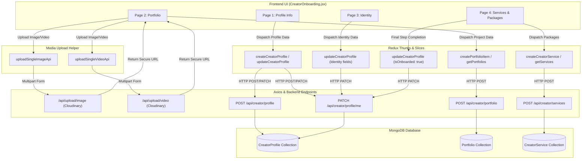

# CreatorLink — Complete Creator Onboarding Architecture & Implementation Analysis

> **Document Type:** Senior Full-Stack Engineering Architecture & Implementation-Ready Specification  
> **Target Module:** Creator Onboarding (4 Compulsory Pages: Profile Information, Portfolio, Identity, Services & Packages)  
> **Date:** October 31, 2026  
> **Status:** Architecture Approved / Ready for Implementation  

---

## Table of Contents
1. [Existing Onboarding Architecture](#1-existing-onboarding-architecture)
2. [Complete Four-Page Requirements Mapping](#2-complete-four-page-requirements-mapping)
3. [Relevant Frontend File Paths](#3-relevant-frontend-file-paths)
4. [Relevant Backend File Paths](#4-relevant-backend-file-paths)
5. [Redux and API Flow](#5-redux-and-api-flow)
6. [Database Schema Mapping](#6-database-schema-mapping)
7. [Existing Upload and Cloudinary Flow](#7-existing-upload-and-cloudinary-flow)
8. [Social OAuth Integration Status](#8-social-oauth-integration-status)
9. [Missing Functionality and Required Changes](#9-missing-functionality-and-required-changes)
10. [Potential Conflicts and Backward-Compatibility Risks](#10-potential-conflicts-and-backward-compatibility-risks)
11. [Recommended Implementation Order](#11-recommended-implementation-order)
12. [Testing and Verification Checklist](#12-testing-and-verification-checklist)
13. [Complete Source Code Appendix](#13-complete-source-code-appendix)
    - [13.1 Module: Onboarding](#131-module-onboarding)
    - [13.2 Module: Authentication / Redirects](#132-module-authentication--redirects)
    - [13.3 Module: Profile](#133-module-profile)
    - [13.4 Module: Portfolio](#134-module-portfolio)
    - [13.5 Module: Services](#135-module-services)
    - [13.6 Module: Upload / Cloudinary](#136-module-upload--cloudinary)
    - [13.7 Module: Social Authentication](#137-module-social-authentication)
    - [13.8 Module: Redux Store / Reducers / Providers](#138-module-redux-store--reducers--providers)

---

## 1. Existing Onboarding Architecture

### Current Implementation Overview
The current onboarding module was built as an interim 3-step single-page wizard inside `frontend/components/creator/onboarding/CreatorOnboarding.jsx` and routed via `frontend/app/creator/onboarding/page.js`.

The current 3-step flow consists of:
1. **Step 1: Select Primary Niche** — Single category selection from 11 categories (`category` field in `CreatorProfile`).
2. **Step 2: Enter Location** — Required text input for creator's city or region (`location` field).
3. **Step 3: Enter Starting Rate** — Number input in INR (`startingRate` field).

### Existing Submission and Gating Mechanism
- **Skip Functionality:** Currently includes a "Skip for now" / "Do this later" action that calls `router.push("/creator/dashboard")` without updating the profile or marking `isOnboarded: true`.
- **Submission Sequence:** On Step 3 submission:
  1. The profile is saved/updated with `isOnboarded: false` using `createCreatorProfile` (with a 409 conflict fallback to `updateCreatorProfile`).
  2. Fresh services are fetched using `getServices({ limit: 100 })`.
  3. The system checks if a service named `"Standard Collaboration"` exists. If not, it calls `createCreatorService` with hardcoded defaults (`deliverables: ["1x Dedicated Post / Reel"]`, `deliveryTime: 7`, `price: startingRate`).
  4. Only after the starter service is confirmed or created, the profile is updated with `isOnboarded: true`.
  5. The creator is redirected to `"/creator/dashboard"`.

### Why the Architecture Must Be Expanded
The business requirement mandates replacing this interim 3-step wizard with a **comprehensive 4-page compulsory flow**:
1. **Eliminate automated starter package generation:** The creator must create and manage their own explicit service packages with platform-dependent content types, quantities, and pricing.
2. **Eliminate Skip:** The onboarding flow is 100% compulsory. No skip button or bypass is permitted.
3. **Add Rich Identity and Demographic Information:** Date of birth (required), gender (required), languages (required), and ethnicity (optional).
4. **Add Portfolio Integration:** Multiple portfolio project creations, image and video media uploads via Cloudinary, and external links directly in onboarding.
5. **Support Multi-Niche & Searchable Keywords:** Transition from a single category to up to 3 niches plus keyword tags and a professional headline/title.

---

## 2. Complete Four-Page Requirements Mapping

The expanded Creator Onboarding consists of 4 distinct pages, each mapping directly to database fields, validation rules, and UI components:

| Page | Title & Purpose | Target Fields & Data Structure | Backend Validation Rules | Required / Optional |
| :--- | :--- | :--- | :--- | :--- |
| **Page 1** | **Profile Information** | `title` (String)<br>`bio` (String)<br>`keywords` (Array of Strings)<br>`niches` (Array of Strings)<br>`location` (String)<br>`socialLinks` (Object) | - `title`: Max 150 chars<br>- `bio`: Max 1000 chars<br>- `keywords`: Array of strings<br>- `niches`: Array of strings, **max 3 items**<br>- `location`: Max 100 chars<br>- `socialLinks`: Object containing strings (`instagram`, `youtube`, `tiktok`, `facebook`, `website`) | - Title: Required<br>- Bio: Required<br>- Keywords: Required ($ge 1$)<br>- Niches: Required (1 to 3)<br>- Location: Required<br>- Social Links: At least 1 handle/URL required |
| **Page 2** | **Portfolio** | `title` (String)<br>`description` (String)<br>`category` (String)<br>`coverImage` (String - Cloudinary URL)<br>`contents` (Array of Objects):<br>- `platform` (enum)<br>- `contentType` (enum)<br>- `url` (String)<br>- `previewImage` (String)<br>- `title` (String)<br>`isPublic` (Boolean) | - Uses `Portfolio` model & endpoints (`POST /api/creator/portfolio`)<br>- `title`: Required, max 150 chars<br>- `description`: Max 2000 chars<br>- `contents`: Validated array of platform/content objects<br>- `coverImage`: Valid string URL | - At least 1 portfolio project is required in onboarding.<br>- Multiple projects supported.<br>- Images & videos uploaded via Cloudinary. |
| **Page 3** | **Identity** | `dob` (Date)<br>`gender` (String enum)<br>`languages` (Array of Strings)<br>`ethnicity` (String) | - `dob`: Parseable valid Date<br>- `gender`: Enum [`male`, `female`, `non-binary`, `other`, `prefer_not_to_say`]<br>- `languages`: Array of strings ($ge 1$)<br>- `ethnicity`: String | - `dob`: **Required**<br>- `gender`: **Required**<br>- `languages`: **Required**<br>- `ethnicity`: **Optional** |
| **Page 4** | **Services & Packages** | `title` (String)<br>`category` (String)<br>`platform` (enum)<br>`contentType` (String)<br>`quantity` (Number, integer $ge 1$)<br>`price` (Number $ge 0$)<br>`description` (String, optional)<br>`deliverables` (Array of Strings)<br>`deliveryTime` (Number $ge 1$)<br>`revisions` (Number $ge 0$) | - Uses `CreatorService` model & endpoints (`POST /api/creator/services`)<br>- `title`: Required, max 150 chars<br>- `category`: Required, max 100 chars<br>- `platform`: Required enum<br>- `contentType`: Optional string<br>- `quantity`: Integer $ge 1$<br>- `price`: Number $ge 0$ | - At least 1 service package required.<br>- Multiple packages supported.<br>- Content types dynamically depend on selected platform. |

### Dynamic Platform-to-Content-Type Mapping for Page 4
When a creator selects a platform in Page 4, the `contentType` dropdown must dynamically update with platform-specific content types:

| Platform Selected | Available Content Types |
| :--- | :--- |
| **Instagram** | Reel, Dedicated Post, Carousel Post, Story with Link, IG Live Collaboration |
| **YouTube** | Dedicated Video Review, Integrated Video Segment (60-90s), YouTube Short, Community Tab Post |
| **TikTok** | Dedicated TikTok Video, TikTok Series / Multi-part, TikTok LIVE Placement |
| **Facebook** | Facebook Video, Facebook Reel, Feed Post with Link, Live Broadcast |
| **Website / Blog** | Sponsored Blog Review, Banner Advertisement, Backlink / Editorial Mention |
| **Multiple / Other** | Multi-Platform Bundle, Cross-Platform Campaign, Custom Collaboration |

---

## 3. Relevant Frontend File Paths

1. **Onboarding Page Container:**
   - `frontend/app/creator/onboarding/page.js` — Next.js App Router page wrapping the onboarding module with `ReduxProvider`.
2. **Onboarding Main Component:**
   - `frontend/components/creator/onboarding/CreatorOnboarding.jsx` — Multi-step wizard UI, state management, form validation, step navigation, and API dispatch logic.
3. **Authentication Components & Redirects:**
   - `frontend/components/auth/SignupForm.jsx` — Creator signup handler (currently redirects to `/creator/onboarding`).
   - `frontend/components/auth/LoginForm.jsx` — Creator login handler (redirects to `/creator/dashboard`).
4. **Creator Profile UI & Redux:**
   - `frontend/components/creator/profile/CreatorProfile.jsx` — Reference component containing full category definitions, social icons, avatar upload logic, and badge displays.
   - `frontend/redux/creator/profile/profile_slice.js` — Redux slice exposing `createCreatorProfile`, `getCreatorProfile`, `updateCreatorProfile`.
   - `frontend/redux/creator/profile/profile_api.js` — Axios API calls for `/creator/profile`.
5. **Creator Portfolio UI & Redux:**
   - `frontend/components/creator/portfolio/CreatorPortfolio.jsx` — Reference component with modal, project card layout, content entry management, and cover upload.
   - `frontend/redux/creator/portfolio/portfolio_slice.js` — Redux slice exposing `createPortfolioItem`, `getPortfolios`, `getPortfolio`, `updatePortfolioItem`, `deletePortfolioItem`.
   - `frontend/redux/creator/portfolio/portfolio_api.js` — Axios API calls for `/creator/portfolio`.
6. **Creator Services UI & Redux:**
   - `frontend/components/creator/services/CreatorServices.jsx` — Reference component with service card layout, package creation modal, and currency formatting.
   - `frontend/redux/creator/services/services_slice.js` — Redux slice exposing `createCreatorService`, `getServices`, `getService`, `updateCreatorService`, `deleteCreatorService`.
   - `frontend/redux/creator/services/services_api.js` — Axios API calls for `/creator/services`.
7. **Upload & Media Helpers:**
   - `frontend/lib/upload.js` — Helper functions `uploadSingleImageApi` and `uploadSingleVideoApi` interfacing with `/api/upload/image` and `/api/upload/video`.
8. **Redux Store Setup:**
   - `frontend/redux/store.js` — Store configuration with middleware.
   - `frontend/redux/root_reducer.js` — Combines auth, profile, portfolio, services, and bookings reducers.
   - `frontend/components/common/ReduxProvider/ReduxProvider.jsx` — Client-side Redux Provider.
   - `frontend/lib/axios.js` — Central Axios instance configured with `withCredentials: true` and interceptor-based automatic token refreshing.

---

## 4. Relevant Backend File Paths

1. **Routing Hub:**
   - `backend/src/routes/index.js` — Central API router mounting `/auth`, `/creator/profile`, `/creator/portfolio`, `/creator/services`, `/upload`.
2. **Profile Module:**
   - `backend/src/modules/creator/profile/profile.model.js` — `CreatorProfile` Mongoose model schema.
   - `backend/src/modules/creator/profile/profile.validation.js` — Validation middleware for profile create and update.
   - `backend/src/modules/creator/profile/profile.controller.js` — Controllers for profile operations.
   - `backend/src/modules/creator/profile/profile.service.js` — Database querying, 409 prevention, and population.
   - `backend/src/modules/creator/profile/profile.route.js` — Express router mounting `POST /`, `GET /me`, `PATCH /me`.
3. **Portfolio Module:**
   - `backend/src/modules/creator/portfolio/portfolio.model.js` — `Portfolio` and sub-schema `portfolioContentSchema`.
   - `backend/src/modules/creator/portfolio/portfolio.validation.js` — Validation for contents array, URLs, and platforms.
   - `backend/src/modules/creator/portfolio/portfolio.controller.js` — CRUD controllers for creator portfolio.
   - `backend/src/modules/creator/portfolio/portfolio.service.js` — Database operations for portfolios.
   - `backend/src/modules/creator/portfolio/portfolio.route.js` — Express router for portfolio endpoints.
4. **Services Module:**
   - `backend/src/modules/creator/services/services.model.js` — `CreatorService` model schema.
   - `backend/src/modules/creator/services/services.validation.js` — Validation middleware for services.
   - `backend/src/modules/creator/services/services.controller.js` — CRUD controllers for creator services.
   - `backend/src/modules/creator/services/services.service.js` — Pagination, filtering, and database operations.
   - `backend/src/modules/creator/services/services.route.js` — Express router for service endpoints.
5. **Upload & Cloudinary Infrastructure:**
   - `backend/src/config/cloudinary.js` — Cloudinary SDK initialization.
   - `backend/src/middleware/upload.middleware.js` — Multer memory storage and file type/size validation.
   - `backend/src/modules/upload/upload.route.js` — Upload endpoints (`POST /image`, `POST /images`, `POST /video`).
   - `backend/src/modules/upload/upload.controller.js` — Upload folder validation and streaming handlers.
   - `backend/src/utils/helpers/cloudinary.helper.js` — WebP conversion and streaming buffer to Cloudinary.
6. **Authentication & Middleware:**
   - `backend/src/middleware/auth.middleware.js` — HttpOnly cookie verification and token version matching.
   - `backend/src/modules/auth/auth.route.js` — Auth endpoints.
   - `backend/src/modules/auth/auth.controller.js` — User registration, login, token refresh, and Google authentication.

---

## 5. Redux and API Flow



### Execution Flow Details
1. **Axios Client Security:** All frontend API calls use `@/lib/axios.js`, which attaches `withCredentials: true`. Authentication cookies (`accessToken`, `refreshToken`) are sent automatically by the browser with zero manual token handling in localStorage.
2. **Safe Multi-Step Persistence:** 
   - When the user completes Page 1, profile data is saved/updated to MongoDB with `isOnboarded: false`.
   - When the user creates portfolio projects on Page 2, each project is directly saved to the `Portfolio` collection associated with `req.user.userId`. Navigating back to Page 1 or reloading does not delete created portfolio works.
   - When the user completes Page 3, identity fields (`dob`, `gender`, `languages`, `ethnicity`) are patched to the creator profile with `isOnboarded: false`.
   - On Page 4, the creator creates their services, each persisted to `CreatorService`.
   - **Only after all 4 pages are completely validated and saved**, the frontend dispatches:
     ```javascript
     await dispatch(updateCreatorProfile({ isOnboarded: true })).unwrap();
     router.push("/creator/dashboard");
     ```

---

## 6. Database Schema Mapping

### 6.1 CreatorProfile Schema (`backend/src/modules/creator/profile/profile.model.js`)
```javascript
{
  user: { type: ObjectId, ref: "Auth", required: true, unique: true },
  title: { type: String, trim: true, maxlength: 150, default: "" },
  bio: { type: String, trim: true, maxlength: 1000, default: "" },
  category: { type: String, trim: true, maxlength: 100, default: "" },
  niches: {
    type: [String],
    default: [],
    validate: [val => !val || val.length <= 3, "Niches cannot exceed 3 items"]
  },
  keywords: { type: [String], default: [] },
  location: { type: String, trim: true, maxlength: 100, default: "" },
  profileImage: { type: String, trim: true, default: "" },
  dob: { type: Date },
  gender: {
    type: String,
    trim: true,
    enum: ["male", "female", "non-binary", "other", "prefer_not_to_say"]
  },
  languages: { type: [String], default: [] },
  ethnicity: { type: String, trim: true, default: "" },
  socialLinks: {
    instagram: { type: String, trim: true, default: "" },
    facebook: { type: String, trim: true, default: "" },
    youtube: { type: String, trim: true, default: "" },
    tiktok: { type: String, trim: true, default: "" },
    website: { type: String, trim: true, default: "" }
  },
  followerCount: { type: Number, default: 0, min: 0 },
  engagementRate: { type: Number, default: 0, min: 0 },
  isPublic: { type: Boolean, default: true },
  isOnboarded: { type: Boolean, default: false },
  startingRate: { type: Number, min: 0, default: 0 }
}
```

### 6.2 Portfolio Schema (`backend/src/modules/creator/portfolio/portfolio.model.js`)
```javascript
{
  creator: { type: ObjectId, ref: "Auth", required: true, index: true },
  campaign: { type: ObjectId, ref: "Campaign", default: null },
  brand: { type: ObjectId, ref: "Auth", default: null },
  title: { type: String, required: true, trim: true, maxlength: 150 },
  description: { type: String, trim: true, maxlength: 2000, default: "" },
  category: { type: String, trim: true, maxlength: 100, default: "" },
  coverImage: { type: String, trim: true, default: "" },
  contents: [{
    platform: {
      type: String,
      enum: ["instagram", "facebook", "youtube", "tiktok", "website"],
      required: true
    },
    contentType: {
      type: String,
      enum: ["post", "reel", "story", "video", "short", "article", "other"],
      required: true
    },
    url: { type: String, required: true, trim: true },
    previewImage: { type: String, trim: true, default: "" },
    title: { type: String, trim: true, maxlength: 150, default: "" }
  }],
  isPublic: { type: Boolean, default: true }
}
```

### 6.3 CreatorService Schema (`backend/src/modules/creator/services/services.model.js`)
```javascript
{
  creator: { type: ObjectId, ref: "Auth", required: true, index: true },
  title: { type: String, required: true, trim: true, maxlength: 150 },
  description: { type: String, trim: true, maxlength: 2000, default: "" },
  category: { type: String, trim: true, maxlength: 100, required: true },
  coverImage: { type: String, trim: true, default: "" },
  platform: {
    type: String,
    enum: ["instagram", "youtube", "facebook", "tiktok", "website", "multiple", "other"],
    required: true
  },
  contentType: { type: String, trim: true, default: "" },
  quantity: { type: Number, min: 1, default: 1 },
  deliverables: { type: [String], default: [] },
  pricingType: { type: String, enum: ["fixed", "starting_from", "custom"], default: "fixed" },
  price: { type: Number, min: 0, default: 0 },
  currency: { type: String, uppercase: true, trim: true, default: "INR", maxlength: 3 },
  deliveryTime: { type: Number, min: 1, default: 7 },
  revisions: { type: Number, min: 0, default: 1 },
  isActive: { type: Boolean, default: true }
}
```

---

## 7. Existing Upload and Cloudinary Flow

The codebase contains a fully implemented, production-ready Cloudinary upload pipeline:

### 1. Configuration (`backend/src/config/cloudinary.js`)
Initializes the official `cloudinary` v2 SDK using:
- `CLOUDINARY_CLOUD_NAME`
- `CLOUDINARY_API_KEY`
- `CLOUDINARY_API_SECRET`

### 2. Multer Middleware (`backend/src/middleware/upload.middleware.js`)
- **Memory Storage:** Uploaded files are stored in-memory as Buffers (`multer.memoryStorage()`) rather than writing temporary files to disk.
- **Image Limits:** Accepts JPEG, JPG, PNG, WEBP; max file size 5 MB.
- **Multiple Images:** Supports up to 10 files per request under the `'images'` field.
- **Video Limits:** Accepts MP4, WebM, MOV; max file size 50 MB under the `'video'` field.

### 3. Image Optimization & Cloudinary Stream Helper (`backend/src/utils/helpers/cloudinary.helper.js`)
- Automatic WebP conversion: Invokes `convertImageToWebp` (using `sharp`), compressing the image and converting it to WebP before streaming.
- Streams the buffer directly to Cloudinary using `cloudinary.uploader.upload_stream`.
- Enforces an approved folder allowlist:
  - `creatorlink/profiles`
  - `creatorlink/portfolios`
  - `creatorlink/deliverables`
  - `creatorlink/services`
  - `creatorlink/campaigns`
  - `creatorlink/general`

### 4. Upload Endpoints (`backend/src/modules/upload/upload.route.js`)
- `POST /api/upload/image` $
ightarrow$ Upload single image (`folder` parameter in form data).
- `POST /api/upload/images` $
ightarrow$ Upload up to 10 images concurrently.
- `POST /api/upload/video` $
ightarrow$ Upload single video.

### 5. Frontend Client Helper (`frontend/lib/upload.js`)
- `uploadSingleImageApi(file, folder)` $
ightarrow$ Automates multipart `FormData` construction and posts to `/upload/image`.
- `uploadSingleVideoApi(file, folder)` $
ightarrow$ Automates multipart `FormData` construction and posts to `/upload/video`.

---

## 8. Social OAuth Integration Status

### Current Implementation Audit
A complete grep and source code inspection of the entire backend and frontend codebase reveals:

| Platform | OAuth Login/Connect | API Follower Statistics Fetch | Status |
| :--- | :--- | :--- | :--- |
| **Google** | Implemented (Auth login/signup only via GIS code client) | YouTube Channel stats: **NOT IMPLEMENTED** | Partial (Auth only) |
| **Instagram** | **NOT IMPLEMENTED** | **NOT IMPLEMENTED** | Missing |
| **YouTube** | **NOT IMPLEMENTED** | **NOT IMPLEMENTED** | Missing |
| **TikTok** | **NOT IMPLEMENTED** | **NOT IMPLEMENTED** | Missing |
| **Facebook** | **NOT IMPLEMENTED** | **NOT IMPLEMENTED** | Missing |

### Reality & Architectural Gap
1. **Existing Behavior:** Currently, creators enter their social handles or URLs as plain strings in `socialLinks` (`instagram`, `facebook`, `youtube`, `tiktok`, `website`).
2. **Follower Counts:** `followerCount` and `engagementRate` are numeric fields stored in `CreatorProfile`, currently defaulted to `0`.
3. **Required Architecture for Official Follower Statistics:**
   - **Meta Graph API (Instagram & Facebook):** Requires Meta App approval, `instagram_basic`, `pages_show_list`, `instagram_manage_insights` permissions, long-lived user access token exchange, and periodic refresh.
   - **YouTube Data API v3:** Requires Google OAuth2 with scope `https://www.googleapis.com/auth/youtube.readonly`, access token + refresh token storage, and calling `channels.list(part: 'statistics', mine: true)`.
   - **TikTok for Developers:** Requires TikTok Login Kit and `user.info.stats` permission to query public metrics.
4. **Implementation Recommendation for Onboarding:**
   - For immediate Onboarding Page 1: Allow creators to enter their profile URLs/handles manually.
   - Provide "Connect" buttons with clear UI indicators for OAuth integration.
   - Do NOT block onboarding completion on external OAuth APIs until client app IDs and secret credentials for Meta, TikTok, and Google YouTube are formally provisioned in `.env`.

---

## 9. Missing Functionality and Required Changes

### Frontend Required Changes
1. **Rewrite `CreatorOnboarding.jsx` into 4 Compulsory Steps:**
   - Step 1: Profile Information (`title`, `bio`, `keywords`, `niches` [max 3], `location`, `socialLinks`).
   - Step 2: Portfolio Projects (`title`, `description`, `coverImage`, `contents` image/video/link list).
   - Step 3: Identity (`dob`, `gender`, `languages`, optional `ethnicity`).
   - Step 4: Services & Packages (`title`, `category`, `platform`, dynamic `contentType`, integer `quantity`, `price`, `description`).
2. **Remove All Skip Triggers:**
   - Delete `handleSkip`, the top-right "Skip for now" link, and the bottom "Do this later" action.
3. **Remove Automated "Standard Collaboration" Generation:**
   - In Step 4, creator creates their own packages using `createCreatorService`.
4. **Add Form Validation per Step:**
   - Step 1: Title, bio, at least 1 keyword, 1 to 3 niches, location, at least 1 social link.
   - Step 2: At least 1 portfolio project created and present.
   - Step 3: Valid date of birth (age $ge 18$ validation), gender from enum, at least 1 language.
   - Step 4: At least 1 custom service package created.
5. **State Preservation Across Back & Continue:**
   - Keep state in component state / Redux so clicking "Back" restores all previously entered inputs.

### Backend Required Changes
1. All database schema fields and validations for Profile (Step 1) and Services (Step 2) are already completed:
   - `profile.model.js` and `profile.validation.js` support `title`, `keywords`, `niches` (max 3), `dob`, `gender`, `languages`, `ethnicity`.
   - `services.model.js` and `services.validation.js` support `contentType` and integer `quantity` ($ge 1$).
2. **Optional Route Guard Enhancement:**
   - Check `isOnboarded` in `getMyProfileService` or create a navigation guard redirecting creators with `isOnboarded: false` to `/creator/onboarding`.

---

## 10. Potential Conflicts and Backward-Compatibility Risks

1. **`category` vs. `niches` Field in Profile:**
   - Existing creators and marketplace search queries rely on `category: String`.
   - **Solution:** When saving `niches: [n1, n2, n3]` in Page 1, automatically populate `category: niches[0]` to guarantee 100% backward compatibility for existing code that reads `profile.category`.
2. **Starter Service Conflict:**
   - Previously, onboarding created a hardcoded `"Standard Collaboration"` package.
   - **Solution:** The new flow lets the creator define their own services in Page 4. Existing creators who already have `"Standard Collaboration"` retain it untouched.
3. **Idempotency on Retry:**
   - If a creator enters Page 2, adds a portfolio item, and then navigates back to Page 1 or reloads, the portfolio item already exists in MongoDB.
   - **Solution:** On component load, fetch `getPortfolios()` and `getServices()`. If items already exist, display them in the Page 2 and Page 4 lists with Edit/Delete options instead of forcing duplicate creation.
4. **Session Security & Refresh Token Rotation:**
   - All API endpoints use `authenticateUser` checking HttpOnly cookies. If a creator spends a long time filling out the 4 pages, Axios automatic token refresh on 401 prevents session expiry errors.

---

## 11. Recommended Implementation Order

1. **Phase 1: State & Step Structure in `CreatorOnboarding.jsx`**
   - Refactor `currentStep` from 1–3 to 1–4.
   - Update step progress indicators, labels, and titles:
     - Step 1: Profile Information
     - Step 2: Portfolio Work
     - Step 3: Identity & Demographics
     - Step 4: Services & Packages
   - Remove "Skip" and "Do this later" buttons.

2. **Phase 2: Page 1 (Profile Information) UI & Validation**
   - Implement title input (max 150), bio textarea (max 1000), keyword tag input, multi-select niches (up to 3), location input, and social media handles/links.
   - On Step 1 Continue: Dispatch `createCreatorProfile` or `updateCreatorProfile` with `isOnboarded: false`.

3. **Phase 3: Page 2 (Portfolio) UI & Media Upload Integration**
   - Embed portfolio creation form (title, description, cover image upload via `uploadSingleImageApi`, content URL, and platform selector).
   - Display a list of added portfolio projects with a minimum requirement of 1 project to proceed.

4. **Phase 4: Page 3 (Identity) UI & Validation**
   - Implement DOB picker (validating $ge 18$ years old), gender radio/select cards (male, female, non-binary, other, prefer_not_to_say), language tag selector, and optional ethnicity input.
   - On Step 3 Continue: Dispatch `updateCreatorProfile` saving identity fields with `isOnboarded: false`.

5. **Phase 5: Page 4 (Services & Packages) UI & Dynamic Content Types**
   - Implement package creation modal/inline form with platform selector, dynamic content type dropdown, integer quantity ($ge 1$), price in INR, delivery days, and revisions.
   - Require at least 1 service package to be created.

6. **Phase 6: Final Submission & Onboarding Completion**
   - On Step 4 Final Complete:
     - Verify at least 1 custom service exists.
     - Dispatch `updateCreatorProfile({ isOnboarded: true })`.
     - Redirect to `/creator/dashboard`.

---

## 12. Testing and Verification Checklist

- [ ] **Navigation & Gating:**
  - [ ] No Skip button or bypass link exists anywhere on any of the 4 pages.
  - [ ] User can freely navigate Back and Forward between completed pages without data loss.
  - [ ] Refreshing the browser repopulates previously saved fields from Redux/API.
  - [ ] Dashboard is never reachable until all 4 pages are successfully completed.
- [ ] **Page 1 (Profile Information):**
  - [ ] Title exceeds 150 chars $
ightarrow$ Rejected with clear validation error.
  - [ ] Bio exceeds 1000 chars $
ightarrow$ Rejected with clear validation error.
  - [ ] Niches selection rejects 4th selection (enforces max 3).
  - [ ] Setting niches automatically keeps `category` populated with primary niche.
  - [ ] Social handles/links are properly formatted into `socialLinks` object.
- [ ] **Page 2 (Portfolio):**
  - [ ] Single image upload sends file to `creatorlink/portfolios` and returns secure URL.
  - [ ] Portfolio item successfully creates via `createPortfolioItem`.
  - [ ] Page prevents continuing to Page 3 if zero portfolio projects exist.
  - [ ] Multiple portfolio projects can be created, displayed, and managed.
- [ ] **Page 3 (Identity):**
  - [ ] DOB validation rejects future dates or ages under 18.
  - [ ] Gender selection only accepts allowed enum values.
  - [ ] Languages array requires at least 1 language.
  - [ ] Ethnicity remains optional.
- [ ] **Page 4 (Services & Packages):**
  - [ ] Selecting Instagram shows Reel, Post, Story, Carousel.
  - [ ] Selecting YouTube shows Dedicated Video, Short, Community Post.
  - [ ] Quantity rejects decimals (e.g., `1.5`) and values $< 1$.
  - [ ] Price rejects negative numbers.
  - [ ] Page prevents completing onboarding if zero service packages exist.
  - [ ] Final submission successfully updates `isOnboarded: true` and redirects to `/creator/dashboard`.

---

## 13. Complete Source Code Appendix

Every relevant file is provided below in full, un-truncated source code, grouped by module.

### 13.1 Module: Onboarding

#### `frontend/components/creator/onboarding/CreatorOnboarding.jsx` (898 lines)

```jsx
"use client";

import React, { useState, useEffect } from "react";
import Link from "next/link";
import { useRouter } from "next/navigation";
import { useDispatch, useSelector } from "react-redux";
import {
  getCreatorProfile,
  createCreatorProfile,
  updateCreatorProfile,
} from "@/redux/creator/profile/profile_slice";
import {
  createCreatorService,
  getServices,
} from "@/redux/creator/services/services_slice";

// =========================================================
// ERROR FORMATTER HELPER
// =========================================================
function formatErrorMessage(err, fallback = "An unexpected error occurred.") {
  if (!err) return fallback;
  if (typeof err === "string") return err.trim() || fallback;
  if (typeof err === "object") {
    if (typeof err.message === "string" && err.message.trim()) {
      return err.message.trim();
    }
    if (typeof err.error === "string" && err.error.trim()) {
      return err.error.trim();
    }
    if (typeof err.msg === "string" && err.msg.trim()) {
      return err.msg.trim();
    }
  }
  return String(err) || fallback;
}

// =========================================================
// NICHE CATEGORIES (EXACT 11 CATEGORIES FROM CREATOR PROFILE)
// =========================================================
const CATEGORIES = [
  {
    id: "fashion-luxury",
    name: "Fashion & Luxury",
    desc: "Haute couture, streetwear, designer styling & luxury goods",
    icon: SparklesIcon,
  },
  {
    id: "beauty-skincare",
    name: "Beauty & Skincare",
    desc: "Cosmetics, dermatology, routines, makeup & glam",
    icon: HeartIcon,
  },
  {
    id: "travel-lifestyle",
    name: "Travel & Lifestyle",
    desc: "Destinations, stays, city guides & aesthetic living",
    icon: GlobeIcon,
  },
  {
    id: "tech-gaming",
    name: "Tech & Gaming",
    desc: "Gadgets, PC setups, consoles, apps, AI & gameplay",
    icon: DeviceIcon,
  },
  {
    id: "fitness-wellness",
    name: "Fitness & Wellness",
    desc: "Workouts, nutrition, mindfulness & healthy lifestyle",
    icon: BoltIcon,
  },
  {
    id: "food-culinary",
    name: "Food & Culinary",
    desc: "Recipes, cafes, food reviews, cooking & baking",
    icon: UtensilsIcon,
  },
  {
    id: "apparel-lifestyle",
    name: "Apparel & Lifestyle",
    desc: "Everyday fits, activewear, capsule closets & accessories",
    icon: TagIcon,
  },
  {
    id: "photography",
    name: "Photography",
    desc: "Portraits, landscapes, editorial shoots & camera gear",
    icon: CameraIcon,
  },
  {
    id: "video-reels",
    name: "Video & Reels",
    desc: "Short-form video, TikToks, Reels, cinematics & vlogs",
    icon: VideoCameraIcon,
  },
  {
    id: "art-design",
    name: "Art & Design",
    desc: "Digital art, illustrations, UX/UI, pottery & creative works",
    icon: PaletteIcon,
  },
  {
    id: "other",
    name: "Other",
    desc: "Education, business, comedy, music & creative niches",
    icon: SquaresIcon,
  },
];

// Quick suggestions for popular Indian and global creative hubs
const POPULAR_LOCATIONS = [
  "Mumbai, Maharashtra",
  "Delhi NCR, India",
  "Bengaluru, Karnataka",
  "Hyderabad, Telangana",
  "Pune, Maharashtra",
  "Goa, India",
  "Remote / Worldwide",
];

// Quick rate presets in INR
const RATE_PRESETS = [2500, 5000, 10000, 15000, 25000, 50000];

// =========================================================
// SVG ICONS
// =========================================================
function SparklesIcon({ className = "w-5 h-5" }) {
  return (
    <svg className={className} fill="none" viewBox="0 0 24 24" stroke="currentColor" strokeWidth={1.75}>
      <path strokeLinecap="round" strokeLinejoin="round" d="M9.813 15.904L9 18.75l-.813-2.846a4.5 4.5 0 00-3.09-3.09L2.25 12l2.846-.813a4.5 4.5 0 003.09-3.09L9 5.25l.813 2.846a4.5 4.5 0 003.09 3.09L15.75 12l-2.846.813a4.5 4.5 0 00-3.09 3.09zM18.259 8.715L18 9.75l-.259-1.035a3.375 3.375 0 00-2.455-2.456L14.25 6l1.036-.259a3.375 3.375 0 002.455-2.456L18 2.25l.259 1.035a3.375 3.375 0 002.456 2.456L21.75 6l-1.035.259a3.375 3.375 0 00-2.456 2.456z" />
    </svg>
  );
}

function HeartIcon({ className = "w-5 h-5" }) {
  return (
    <svg className={className} fill="none" viewBox="0 0 24 24" stroke="currentColor" strokeWidth={1.75}>
      <path strokeLinecap="round" strokeLinejoin="round" d="M21 8.25c0-2.485-2.099-4.5-4.688-4.5-1.935 0-3.597 1.126-4.312 2.733-.715-1.607-2.377-2.733-4.313-2.733C5.1 3.75 3 5.765 3 8.25c0 7.22 9 12 9 12s9-4.78 9-12z" />
    </svg>
  );
}

function GlobeIcon({ className = "w-5 h-5" }) {
  return (
    <svg className={className} fill="none" viewBox="0 0 24 24" stroke="currentColor" strokeWidth={1.75}>
      <path strokeLinecap="round" strokeLinejoin="round" d="M12 21a9 9 0 100-18 9 9 0 000 18zM2.25 12h19.5M12 2.25a15.3 15.3 0 014.5 9.75 15.3 15.3 0 01-4.5 9.75 15.3 15.3 0 01-4.5-9.75A15.3 15.3 0 0112 2.25z" />
    </svg>
  );
}

function DeviceIcon({ className = "w-5 h-5" }) {
  return (
    <svg className={className} fill="none" viewBox="0 0 24 24" stroke="currentColor" strokeWidth={1.75}>
      <path strokeLinecap="round" strokeLinejoin="round" d="M9 17.25v1.007a3 3 0 01-.879 2.122L7.5 21h9l-.621-.621A3 3 0 0115 18.257V17.25m6-12V15a2.25 2.25 0 01-2.25 2.25H5.25A2.25 2.25 0 013 15V5.25m18 0A2.25 2.25 0 0018.75 3H5.25A2.25 2.25 0 003 5.25m18 0H3" />
    </svg>
  );
}

function BoltIcon({ className = "w-5 h-5" }) {
  return (
    <svg className={className} fill="none" viewBox="0 0 24 24" stroke="currentColor" strokeWidth={1.75}>
      <path strokeLinecap="round" strokeLinejoin="round" d="M3.75 13.5l10.5-11.25L12 10.5h8.25L9.75 21.75 12 13.5H3.75z" />
    </svg>
  );
}

function UtensilsIcon({ className = "w-5 h-5" }) {
  return (
    <svg className={className} fill="none" viewBox="0 0 24 24" stroke="currentColor" strokeWidth={1.75}>
      <path strokeLinecap="round" strokeLinejoin="round" d="M12 6.042A8.967 8.967 0 006 3.75c-1.052 0-2.062.18-3 .512v14.25A8.987 8.987 0 016 18c2.305 0 4.408.867 6 2.292m0-14.25a8.966 8.966 0 016-2.292c1.052 0 2.062.18 3 .512v14.25A8.987 8.987 0 0018 18a8.967 8.967 0 00-6 2.292m0-14.25v14.25" />
    </svg>
  );
}

function TagIcon({ className = "w-5 h-5" }) {
  return (
    <svg className={className} fill="none" viewBox="0 0 24 24" stroke="currentColor" strokeWidth={1.75}>
      <path strokeLinecap="round" strokeLinejoin="round" d="M9.568 3H5.25A2.25 2.25 0 003 5.25v4.318c0 .597.237 1.17.659 1.591l9.581 9.581c.699.699 1.78.872 2.607.33a18.095 18.095 0 005.223-5.223c.542-.827.369-1.908-.33-2.607L11.16 3.66A2.25 2.25 0 009.568 3z" />
      <path strokeLinecap="round" strokeLinejoin="round" d="M6 6h.008v.008H6V6z" />
    </svg>
  );
}

function CameraIcon({ className = "w-5 h-5" }) {
  return (
    <svg className={className} fill="none" viewBox="0 0 24 24" stroke="currentColor" strokeWidth={1.75}>
      <path strokeLinecap="round" strokeLinejoin="round" d="M6.827 6.175A2.31 2.31 0 015.186 7.23c-.38.054-.757.112-1.134.175C2.999 7.58 2.25 8.507 2.25 9.574V18a2.25 2.25 0 002.25 2.25h15A2.25 2.25 0 0021.75 18V9.574c0-1.067-.75-1.994-1.802-2.169a47.865 47.865 0 00-1.134-.175 2.31 2.31 0 01-1.64-1.055l-.822-1.316a2.192 2.192 0 00-1.736-1.039 48.774 48.774 0 00-5.232 0 2.192 2.192 0 00-1.736 1.039l-.821 1.316z" />
      <path strokeLinecap="round" strokeLinejoin="round" d="M16.5 12.75a4.5 4.5 0 11-9 0 4.5 4.5 0 019 0zM18.75 10.5h.008v.008h-.008V10.5z" />
    </svg>
  );
}

function VideoCameraIcon({ className = "w-5 h-5" }) {
  return (
    <svg className={className} fill="none" viewBox="0 0 24 24" stroke="currentColor" strokeWidth={1.75}>
      <path strokeLinecap="round" strokeLinejoin="round" d="M15.75 10.5l4.72-4.72a.75.75 0 011.28.53v11.38a.75.75 0 01-1.28.53l-4.72-4.72M4.5 18.75h9a2.25 2.25 0 002.25-2.25v-9a2.25 2.25 0 00-2.25-2.25h-9A2.25 2.25 0 002.25 7.5v9a2.25 2.25 0 002.25 2.25z" />
    </svg>
  );
}

function PaletteIcon({ className = "w-5 h-5" }) {
  return (
    <svg className={className} fill="none" viewBox="0 0 24 24" stroke="currentColor" strokeWidth={1.75}>
      <path strokeLinecap="round" strokeLinejoin="round" d="M9.53 16.122a3 3 0 00-5.78 1.128 2.25 2.25 0 01-2.4 2.245 4.5 4.5 0 008.4-2.245c0-.399-.078-.78-.22-1.128zm0 0a15.998 15.998 0 003.388-1.62m-5.043-.025a15.994 15.994 0 011.622-3.395m3.42 3.42a15.995 15.995 0 004.764-4.648l3.876-5.814a1.151 1.151 0 00-1.597-1.597L14.146 6.32a15.996 15.996 0 00-4.649 4.763m3.42 3.42a6.776 6.776 0 00-3.42-3.42" />
    </svg>
  );
}

function SquaresIcon({ className = "w-5 h-5" }) {
  return (
    <svg className={className} fill="none" viewBox="0 0 24 24" stroke="currentColor" strokeWidth={1.75}>
      <path strokeLinecap="round" strokeLinejoin="round" d="M3.75 6A2.25 2.25 0 016 3.75h2.25A2.25 2.25 0 0110.5 6v2.25a2.25 2.25 0 01-2.25 2.25H6a2.25 2.25 0 01-2.25-2.25V6zM3.75 15.75A2.25 2.25 0 016 13.5h2.25a2.25 2.25 0 012.25 2.25V18a2.25 2.25 0 01-2.25 2.25H6A2.25 2.25 0 013.75 18v-2.25zM13.5 6a2.25 2.25 0 012.25-2.25H18A2.25 2.25 0 0120.25 6v2.25A2.25 2.25 0 0118 10.5h-2.25a2.25 2.25 0 01-2.25-2.25V6zM13.5 15.75a2.25 2.25 0 012.25-2.25H18a2.25 2.25 0 012.25 2.25V18A2.25 2.25 0 0118 20.25h-2.25A2.25 2.25 0 0113.5 18v-2.25z" />
    </svg>
  );
}

function MapPinIcon({ className = "w-5 h-5" }) {
  return (
    <svg className={className} fill="none" viewBox="0 0 24 24" stroke="currentColor" strokeWidth={1.75}>
      <path strokeLinecap="round" strokeLinejoin="round" d="M15 10.5a3 3 0 11-6 0 3 3 0 016 0z" />
      <path strokeLinecap="round" strokeLinejoin="round" d="M19.5 10.5c0 7.142-7.5 11.25-7.5 11.25S4.5 17.642 4.5 10.5a7.5 7.5 0 1115 0z" />
    </svg>
  );
}

function CheckIcon({ className = "w-4 h-4" }) {
  return (
    <svg className={className} fill="none" viewBox="0 0 24 24" stroke="currentColor" strokeWidth={2.5}>
      <path strokeLinecap="round" strokeLinejoin="round" d="M4.5 12.75l6 6 9-13.5" />
    </svg>
  );
}

function ArrowRightIcon({ className = "w-4 h-4" }) {
  return (
    <svg className={className} fill="none" viewBox="0 0 24 24" stroke="currentColor" strokeWidth={2}>
      <path strokeLinecap="round" strokeLinejoin="round" d="M13.5 4.5L21 12m0 0l-7.5 7.5M21 12H3" />
    </svg>
  );
}

function ArrowLeftIcon({ className = "w-4 h-4" }) {
  return (
    <svg className={className} fill="none" viewBox="0 0 24 24" stroke="currentColor" strokeWidth={2}>
      <path strokeLinecap="round" strokeLinejoin="round" d="M10.5 19.5L3 12m0 0l7.5-7.5M3 12h18" />
    </svg>
  );
}

export default function CreatorOnboarding() {
  const router = useRouter();
  const dispatch = useDispatch();

  const { profile } = useSelector((state) => state.profile);

  // Step state: 1 = Niche, 2 = Location, 3 = Starting Rate
  const [currentStep, setCurrentStep] = useState(1);

  // Form data state
  const [formData, setFormData] = useState({
    category: "",
    location: "",
    startingRate: "",
  });

  const [validationError, setValidationError] = useState(null);
  const [isSubmitting, setIsSubmitting] = useState(false);

  // 1. On component load, fetch the creator profile and existing services
  useEffect(() => {
    dispatch(getCreatorProfile())
      .unwrap()
      .then((res) => {
        const p = res?.data || res;
        if (p) {
          setFormData((prev) => ({
            category: prev.category || p.category || "",
            location: prev.location || p.location || "",
            startingRate:
              prev.startingRate !== ""
                ? prev.startingRate
                : p.startingRate > 0
                ? p.startingRate
                : "",
          }));
        }
      })
      .catch(() => {
        // Safe to ignore 404 for new creators without an existing profile
      });

    dispatch(getServices({ limit: 10 }));
  }, [dispatch]);

  // Quick navigation to Creator Dashboard without marking onboarding complete
  const handleSkip = () => {
    router.push("/creator/dashboard");
  };

  // Next step and submission handler
  const handleContinue = async (e) => {
    e?.preventDefault();
    if (isSubmitting) return;
    setValidationError(null);

    // Step 1: Select Niche validation
    if (currentStep === 1) {
      if (!formData.category || !formData.category.trim()) {
        setValidationError("Please select your primary niche to continue.");
        return;
      }
      setCurrentStep(2);
      return;
    }

    // Step 2: Enter Location validation
    if (currentStep === 2) {
      if (!formData.location || !formData.location.trim()) {
        setValidationError("Please enter your city or region to help brands find you.");
        return;
      }
      setCurrentStep(3);
      return;
    }

    // Step 3: Enter Starting Rate validation & API Submission
    if (currentStep === 3) {
      const parsedRate = Number(formData.startingRate);
      if (
        formData.startingRate === "" ||
        isNaN(parsedRate) ||
        parsedRate <= 0
      ) {
        setValidationError("Please provide a valid starting rate greater than ₹0 (INR).");
        return;
      }

      setIsSubmitting(true);
      setValidationError(null);

      const initialProfilePayload = {
        category: formData.category,
        location: formData.location.trim(),
        startingRate: parsedRate,
        isOnboarded: false,
      };

      try {
        // Step A: Save or update creator profile with isOnboarded: false
        const hasExistingProfile = Boolean(profile && (profile._id || profile.id));

        if (hasExistingProfile) {
          await dispatch(updateCreatorProfile(initialProfilePayload)).unwrap();
        } else {
          try {
            await dispatch(createCreatorProfile(initialProfilePayload)).unwrap();
          } catch (createErr) {
            const createErrMsg = formatErrorMessage(createErr);
            if (
              createErrMsg.toLowerCase().includes("already exists") ||
              createErrMsg.includes("409")
            ) {
              await dispatch(updateCreatorProfile(initialProfilePayload)).unwrap();
            } else {
              throw createErr;
            }
          }
        }

        // Step B: Always fetch fresh services from API before checking for "Standard Collaboration"
        let freshServicesList = [];
        try {
          const fetched = await dispatch(getServices({ limit: 100 })).unwrap();
          freshServicesList =
            fetched?.data?.services ||
            fetched?.services ||
            (Array.isArray(fetched) ? fetched : []);
        } catch (fetchErr) {
          const fetchErrMsg = formatErrorMessage(
            fetchErr,
            "Failed to verify existing services."
          );
          // If fetching services fails, stop onboarding completion, keep isOnboarded: false, show retry error, do not create service
          setValidationError(
            `Profile details saved, but failed to fetch services: ${fetchErrMsg}. Please retry to complete onboarding, or skip to dashboard.`
          );
          setIsSubmitting(false);
          return;
        }

        // Check exact service title to prevent duplicates
        const hasStarterService =
          Array.isArray(freshServicesList) &&
          freshServicesList.some(
            (s) => s?.title === "Standard Collaboration" || s?.title?.trim() === "Standard Collaboration"
          );

        // Step C: If no "Standard Collaboration" service exists, create it
        if (!hasStarterService) {
          const starterServicePayload = {
            title: "Standard Collaboration",
            category: formData.category,
            platform: "multiple",
            price: parsedRate,
            pricingType: "starting_from",
            currency: "INR",
            deliveryTime: 7,
            revisions: 1,
            deliverables: ["1x Dedicated Post / Reel"],
            description: "Starter collaboration package for brand partnerships.",
          };

          try {
            await dispatch(createCreatorService(starterServicePayload)).unwrap();
          } catch (serviceErr) {
            const serviceErrMsg = formatErrorMessage(
              serviceErr,
              "Failed to create starter service package."
            );
            // If service creation fails, keep onboarding incomplete (isOnboarded remains false) and show retry message
            setValidationError(
              `Profile details saved, but creating the starter service failed: ${serviceErrMsg}. Please retry to complete onboarding, or skip to dashboard.`
            );
            setIsSubmitting(false);
            return;
          }
        }

        // Step D: Only after starter service is confirmed or created, mark onboarding as complete
        await dispatch(
          updateCreatorProfile({
            category: formData.category,
            location: formData.location.trim(),
            startingRate: parsedRate,
            isOnboarded: true,
          })
        ).unwrap();

        // Step E: Navigate to Creator Dashboard
        router.push("/creator/dashboard");
      } catch (err) {
        // 7. If profile saving fails, show the actual error and remain on Step 3
        const errorMsg = formatErrorMessage(
          err,
          "Failed to save creator profile. Please try again."
        );
        setValidationError(errorMsg);
      } finally {
        setIsSubmitting(false);
      }
    }
  };

  // Back step handler
  const handleBack = () => {
    if (isSubmitting) return;
    setValidationError(null);
    if (currentStep > 1) {
      setCurrentStep((prev) => prev - 1);
    }
  };

  // Step labels for progress indicator
  const stepsMeta = [
    { number: 1, title: "Primary Niche", subtitle: "What you create" },
    { number: 2, title: "Location", subtitle: "Where you operate" },
    { number: 3, title: "Starting Rate", subtitle: "Collaboration base" },
  ];

  return (
    <div className="w-full min-h-screen bg-background text-foreground flex flex-col justify-between p-4 sm:p-8 lg:p-12 transition-colors duration-300">
      {/* =========================================================
          TOP BAR: BRANDING & SKIP CONTROL
      ========================================================= */}
      <header className="max-w-3xl w-full mx-auto flex items-center justify-between pb-6 sm:pb-8">
        <Link
          href="/"
          className="inline-flex items-center gap-1.5 font-serif text-xl sm:text-2xl font-medium tracking-wide text-foreground"
        >
          <span>CREATORLINK</span>
          <span className="text-secondary text-xl sm:text-2xl leading-none">✦</span>
        </Link>

        <button
          type="button"
          onClick={handleSkip}
          disabled={isSubmitting}
          className="text-xs sm:text-sm font-sans font-medium text-text-secondary hover:text-foreground transition-colors cursor-pointer py-1.5 px-3 rounded-lg hover:bg-surface-muted disabled:opacity-50 disabled:cursor-not-allowed"
        >
          Skip for now →
        </button>
      </header>

      {/* =========================================================
          CENTERED ONBOARDING CARD
      ========================================================= */}
      <main className="my-auto max-w-2xl w-full mx-auto">
        <div className="bg-surface text-foreground rounded-2xl sm:rounded-3xl p-6 sm:p-10 border border-border-theme shadow-sm transition-colors duration-300">
          {/* Progress Indicator */}
          <div className="mb-8">
            <div className="flex items-center justify-between mb-3">
              <span className="text-xs font-semibold uppercase tracking-wider text-secondary">
                Step {currentStep} of 3
              </span>
              <span className="text-xs text-text-secondary font-medium">
                {currentStep === 1 && "Niche Selection"}
                {currentStep === 2 && "Location Setup"}
                {currentStep === 3 && "Pricing Baseline"}
              </span>
            </div>

            {/* Visual Progress Bar */}
            <div className="w-full h-1.5 bg-surface-muted rounded-full overflow-hidden">
              <div
                className="h-full bg-secondary transition-all duration-500 ease-out"
                style={{ width: `${(currentStep / 3) * 100}%` }}
              />
            </div>

            {/* Stepper Dots / Titles */}
            <div className="grid grid-cols-3 gap-2 mt-4 pt-1">
              {stepsMeta.map((s) => {
                const isCompleted = s.number < currentStep;
                const isCurrent = s.number === currentStep;

                return (
                  <button
                    key={s.number}
                    type="button"
                    disabled={isSubmitting || s.number > currentStep}
                    onClick={() => {
                      if (!isSubmitting && s.number < currentStep) setCurrentStep(s.number);
                    }}
                    className={`text-left p-2 rounded-xl transition-all ${
                      isCurrent
                        ? "bg-surface-muted/60"
                        : isCompleted
                        ? "cursor-pointer hover:bg-surface-muted/40"
                        : "opacity-40 cursor-not-allowed"
                    } ${isSubmitting ? "cursor-not-allowed opacity-60" : ""}`}
                  >
                    <div className="flex items-center gap-2 mb-1">
                      <div
                        className={`w-5 h-5 rounded-full flex items-center justify-center text-[10px] font-bold ${
                          isCompleted
                            ? "bg-secondary text-white"
                            : isCurrent
                            ? "border-2 border-secondary text-secondary"
                            : "border border-border-theme text-text-secondary"
                        }`}
                      >
                        {isCompleted ? <CheckIcon className="w-3 h-3" /> : s.number}
                      </div>
                      <span className="text-xs font-semibold truncate text-foreground">
                        {s.title}
                      </span>
                    </div>
                    <p className="text-[11px] text-text-secondary truncate hidden sm:block">
                      {s.subtitle}
                    </p>
                  </button>
                );
              })}
            </div>
          </div>

          {/* Validation Alert */}
          {validationError && (
            <div className="mb-6 p-3.5 rounded-xl bg-red-500/10 border border-red-500/20 text-red-500 text-xs sm:text-sm font-sans font-medium flex items-center gap-2">
              <span className="text-base leading-none">⚠</span>
              <span>{validationError}</span>
            </div>
          )}

          {/* =========================================================
              STEP 1: SELECT NICHE
          ========================================================= */}
          {currentStep === 1 && (
            <div>
              <div className="mb-6">
                <h1 className="text-2xl sm:text-3xl font-serif font-medium tracking-tight text-foreground mb-2">
                  Select Your Primary Niche
                </h1>
                <p className="text-xs sm:text-sm text-text-secondary leading-relaxed">
                  Choose the category that best represents your content. Brands filter creators by niche when discovering new collaborations.
                </p>
              </div>

              {/* 11 Categories Grid */}
              <div className="grid grid-cols-1 sm:grid-cols-2 gap-3 max-h-[380px] overflow-y-auto pr-1">
                {CATEGORIES.map((cat) => {
                  const isSelected = formData.category === cat.name;
                  const Icon = cat.icon;

                  return (
                    <button
                      key={cat.id}
                      type="button"
                      disabled={isSubmitting}
                      onClick={() => {
                        setFormData((prev) => ({ ...prev, category: cat.name }));
                        setValidationError(null);
                      }}
                      className={`group relative text-left p-3.5 sm:p-4 rounded-xl border transition-all duration-200 cursor-pointer flex items-start gap-3.5 ${
                        isSelected
                          ? "bg-secondary/10 border-secondary text-foreground shadow-xs ring-1 ring-secondary/40"
                          : "bg-surface-muted/40 border-border-theme hover:bg-surface-muted hover:border-secondary/50 text-foreground"
                      } ${isSubmitting ? "opacity-60 cursor-not-allowed" : ""}`}
                    >
                      <div
                        className={`p-2 rounded-lg transition-colors shrink-0 ${
                          isSelected
                            ? "bg-secondary text-white"
                            : "bg-surface border border-border-theme text-text-secondary group-hover:text-secondary group-hover:border-secondary/40"
                        }`}
                      >
                        <Icon className="w-5 h-5" />
                      </div>

                      <div className="flex-1 min-w-0">
                        <div className="flex items-center justify-between gap-1">
                          <h3 className="text-xs sm:text-sm font-semibold truncate text-foreground">
                            {cat.name}
                          </h3>
                          {isSelected && (
                            <span className="w-4 h-4 rounded-full bg-secondary text-white flex items-center justify-center shrink-0">
                              <CheckIcon className="w-2.5 h-2.5" />
                            </span>
                          )}
                        </div>
                        <p className="text-[11px] text-text-secondary line-clamp-2 mt-0.5 leading-snug">
                          {cat.desc}
                        </p>
                      </div>
                    </button>
                  );
                })}
              </div>
            </div>
          )}

          {/* =========================================================
              STEP 2: ENTER LOCATION
          ========================================================= */}
          {currentStep === 2 && (
            <div>
              <div className="mb-6">
                <h1 className="text-2xl sm:text-3xl font-serif font-medium tracking-tight text-foreground mb-2">
                  Where are you based?
                </h1>
                <p className="text-xs sm:text-sm text-text-secondary leading-relaxed">
                  Enter your city and state/country. Brands use your location for localized campaigns, on-site shoots, product deliveries, and regional promotions.
                </p>
              </div>

              {/* Location Input */}
              <div className="space-y-4">
                <div className="space-y-2">
                  <label
                    htmlFor="location"
                    className="text-xs font-semibold uppercase tracking-wider text-foreground block font-sans"
                  >
                    Location / City *
                  </label>

                  <div className="relative flex items-center">
                    <span className="absolute left-3.5 text-text-secondary pointer-events-none">
                      <MapPinIcon className="w-5 h-5" />
                    </span>
                    <input
                      id="location"
                      name="location"
                      type="text"
                      disabled={isSubmitting}
                      value={formData.location}
                      onChange={(e) => {
                        setFormData((prev) => ({ ...prev, location: e.target.value }));
                        setValidationError(null);
                      }}
                      placeholder="e.g. Mumbai, Maharashtra or London, UK"
                      autoFocus
                      className="w-full pl-11 pr-4 py-3.5 rounded-xl bg-background border border-border-theme text-foreground placeholder:text-text-secondary/50 text-sm font-sans focus:outline-none focus:border-secondary focus:ring-1 focus:ring-secondary transition-all disabled:opacity-60"
                    />
                  </div>
                </div>

                {/* Quick Selection Hubs */}
                <div className="pt-2">
                  <span className="text-xs font-medium text-text-secondary block mb-2">
                    Popular creator hubs:
                  </span>
                  <div className="flex flex-wrap gap-2">
                    {POPULAR_LOCATIONS.map((loc) => {
                      const isActive = formData.location === loc;
                      return (
                        <button
                          key={loc}
                          type="button"
                          disabled={isSubmitting}
                          onClick={() => {
                            setFormData((prev) => ({ ...prev, location: loc }));
                            setValidationError(null);
                          }}
                          className={`text-xs px-3 py-1.5 rounded-lg border transition-all cursor-pointer ${
                            isActive
                              ? "bg-secondary text-white border-secondary font-medium"
                              : "bg-surface-muted/50 border-border-theme text-text-secondary hover:text-foreground hover:bg-surface-muted"
                          } ${isSubmitting ? "opacity-60 cursor-not-allowed" : ""}`}
                        >
                          {loc}
                        </button>
                      );
                    })}
                  </div>
                </div>

                {/* Helpful Note */}
                <div className="mt-4 p-3.5 rounded-xl bg-surface-muted/50 border border-border-theme text-xs text-text-secondary leading-relaxed">
                  💡 <span className="font-medium text-foreground">Tip:</span> You can change or refine your location anytime in your creator profile settings.
                </div>
              </div>
            </div>
          )}

          {/* =========================================================
              STEP 3: STARTING RATE (INR)
          ========================================================= */}
          {currentStep === 3 && (
            <div>
              <div className="mb-6">
                <h1 className="text-2xl sm:text-3xl font-serif font-medium tracking-tight text-foreground mb-2">
                  Set Your Starting Rate
                </h1>
                <p className="text-xs sm:text-sm text-text-secondary leading-relaxed">
                  Provide your baseline collaboration fee in Indian Rupees (INR). This is displayed on your marketplace card as the starting price for brands.
                </p>
              </div>

              <div className="space-y-5">
                {/* Rate Input */}
                <div className="space-y-2">
                  <label
                    htmlFor="startingRate"
                    className="text-xs font-semibold uppercase tracking-wider text-foreground block font-sans"
                  >
                    Starting Rate (INR ₹) *
                  </label>

                  <div className="relative flex items-center">
                    <span className="absolute left-4 text-base font-semibold text-secondary pointer-events-none select-none">
                      ₹
                    </span>
                    <input
                      id="startingRate"
                      name="startingRate"
                      type="number"
                      min="1"
                      step="500"
                      disabled={isSubmitting}
                      value={formData.startingRate}
                      onChange={(e) => {
                        setFormData((prev) => ({
                          ...prev,
                          startingRate: e.target.value === "" ? "" : Number(e.target.value),
                        }));
                        setValidationError(null);
                      }}
                      placeholder="5000"
                      autoFocus
                      className="w-full pl-9 pr-14 py-3.5 rounded-xl bg-background border border-border-theme text-foreground placeholder:text-text-secondary/50 text-base sm:text-lg font-semibold font-sans focus:outline-none focus:border-secondary focus:ring-1 focus:ring-secondary transition-all disabled:opacity-60"
                    />
                    <span className="absolute right-4 text-xs font-bold text-text-secondary uppercase select-none pointer-events-none">
                      INR
                    </span>
                  </div>
                </div>

                {/* Quick Presets */}
                <div>
                  <span className="text-xs font-medium text-text-secondary block mb-2">
                    Quick rate presets:
                  </span>
                  <div className="grid grid-cols-3 sm:grid-cols-6 gap-2">
                    {RATE_PRESETS.map((rate) => {
                      const isActive = Number(formData.startingRate) === rate;
                      return (
                        <button
                          key={rate}
                          type="button"
                          disabled={isSubmitting}
                          onClick={() => {
                            setFormData((prev) => ({ ...prev, startingRate: rate }));
                            setValidationError(null);
                          }}
                          className={`text-xs py-2 px-2.5 rounded-lg border font-medium text-center transition-all cursor-pointer ${
                            isActive
                              ? "bg-secondary text-white border-secondary shadow-xs"
                              : "bg-surface-muted/50 border-border-theme text-text-secondary hover:text-foreground hover:bg-surface-muted"
                          } ${isSubmitting ? "opacity-60 cursor-not-allowed" : ""}`}
                        >
                          ₹{rate.toLocaleString("en-IN")}
                        </button>
                      );
                    })}
                  </div>
                </div>

                {/* Profile Summary Card */}
                <div className="mt-4 p-4 rounded-xl bg-surface-muted/40 border border-border-theme">
                  <h4 className="text-xs font-semibold uppercase tracking-wider text-text-secondary mb-3">
                    Onboarding Summary
                  </h4>
                  <div className="grid grid-cols-3 gap-2 text-xs">
                    <div>
                      <span className="text-text-secondary block">Niche</span>
                      <span className="font-semibold text-foreground truncate block">
                        {formData.category || "Not selected"}
                      </span>
                    </div>
                    <div>
                      <span className="text-text-secondary block">Location</span>
                      <span className="font-semibold text-foreground truncate block">
                        {formData.location || "Not set"}
                      </span>
                    </div>
                    <div>
                      <span className="text-text-secondary block">Starting Rate</span>
                      <span className="font-semibold text-secondary truncate block">
                        {formData.startingRate && Number(formData.startingRate) > 0
                          ? `₹${Number(formData.startingRate).toLocaleString("en-IN")}`
                          : "Not set"}
                      </span>
                    </div>
                  </div>
                </div>
              </div>
            </div>
          )}

          {/* =========================================================
              ACTION CONTROLS (BACK & CONTINUE)
          ========================================================= */}
          <div className="mt-8 pt-6 border-t border-border-theme flex items-center justify-between gap-3">
            {currentStep > 1 ? (
              <button
                type="button"
                onClick={handleBack}
                disabled={isSubmitting}
                className="inline-flex items-center gap-2 px-4 sm:px-5 py-3 rounded-xl bg-surface-muted hover:bg-background border border-border-theme text-foreground font-sans font-medium text-xs sm:text-sm transition-all duration-200 cursor-pointer disabled:opacity-50 disabled:cursor-not-allowed"
              >
                <ArrowLeftIcon className="w-4 h-4" />
                <span>Back</span>
              </button>
            ) : (
              <button
                type="button"
                onClick={handleSkip}
                disabled={isSubmitting}
                className="text-xs sm:text-sm font-sans font-medium text-text-secondary hover:text-foreground transition-colors cursor-pointer disabled:opacity-50 disabled:cursor-not-allowed"
              >
                Do this later
              </button>
            )}

            <button
              type="button"
              onClick={handleContinue}
              disabled={isSubmitting}
              className="inline-flex items-center justify-center gap-2 px-6 sm:px-8 py-3.5 rounded-xl bg-secondary hover:bg-secondary-dark text-white font-sans font-semibold text-xs sm:text-sm tracking-wide shadow-xs hover:shadow-md hover:-translate-y-0.5 active:translate-y-0 transition-all duration-300 cursor-pointer ml-auto disabled:opacity-60 disabled:cursor-not-allowed disabled:transform-none"
            >
              {isSubmitting ? (
                <span className="inline-flex items-center gap-2">
                  <svg className="animate-spin h-4 w-4 text-white" fill="none" viewBox="0 0 24 24">
                    <circle className="opacity-25" cx="12" cy="12" r="10" stroke="currentColor" strokeWidth="4" />
                    <path className="opacity-75" fill="currentColor" d="M4 12a8 8 0 018-8V0C5.373 0 0 5.373 0 12h4zm2 5.291A7.962 7.962 0 014 12H0c0 3.042 1.135 5.824 3 7.938l3-2.647z" />
                  </svg>
                  <span>Saving & Setting up...</span>
                </span>
              ) : (
                <>
                  <span>{currentStep === 3 ? "Complete & Go to Dashboard" : "Continue"}</span>
                  <ArrowRightIcon className="w-4 h-4" />
                </>
              )}
            </button>
          </div>
        </div>
      </main>

      {/* =========================================================
          FOOTER COPYRIGHT & HELP
      ========================================================= */}
      <footer className="max-w-3xl w-full mx-auto text-center pt-6 text-xs text-text-secondary font-sans">
        Need assistance? You can update all preferences later in your Creator Settings.
      </footer>
    </div>
  );
}
```

#### `frontend/app/creator/onboarding/page.js` (17 lines)

```javascript
import ReduxProvider from "@/components/common/ReduxProvider/ReduxProvider";
import CreatorOnboarding from "@/components/creator/onboarding/CreatorOnboarding";

export const metadata = {
  title: "Creator Onboarding | CreatorLink",
  description: "Set up your creator profile niche, location, and starting rates in 3 quick steps.",
};

export default function CreatorOnboardingPage() {
  return (
    <ReduxProvider>
      <CreatorOnboarding />
    </ReduxProvider>
  );
}

```


### 13.2 Module: Authentication / Redirects

#### `frontend/components/auth/SignupForm.jsx` (660 lines)

```jsx
"use client";

import React, { useState, useEffect } from "react";
import Link from "next/link";
import { useRouter } from "next/navigation";
import { useDispatch } from "react-redux";
import { register, loginWithGoogle, verifyOtp } from "@/redux/auth/auth_slice";
import { getGoogleClientId, resendVerificationOtp } from "@/redux/auth/auth_api";
import { requestGoogleAuthCode } from "@/lib/googleAuth";

// =========================================================
// SVG ICONS
// =========================================================
function UserIcon({ className = "w-5 h-5" }) {
  return (
    <svg className={className} fill="none" viewBox="0 0 24 24" stroke="currentColor" strokeWidth={1.75}>
      <path
        strokeLinecap="round"
        strokeLinejoin="round"
        d="M16 7a4 4 0 11-8 0 4 4 0 018 0zM12 14a7 7 0 00-7 7h14a7 7 0 00-7-7z"
      />
    </svg>
  );
}

function MailIcon({ className = "w-5 h-5" }) {
  return (
    <svg className={className} fill="none" viewBox="0 0 24 24" stroke="currentColor" strokeWidth={1.75}>
      <path
        strokeLinecap="round"
        strokeLinejoin="round"
        d="M3 8l7.89 5.26a2 2 0 002.22 0L21 8M5 19h14a2 2 0 002-2V7a2 2 0 00-2-2H5a2 2 0 00-2 2v10a2 2 0 002 2z"
      />
    </svg>
  );
}

function LockIcon({ className = "w-5 h-5" }) {
  return (
    <svg className={className} fill="none" viewBox="0 0 24 24" stroke="currentColor" strokeWidth={1.75}>
      <path
        strokeLinecap="round"
        strokeLinejoin="round"
        d="M12 15v2m-6 4h12a2 2 0 002-2v-6a2 2 0 00-2-2H6a2 2 0 00-2 2v6a2 2 0 002 2zm10-10V7a4 4 0 00-8 0v4h8z"
      />
    </svg>
  );
}

function GoogleIcon({ className = "w-5 h-5" }) {
  return (
    <svg className={className} viewBox="0 0 24 24">
      <path
        fill="#4285F4"
        d="M23.745 12.27c0-.7-.06-1.4-.19-2.07H12v4.51h6.6c-.29 1.52-1.14 2.82-2.4 3.68v3.05h3.88c2.27-2.09 3.665-5.17 3.665-9.17z"
      />
      <path
        fill="#34A853"
        d="M12 24c3.24 0 5.95-1.08 7.93-2.91l-3.88-3.05c-1.08.72-2.45 1.16-4.05 1.16-3.12 0-5.77-2.11-6.72-4.96H1.29v3.15C3.26 21.3 7.31 24 12 24z"
      />
      <path
        fill="#FBBC05"
        d="M5.28 14.24c-.25-.72-.38-1.49-.38-2.24s.13-1.52.38-2.24V6.61H1.29C.47 8.24 0 10.06 0 12s.47 3.76 1.29 5.39l3.99-3.15z"
      />
      <path
        fill="#EA4335"
        d="M12 4.75c1.77 0 3.35.61 4.6 1.8l3.42-3.42C17.95 1.19 15.24 0 12 0 7.31 0 3.26 2.7 1.29 6.61l3.99 3.15c.95-2.85 3.6-4.96 6.72-4.96z"
      />
    </svg>
  );
}

function AppleIcon({ className = "w-5 h-5" }) {
  return (
    <svg className={className} fill="currentColor" viewBox="0 0 24 24">
      <path d="M18.71 19.5c-.83 1.24-1.71 2.45-3.05 2.47-1.34.03-1.77-.79-3.29-.79-1.53 0-2 .77-3.27.82-1.31.05-2.3-1.32-3.14-2.53C4.25 17 2.94 12.45 4.7 9.39c.87-1.52 2.43-2.48 4.12-2.51 1.28-.02 2.5.87 3.29.87.78 0 2.26-1.07 3.81-.91.65.03 2.47.26 3.64 1.98-.09.06-2.17 1.28-2.15 3.81.03 3.02 2.65 4.03 2.68 4.04-.03.07-.42 1.44-1.38 2.83M15.97 6.37c.68-.83 1.14-1.99.98-3.17-1 .04-2.22.67-2.91 1.48-.62.72-1.16 1.89-.99 3.03 1.12.09 2.24-.51 2.92-1.34z" />
    </svg>
  );
}

// =========================================================
// MAIN SIGNUP FORM COMPONENT
// =========================================================
export default function SignupForm() {
  const router = useRouter();
  const dispatch = useDispatch();

  const [step, setStep] = useState("form"); // "form" | "otp"
  const [name, setName] = useState("");
  const [email, setEmail] = useState("");
  const [password, setPassword] = useState("");
  const [role, setRole] = useState("creator");

  const [otp, setOtp] = useState("");
  const [isLoading, setIsLoading] = useState(false);
  const [isGoogleLoading, setIsGoogleLoading] = useState(false);
  const [isVerifying, setIsVerifying] = useState(false);
  const [isResending, setIsResending] = useState(false);
  const [resendCooldown, setResendCooldown] = useState(0);

  const [errorMsg, setErrorMsg] = useState(null);
  const [successMsg, setSuccessMsg] = useState(null);

  // Countdown timer for OTP resend cooldown
  useEffect(() => {
    if (resendCooldown <= 0) return;
    const timer = setInterval(() => {
      setResendCooldown((prev) => (prev > 0 ? prev - 1 : 0));
    }, 1000);
    return () => clearInterval(timer);
  }, [resendCooldown]);

  const handleGoogleSignup = async () => {
    if (isLoading || isGoogleLoading) return;
    setErrorMsg(null);
    setSuccessMsg(null);
    setIsGoogleLoading(true);

    try {
      let clientId = process.env.NEXT_PUBLIC_GOOGLE_CLIENT_ID;
      if (!clientId) {
        const config = await getGoogleClientId();
        clientId = config?.data?.clientId;
      }

      if (!clientId) {
        setErrorMsg("Google Client ID is not configured. Please contact support.");
        setIsGoogleLoading(false);
        return;
      }

      const code = await requestGoogleAuthCode(clientId);
      const resultAction = await dispatch(loginWithGoogle({ code, role }));

      if (loginWithGoogle.fulfilled.match(resultAction)) {
        const user = resultAction.payload?.data?.user;
        const userRole = user?.role;

        if (userRole === "creator") {
          router.push("/creator/onboarding");
        } else if (userRole === "brand") {
          router.push("/brand/dashboard");
        } else if (userRole === "admin") {
          router.push("/admin/dashboard");
        } else {
          router.push("/login");
        }
      } else {
        const message =
          resultAction.payload ||
          resultAction.error?.message ||
          "Google sign-up failed. Please try again.";
        setErrorMsg(message);
      }
    } catch (err) {
      setErrorMsg(err.message || "Google sign-up was interrupted. Please try again.");
    } finally {
      setIsGoogleLoading(false);
    }
  };

  const handleSubmit = async (e) => {
    e.preventDefault();
    if (isLoading) return;

    setErrorMsg(null);
    setSuccessMsg(null);

    const cleanName = name.trim();
    const cleanEmail = email.trim();

    if (!cleanName || !cleanEmail || !password) {
      setErrorMsg("All fields are required");
      return;
    }

    if (password.length < 6) {
      setErrorMsg("Password must be at least 6 characters");
      return;
    }

    setIsLoading(true);

    try {
      const userData = {
        name: cleanName,
        email: cleanEmail,
        password,
        role
      };

      const resultAction = await dispatch(register(userData));

      if (register.fulfilled.match(resultAction)) {
        // Clear sensitive password from component state
        setPassword("");
        setOtp("");
        setStep("otp");
        setResendCooldown(60);
        setSuccessMsg(
          resultAction.payload?.message ||
          `Verification code sent to ${cleanEmail}. Please enter the 6-digit code.`
        );
      } else {
        const message =
          resultAction.payload ||
          resultAction.error?.message ||
          "Registration failed. Please try again.";
        setErrorMsg(message);
      }
    } catch (err) {
      setErrorMsg("An unexpected error occurred. Please try again.");
    } finally {
      setIsLoading(false);
    }
  };

  const handleVerifyOtp = async (e) => {
    e.preventDefault();
    if (isVerifying) return;

    setErrorMsg(null);
    setSuccessMsg(null);

    const cleanOtp = otp.trim();
    if (!cleanOtp || cleanOtp.length !== 6) {
      setErrorMsg("Please enter a valid 6-digit verification code");
      return;
    }

    setIsVerifying(true);

    try {
      const resultAction = await dispatch(
        verifyOtp({
          email: email.trim(),
          otp: cleanOtp
        })
      );

      if (verifyOtp.fulfilled.match(resultAction)) {
        setSuccessMsg("Email verified successfully! Welcome to CreatorLink.");
        const user = resultAction.payload?.data?.user;
        const userRole = user?.role || role;

        setTimeout(() => {
          if (userRole === "creator") {
            router.push("/creator/onboarding");
          } else if (userRole === "brand") {
            router.push("/brand/dashboard");
          } else if (userRole === "admin") {
            router.push("/admin/dashboard");
          } else {
            router.push("/login");
          }
        }, 1200);
      } else {
        const message =
          resultAction.payload ||
          resultAction.error?.message ||
          "Verification failed. Please check the code and try again.";
        setErrorMsg(message);
      }
    } catch (err) {
      setErrorMsg("An unexpected error occurred. Please try again.");
    } finally {
      setIsVerifying(false);
    }
  };

  const handleResendOtp = async () => {
    if (isResending || resendCooldown > 0) return;

    setErrorMsg(null);
    setSuccessMsg(null);
    setIsResending(true);

    try {
      const response = await resendVerificationOtp(email.trim());
      setResendCooldown(60);
      setSuccessMsg(
        response?.message || "A new verification code has been sent to your email."
      );
    } catch (err) {
      const message =
        err.response?.data?.message ||
        err.message ||
        "Failed to resend verification code. Please try again.";
      setErrorMsg(message);
    } finally {
      setIsResending(false);
    }
  };

  return (
    <div className="w-full h-full min-h-screen bg-background text-foreground flex flex-col justify-between p-6 sm:p-10 lg:p-16">
      {/* =========================================================
          MOBILE TOP BRANDING HEADER (VISIBLE ON SMALL SCREENS)
      ========================================================= */}
      <div className="block lg:hidden text-center mb-6 pt-2">
        <Link
          href="/"
          className="inline-flex items-center gap-1.5 font-serif text-2xl font-medium tracking-wide text-foreground"
        >
          <span>CREATORLINK</span>
          <span className="text-secondary text-2xl leading-none">✦</span>
        </Link>
      </div>

      {/* =========================================================
          CENTERED SIGNUP CARD CONTAINER
      ========================================================= */}
      <div className="my-auto max-w-md w-full mx-auto lg:-translate-x-[72px]">
        <div className="bg-surface text-foreground rounded-2xl sm:rounded-3xl p-6 sm:p-10 border border-border-theme shadow-sm transition-colors duration-300">
          {/* Card Header */}
          {step === "form" ? (
            <h1 className="text-2xl sm:text-3xl font-serif font-medium tracking-tight text-foreground mb-6">
              Join CreatorLink
            </h1>
          ) : (
            <div className="mb-6">
              <h1 className="text-2xl sm:text-3xl font-serif font-medium tracking-tight text-foreground mb-2">
                Verify Your Email
              </h1>
              <p className="text-xs sm:text-sm text-text-secondary font-sans leading-relaxed">
                We sent a 6-digit verification code to{" "}
                <span className="font-semibold text-foreground">{email}</span>.{" "}
                <button
                  type="button"
                  onClick={() => {
                    setStep("form");
                    setErrorMsg(null);
                    setSuccessMsg(null);
                  }}
                  className="text-secondary hover:underline cursor-pointer font-medium"
                >
                  Change
                </button>
              </p>
            </div>
          )}

          {/* Error & Success Feedback Alerts */}
          {errorMsg && (
            <div className="mb-5 p-3.5 rounded-xl bg-red-500/10 border border-red-500/20 text-red-500 text-xs font-sans font-medium leading-relaxed">
              {errorMsg}
            </div>
          )}

          {successMsg && (
            <div className="mb-5 p-3.5 rounded-xl bg-emerald-500/10 border border-emerald-500/20 text-emerald-500 text-xs font-sans font-medium leading-relaxed">
              {successMsg}
            </div>
          )}

          {/* Step 1: Registration Form */}
          {step === "form" && (
            <>
              <form onSubmit={handleSubmit} className="space-y-4">
            {/* Name Field */}
            <div className="space-y-2">
              <label
                htmlFor="name"
                className="text-xs font-semibold uppercase tracking-wider text-foreground block font-sans"
              >
                Name
              </label>

              <div className="relative flex items-center">
                <span className="absolute left-3.5 text-text-secondary pointer-events-none">
                  <UserIcon />
                </span>
                <input
                  id="name"
                  name="name"
                  type="text"
                  value={name}
                  onChange={(e) => setName(e.target.value)}
                  placeholder="Full Name"
                  required
                  className="w-full pl-11 pr-4 py-3 rounded-xl bg-background border border-border-theme text-foreground placeholder:text-text-secondary/50 text-sm font-sans focus:outline-none focus:border-secondary focus:ring-1 focus:ring-secondary transition-all"
                />
              </div>
            </div>

            {/* Email Field */}
            <div className="space-y-2">
              <label
                htmlFor="email"
                className="text-xs font-semibold uppercase tracking-wider text-foreground block font-sans"
              >
                Email
              </label>

              <div className="relative flex items-center">
                <span className="absolute left-3.5 text-text-secondary pointer-events-none">
                  <MailIcon />
                </span>
                <input
                  id="email"
                  name="email"
                  type="email"
                  value={email}
                  onChange={(e) => setEmail(e.target.value)}
                  placeholder="example@collabstr.com"
                  required
                  className="w-full pl-11 pr-4 py-3 rounded-xl bg-background border border-border-theme text-foreground placeholder:text-text-secondary/50 text-sm font-sans focus:outline-none focus:border-secondary focus:ring-1 focus:ring-secondary transition-all"
                />
              </div>
            </div>

            {/* Password Field */}
            <div className="space-y-2">
              <label
                htmlFor="password"
                className="text-xs font-semibold uppercase tracking-wider text-foreground block font-sans"
              >
                Password
              </label>

              <div className="relative flex items-center">
                <span className="absolute left-3.5 text-text-secondary pointer-events-none">
                  <LockIcon />
                </span>
                <input
                  id="password"
                  name="password"
                  type="password"
                  value={password}
                  onChange={(e) => setPassword(e.target.value)}
                  placeholder="••••••••"
                  minLength={6}
                  required
                  className="w-full pl-11 pr-4 py-3 rounded-xl bg-background border border-border-theme text-foreground placeholder:text-text-secondary/50 text-sm font-sans focus:outline-none focus:border-secondary focus:ring-1 focus:ring-secondary transition-all"
                />
              </div>
            </div>

            {/* Role Selection */}
            <div className="space-y-2">
              <label className="text-xs font-semibold uppercase tracking-wider text-foreground block font-sans">
                Account Type
              </label>
              <div className="grid grid-cols-2 gap-3" role="radiogroup" aria-label="Account Type">
                <button
                  type="button"
                  role="radio"
                  aria-checked={role === "creator"}
                  onClick={() => setRole("creator")}
                  className={`px-4 py-2.5 rounded-xl text-xs font-sans font-semibold border text-center transition-all cursor-pointer ${
                    role === "creator"
                      ? "bg-secondary/10 border-secondary text-secondary shadow-xs"
                      : "bg-background border-border-theme text-text-secondary hover:text-foreground hover:bg-surface-muted"
                  }`}
                >
                  Creator
                </button>
                <button
                  type="button"
                  role="radio"
                  aria-checked={role === "brand"}
                  onClick={() => setRole("brand")}
                  className={`px-4 py-2.5 rounded-xl text-xs font-sans font-semibold border text-center transition-all cursor-pointer ${
                    role === "brand"
                      ? "bg-secondary/10 border-secondary text-secondary shadow-xs"
                      : "bg-background border-border-theme text-text-secondary hover:text-foreground hover:bg-surface-muted"
                  }`}
                >
                  Brand
                </button>
              </div>
            </div>

            {/* Primary Submit Button */}
            <button
              type="submit"
              disabled={isLoading}
              className="w-full inline-flex items-center justify-center gap-2 px-6 py-3.5 rounded-xl bg-secondary hover:bg-secondary-dark disabled:opacity-60 disabled:cursor-not-allowed text-white font-sans font-semibold text-sm tracking-wide shadow-xs hover:shadow-md hover:-translate-y-0.5 active:translate-y-0 transition-all duration-300 cursor-pointer mt-2"
            >
              {isLoading ? (
                <span className="inline-flex items-center gap-2">
                  <svg className="animate-spin h-4 w-4 text-white" fill="none" viewBox="0 0 24 24">
                    <circle className="opacity-25" cx="12" cy="12" r="10" stroke="currentColor" strokeWidth="4" />
                    <path className="opacity-75" fill="currentColor" d="M4 12a8 8 0 018-8V0C5.373 0 0 5.373 0 12h4zm2 5.291A7.962 7.962 0 014 12H0c0 3.042 1.135 5.824 3 7.938l3-2.647z" />
                  </svg>
                  <span>Creating Account...</span>
                </span>
              ) : (
                <span>Sign Up</span>
              )}
            </button>
          </form>

          {/* Divider */}
          <div className="relative my-6 flex items-center justify-center">
            <div className="w-full border-t border-border-theme" />
            <span className="absolute bg-surface px-3 text-xs text-text-secondary font-sans uppercase tracking-wider">
              or
            </span>
          </div>

          {/* Social Sign up Buttons */}
          <div className="space-y-3">
            {/* Google Button */}
            <button
              type="button"
              onClick={handleGoogleSignup}
              disabled={isLoading || isGoogleLoading}
              className="w-full inline-flex items-center justify-center gap-3 px-6 py-3 rounded-xl bg-background hover:bg-surface-muted disabled:opacity-60 disabled:cursor-not-allowed border border-border-theme text-foreground font-sans font-semibold text-xs sm:text-sm transition-all duration-200 cursor-pointer"
            >
              {isGoogleLoading ? (
                <span className="inline-flex items-center gap-2">
                  <svg className="animate-spin h-4 w-4 text-secondary" fill="none" viewBox="0 0 24 24">
                    <circle className="opacity-25" cx="12" cy="12" r="10" stroke="currentColor" strokeWidth="4" />
                    <path className="opacity-75" fill="currentColor" d="M4 12a8 8 0 018-8V0C5.373 0 0 5.373 0 12h4zm2 5.291A7.962 7.962 0 014 12H0c0 3.042 1.135 5.824 3 7.938l3-2.647z" />
                  </svg>
                  <span>Connecting to Google...</span>
                </span>
              ) : (
                <>
                  <GoogleIcon />
                  <span>Sign up with Google</span>
                </>
              )}
            </button>

            {/* Apple Button */}
            <button
              type="button"
              className="w-full inline-flex items-center justify-center gap-3 px-6 py-3 rounded-xl bg-background hover:bg-surface-muted border border-border-theme text-foreground font-sans font-semibold text-xs sm:text-sm transition-all duration-200 cursor-pointer"
            >
              <AppleIcon />
              <span>Sign up with Apple</span>
            </button>
          </div>

          {/* Log in Link */}
          <div className="mt-8 text-center text-xs sm:text-sm text-text-secondary font-sans">
            <span>Already have an account? </span>
            <Link
              href="/login"
              className="text-secondary font-semibold hover:underline transition-all"
            >
              Log in here
            </Link>
          </div>
            </>
          )}

          {/* =========================================================
              STEP 2: EMAIL OTP VERIFICATION
          ========================================================= */}
          {step === "otp" && (
            <div className="space-y-5">
              <form onSubmit={handleVerifyOtp} className="space-y-4">
                <div className="space-y-2">
                  <label
                    htmlFor="otp"
                    className="text-xs font-semibold uppercase tracking-wider text-foreground block font-sans"
                  >
                    6-Digit Verification Code
                  </label>

                  <div className="relative flex items-center">
                    <input
                      id="otp"
                      name="otp"
                      type="text"
                      inputMode="numeric"
                      pattern="[0-9]*"
                      maxLength={6}
                      autoComplete="one-time-code"
                      autoFocus
                      value={otp}
                      onChange={(e) =>
                        setOtp(e.target.value.replace(/\D/g, "").slice(0, 6))
                      }
                      placeholder="••••••"
                      required
                      className="w-full text-center text-2xl tracking-[0.45em] font-mono py-3.5 px-4 rounded-xl bg-background border border-border-theme text-foreground placeholder:text-text-secondary/30 focus:outline-none focus:border-secondary focus:ring-1 focus:ring-secondary transition-all"
                    />
                  </div>
                  <p className="text-[11px] text-text-secondary font-sans">
                    The code is valid for 10 minutes. Check your spam folder if you do not see it in your inbox.
                  </p>
                </div>

                <button
                  type="submit"
                  disabled={isVerifying || otp.trim().length !== 6}
                  className="w-full inline-flex items-center justify-center gap-2 px-6 py-3.5 rounded-xl bg-secondary hover:bg-secondary-dark disabled:opacity-60 disabled:cursor-not-allowed text-white font-sans font-semibold text-sm tracking-wide shadow-xs hover:shadow-md hover:-translate-y-0.5 active:translate-y-0 transition-all duration-300 cursor-pointer mt-2"
                >
                  {isVerifying ? (
                    <span className="inline-flex items-center gap-2">
                      <svg className="animate-spin h-4 w-4 text-white" fill="none" viewBox="0 0 24 24">
                        <circle className="opacity-25" cx="12" cy="12" r="10" stroke="currentColor" strokeWidth="4" />
                        <path className="opacity-75" fill="currentColor" d="M4 12a8 8 0 018-8V0C5.373 0 0 5.373 0 12h4zm2 5.291A7.962 7.962 0 014 12H0c0 3.042 1.135 5.824 3 7.938l3-2.647z" />
                      </svg>
                      <span>Verifying...</span>
                    </span>
                  ) : (
                    <span>Verify & Complete Registration</span>
                  )}
                </button>
              </form>

              {/* Resend Section */}
              <div className="pt-4 border-t border-border-theme flex flex-col sm:flex-row items-center justify-between text-xs text-text-secondary font-sans gap-2">
                <span>Didn&apos;t receive the code?</span>
                <button
                  type="button"
                  onClick={handleResendOtp}
                  disabled={isResending || resendCooldown > 0}
                  className="text-secondary font-semibold hover:underline disabled:opacity-50 disabled:no-underline disabled:cursor-not-allowed cursor-pointer transition-all"
                >
                  {isResending ? (
                    "Sending..."
                  ) : resendCooldown > 0 ? (
                    `Resend code in ${resendCooldown}s`
                  ) : (
                    "Resend Code"
                  )}
                </button>
              </div>

              {/* Back to Form link */}
              <div className="pt-2 text-center text-xs text-text-secondary font-sans">
                <button
                  type="button"
                  onClick={() => {
                    setStep("form");
                    setErrorMsg(null);
                    setSuccessMsg(null);
                  }}
                  className="text-secondary hover:underline cursor-pointer font-medium"
                >
                  ← Back to registration form
                </button>
              </div>
            </div>
          )}
        </div>
      </div>

      {/* =========================================================
          BOTTOM TERMS AND PRIVACY POLICY FOOTER
      ========================================================= */}
      <div className="mt-6 text-center text-xs text-text-secondary font-sans">
        <a href="#" className="hover:text-foreground transition-colors">
          Terms
        </a>
        <span className="mx-1 text-text-secondary font-normal">and</span>
        <a href="#" className="hover:text-foreground transition-colors">
          Privacy Policy
        </a>
      </div>
    </div>
  );
}
```

#### `frontend/components/auth/LoginForm.jsx` (380 lines)

```jsx
"use client";

import React, { useState } from "react";
import Link from "next/link";
import { useRouter } from "next/navigation";
import { useDispatch } from "react-redux";
import store from "@/redux/store";
import { login, loginWithGoogle } from "@/redux/auth/auth_slice";
import { getGoogleClientId } from "@/redux/auth/auth_api";
import { requestGoogleAuthCode } from "@/lib/googleAuth";

// =========================================================
// SVG ICONS
// =========================================================
function MailIcon({ className = "w-5 h-5" }) {
  return (
    <svg className={className} fill="none" viewBox="0 0 24 24" stroke="currentColor" strokeWidth={1.75}>
      <path
        strokeLinecap="round"
        strokeLinejoin="round"
        d="M3 8l7.89 5.26a2 2 0 002.22 0L21 8M5 19h14a2 2 0 002-2V7a2 2 0 00-2-2H5a2 2 0 00-2 2v10a2 2 0 002 2z"
      />
    </svg>
  );
}

function LockIcon({ className = "w-5 h-5" }) {
  return (
    <svg className={className} fill="none" viewBox="0 0 24 24" stroke="currentColor" strokeWidth={1.75}>
      <path
        strokeLinecap="round"
        strokeLinejoin="round"
        d="M12 15v2m-6 4h12a2 2 0 002-2v-6a2 2 0 00-2-2H6a2 2 0 00-2 2v6a2 2 0 002 2zm10-10V7a4 4 0 00-8 0v4h8z"
      />
    </svg>
  );
}

function GoogleIcon({ className = "w-5 h-5" }) {
  return (
    <svg className={className} viewBox="0 0 24 24">
      <path
        fill="#4285F4"
        d="M23.745 12.27c0-.7-.06-1.4-.19-2.07H12v4.51h6.6c-.29 1.52-1.14 2.82-2.4 3.68v3.05h3.88c2.27-2.09 3.665-5.17 3.665-9.17z"
      />
      <path
        fill="#34A853"
        d="M12 24c3.24 0 5.95-1.08 7.93-2.91l-3.88-3.05c-1.08.72-2.45 1.16-4.05 1.16-3.12 0-5.77-2.11-6.72-4.96H1.29v3.15C3.26 21.3 7.31 24 12 24z"
      />
      <path
        fill="#FBBC05"
        d="M5.28 14.24c-.25-.72-.38-1.49-.38-2.24s.13-1.52.38-2.24V6.61H1.29C.47 8.24 0 10.06 0 12s.47 3.76 1.29 5.39l3.99-3.15z"
      />
      <path
        fill="#EA4335"
        d="M12 4.75c1.77 0 3.35.61 4.6 1.8l3.42-3.42C17.95 1.19 15.24 0 12 0 7.31 0 3.26 2.7 1.29 6.61l3.99 3.15c.95-2.85 3.6-4.96 6.72-4.96z"
      />
    </svg>
  );
}

function AppleIcon({ className = "w-5 h-5" }) {
  return (
    <svg className={className} fill="currentColor" viewBox="0 0 24 24">
      <path d="M18.71 19.5c-.83 1.24-1.71 2.45-3.05 2.47-1.34.03-1.77-.79-3.29-.79-1.53 0-2 .77-3.27.82-1.31.05-2.3-1.32-3.14-2.53C4.25 17 2.94 12.45 4.7 9.39c.87-1.52 2.43-2.48 4.12-2.51 1.28-.02 2.5.87 3.29.87.78 0 2.26-1.07 3.81-.91.65.03 2.47.26 3.64 1.98-.09.06-2.17 1.28-2.15 3.81.03 3.02 2.65 4.03 2.68 4.04-.03.07-.42 1.44-1.38 2.83M15.97 6.37c.68-.83 1.14-1.99.98-3.17-1 .04-2.22.67-2.91 1.48-.62.72-1.16 1.89-.99 3.03 1.12.09 2.24-.51 2.92-1.34z" />
    </svg>
  );
}

// =========================================================
// MAIN LOGIN FORM COMPONENT
// =========================================================
export default function LoginForm() {
  const router = useRouter();

  let reduxDispatch;
  try {
    reduxDispatch = useDispatch();
  } catch (e) {
    reduxDispatch = null;
  }
  const dispatch = reduxDispatch || store.dispatch;

  const [email, setEmail] = useState("");
  const [password, setPassword] = useState("");
  const [isLoading, setIsLoading] = useState(false);
  const [isGoogleLoading, setIsGoogleLoading] = useState(false);
  const [errorMsg, setErrorMsg] = useState(null);

  const handleGoogleLogin = async () => {
    if (isLoading || isGoogleLoading) return;
    setErrorMsg(null);
    setIsGoogleLoading(true);

    try {
      let clientId = process.env.NEXT_PUBLIC_GOOGLE_CLIENT_ID;
      if (!clientId) {
        const config = await getGoogleClientId();
        clientId = config?.data?.clientId;
      }

      if (!clientId) {
        setErrorMsg("Google Client ID is not configured. Please contact support.");
        setIsGoogleLoading(false);
        return;
      }

      const code = await requestGoogleAuthCode(clientId);
      const resultAction = await dispatch(loginWithGoogle({ code }));

      if (loginWithGoogle.fulfilled.match(resultAction)) {
        const user = resultAction.payload?.data?.user;
        const role = user?.role;

        if (role === "creator") {
          router.push("/creator/dashboard");
        } else if (role === "brand") {
          router.push("/brand/dashboard");
        } else if (role === "admin") {
          router.push("/admin/dashboard");
        } else {
          setErrorMsg("Account role not recognized. Please contact support.");
        }
      } else {
        const message =
          resultAction.payload ||
          resultAction.error?.message ||
          "Google login failed. Please try again.";
        setErrorMsg(message);
      }
    } catch (err) {
      setErrorMsg(err.message || "Google sign-in was interrupted. Please try again.");
    } finally {
      setIsGoogleLoading(false);
    }
  };

  const handleSubmit = async (e) => {
    e.preventDefault();
    if (isLoading) return;

    setErrorMsg(null);

    if (!email.trim() || !password) {
      setErrorMsg("Email and password are required");
      return;
    }

    if (password.length < 6) {
      setErrorMsg("Password must be at least 6 characters");
      return;
    }

    setIsLoading(true);

    try {
      const credentials = {
        email: email.trim(),
        password
      };

      const resultAction = await dispatch(login(credentials));

      if (login.fulfilled.match(resultAction)) {
        const user = resultAction.payload?.data?.user;
        const role = user?.role;

        if (role === "creator") {
          router.push("/creator/dashboard");
        } else if (role === "brand") {
          router.push("/brand/dashboard");
        } else if (role === "admin") {
          router.push("/admin/dashboard");
        } else {
          setErrorMsg("Account role not recognized. Please contact support.");
        }
      } else {
        const message =
          resultAction.payload ||
          resultAction.error?.message ||
          "Invalid email or password";
        setErrorMsg(message);
      }
    } catch (err) {
      setErrorMsg("An unexpected error occurred. Please try again.");
    } finally {
      setIsLoading(false);
    }
  };

  return (
    <div className="w-full h-full min-h-screen bg-background text-foreground flex flex-col justify-between p-6 sm:p-10 lg:p-16">
      {/* =========================================================
          MOBILE TOP BRANDING HEADER (VISIBLE ON SMALL SCREENS)
      ========================================================= */}
      <div className="block lg:hidden text-center mb-6 pt-2">
        <Link
          href="/"
          className="inline-flex items-center gap-1.5 font-serif text-2xl font-medium tracking-wide text-foreground"
        >
          <span>CREATORLINK</span>
          <span className="text-secondary text-2xl leading-none">✦</span>
        </Link>
      </div>

      {/* =========================================================
          CENTERED LOGIN CARD CONTAINER (SHIFTED SLIGHTLY LEFT ON DESKTOP)
      ========================================================= */}
      <div className="my-auto max-w-md w-full mx-auto lg:-translate-x-[72px]">
        <div className="bg-surface text-foreground rounded-2xl sm:rounded-3xl p-6 sm:p-10 border border-border-theme shadow-sm transition-colors duration-300">
          {/* Card Title */}
          <h1 className="text-2xl sm:text-3xl font-serif font-medium tracking-tight text-foreground mb-2">
            Welcome back
          </h1>
          <p className="text-xs sm:text-sm text-text-secondary font-sans mb-8">
            Enter your email to sign in to your CreatorLink account.
          </p>

          {/* Error Alert */}
          {errorMsg && (
            <div className="mb-5 p-3.5 rounded-xl bg-red-500/10 border border-red-500/20 text-red-500 text-xs font-sans font-medium leading-relaxed">
              {errorMsg}
            </div>
          )}

          {/* Form */}
          <form onSubmit={handleSubmit} className="space-y-4">
            {/* Email Field */}
            <div className="space-y-2">
              <label
                htmlFor="email"
                className="text-xs font-semibold uppercase tracking-wider text-foreground block font-sans"
              >
                Email
              </label>

              <div className="relative flex items-center">
                <span className="absolute left-3.5 text-text-secondary pointer-events-none">
                  <MailIcon />
                </span>
                <input
                  id="email"
                  name="email"
                  type="email"
                  value={email}
                  onChange={(e) => setEmail(e.target.value)}
                  placeholder="example@collabstr.com"
                  required
                  className="w-full pl-11 pr-4 py-3 rounded-xl bg-background border border-border-theme text-foreground placeholder:text-text-secondary/50 text-sm font-sans focus:outline-none focus:border-secondary focus:ring-1 focus:ring-secondary transition-all"
                />
              </div>
            </div>

            {/* Password Field */}
            <div className="space-y-2">
              <div className="flex items-center justify-between">
                <label
                  htmlFor="password"
                  className="text-xs font-semibold uppercase tracking-wider text-foreground block font-sans"
                >
                  Password
                </label>
                <Link
                  href="/forgot-password"
                  className="text-xs text-secondary hover:underline font-sans font-medium transition-all"
                >
                  Forgot password?
                </Link>
              </div>

              <div className="relative flex items-center">
                <span className="absolute left-3.5 text-text-secondary pointer-events-none">
                  <LockIcon />
                </span>
                <input
                  id="password"
                  name="password"
                  type="password"
                  value={password}
                  onChange={(e) => setPassword(e.target.value)}
                  placeholder="••••••••"
                  minLength={6}
                  required
                  className="w-full pl-11 pr-4 py-3 rounded-xl bg-background border border-border-theme text-foreground placeholder:text-text-secondary/50 text-sm font-sans focus:outline-none focus:border-secondary focus:ring-1 focus:ring-secondary transition-all"
                />
              </div>
            </div>

            {/* Submit Button */}
            <button
              type="submit"
              disabled={isLoading}
              className="w-full inline-flex items-center justify-center gap-2 px-6 py-3.5 rounded-xl bg-secondary hover:bg-secondary-dark disabled:opacity-60 disabled:cursor-not-allowed text-white font-sans font-semibold text-sm tracking-wide shadow-xs hover:shadow-md hover:-translate-y-0.5 active:translate-y-0 transition-all duration-300 cursor-pointer mt-2"
            >
              {isLoading ? (
                <span className="inline-flex items-center gap-2">
                  <svg className="animate-spin h-4 w-4 text-white" fill="none" viewBox="0 0 24 24">
                    <circle className="opacity-25" cx="12" cy="12" r="10" stroke="currentColor" strokeWidth="4" />
                    <path className="opacity-75" fill="currentColor" d="M4 12a8 8 0 018-8V0C5.373 0 0 5.373 0 12h4zm2 5.291A7.962 7.962 0 014 12H0c0 3.042 1.135 5.824 3 7.938l3-2.647z" />
                  </svg>
                  <span>Logging in...</span>
                </span>
              ) : (
                <span>Log in with Email</span>
              )}
            </button>
          </form>

          {/* Divider */}
          <div className="relative my-6 flex items-center justify-center">
            <div className="w-full border-t border-border-theme" />
            <span className="absolute bg-surface px-3 text-xs text-text-secondary font-sans uppercase tracking-wider">
              or
            </span>
          </div>

          {/* Social Login Buttons */}
          <div className="space-y-3">
            {/* Google Button */}
            <button
              type="button"
              onClick={handleGoogleLogin}
              disabled={isLoading || isGoogleLoading}
              className="w-full inline-flex items-center justify-center gap-3 px-6 py-3 rounded-xl bg-background hover:bg-surface-muted disabled:opacity-60 disabled:cursor-not-allowed border border-border-theme text-foreground font-sans font-semibold text-xs sm:text-sm transition-all duration-200 cursor-pointer"
            >
              {isGoogleLoading ? (
                <span className="inline-flex items-center gap-2">
                  <svg className="animate-spin h-4 w-4 text-secondary" fill="none" viewBox="0 0 24 24">
                    <circle className="opacity-25" cx="12" cy="12" r="10" stroke="currentColor" strokeWidth="4" />
                    <path className="opacity-75" fill="currentColor" d="M4 12a8 8 0 018-8V0C5.373 0 0 5.373 0 12h4zm2 5.291A7.962 7.962 0 014 12H0c0 3.042 1.135 5.824 3 7.938l3-2.647z" />
                  </svg>
                  <span>Connecting to Google...</span>
                </span>
              ) : (
                <>
                  <GoogleIcon />
                  <span>Log in with Google</span>
                </>
              )}
            </button>

            {/* Apple Button */}
            <button
              type="button"
              className="w-full inline-flex items-center justify-center gap-3 px-6 py-3 rounded-xl bg-background hover:bg-surface-muted border border-border-theme text-foreground font-sans font-semibold text-xs sm:text-sm transition-all duration-200 cursor-pointer"
            >
              <AppleIcon />
              <span>Log in with Apple</span>
            </button>
          </div>

          {/* Sign up Link */}
          <div className="mt-8 text-center text-xs sm:text-sm text-text-secondary font-sans">
            <span>Don&apos;t have an account? </span>
            <Link
              href="/signup"
              className="text-secondary font-semibold hover:underline transition-all"
            >
              Sign up here
            </Link>
          </div>
        </div>
      </div>

      {/* =========================================================
          BOTTOM TERMS & PRIVACY POLICY FOOTER
      ========================================================= */}
      <div className="mt-6 text-center text-xs text-text-secondary font-sans">
        <a href="#" className="hover:text-foreground transition-colors">
          Terms
        </a>
        <span className="mx-2 text-border-theme">✦</span>
        <a href="#" className="hover:text-foreground transition-colors">
          Privacy Policy
        </a>
      </div>
    </div>
  );
}
```

#### `frontend/redux/auth/auth_slice.js` (425 lines)

```javascript
import { createAsyncThunk, createSlice } from "@reduxjs/toolkit";

import {
    loginUser,
    registerUser,
    refreshAccessToken,
    logoutUser,
    getCurrentUser,
    changePassword as changePasswordApi,
    googleAuth,
    verifyEmailOtp
} from "./auth_api.js";


// Handles user login.
const login = createAsyncThunk(
    "auth/login",
    async (credentials, { rejectWithValue }) => {

        try {

            return await loginUser(credentials);

        } catch (error) {

            return rejectWithValue(
                error.response?.data?.message ||
                "Login failed"
            );
        }
    }
);


// Handles user registration.
const register = createAsyncThunk(
    "auth/register",
    async (userData, { rejectWithValue }) => {

        try {

            return await registerUser(userData);

        } catch (error) {

            return rejectWithValue(
                error.response?.data?.message ||
                "Registration failed"
            );
        }
    }
);


// Handles access-token refresh.
const refreshToken = createAsyncThunk(
    "auth/refreshToken",
    async (_, { rejectWithValue }) => {

        try {

            return await refreshAccessToken();

        } catch (error) {
            const isAuthFailure =
                error.response?.status === 401 ||
                error.response?.status === 403;

            return rejectWithValue(
                error.response?.data?.message ||
                (isAuthFailure
                    ? "Session expired"
                    : (error.message || "Failed to refresh token")),
                { isAuthFailure }
            );
        }
    }
);


// Handles logout.
const logout = createAsyncThunk(
    "auth/logout",
    async (_, { rejectWithValue }) => {

        try {

            return await logoutUser();

        } catch (error) {

            return rejectWithValue(
                error.response?.data?.message ||
                "Logout failed"
            );
        }
    }
);


// Handles get current user.
const getMe = createAsyncThunk(
    "auth/getMe",
    async (_, { rejectWithValue }) => {

        try {

            return await getCurrentUser();

        } catch (error) {
            const isAuthFailure =
                error.response?.status === 401 ||
                error.response?.status === 403;

            return rejectWithValue(
                error.response?.data?.message ||
                "Unable to fetch user",
                { isAuthFailure }
            );
        }
    }
);


// Handles password change.
const changePassword = createAsyncThunk(
    "auth/changePassword",
    async (passwords, { rejectWithValue }) => {

        try {

            return await changePasswordApi(passwords);

        } catch (error) {

            return rejectWithValue(
                error.response?.data?.message ||
                "Failed to change password"
            );
        }
    }
);


// Handles Google authentication (login or signup).
const loginWithGoogle = createAsyncThunk(
    "auth/loginWithGoogle",
    async (googleData, { rejectWithValue }) => {

        try {

            return await googleAuth(googleData);

        } catch (error) {

            return rejectWithValue(
                error.response?.data?.message ||
                "Google authentication failed"
            );
        }
    }
);


// Handles email OTP verification upon signup.
const verifyOtp = createAsyncThunk(
    "auth/verifyOtp",
    async ({ email, otp }, { rejectWithValue }) => {

        try {

            return await verifyEmailOtp({ email, otp });

        } catch (error) {

            return rejectWithValue(
                error.response?.data?.message ||
                "OTP verification failed"
            );
        }
    }
);


const initialState = {
    user: null,
    isAuthenticated: false,
    loading: false,
    error: null
};


const authSlice = createSlice({

    name: "auth",
    initialState,
    reducers: {

        clearAuth: (state) => {
            state.user = null;
            state.isAuthenticated = false;
            state.error = null;
        }
    },

    extraReducers: (builder) => {
        builder
            // Login started.
            .addCase(login.pending, (state) => {

                state.loading = true;
                state.error = null;
            })

            // Login successful.
            .addCase(login.fulfilled, (state, action) => {

                state.loading = false;
                state.user = action.payload?.data?.user || action.payload?.user || null;
                state.isAuthenticated = !!state.user;
                state.error = null;
            })

            // Login failed.
            .addCase(login.rejected, (state, action) => {

                state.loading = false;
                state.error = action.payload;
            })

            // Google Login started.
            .addCase(loginWithGoogle.pending, (state) => {

                state.loading = true;
                state.error = null;
            })

            // Google Login successful.
            .addCase(loginWithGoogle.fulfilled, (state, action) => {

                state.loading = false;
                state.user = action.payload?.data?.user || action.payload?.user || null;
                state.isAuthenticated = !!state.user;
                state.error = null;
            })

            // Google Login failed.
            .addCase(loginWithGoogle.rejected, (state, action) => {

                state.loading = false;
                state.error = action.payload;
            })


            // Registration started.
            .addCase(register.pending, (state) => {

                state.loading = true;
                state.error = null;
            })

            // Registration successful.
            .addCase(register.fulfilled, (state) => {

                state.loading = false;
                state.error = null;
            })

            // Registration failed.
            .addCase(register.rejected, (state, action) => {

                state.loading = false;
                state.error = action.payload;
            })

            // OTP Verification started.
            .addCase(verifyOtp.pending, (state) => {

                state.loading = true;
                state.error = null;
            })

            // OTP Verification successful.
            .addCase(verifyOtp.fulfilled, (state, action) => {

                state.loading = false;
                state.user = action.payload?.data?.user || action.payload?.user || null;
                state.isAuthenticated = !!state.user;
                state.error = null;
            })

            // OTP Verification failed.
            .addCase(verifyOtp.rejected, (state, action) => {

                state.loading = false;
                state.error = action.payload;
            })

            // Change Password started.
            .addCase(changePassword.pending, (state) => {

                state.loading = true;
                state.error = null;
            })

            // Change Password successful.
            .addCase(changePassword.fulfilled, (state) => {

                state.loading = false;
                state.error = null;
            })

            // Change Password failed.
            .addCase(changePassword.rejected, (state, action) => {

                state.loading = false;
                state.error = action.payload;
            })


            // Refresh started.
            .addCase(refreshToken.pending, (state) => {

                state.loading = true;
                state.error = null;
            })

            // Refresh successful.
            .addCase(refreshToken.fulfilled, (state) => {

                state.loading = false;
                state.error = null;
            })

            // Refresh failed.
            .addCase(refreshToken.rejected, (state, action) => {

                state.loading = false;
                state.error = action.payload;

                // Only clear authentication on definitive auth/session failure (HTTP 401/403).
                // Do not log out the user on temporary network errors, timeouts, or 5xx responses.
                if (action.meta?.isAuthFailure) {
                    state.user = null;
                    state.isAuthenticated = false;
                }
            })
             // CURRENT USER
            .addCase(getMe.pending, (state) => {

                state.loading = true;
                state.error = null;
            })

            .addCase(getMe.fulfilled, (state, action) => {

                state.loading = false;
                state.error = null;

                state.user = action.payload?.data?.user || action.payload?.data || action.payload?.user || null;
                state.isAuthenticated = !!state.user;
            })

            .addCase(getMe.rejected, (state, action) => {

                state.loading = false;
                state.error = action.payload;

                // Only clear authentication on definitive auth/session failure (HTTP 401/403).
                // Do not log out the user on temporary network errors or 5xx responses.
                if (action.meta?.isAuthFailure) {
                    state.user = null;
                    state.isAuthenticated = false;
                }
            })


            // Logout started.
            .addCase(logout.pending, (state) => {

                state.loading = true;
                state.error = null;
            })

            // Logout successful.
            .addCase(logout.fulfilled, (state) => {

                state.loading = false;
                state.user = null;
                state.isAuthenticated = false;
                state.error = null;
            })

            // Logout failed.
            .addCase(logout.rejected, (state, action) => {

                state.loading = false;
                state.user = null;
                state.isAuthenticated = false;
                state.error = action.payload;
            });
    }
});


export const {
    clearAuth
} = authSlice.actions;


export {
    login,
    register,
    refreshToken,
    logout,
    getMe,
    changePassword,
    loginWithGoogle,
    verifyOtp
};


export default authSlice.reducer;
```

#### `frontend/redux/auth/auth_api.js` (169 lines)

```javascript
import axiosInstance from "@/lib/axios";


// Sends login credentials to the backend.
const loginUser = async (credentials) => {

    const response = await axiosInstance.post(
        "/auth/login",
        credentials
    );

    return response.data;
};

// Get currently logged in user's details.
const getCurrentUser = async () => {

    const response = await axiosInstance.get(
        "/auth/me"
    );

    return response.data;
};


// Registers a new user.
const registerUser = async (userData) => {

    const response = await axiosInstance.post(
        "/auth/register",
        userData
    );

    return response.data;
};


// Refreshes the access token using the refresh-token cookie.
const refreshAccessToken = async () => {

    const response = await axiosInstance.post(
        "/auth/refresh"
    );

    return response.data;
};


// Logs out the current user.
const logoutUser = async () => {

    const response = await axiosInstance.post(
        "/auth/logout"
    );

    return response.data;
};


// Changes the password for the currently authenticated user.
const changePassword = async ({ currentPassword, newPassword, confirmPassword }) => {

    const response = await axiosInstance.patch(
        "/auth/change-password",
        {
            currentPassword,
            newPassword,
            confirmPassword
        }
    );

    return response.data;
};


// Requests a password reset link for the given email.
const forgotPassword = async (email) => {

    const response = await axiosInstance.post(
        "/auth/forgot-password",
        { email }
    );

    return response.data;
};


// Resets user password using a valid reset token.
const resetPassword = async ({ token, newPassword, confirmPassword }) => {

    const response = await axiosInstance.post(
        "/auth/reset-password",
        {
            token,
            newPassword,
            confirmPassword
        }
    );

    return response.data;
};


// Authenticates user with verified Google credentials or authorization code.
const googleAuth = async ({ idToken, credential, code, role }) => {

    const response = await axiosInstance.post(
        "/auth/google",
        {
            idToken,
            credential,
            code,
            role
        }
    );

    return response.data;
};


// Fetches the public Google Client ID configuration from the server.
const getGoogleClientId = async () => {

    const response = await axiosInstance.get(
        "/auth/google/client-id"
    );

    return response.data;
};


// Verifies email OTP and activates user account.
const verifyEmailOtp = async ({ email, otp }) => {

    const response = await axiosInstance.post(
        "/auth/verify-email-otp",
        { email, otp }
    );

    return response.data;
};


// Resends a fresh email verification OTP.
const resendVerificationOtp = async (email) => {

    const response = await axiosInstance.post(
        "/auth/resend-email-otp",
        { email }
    );

    return response.data;
};


export {
    loginUser,
    registerUser,
    refreshAccessToken,
    logoutUser,
    getCurrentUser,
    changePassword,
    forgotPassword,
    resetPassword,
    googleAuth,
    getGoogleClientId,
    verifyEmailOtp,
    resendVerificationOtp
};
```

#### `backend/src/modules/auth/auth.route.js` (136 lines)

```javascript
import { Router } from "express";

import {
    register,
    login,
    refreshToken,
    logout,
    getMe,
    changePassword,
    forgotPassword,
    resetPassword,
    googleAuth,
    getGoogleClientId,
    verifyEmailOtp,
    resendVerificationOtp
} from "./auth.controller.js";

import {
    validateRegister,
    validateLogin,
    validateRefreshToken,
    validateChangePassword,
    validateForgotPassword,
    validateResetPassword,
    validateGoogleAuth,
    validateVerifyOtp,
    validateResendOtp
} from "./auth.validation.js";
import authenticateUser from "../../middleware/auth.middleware.js";
import {
    changePasswordLimiter,
    forgotPasswordLimiter,
    resetPasswordLimiter,
    signupLimiter,
    verifyOtpLimiter,
    resendOtpLimiter
} from "../../middleware/rateLimiter.middleware.js";

const router = Router();


// Register a new creator or brand user (initiates email OTP).
router.post(
    "/register",
    signupLimiter,
    validateRegister,
    register
);

// Verify email OTP and activate account.
router.post(
    "/verify-email-otp",
    verifyOtpLimiter,
    validateVerifyOtp,
    verifyEmailOtp
);

// Resend email verification OTP.
router.post(
    "/resend-email-otp",
    resendOtpLimiter,
    validateResendOtp,
    resendVerificationOtp
);


// Login an existing user.
router.post(
    "/login",
    validateLogin,
    login
);


// Generate a new access token.
router.post(
    "/refresh",
    validateRefreshToken,
    refreshToken
);

// Get currently authenticated user's profile.
router.get(
    "/me",
    authenticateUser,
    getMe
);

// Logout current refresh-token session.
router.post(
    "/logout",
    validateRefreshToken,
    logout
);

// Change password for currently authenticated user.
router.patch(
    "/change-password",
    authenticateUser,
    changePasswordLimiter,
    validateChangePassword,
    changePassword
);

// Request password reset link.
router.post(
    "/forgot-password",
    forgotPasswordLimiter,
    validateForgotPassword,
    forgotPassword
);

// Reset password using reset token.
router.post(
    "/reset-password",
    resetPasswordLimiter,
    validateResetPassword,
    resetPassword
);

// Authenticate or register using Google credentials.
router.post(
    "/google",
    validateGoogleAuth,
    googleAuth
);

// Get public Google Client ID configuration for frontend clients.
router.get(
    "/google/client-id",
    getGoogleClientId
);


export default router;
```

#### `backend/src/modules/auth/auth.controller.js` (358 lines)

```javascript
import asyncHandler from "../../utils/asyncHandler.js";
import getMilliseconds from "../../utils/helpers/time.helper.js";
import sendResponse from "../../utils/response.js";

import {
    registerUser,
    loginUser,
    refreshAccessToken,
    logoutUser,
    getCurrentUser,
    changeUserPassword,
    forgotPassword as forgotPasswordService,
    resetPassword as resetPasswordService,
    googleAuthUser,
    verifyEmailOtp as verifyEmailOtpService,
    resendVerificationOtp as resendVerificationOtpService
} from "./auth.service.js";


// Cookie configuration.

const cookieOptions = {
    httpOnly: true,
    secure: process.env.NODE_ENV === "production",
    sameSite: process.env.NODE_ENV === "production"
        ? "none"
        : "lax"
};


// Handles user registration request (initiates email OTP verification).

const register = asyncHandler(async (req, res) => {

    const result = await registerUser(req.body);

    return sendResponse(
        res,
        200,
        result.message,
        {
            email: result.email
        }
    );
});


// Handles email OTP verification and activates account.

const verifyEmailOtp = asyncHandler(async (req, res) => {

    const result = await verifyEmailOtpService(req.body);

    res.cookie(
        "accessToken",
        result.accessToken,
        {
            ...cookieOptions,
            maxAge: getMilliseconds(
                process.env.ACCESS_TOKEN_EXPIRES_IN
            )
        }
    );

    res.cookie(
        "refreshToken",
        result.refreshToken,
        {
            ...cookieOptions,
            maxAge: getMilliseconds(
                process.env.REFRESH_TOKEN_EXPIRES_IN
            )
        }
    );

    return sendResponse(
        res,
        200,
        result.message,
        {
            user: result.user
        }
    );
});


// Handles resending email verification OTP.

const resendVerificationOtp = asyncHandler(async (req, res) => {

    const result = await resendVerificationOtpService(req.body.email);

    return sendResponse(
        res,
        200,
        result.message,
        null
    );
});


// Handles user login request.

const login = asyncHandler(async (req, res) => {

    const loginData = await loginUser(req.body);

    res.cookie(
        "accessToken",
        loginData.accessToken,
        {
            ...cookieOptions,
            maxAge: getMilliseconds(
                process.env.ACCESS_TOKEN_EXPIRES_IN
            )
        }
    );

    res.cookie(
        "refreshToken",
        loginData.refreshToken,
        {
            ...cookieOptions,
            maxAge: getMilliseconds(
                process.env.REFRESH_TOKEN_EXPIRES_IN
            )
        }
    );

    return sendResponse(
        res,
        200,
        "Login successful",
        {
            user: loginData.user
        }
    );
});

// Creates a new access token using refresh token.

const refreshToken = asyncHandler(async (req, res) => {

    const token = req.cookies.refreshToken;

    const data = await refreshAccessToken(token);

    res.cookie(
        "accessToken",
        data.accessToken,
        {
            ...cookieOptions,
            maxAge: 15 * 60 * 1000
        }
    );

    return sendResponse(
        res,
        200,
        "Access token refreshed successfully",
        null
    );
});


// Returns the currently authenticated user's profile.

const getMe = asyncHandler(async (req, res) => {

    const user = await getCurrentUser(
        req.user.userId
    );

    return sendResponse(
        res,
        200,
        "User profile fetched successfully",
        user
    );
});

// Logs out the current session.

const logout = asyncHandler(async (req, res) => {

    const token = req.cookies.refreshToken;

    await logoutUser(token);

    res.clearCookie(
        "accessToken",
        cookieOptions
    );

    res.clearCookie(
        "refreshToken",
        cookieOptions
    );

    return sendResponse(
        res,
        200,
        "Logout successful",
        null
    );
});


// Changes password for currently authenticated user.

const changePassword = asyncHandler(async (req, res) => {

    const userId = req.user.userId;
    const { currentPassword, newPassword } = req.body;

    const tokenData = await changeUserPassword(userId, {
        currentPassword,
        newPassword
    });

    res.cookie(
        "accessToken",
        tokenData.accessToken,
        {
            ...cookieOptions,
            maxAge: getMilliseconds(
                process.env.ACCESS_TOKEN_EXPIRES_IN
            )
        }
    );

    res.cookie(
        "refreshToken",
        tokenData.refreshToken,
        {
            ...cookieOptions,
            maxAge: getMilliseconds(
                process.env.REFRESH_TOKEN_EXPIRES_IN
            )
        }
    );

    return sendResponse(
        res,
        200,
        "Password changed successfully",
        null
    );
});


// Handles forgot-password request.

const forgotPassword = asyncHandler(async (req, res) => {

    const result = await forgotPasswordService(req.body.email);

    return sendResponse(
        res,
        200,
        result.message,
        null
    );
});


// Handles reset-password request.

const resetPassword = asyncHandler(async (req, res) => {

    const token = req.body?.token || req.query?.token;
    const { newPassword } = req.body;

    const result = await resetPasswordService({
        token,
        newPassword
    });

    return sendResponse(
        res,
        200,
        result.message,
        null
    );
});


// Handles Google authentication request (login or signup).

const googleAuth = asyncHandler(async (req, res) => {

    const authData = await googleAuthUser(req.body);

    res.cookie(
        "accessToken",
        authData.accessToken,
        {
            ...cookieOptions,
            maxAge: getMilliseconds(
                process.env.ACCESS_TOKEN_EXPIRES_IN
            )
        }
    );

    res.cookie(
        "refreshToken",
        authData.refreshToken,
        {
            ...cookieOptions,
            maxAge: getMilliseconds(
                process.env.REFRESH_TOKEN_EXPIRES_IN
            )
        }
    );

    return sendResponse(
        res,
        200,
        "Google authentication successful",
        {
            user: authData.user
        }
    );
});


// Returns the public Google Client ID configuration for frontend clients.

const getGoogleClientId = asyncHandler(async (req, res) => {

    return sendResponse(
        res,
        200,
        "Google Client ID fetched successfully",
        {
            clientId: process.env.GOOGLE_CLIENT_ID || null
        }
    );
});


export {
    register,
    login,
    refreshToken,
    logout,
    getMe,
    changePassword,
    forgotPassword,
    resetPassword,
    googleAuth,
    getGoogleClientId,
    verifyEmailOtp,
    resendVerificationOtp
};


```

#### `backend/src/middleware/auth.middleware.js` (68 lines)

```javascript
import createApiError from "../utils/ApiError.js";
import Auth from "../modules/auth/auth.model.js";
import {
    verifyAccessToken
} from "../utils/helpers/token.helper.js";


// Verifies the access token stored in the HttpOnly cookie
// and ensures it has not been revoked by a subsequent password change.

const authenticateUser = async (req, res, next) => {

    try {
        // Get access token from the HttpOnly cookie.
        const token = req.cookies?.accessToken;

        // Check if access token exists.
        if (!token) {
            throw createApiError(
                401,
                "Access token is required"
            );
        }

        let decodedToken;
        try {
            // Verify cryptographic signature and expiry of access token.
            decodedToken = verifyAccessToken(token);
        } catch (jwtError) {
            throw createApiError(
                401,
                "Invalid or expired access token"
            );
        }

        // Verify user exists and access token version matches user's current password version.
        const user = await Auth.findById(decodedToken.userId).select("passwordVersion");

        if (!user) {
            throw createApiError(
                401,
                "User not found or account no longer exists"
            );
        }

        const currentVersion = user.passwordVersion || 0;
        const tokenVersion = decodedToken.tokenVersion ?? 0;

        // Immediately reject access tokens issued prior to a password change.
        if (tokenVersion !== currentVersion) {
            throw createApiError(
                401,
                "Session expired due to password change. Please log in again."
            );
        }

        // Store authenticated user information for downstream controllers and services.
        req.user = decodedToken;

        next();

    } catch (error) {
        next(error);
    }
};


export default authenticateUser;
```


### 13.3 Module: Profile

#### `backend/src/modules/creator/profile/profile.model.js` (180 lines)

```javascript
import mongoose from "mongoose";

const profileSchema = new mongoose.Schema(
    {
        // Links this creator profile with the authenticated user.
        // The user comes from the Auth collection.
        // One user can have only one creator profile.
        user: {
            type: mongoose.Schema.Types.ObjectId,
            ref: "Auth",
            required: true,
            unique: true
        },

        // Professional title / headline of the creator.
        title: {
            type: String,
            trim: true,
            maxlength: 150,
            default: ""
        },

        // Creator's public display information.
        bio: {
            type: String,
            trim: true,
            maxlength: 1000,
            default: ""
        },

        category: {
            type: String,
            trim: true,
            maxlength: 100,
            default: ""
        },

        // Multiple creator niches (maximum 3 items).
        niches: {
            type: [String],
            default: [],
            validate: [
                {
                    validator: function (val) {
                        return !val || val.length <= 3;
                    },
                    message: "Niches cannot exceed 3 items"
                }
            ]
        },

        // Searchable keywords representing the creator's content.
        keywords: {
            type: [String],
            default: []
        },

        location: {
            type: String,
            trim: true,
            maxlength: 100,
            default: ""
        },

        profileImage: {
            type: String,
            trim: true,
            default: ""
        },

        // Date of birth for creator verification / demographics.
        dob: {
            type: Date
        },

        // Creator gender identity.
        gender: {
            type: String,
            trim: true,
            enum: [
                "male",
                "female",
                "non-binary",
                "other",
                "prefer_not_to_say"
            ]
        },

        // Languages the creator creates content in or speaks.
        languages: {
            type: [String],
            default: []
        },

        // Optional creator ethnicity demographic information.
        ethnicity: {
            type: String,
            trim: true,
            default: ""
        },

        // Social media profile links.
        socialLinks: {
            instagram: {
                type: String,
                trim: true,
                default: ""
            },

            facebook: {
                type: String,
                trim: true,
                default: ""
            },

            youtube: {
                type: String,
                trim: true,
                default: ""
            },

            tiktok: {
                type: String,
                trim: true,
                default: ""
            },

            website: {
                type: String,
                trim: true,
                default: ""
            }
        },

        // These values can later be updated from
        // connected social-media accounts.
        followerCount: {
            type: Number,
            default: 0,
            min: 0
        },

        engagementRate: {
            type: Number,
            default: 0,
            min: 0
        },

        // Controls whether the creator profile
        // is visible on the public marketplace.
        isPublic: {
            type: Boolean,
            default: true
        },

        // Indicates whether the creator has completed the guided onboarding flow.
        isOnboarded: {
            type: Boolean,
            default: false
        },

        // Starting collaboration rate / base price (INR).
        startingRate: {
            type: Number,
            min: 0,
            default: 0
        }
    },
    {
        timestamps: true
    }
);

const CreatorProfile = mongoose.model(
    "CreatorProfile",
    profileSchema
);

export default CreatorProfile;
```

#### `backend/src/modules/creator/profile/profile.validation.js` (391 lines)

```javascript
import createApiError from "../../../utils/ApiError.js";


// Validate data while creating a creator profile.
const createProfileValidation = (req, res, next) => {

    const {
        bio,
        category,
        location,
        profileImage,
        isPublic,
        isOnboarded,
        startingRate,
        socialLinks,
        title,
        keywords,
        niches,
        dob,
        gender,
        languages,
        ethnicity
    } = req.body;


    // Validate bio.
    if (bio !== undefined) {

        if (typeof bio !== "string") {
            throw createApiError(
                400,
                "Bio must be a string"
            );
        }

        if (bio.length > 1000) {
            throw createApiError(
                400,
                "Bio must not exceed 1000 characters"
            );
        }
    }


    // Validate category.
    if (category !== undefined) {

        if (typeof category !== "string") {
            throw createApiError(
                400,
                "Category must be a string"
            );
        }

        if (category.length > 100) {
            throw createApiError(
                400,
                "Category must not exceed 100 characters"
            );
        }
    }


    // Validate location.
    if (location !== undefined) {

        if (typeof location !== "string") {
            throw createApiError(
                400,
                "Location must be a string"
            );
        }

        if (location.length > 100) {
            throw createApiError(
                400,
                "Location must not exceed 100 characters"
            );
        }
    }


    // Validate profile image URL/value.
    if (profileImage !== undefined) {

        if (typeof profileImage !== "string") {
            throw createApiError(
                400,
                "Profile image must be a string"
            );
        }
    }


    // Validate isPublic visibility flag.
    if (isPublic !== undefined) {

        if (typeof isPublic !== "boolean") {
            throw createApiError(
                400,
                "isPublic must be a boolean"
            );
        }
    }


    // Validate isOnboarded status flag.
    if (isOnboarded !== undefined) {

        if (typeof isOnboarded !== "boolean") {
            throw createApiError(
                400,
                "isOnboarded must be a boolean"
            );
        }
    }


    // Validate startingRate.
    if (startingRate !== undefined) {

        const parsedRate = Number(startingRate);

        if (
            startingRate === null ||
            startingRate === "" ||
            typeof startingRate === "boolean" ||
            Number.isNaN(parsedRate) ||
            !Number.isFinite(parsedRate) ||
            parsedRate < 0
        ) {
            throw createApiError(
                400,
                "startingRate must be a non-negative number"
            );
        }
    }


    // socialLinks must be an object.
    if (socialLinks !== undefined) {

        if (
            typeof socialLinks !== "object" ||
            socialLinks === null ||
            Array.isArray(socialLinks)
        ) {
            throw createApiError(
                400,
                "socialLinks must be an object"
            );
        }


        // Validate individual social links.
        const {
            instagram,
            youtube,
            tiktok,
            website
        } = socialLinks;


        if (
            instagram !== undefined &&
            typeof instagram !== "string"
        ) {
            throw createApiError(
                400,
                "Instagram link must be a string"
            );
        }


        if (
            youtube !== undefined &&
            typeof youtube !== "string"
        ) {
            throw createApiError(
                400,
                "YouTube link must be a string"
            );
        }


        if (
            tiktok !== undefined &&
            typeof tiktok !== "string"
        ) {
            throw createApiError(
                400,
                "TikTok link must be a string"
            );
        }


        if (
            website !== undefined &&
            typeof website !== "string"
        ) {
            throw createApiError(
                400,
                "Website link must be a string"
            );
        }
    }


    // Validate title.
    if (title !== undefined) {

        if (typeof title !== "string") {
            throw createApiError(
                400,
                "Title must be a string"
            );
        }

        if (title.length > 150) {
            throw createApiError(
                400,
                "Title must not exceed 150 characters"
            );
        }
    }


    // Validate keywords.
    if (keywords !== undefined) {

        if (!Array.isArray(keywords)) {
            throw createApiError(
                400,
                "Keywords must be an array"
            );
        }

        if (keywords.some((keyword) => typeof keyword !== "string")) {
            throw createApiError(
                400,
                "Each keyword must be a string"
            );
        }
    }


    // Validate niches.
    if (niches !== undefined) {

        if (!Array.isArray(niches)) {
            throw createApiError(
                400,
                "Niches must be an array"
            );
        }

        if (niches.length > 3) {
            throw createApiError(
                400,
                "Niches cannot exceed 3 items"
            );
        }

        if (niches.some((niche) => typeof niche !== "string")) {
            throw createApiError(
                400,
                "Each niche must be a string"
            );
        }
    }


    // Validate dob (date of birth).
    if (dob !== undefined) {

        if (
            (typeof dob !== "string" && !(dob instanceof Date)) ||
            Number.isNaN(new Date(dob).getTime())
        ) {
            throw createApiError(
                400,
                "Date of birth must be a valid date"
            );
        }
    }


    // Validate gender.
    if (gender !== undefined) {

        const allowedGenders = [
            "male",
            "female",
            "non-binary",
            "other",
            "prefer_not_to_say"
        ];

        if (typeof gender !== "string" || !allowedGenders.includes(gender)) {
            throw createApiError(
                400,
                `Gender must be one of: ${allowedGenders.join(", ")}`
            );
        }
    }


    // Validate languages.
    if (languages !== undefined) {

        if (!Array.isArray(languages)) {
            throw createApiError(
                400,
                "Languages must be an array"
            );
        }

        if (languages.some((language) => typeof language !== "string")) {
            throw createApiError(
                400,
                "Each language must be a string"
            );
        }
    }


    // Validate ethnicity.
    if (ethnicity !== undefined) {

        if (typeof ethnicity !== "string") {
            throw createApiError(
                400,
                "Ethnicity must be a string"
            );
        }
    }


    next();
};


// Validate data while updating a creator profile.
const updateProfileValidation = (req, res, next) => {

    const allowedFields = [
        "bio",
        "category",
        "location",
        "profileImage",
        "isPublic",
        "isOnboarded",
        "startingRate",
        "socialLinks",
        "title",
        "keywords",
        "niches",
        "dob",
        "gender",
        "languages",
        "ethnicity"
    ];


    // Prevent protected/system fields from being updated
    // directly by the client.
    const receivedFields = Object.keys(req.body);

    const invalidFields = receivedFields.filter(
        (field) => !allowedFields.includes(field)
    );


    if (invalidFields.length > 0) {
        throw createApiError(
            400,
            `These fields cannot be updated: ${invalidFields.join(", ")}`
        );
    }


    // Reuse the same validation rules used during creation.
    return createProfileValidation(req, res, next);
};


export {
    createProfileValidation,
    updateProfileValidation
};
```

#### `backend/src/modules/creator/profile/profile.service.js` (85 lines)

```javascript
import CreatorProfile from "./profile.model.js";
import createApiError from "../../../utils/ApiError.js";


// Create a creator profile for the authenticated user.
const createProfileService = async (userId, profileData) => {

    // Check whether this Auth user already has a creator profile.
    const existingProfile = await CreatorProfile.findOne({
        user: userId
    });

    if (existingProfile) {
        throw createApiError(
            409,
            "Creator profile already exists"
        );
    }

    // Create the profile using Auth._id.
    const profile = await CreatorProfile.create({
        user: userId,
        ...profileData
    });

    return profile;
};


// Get the creator profile of the authenticated user.
const getMyProfileService = async (userId) => {

    const profile = await CreatorProfile.findOne({
        user: userId
    }).populate(
        "user",
        "name email role"
    );

    if (!profile) {
        throw createApiError(
            404,
            "Creator profile not found"
        );
    }

    return profile;
};


// Update the creator profile of the authenticated user.
const updateProfileService = async (userId, profileData) => {

    const profile = await CreatorProfile.findOneAndUpdate(
        {
            user: userId
        },
        {
            $set: profileData
        },
        {
            new: true,
            runValidators: true
        }
    ).populate(
        "user",
        "name email role"
    );

    if (!profile) {
        throw createApiError(
            404,
            "Creator profile not found"
        );
    }

    return profile;
};


export {
    createProfileService,
    getMyProfileService,
    updateProfileService
};
```

#### `backend/src/modules/creator/profile/profile.controller.js` (65 lines)

```javascript
import asyncHandler from "../../../utils/asyncHandler.js";
import sendResponse from "../../../utils/response.js";

import {
    createProfileService,
    getMyProfileService,
    updateProfileService
} from "./profile.service.js";


// Create creator profile
const createProfile = asyncHandler(async (req, res) => {

    const profile = await createProfileService(
        req.user.userId,
        req.body
    );

    return sendResponse(
        res,
        201,
        "Creator profile created successfully",
        profile
    );
});


// Get logged-in creator profile
const getMyProfile = asyncHandler(async (req, res) => {

    const profile = await getMyProfileService(
        req.user.userId
    );

    return sendResponse(
        res,
        200,
        "Creator profile fetched successfully",
        profile
    );
});


// Update logged-in creator profile
const updateMyProfile = asyncHandler(async (req, res) => {

    const profile = await updateProfileService(
        req.user.userId,
        req.body
    );

    return sendResponse(
        res,
        200,
        "Creator profile updated successfully",
        profile
    );
});


export {
    createProfile,
    getMyProfile,
    updateMyProfile
};
```

#### `backend/src/modules/creator/profile/profile.route.js` (47 lines)

```javascript
import express from "express";

import authenticateUser from "../../../middleware/auth.middleware.js";

import {
    createProfile,
    getMyProfile,
    updateMyProfile
} from "./profile.controller.js";

import {
    createProfileValidation,
    updateProfileValidation
} from "./profile.validation.js";


const router = express.Router();


// All creator profile APIs require authentication.
router.use(authenticateUser);


// Create creator profile.
router.post(
    "/",
    createProfileValidation,
    createProfile
);


// Get logged-in creator profile.
router.get(
    "/me",
    getMyProfile
);


// Update logged-in creator profile.
router.patch(
    "/me",
    updateProfileValidation,
    updateMyProfile
);


export default router;
```

#### `frontend/redux/creator/profile/profile_slice.js` (209 lines)

```javascript
import {
    createAsyncThunk,
    createSlice
} from "@reduxjs/toolkit";

import {
    createProfile,
    getMyProfile,
    updateMyProfile
} from "./profile_api";

import {
    login,
    logout,
    clearAuth
} from "../../auth/auth_slice";


// Handles creator profile creation.
const createCreatorProfile = createAsyncThunk(
    "profile/createProfile",
    async (profileData, { rejectWithValue }) => {

        try {

            return await createProfile(profileData);

        } catch (error) {

            return rejectWithValue(
                error.response?.data?.message ||
                "Profile creation failed"
            );
        }
    }
);


// Handles fetching the logged-in creator profile.
const getCreatorProfile = createAsyncThunk(
    "profile/getMyProfile",
    async (_, { rejectWithValue }) => {

        try {

            return await getMyProfile();

        } catch (error) {

            return rejectWithValue(
                error.response?.data?.message ||
                "Unable to fetch profile"
            );
        }
    }
);


// Handles creator profile update.
const updateCreatorProfile = createAsyncThunk(
    "profile/updateProfile",
    async (profileData, { rejectWithValue }) => {

        try {

            return await updateMyProfile(profileData);

        } catch (error) {

            return rejectWithValue(
                error.response?.data?.message ||
                "Profile update failed"
            );
        }
    }
);


const initialState = {
    profile: null,
    loading: false,
    error: null
};


const profileSlice = createSlice({

    name: "profile",

    initialState,

    reducers: {

        clearProfile: (state) => {
            state.profile = null;
            state.error = null;
        }
    },

    extraReducers: (builder) => {

        builder

            // Create profile started.
            .addCase(createCreatorProfile.pending, (state) => {

                state.loading = true;
                state.error = null;
            })

            // Create profile successful.
            .addCase(createCreatorProfile.fulfilled, (state, action) => {

                state.loading = false;
                state.profile = action.payload.data;
                state.error = null;
            })

            // Create profile failed.
            .addCase(createCreatorProfile.rejected, (state, action) => {

                state.loading = false;
                state.error = action.payload;
            })


            // Get profile started.
            .addCase(getCreatorProfile.pending, (state) => {

                state.loading = true;
                state.error = null;
            })

            // Get profile successful.
            .addCase(getCreatorProfile.fulfilled, (state, action) => {

                state.loading = false;
                state.profile = action.payload.data;
                state.error = null;
            })

            // Get profile failed.
            .addCase(getCreatorProfile.rejected, (state, action) => {

                state.loading = false;
                state.error = action.payload;
            })


            // Update profile started.
            .addCase(updateCreatorProfile.pending, (state) => {

                state.loading = true;
                state.error = null;
            })

            // Update profile successful.
            .addCase(updateCreatorProfile.fulfilled, (state, action) => {

                state.loading = false;
                state.profile = action.payload.data;
                state.error = null;
            })

            // Update profile failed.
            .addCase(updateCreatorProfile.rejected, (state, action) => {

                state.loading = false;
                state.error = action.payload;
            })

            // Clear profile state when user logs in, logs out, or clears auth state.
            .addCase(login.fulfilled, (state) => {

                state.profile = null;
                state.loading = false;
                state.error = null;
            })

            .addCase(logout.fulfilled, (state) => {

                state.profile = null;
                state.loading = false;
                state.error = null;
            })

            .addCase(clearAuth, (state) => {

                state.profile = null;
                state.loading = false;
                state.error = null;
            });
    }
});


export const {
    clearProfile
} = profileSlice.actions;


export {
    createCreatorProfile,
    getCreatorProfile,
    updateCreatorProfile
};


export default profileSlice.reducer;
```

#### `frontend/redux/creator/profile/profile_api.js` (43 lines)

```javascript
import axiosInstance from "@/lib/axios";


// Creates a new creator profile.
const createProfile = async (profileData) => {

    const response = await axiosInstance.post(
        "/creator/profile",
        profileData
    );

    return response.data;
};


// Gets the currently logged-in creator's profile.
const getMyProfile = async () => {

    const response = await axiosInstance.get(
        "/creator/profile/me"
    );

    return response.data;
};


// Updates the currently logged-in creator's profile.
const updateMyProfile = async (profileData) => {

    const response = await axiosInstance.patch(
        "/creator/profile/me",
        profileData
    );

    return response.data;
};


export {
    createProfile,
    getMyProfile,
    updateMyProfile
};
```

#### `frontend/components/creator/profile/CreatorProfile.jsx` (1432 lines)

```jsx
"use client";

import React, { useState, useEffect, useRef } from "react";
import { useDispatch, useSelector } from "react-redux";
import CreatorSidebar from "@/components/creator/dashboard/CreatorSidebar";
import CreatorHeader from "@/components/creator/dashboard/CreatorHeader";
import {
  getCreatorProfile,
  createCreatorProfile,
  updateCreatorProfile,
} from "@/redux/creator/profile/profile_slice";
import { uploadSingleImageApi } from "@/lib/upload";

// =========================================================
// HELPER FOR INITIALS & DATE
// =========================================================
function getCreatorDisplayInitial(name) {
  if (name && typeof name === "string" && name.trim()) {
    const parts = name.trim().split(/\s+/);
    if (parts.length === 1) return parts[0].slice(0, 2).toUpperCase();
    return (parts[0][0] + parts[parts.length - 1][0]).toUpperCase();
  }
  return "CR";
}

function formatJoinedDate(dateStr) {
  if (!dateStr) return "12 Aug 2024";
  const d = new Date(dateStr);
  if (isNaN(d.getTime())) return "12 Aug 2024";
  return d.toLocaleDateString("en-GB", {
    day: "numeric",
    month: "short",
    year: "numeric",
  });
}

function formatNumber(num) {
  if (typeof num !== "number" || isNaN(num)) return "0";
  if (num >= 1000000) return `${(num / 1000000).toFixed(1).replace(/\.0$/, "")}M`;
  if (num >= 1000) return `${(num / 1000).toFixed(1).replace(/\.0$/, "")}K`;
  return new Intl.NumberFormat("en-IN").format(num);
}

// =========================================================
// ERROR FORMATTER HELPER (EXACT BRAND SYNTAX)
// =========================================================
function formatErrorMessage(err, fallback = "An unexpected error occurred.") {
  if (!err) return fallback;
  if (typeof err === "string") return err.trim() || fallback;
  if (typeof err === "object") {
    if (typeof err.message === "string" && err.message.trim()) {
      return err.message.trim();
    }
    if (typeof err.error === "string" && err.error.trim()) {
      return err.error.trim();
    }
    if (typeof err.msg === "string" && err.msg.trim()) {
      return err.msg.trim();
    }
    try {
      const json = JSON.stringify(err);
      if (json && json !== "{}") return json;
    } catch {
      // ignore serialization error
    }
  }
  return String(err) || fallback;
}

// =========================================================
// SVG ICONS
// =========================================================
function UserIcon({ className = "w-5 h-5" }) {
  return (
    <svg className={className} fill="none" viewBox="0 0 24 24" stroke="currentColor" strokeWidth={1.75}>
      <path strokeLinecap="round" strokeLinejoin="round" d="M15.75 6a3.75 3.75 0 11-7.5 0 3.75 3.75 0 017.5 0zM4.501 20.118a7.5 7.5 0 0114.998 0A17.933 17.933 0 0112 21.75c-2.676 0-5.216-.584-7.499-1.632z" />
    </svg>
  );
}

function GlobeIcon({ className = "w-4 h-4" }) {
  return (
    <svg className={className} fill="none" viewBox="0 0 24 24" stroke="currentColor" strokeWidth={1.75}>
      <path strokeLinecap="round" strokeLinejoin="round" d="M12 21a9 9 0 100-18 9 9 0 000 18zM2.25 12h19.5M12 2.25a15.3 15.3 0 014.5 9.75 15.3 15.3 0 01-4.5 9.75 15.3 15.3 0 01-4.5-9.75A15.3 15.3 0 0112 2.25z" />
    </svg>
  );
}

function UserGroupIcon({ className = "w-5 h-5" }) {
  return (
    <svg className={className} fill="none" viewBox="0 0 24 24" stroke="currentColor" strokeWidth={1.75}>
      <path strokeLinecap="round" strokeLinejoin="round" d="M15 19.128a9.38 9.38 0 002.625.372 9.337 9.337 0 004.121-.952 4.125 4.125 0 00-7.533-2.493M15 19.128v-.003c0-1.113-.285-2.16-.786-3.07M15 19.128v.106A12.318 12.318 0 018.624 21c-2.331 0-4.512-.645-6.374-1.766l-.001-.109a6.375 6.375 0 0111.964-3.07M12 6.375a3.375 3.375 0 11-6.75 0 3.375 3.375 0 016.75 0zm8.25 2.25a2.625 2.625 0 11-5.25 0 2.625 2.625 0 015.25 0z" />
    </svg>
  );
}

function CheckCircleIcon({ className = "w-5 h-5" }) {
  return (
    <svg className={className} fill="none" viewBox="0 0 24 24" stroke="currentColor" strokeWidth={1.75}>
      <path strokeLinecap="round" strokeLinejoin="round" d="M9 12.75L11.25 15 15 9.75M21 12a9 9 0 11-18 0 9 9 0 0118 0z" />
    </svg>
  );
}

function PencilIcon({ className = "w-4 h-4" }) {
  return (
    <svg className={className} fill="none" viewBox="0 0 24 24" stroke="currentColor" strokeWidth={2}>
      <path strokeLinecap="round" strokeLinejoin="round" d="M16.862 4.487l1.687-1.688a1.875 1.875 0 112.652 2.652L6.832 19.82a4.5 4.5 0 01-1.897 1.13l-2.685.8.8-2.685a4.5 4.5 0 011.13-1.897L16.863 4.487zm0 0L19.5 7.125" />
    </svg>
  );
}

function MapPinIcon({ className = "w-3.5 h-3.5" }) {
  return (
    <svg className={className} fill="none" viewBox="0 0 24 24" stroke="currentColor" strokeWidth={1.8}>
      <path strokeLinecap="round" strokeLinejoin="round" d="M15 10.5a3 3 0 11-6 0 3 3 0 016 0z" />
      <path strokeLinecap="round" strokeLinejoin="round" d="M19.5 10.5c0 7.142-7.5 11.25-7.5 11.25S4.5 17.642 4.5 10.5a7.5 7.5 0 1115 0z" />
    </svg>
  );
}

function MailIcon({ className = "w-3.5 h-3.5" }) {
  return (
    <svg className={className} fill="none" viewBox="0 0 24 24" stroke="currentColor" strokeWidth={1.75}>
      <path strokeLinecap="round" strokeLinejoin="round" d="M21.75 6.75v10.5a2.25 2.25 0 01-2.25 2.25h-15a2.25 2.25 0 01-2.25-2.25V6.75m19.5 0A2.25 2.25 0 0019.5 4.5h-15a2.25 2.25 0 00-2.25 2.25m19.5 0v.243a2.25 2.25 0 01-1.07 1.916l-7.5 4.615a2.25 2.25 0 01-2.36 0L3.32 8.91a2.25 2.25 0 01-1.07-1.916V6.75" />
    </svg>
  );
}

function ExternalLinkIcon({ className = "w-3.5 h-3.5" }) {
  return (
    <svg className={className} fill="none" viewBox="0 0 24 24" stroke="currentColor" strokeWidth={2}>
      <path strokeLinecap="round" strokeLinejoin="round" d="M13.5 6H5.25A2.25 2.25 0 003 8.25v10.5A2.25 2.25 0 005.25 21h10.5A2.25 2.25 0 0018 18.75V10.5m-10.5 6L21 3m0 0h-5.25M21 3v5.25" />
    </svg>
  );
}

function CameraIcon({ className = "w-4 h-4" }) {
  return (
    <svg className={className} fill="none" viewBox="0 0 24 24" stroke="currentColor" strokeWidth={1.75}>
      <path strokeLinecap="round" strokeLinejoin="round" d="M6.827 6.175A2.31 2.31 0 015.186 7.23c-.38.054-.757.112-1.134.175C2.999 7.58 2.25 8.507 2.25 9.574V18a2.25 2.25 0 002.25 2.25h15A2.25 2.25 0 0021.75 18V9.574c0-1.067-.75-1.994-1.802-2.169a47.865 47.865 0 00-1.134-.175 2.31 2.31 0 01-1.64-1.055l-.822-1.316a2.192 2.192 0 00-1.736-1.039 48.774 48.774 0 00-5.232 0 2.192 2.192 0 00-1.736 1.039l-.821 1.316z" />
      <path strokeLinecap="round" strokeLinejoin="round" d="M16.5 12.75a4.5 4.5 0 11-9 0 4.5 4.5 0 019 0zM18.75 10.5h.008v.008h-.008V10.5z" />
    </svg>
  );
}

function InstagramIcon({ className = "w-4 h-4" }) {
  return (
    <svg className={className} fill="currentColor" viewBox="0 0 24 24">
      <path d="M12 2.163c3.204 0 3.584.012 4.85.07 3.252.148 4.771 1.691 4.919 4.919.058 1.265.069 1.645.069 4.849 0 3.205-.012 3.584-.069 4.849-.149 3.225-1.664 4.771-4.919 4.919-1.266.058-1.644.07-4.85.07-3.204 0-3.584-.012-4.849-.07-3.26-.149-4.771-1.699-4.919-4.92-.058-1.265-.07-1.644-.07-4.849 0-3.204.013-3.583.07-4.849.149-3.227 1.664-4.771 4.919-4.919 1.266-.057 1.645-.069 4.849-.069zm0-2.163c-3.259 0-3.667.014-4.947.072-4.358.2-6.78 2.618-6.98 6.98-.059 1.281-.073 1.689-.073 4.948 0 3.259.014 3.668.072 4.948.2 4.358 2.618 6.78 6.98 6.98 1.281.058 1.689.072 4.948.072 3.259 0 3.668-.014 4.948-.072 4.354-.2 6.782-2.618 6.979-6.98.059-1.28.073-1.689.073-4.948 0-3.259-.014-3.667-.072-4.947-.196-4.354-2.617-6.78-6.979-6.98-1.281-.059-1.69-.073-4.949-.073zm0 5.838c-3.403 0-6.162 2.759-6.162 6.162s2.759 6.163 6.162 6.163 6.162-2.759 6.162-6.163c0-3.403-2.759-6.162-6.162-6.162zm0 10.162c-2.209 0-4-1.79-4-4 0-2.209 1.791-4 4-4s4 1.791 4 4c0 2.21-1.791 4-4 4zm6.406-11.845c-.796 0-1.441.645-1.441 1.44s.645 1.44 1.441 1.44c.795 0 1.439-.645 1.439-1.44s-.644-1.44-1.439-1.44z" />
    </svg>
  );
}

function YoutubeIcon({ className = "w-4 h-4" }) {
  return (
    <svg className={className} fill="currentColor" viewBox="0 0 24 24">
      <path d="M23.498 6.186a3.016 3.016 0 0 0-2.122-2.136C19.505 3.545 12 3.545 12 3.545s-7.505 0-9.377.505A3.017 3.017 0 0 0 .502 6.186C0 8.07 0 12 0 12s0 3.93.502 5.814a3.016 3.016 0 0 0 2.122 2.136c1.871.505 9.376.505 9.376.505s7.505 0 9.377-.505a3.015 3.015 0 0 0 2.122-2.136C24 15.93 24 12 24 12s0-3.93-.502-5.814zM9.545 15.568V8.432L15.818 12l-6.273 3.568z" />
    </svg>
  );
}

function FacebookIcon({ className = "w-4 h-4" }) {
  return (
    <svg className={className} fill="currentColor" viewBox="0 0 24 24">
      <path d="M24 12.073c0-6.627-5.373-12-12-12s-12 5.373-12 12c0 5.99 4.388 10.954 10.125 11.854v-8.385H7.078v-3.47h3.047V9.43c0-3.007 1.792-4.669 4.533-4.669 1.312 0 2.686.235 2.686.235v2.953H15.83c-1.491 0-1.956.925-1.956 1.874v2.25h3.328l-.532 3.47h-2.796v8.385C19.612 23.027 24 18.062 24 12.073z" />
    </svg>
  );
}

function TiktokIcon({ className = "w-4 h-4" }) {
  return (
    <svg className={className} fill="currentColor" viewBox="0 0 24 24">
      <path d="M12.525 9.072v3.655c.677.305 1.428.483 2.222.483 2.879 0 5.214-2.335 5.214-5.214 0-.17-.01-.339-.028-.505A7.473 7.473 0 0023 6.002a7.483 7.483 0 01-4.23 1.205 5.225 5.225 0 00-3.771-1.608 5.214 5.214 0 00-5.214 5.214c0 .35.035.692.102 1.022-4.328-.217-8.167-2.29-10.736-5.441a5.187 5.187 0 00-.706 2.623c0 1.808.92 3.404 2.319 4.339a5.176 5.176 0 01-2.361-.652v.066c0 2.525 1.797 4.632 4.182 5.111a5.244 5.244 0 01-2.355.089c.663 2.07 2.587 3.577 4.869 3.619A10.46 10.46 0 010 20.354 14.75 14.75 0 007.981 22.69c9.577 0 14.815-7.933 14.815-14.815 0-.226-.005-.451-.015-.675A10.584 10.584 0 0024 4.557a10.373 10.373 0 01-3.003.823 5.24 5.24 0 002.3-2.893 10.457 10.457 0 01-3.32 1.269A5.204 5.204 0 0016.155 2c-2.879 0-5.214 2.335-5.214 5.214 0 .409.046.807.133 1.189A14.78 14.78 0 011.644 3.737a5.215 5.215 0 001.613 6.953 5.174 5.174 0 01-2.36-.652v.065c0 2.526 1.797 4.633 4.182 5.112a5.228 5.228 0 01-2.355.089c.663 2.07 2.587 3.577 4.869 3.619A10.46 10.46 0 010 20.354z" />
    </svg>
  );
}

// =========================================================
// SHARED AVATAR PREVIEW COMPONENT (EXACT BRAND LOGO PREVIEW SYNTAX)
// =========================================================
function CreatorAvatarPreview({
  url,
  alt = "Creator Profile Picture",
  initials = "CR",
  isUploading = false,
  className = "w-20 h-20 sm:w-22 sm:h-22",
}) {
  const [loadedUrl, setLoadedUrl] = useState(null);
  const [failedUrl, setFailedUrl] = useState(null);

  const cleanUrl = typeof url === "string" ? url.trim() : "";
  const isLoaded = Boolean(cleanUrl) && loadedUrl === cleanUrl;
  const isFailed = Boolean(cleanUrl) && failedUrl === cleanUrl;
  const isLoading = Boolean(cleanUrl) && !isLoaded && !isFailed;

  return (
    <div
      className={`relative ${className} rounded-2xl overflow-hidden shadow-sm shrink-0 flex items-center justify-center bg-gradient-to-br from-[#ff5388] via-[#ff3b77] to-[#ff2d6c] text-white`}
    >
      {cleanUrl && !isFailed ? (
        <>
          {isLoading && (
            <div className="absolute inset-0 bg-surface-muted animate-pulse flex items-center justify-center text-text-secondary/40 font-serif font-semibold text-2xl uppercase select-none tracking-wide">
              {initials}
            </div>
          )}
          {/* eslint-disable-next-line @next/next/no-img-element */}
           {
              setLoadedUrl(cleanUrl);
            }}
            onError={() => {
              setFailedUrl(cleanUrl);
            }}
            className={`w-full h-full object-cover transition-opacity duration-300 ${
              isLoaded ? "opacity-100" : "opacity-0"
            }`}
          />
        </>
      ) : (
        <div className="w-full h-full flex items-center justify-center select-none font-serif font-semibold text-3xl sm:text-4xl text-white tracking-wide">
          <div className="flex items-center">
            <span>{initials || "CR"}</span>
            <span className="text-xl sm:text-2xl font-light -mt-2.5 ml-0.5">⁺</span>
          </div>
        </div>
      )}

      {isUploading && (
        <div className="absolute inset-0 bg-black/50 backdrop-blur-xs flex flex-col items-center justify-center text-white gap-1 z-10">
          <svg
            className="animate-spin h-5 w-5 text-white"
            fill="none"
            viewBox="0 0 24 24"
          >
            <circle
              className="opacity-25"
              cx="12"
              cy="12"
              r="10"
              stroke="currentColor"
              strokeWidth="4"
            />
            <path
              className="opacity-75"
              fill="currentColor"
              d="M4 12a8 8 0 018-8v4a4 4 0 00-4 4H4z"
            />
          </svg>
          <span className="text-[10px] font-semibold">Uploading...</span>
        </div>
      )}
    </div>
  );
}

// =========================================================
// CREATOR PROFILE FORM / VIEW COMPONENT
// =========================================================
export default function CreatorProfile() {
  const [mobileOpen, setMobileOpen] = useState(false);
  const [isEditing, setIsEditing] = useState(false);
  const [successMessage, setSuccessMessage] = useState("");
  const [saveError, setSaveError] = useState("");
  const [uploadError, setUploadError] = useState("");
  const [isUploadingImage, setIsUploadingImage] = useState(false);
  const [isSubmitting, setIsSubmitting] = useState(false);
  const [initialFetchDone, setInitialFetchDone] = useState(false);
  const [isRetrying, setIsRetrying] = useState(false);
  const [lastFetchError, setLastFetchError] = useState("");

  const fileInputRef = useRef(null);

  const dispatch = useDispatch();
  const { profile, loading, error } = useSelector(
    (state) => state.profile || {}
  );
  const authUser = useSelector((state) => state.auth?.user);

  const [formData, setFormData] = useState({
    bio: "",
    category: "Fashion & Luxury",
    location: "",
    profileImage: "",
    isPublic: true,
    socialLinks: {
      instagram: "",
      facebook: "",
      youtube: "",
      tiktok: "",
      website: "",
    },
  });

  // Fetch creator profile on mount
  useEffect(() => {
    let isMounted = true;
    dispatch(getCreatorProfile()).finally(() => {
      if (isMounted) {
        setInitialFetchDone(true);
      }
    });
    return () => {
      isMounted = false;
    };
  }, [dispatch]);

  // Sync form data whenever profile in Redux updates, unless the user is actively editing
  useEffect(() => {
    if (profile && !isEditing) {
      // eslint-disable-next-line react-hooks/set-state-in-effect
      setFormData({
        bio: profile.bio || "",
        category: profile.category || "Fashion & Luxury",
        location: profile.location || "",
        profileImage: profile.profileImage || "",
        isPublic: profile.isPublic ?? true,
        socialLinks: {
          instagram: profile.socialLinks?.instagram || "",
          facebook: profile.socialLinks?.facebook || "",
          youtube: profile.socialLinks?.youtube || "",
          tiktok: profile.socialLinks?.tiktok || "",
          website: profile.socialLinks?.website || "",
        },
      });
    }
  }, [profile, isEditing]);

  // Top-level input change handler
  const handleInputChange = (e) => {
    const { name, value } = e.target;
    setFormData((prev) => ({
      ...prev,
      [name]: value,
    }));
  };

  // Nested social links change handler
  const handleSocialChange = (e) => {
    const { name, value } = e.target;
    setFormData((prev) => ({
      ...prev,
      socialLinks: {
        ...(prev.socialLinks || {}),
        [name]: value,
      },
    }));
  };

  const handleToggleVisibility = () => {
    setFormData((prev) => ({
      ...prev,
      isPublic: !prev.isPublic,
    }));
  };

  // Image file selection and instant upload
  const handleFileSelect = async (e) => {
    const file = e.target?.files?.[0];
    if (!file) return;

    if (!["image/jpeg", "image/png", "image/webp"].includes(file.type)) {
      setUploadError("Please upload a valid image file (JPEG, PNG, or WebP).");
      return;
    }

    if (file.size > 5 * 1024 * 1024) {
      setUploadError("Image size must be less than 5 MB.");
      return;
    }

    setUploadError("");
    setIsUploadingImage(true);

    try {
      const uploadRes = await uploadSingleImageApi(file, "creatorlink/profiles");
      const uploadedUrl =
        uploadRes?.url ||
        uploadRes?.secure_url ||
        uploadRes?.data?.url ||
        uploadRes?.data?.secure_url;

      if (uploadedUrl) {
        setFormData((prev) => ({
          ...prev,
          profileImage: uploadedUrl,
        }));

        if (profile && (profile._id || profile.id) && !isEditing) {
          const updatePayload = {
            bio: formData.bio || profile.bio || "",
            category: formData.category || profile.category || "Fashion & Luxury",
            location: formData.location || profile.location || "",
            profileImage: uploadedUrl,
            isPublic: formData.isPublic ?? profile.isPublic ?? true,
            socialLinks: {
              instagram: formData.socialLinks?.instagram || profile.socialLinks?.instagram || "",
              facebook: formData.socialLinks?.facebook || profile.socialLinks?.facebook || "",
              youtube: formData.socialLinks?.youtube || profile.socialLinks?.youtube || "",
              tiktok: formData.socialLinks?.tiktok || profile.socialLinks?.tiktok || "",
              website: formData.socialLinks?.website || profile.socialLinks?.website || "",
            },
          };
          const actionResult = await dispatch(updateCreatorProfile(updatePayload));
          if (updateCreatorProfile.fulfilled.match(actionResult)) {
            setSuccessMessage("Profile picture updated successfully!");
          }
        }
      } else {
        setUploadError("Could not retrieve uploaded image URL.");
      }
    } catch (err) {
      const errMsg = formatErrorMessage(
        err?.response?.data?.message || err?.message || err,
        "Failed to upload profile picture."
      );
      setUploadError(errMsg);
    } finally {
      setIsUploadingImage(false);
      if (fileInputRef.current) {
        fileInputRef.current.value = "";
      }
    }
  };

  // Reset form to active profile
  const handleCancel = () => {
    setIsEditing(false);
    setSaveError("");
    setUploadError("");
    setSuccessMessage("");
    if (profile) {
      setFormData({
        bio: profile.bio || "",
        category: profile.category || "Fashion & Luxury",
        location: profile.location || "",
        profileImage: profile.profileImage || "",
        isPublic: profile.isPublic ?? true,
        socialLinks: {
          instagram: profile.socialLinks?.instagram || "",
          facebook: profile.socialLinks?.facebook || "",
          youtube: profile.socialLinks?.youtube || "",
          tiktok: profile.socialLinks?.tiktok || "",
          website: profile.socialLinks?.website || "",
        },
      });
    }
  };

  // Form submission handler
  const handleSubmit = async (e) => {
    e.preventDefault();
    if (isSubmitting) return;

    setSuccessMessage("");
    setSaveError("");
    setUploadError("");

    const hasExistingProfile = Boolean(profile && (profile._id || profile.id));

    const payload = {
      bio: formData.bio || "",
      category: formData.category || "Fashion & Luxury",
      location: formData.location || "",
      profileImage: formData.profileImage || "",
      isPublic: Boolean(formData.isPublic),
      socialLinks: {
        instagram: formData.socialLinks?.instagram || "",
        facebook: formData.socialLinks?.facebook || "",
        youtube: formData.socialLinks?.youtube || "",
        tiktok: formData.socialLinks?.tiktok || "",
        website: formData.socialLinks?.website || "",
      },
    };

    try {
      setIsSubmitting(true);
      let actionResult;
      if (hasExistingProfile) {
        actionResult = await dispatch(updateCreatorProfile(payload));
      } else {
        actionResult = await dispatch(createCreatorProfile(payload));
      }

      if (
        updateCreatorProfile.fulfilled.match(actionResult) ||
        createCreatorProfile.fulfilled.match(actionResult)
      ) {
        setSuccessMessage(
          hasExistingProfile
            ? "Creator profile updated successfully!"
            : "Creator profile created successfully!"
        );
        setIsEditing(false);
      } else {
        const errMsg = formatErrorMessage(
          actionResult?.payload || error,
          hasExistingProfile
            ? "Failed to update creator profile."
            : "Failed to create creator profile."
        );
        setSaveError(errMsg);
      }
    } catch (err) {
      const errMsg = formatErrorMessage(
        err?.response?.data?.message || err?.message || err,
        "An unexpected error occurred while saving."
      );
      setSaveError(errMsg);
    } finally {
      setIsSubmitting(false);
    }
  };

  const isNotFoundError =
    Boolean(error) &&
    (typeof error === "string"
      ? error.toLowerCase().includes("not found")
      : typeof error === "object" && typeof error?.message === "string"
        ? error.message.toLowerCase().includes("not found")
        : false);

  const handleRetry = async () => {
    if (isRetrying || loading) return;
    try {
      setIsRetrying(true);
      setLastFetchError(
        formatErrorMessage(error, "An error occurred while loading your profile.")
      );
      const actionResult = await dispatch(getCreatorProfile());
      if (getCreatorProfile.fulfilled.match(actionResult)) {
        setLastFetchError("");
      } else if (getCreatorProfile.rejected.match(actionResult)) {
        setLastFetchError(
          formatErrorMessage(
            actionResult.payload,
            "An error occurred while loading your profile."
          )
        );
      }
    } finally {
      setIsRetrying(false);
    }
  };

  const displayFetchError =
    (error && formatErrorMessage(error)) ||
    lastFetchError ||
    "An error occurred while loading your profile.";

  // Dynamic values falling back to reference defaults
  const creatorName = profile?.user?.name || authUser?.name || "Aarav Sharma";
  const category = profile?.category || formData.category || "Fashion & Luxury";
  const location = profile?.location || formData.location || "Mumbai, India";
  const displayEmail = profile?.user?.email || authUser?.email || "creator@creatorlink.io";
  const websiteUrl = profile?.socialLinks?.website || formData.socialLinks?.website || "https://aaravsharma.me";
  const displayInitial = getCreatorDisplayInitial(creatorName);
  const bio =
    profile?.bio ||
    formData.bio ||
    "Digital creator, fashion enthusiast, and creative visual storyteller collaborating with modern brands. Passionate about curating high-aesthetic lifestyle content and connecting authentic audiences with innovative products.";
  const instagramUrl = profile?.socialLinks?.instagram || formData.socialLinks?.instagram || "https://instagram.com/aaravsharma";
  const youtubeUrl = profile?.socialLinks?.youtube || formData.socialLinks?.youtube || "https://youtube.com/@aaravsharma";
  const tiktokUrl = profile?.socialLinks?.tiktok || formData.socialLinks?.tiktok || "https://tiktok.com/@aaravsharma";
  const facebookUrl = profile?.socialLinks?.facebook || formData.socialLinks?.facebook || "https://facebook.com/aaravsharma";
  const followerCount = profile?.followerCount || 128000;
  const engagementRate = profile?.engagementRate ? `${profile.engagementRate}%` : "4.8%";
  const isPublic = profile?.isPublic ?? formData.isPublic ?? true;
  const joinedOn = formatJoinedDate(profile?.createdAt || authUser?.createdAt);

  return (
    <div className="min-h-screen bg-background text-foreground flex flex-col font-sans">
      {/* Hidden File Input for Avatar Uploads */}
      <input
        ref={fileInputRef}
        type="file"
        accept="image/jpeg,image/png,image/webp"
        onChange={handleFileSelect}
        className="hidden"
        aria-label="Upload creator profile image file"
      />

      {/* Sidebar Component */}
      <CreatorSidebar mobileOpen={mobileOpen} setMobileOpen={setMobileOpen} />

      {/* Main Content Area Offset by Desktop Sidebar */}
      <div className="flex-1 lg:ml-64 flex flex-col min-w-0">
        {/* Header Bar Component */}
        <CreatorHeader setMobileOpen={setMobileOpen} />

        {/* Profile Main Container */}
        <main className="flex-1 px-4 sm:px-6 lg:px-8 py-5 sm:py-6 space-y-6 max-w-[1400px] w-full mx-auto min-w-0">

          {/* Section Heading & Edit Toggle Button */}
          <div className="flex flex-col sm:flex-row sm:items-center sm:justify-between gap-4">
            <div>
              <div className="mb-2">
                <span className="font-bold text-[11px] tracking-wider uppercase text-[#ff2d6c] dark:text-[#ff4f87] font-sans">
                  ACCOUNT MANAGEMENT
                </span>
              </div>
              <h1 className="font-serif font-medium text-2xl sm:text-3xl text-slate-900 dark:text-foreground tracking-wide">
                Creator Profile
              </h1>
              <p className="text-xs sm:text-sm text-text-secondary mt-1 font-sans">
                Manage your public creator identity, social channels, and marketplace visibility.
              </p>
            </div>

            {/* Edit / View Profile Button (Brand Syntax Pure Black Button) */}
            <button
              type="button"
              onClick={() => {
                setSuccessMessage("");
                setSaveError("");
                setUploadError("");
                setIsEditing(!isEditing);
              }}
              className="inline-flex items-center justify-center gap-2 px-5 py-2.5 rounded-xl bg-[#252525] hover:bg-[#111111] text-white text-xs font-semibold tracking-wide transition-all shadow-xs hover:shadow-md cursor-pointer shrink-0"
            >
              <PencilIcon className="w-4 h-4" />
              <span>{isEditing ? "View Profile" : "Edit Profile"}</span>
            </button>
          </div>

          {/* Success Message Alert */}
          {successMessage && (
            <div className="bg-emerald-500/10 border border-emerald-500/20 text-emerald-500 rounded-2xl p-4 text-xs font-sans flex items-center justify-between">
              <div className="flex items-center gap-2">
                <CheckCircleIcon className="w-5 h-5 shrink-0" />
                <span>{successMessage}</span>
              </div>
              <button
                type="button"
                onClick={() => setSuccessMessage("")}
                className="text-emerald-500/70 hover:text-emerald-500 text-xs font-semibold cursor-pointer ml-2"
                aria-label="Dismiss success message"
              >
                ✕
              </button>
            </div>
          )}

          {/* Upload Error Banner */}
          {uploadError && (
            <div className="bg-red-500/10 border border-red-500/20 text-red-500 rounded-2xl p-4 text-xs font-sans flex items-center justify-between">
              <span>{formatErrorMessage(uploadError, "Failed to upload image.")}</span>
              <button
                type="button"
                onClick={() => setUploadError("")}
                className="text-red-500/70 hover:text-red-500 text-xs font-semibold cursor-pointer ml-2"
                aria-label="Dismiss upload error"
              >
                ✕
              </button>
            </div>
          )}

          {/* Save Error Banner */}
          {saveError && (
            <div className="bg-red-500/10 border border-red-500/20 text-red-500 rounded-2xl p-4 text-xs font-sans flex items-center justify-between">
              <span>{formatErrorMessage(saveError, "Failed to save profile.")}</span>
              <button
                type="button"
                onClick={() => setSaveError("")}
                className="text-red-500/70 hover:text-red-500 text-xs font-semibold cursor-pointer ml-2"
                aria-label="Dismiss save error"
              >
                ✕
              </button>
            </div>
          )}

          {/* Profile Fetch Error Banner with Retry */}
          {(error || isRetrying) && !isNotFoundError && !profile && (
            <div className="bg-red-500/10 border border-red-500/20 text-red-500 rounded-2xl p-4 text-xs font-sans flex flex-col sm:flex-row sm:items-center sm:justify-between gap-3">
              <span>{displayFetchError}</span>
              <button
                type="button"
                onClick={handleRetry}
                disabled={isRetrying || loading}
                className="inline-flex items-center justify-center px-4 py-1.5 rounded-xl bg-red-500/20 hover:bg-red-500/30 text-red-500 text-xs font-semibold transition-colors cursor-pointer self-start sm:self-auto disabled:opacity-50 disabled:cursor-not-allowed"
              >
                {isRetrying || loading ? (
                  <span className="flex items-center gap-1.5">
                    <span className="w-3 h-3 border-2 border-red-500/40 border-t-red-500 rounded-full animate-spin" />
                    <span>Retrying...</span>
                  </span>
                ) : (
                  <span>Retry</span>
                )}
              </button>
            </div>
          )}

          {/* Initial Loading Skeleton */}
          {loading && !profile && !initialFetchDone && !isRetrying && (
            <div className="space-y-6 animate-pulse">
              <div className="bg-white dark:bg-surface border border-border-theme rounded-2xl p-6 sm:p-8 shadow-xs flex flex-col sm:flex-row items-start sm:items-center gap-6">
                <div className="w-20 h-20 rounded-2xl bg-surface-muted shrink-0" />
                <div className="space-y-2 flex-1 w-full">
                  <div className="h-7 w-48 bg-surface-muted rounded-lg" />
                  <div className="h-4 w-72 bg-surface-muted rounded-md" />
                </div>
              </div>
            </div>
          )}

          {/* ========================================================= */}
          {/* VIEW MODE: EXACT BRAND PROFILE SYNTAX FOR CREATOR */}
          {/* ========================================================= */}
          {!isEditing && (
            <div className="space-y-6">

              {/* 1. HERO BANNER CARD */}
              <div className="bg-white dark:bg-surface border border-border-theme rounded-2xl p-6 sm:p-7 relative overflow-hidden shadow-xs">
                {/* Dreamy subtle pastel wave accent in corner */}
                <div className="absolute right-0 top-0 bottom-0 w-full sm:w-1/2 pointer-events-none opacity-40 dark:opacity-10 overflow-hidden select-none">
                  <svg
                    viewBox="0 0 400 200"
                    preserveAspectRatio="none"
                    className="w-full h-full text-pink-100 dark:text-pink-950"
                  >
                    <path
                      d="M100,0 C220,130 180,180 400,200 L400,0 Z"
                      fill="currentColor"
                      fillOpacity="0.5"
                    />
                  </svg>
                </div>

                <div className="relative z-10 flex flex-col lg:flex-row lg:items-center justify-between gap-6">
                  {/* Left: Avatar + Title + Category + Location + Email + Website */}
                  <div className="flex items-start sm:items-center gap-4 sm:gap-5 min-w-0">
                    {/* Creator Avatar */}
                    <div className="relative shrink-0">
                      <CreatorAvatarPreview
                        url={profile?.profileImage}
                        alt={creatorName}
                        initials={displayInitial}
                        isUploading={isUploadingImage}
                        className="w-20 h-20 sm:w-22 sm:h-22"
                      />
                      <button
                        type="button"
                        onClick={() => fileInputRef.current?.click()}
                        disabled={isUploadingImage}
                        aria-label="Change profile picture"
                        title="Change profile picture"
                        className={`absolute -bottom-1 -right-1 p-1.5 rounded-lg bg-surface border border-border-theme text-text-secondary hover:text-foreground hover:bg-surface-muted shadow-xs transition-colors cursor-pointer ${
                          isUploadingImage ? "opacity-50 cursor-not-allowed" : ""
                        }`}
                      >
                        <CameraIcon className="w-3.5 h-3.5 text-secondary" />
                      </button>
                    </div>

                    <div className="min-w-0 flex-1 space-y-1">
                      <h2 className="font-serif font-semibold text-2xl sm:text-[26px] text-slate-900 dark:text-foreground tracking-wide truncate">
                        {creatorName}
                      </h2>
                      <div>
                        <span className="inline-block px-3 py-0.5 rounded-full text-xs font-medium bg-[#fff0f4] dark:bg-[#ff2d6c]/10 text-[#ff2d6c] border border-[#ff2d6c]/20 font-sans">
                          {category}
                        </span>
                      </div>
                      <div className="flex flex-wrap items-center gap-2.5 sm:gap-3 text-xs font-sans text-text-secondary pt-1">
                        <span className="inline-flex items-center gap-1.5 text-text-secondary">
                          <MapPinIcon className="w-3.5 h-3.5 text-[#ff2d6c] shrink-0" />
                          <span>{location}</span>
                        </span>
                        <span className="text-border-theme hidden sm:inline">|</span>
                        <span className="inline-flex items-center gap-1.5 text-text-secondary">
                          <MailIcon className="w-3.5 h-3.5 text-[#ff2d6c] shrink-0" />
                          <span className="truncate max-w-[200px]">{displayEmail}</span>
                        </span>
                        {websiteUrl && (
                          <>
                            <span className="text-border-theme hidden sm:inline">|</span>
                            <a
                              href={websiteUrl.startsWith("http") ? websiteUrl : `https://${websiteUrl}`}
                              target="_blank"
                              rel="noopener noreferrer"
                              className="inline-flex items-center gap-1 text-[#ff2d6c] hover:underline font-medium truncate max-w-[220px]"
                            >
                              <GlobeIcon className="w-3.5 h-3.5 text-[#ff2d6c] shrink-0" />
                              <span className="truncate">{websiteUrl}</span>
                              <ExternalLinkIcon className="w-3 h-3 text-[#ff2d6c] shrink-0" />
                            </a>
                          </>
                        )}
                      </div>
                    </div>
                  </div>

                  {/* Right: 3 Stats Columns Matching Brand Layout */}
                  <div className="flex items-center justify-around sm:justify-end gap-6 sm:gap-8 shrink-0 pt-4 lg:pt-0 border-t lg:border-t-0 border-border-theme/60">
                    <div className="text-center sm:text-left">
                      <span className="block text-[22px] sm:text-[24px] font-semibold font-sans text-slate-900 dark:text-foreground leading-none">
                        {formatNumber(followerCount)}
                      </span>
                      <span className="block text-[10px] sm:text-[11px] text-text-secondary mt-1.5 font-sans leading-tight">
                        Total<br className="hidden sm:inline" /> Followers
                      </span>
                    </div>
                    <div className="h-10 w-px bg-border-theme" />
                    <div className="text-center sm:text-left">
                      <span className="block text-[22px] sm:text-[24px] font-semibold font-sans text-slate-900 dark:text-foreground leading-none">
                        {engagementRate}
                      </span>
                      <span className="block text-[10px] sm:text-[11px] text-text-secondary mt-1.5 font-sans leading-tight">
                        Engagement<br className="hidden sm:inline" /> Rate
                      </span>
                    </div>
                    <div className="h-10 w-px bg-border-theme" />
                    <div className="text-center sm:text-left">
                      <span className="inline-flex items-center gap-1.5 text-xs font-semibold text-slate-900 dark:text-foreground leading-none">
                        <span
                          className={`w-2 h-2 rounded-full ${
                            isPublic ? "bg-emerald-500 animate-pulse" : "bg-amber-500"
                          }`}
                        />
                        <span>{isPublic ? "Public" : "Private"}</span>
                      </span>
                      <span className="block text-[10px] sm:text-[11px] text-text-secondary mt-1.5 font-sans leading-tight">
                        Profile<br className="hidden sm:inline" /> Visibility
                      </span>
                    </div>
                  </div>
                </div>
              </div>

              {/* 2. TWO-COLUMN MAIN CONTENT GRID (8 / 4 LAYOUT) */}
              <div className="grid grid-cols-1 lg:grid-cols-12 gap-5 sm:gap-6 items-start">

                {/* LEFT COLUMN: 8 COLS */}
                <div className="lg:col-span-8 space-y-5 sm:space-y-6">

                  {/* Card 1: Creator Overview / Bio */}
                  <div className="bg-white dark:bg-surface border border-border-theme rounded-2xl p-5 sm:p-6 shadow-xs space-y-3">
                    <h3 className="font-serif font-semibold text-lg text-slate-900 dark:text-foreground tracking-wide">
                      About Creator
                    </h3>
                    <p className="text-xs sm:text-sm text-text-secondary leading-relaxed font-sans whitespace-pre-line">
                      {bio}
                    </p>
                  </div>

                  {/* Card 2: Social Presence (Identical 2x2 Brand Grid) */}
                  <div className="bg-white dark:bg-surface border border-border-theme rounded-2xl p-5 sm:p-6 shadow-xs space-y-4">
                    <h3 className="font-serif font-semibold text-lg text-slate-900 dark:text-foreground tracking-wide">
                      Social Presence
                    </h3>
                    <div className="grid grid-cols-1 sm:grid-cols-2 gap-3 sm:gap-3.5">
                      {/* Instagram */}
                      <a
                        href={
                          instagramUrl.startsWith("http")
                            ? instagramUrl
                            : `https://instagram.com/${instagramUrl.replace(/^@/, "")}`
                        }
                        target="_blank"
                        rel="noopener noreferrer"
                        className="p-3 sm:p-3.5 rounded-xl border border-border-theme bg-white dark:bg-surface-muted/30 hover:border-secondary/40 hover:bg-surface-muted/50 transition-all flex items-center justify-between group"
                      >
                        <div className="flex items-center gap-3 min-w-0 pr-2">
                          <div className="w-9 h-9 rounded-xl bg-gradient-to-tr from-[#f09433] via-[#dc2743] to-[#bc1888] flex items-center justify-center text-white shrink-0 shadow-xs">
                            <InstagramIcon className="w-5 h-5" />
                          </div>
                          <div className="min-w-0">
                            <span className="block text-xs font-semibold text-slate-900 dark:text-foreground group-hover:text-secondary transition-colors font-sans">
                              Instagram
                            </span>
                            <span className="block text-[11px] text-text-secondary truncate mt-0.5 font-sans">
                              {instagramUrl}
                            </span>
                          </div>
                        </div>
                        <ExternalLinkIcon className="w-3.5 h-3.5 text-text-secondary/60 group-hover:text-secondary shrink-0 transition-colors" />
                      </a>

                      {/* YouTube */}
                      <a
                        href={
                          youtubeUrl.startsWith("http")
                            ? youtubeUrl
                            : `https://youtube.com/@${youtubeUrl.replace(/^@/, "")}`
                        }
                        target="_blank"
                        rel="noopener noreferrer"
                        className="p-3 sm:p-3.5 rounded-xl border border-border-theme bg-white dark:bg-surface-muted/30 hover:border-secondary/40 hover:bg-surface-muted/50 transition-all flex items-center justify-between group"
                      >
                        <div className="flex items-center gap-3 min-w-0 pr-2">
                          <div className="w-9 h-9 rounded-xl bg-[#ff0000] flex items-center justify-center text-white shrink-0 shadow-xs">
                            <YoutubeIcon className="w-5 h-5" />
                          </div>
                          <div className="min-w-0">
                            <span className="block text-xs font-semibold text-slate-900 dark:text-foreground group-hover:text-secondary transition-colors font-sans">
                              YouTube
                            </span>
                            <span className="block text-[11px] text-text-secondary truncate mt-0.5 font-sans">
                              {youtubeUrl}
                            </span>
                          </div>
                        </div>
                        <ExternalLinkIcon className="w-3.5 h-3.5 text-text-secondary/60 group-hover:text-secondary shrink-0 transition-colors" />
                      </a>

                      {/* TikTok */}
                      <a
                        href={
                          tiktokUrl.startsWith("http")
                            ? tiktokUrl
                            : `https://tiktok.com/@${tiktokUrl.replace(/^@/, "")}`
                        }
                        target="_blank"
                        rel="noopener noreferrer"
                        className="p-3 sm:p-3.5 rounded-xl border border-border-theme bg-white dark:bg-surface-muted/30 hover:border-secondary/40 hover:bg-surface-muted/50 transition-all flex items-center justify-between group"
                      >
                        <div className="flex items-center gap-3 min-w-0 pr-2">
                          <div className="w-9 h-9 rounded-xl bg-black dark:bg-white text-white dark:text-black flex items-center justify-center shrink-0 shadow-xs">
                            <TiktokIcon className="w-4.5 h-4.5" />
                          </div>
                          <div className="min-w-0">
                            <span className="block text-xs font-semibold text-slate-900 dark:text-foreground group-hover:text-secondary transition-colors font-sans">
                              TikTok
                            </span>
                            <span className="block text-[11px] text-text-secondary truncate mt-0.5 font-sans">
                              {tiktokUrl}
                            </span>
                          </div>
                        </div>
                        <ExternalLinkIcon className="w-3.5 h-3.5 text-text-secondary/60 group-hover:text-secondary shrink-0 transition-colors" />
                      </a>

                      {/* Facebook */}
                      <a
                        href={
                          facebookUrl.startsWith("http")
                            ? facebookUrl
                            : `https://facebook.com/${facebookUrl.replace(/^@/, "")}`
                        }
                        target="_blank"
                        rel="noopener noreferrer"
                        className="p-3 sm:p-3.5 rounded-xl border border-border-theme bg-white dark:bg-surface-muted/30 hover:border-secondary/40 hover:bg-surface-muted/50 transition-all flex items-center justify-between group"
                      >
                        <div className="flex items-center gap-3 min-w-0 pr-2">
                          <div className="w-9 h-9 rounded-xl bg-[#1877f2] flex items-center justify-center text-white shrink-0 shadow-xs">
                            <FacebookIcon className="w-5 h-5" />
                          </div>
                          <div className="min-w-0">
                            <span className="block text-xs font-semibold text-slate-900 dark:text-foreground group-hover:text-secondary transition-colors font-sans">
                              Facebook
                            </span>
                            <span className="block text-[11px] text-text-secondary truncate mt-0.5 font-sans">
                              {facebookUrl}
                            </span>
                          </div>
                        </div>
                        <ExternalLinkIcon className="w-3.5 h-3.5 text-text-secondary/60 group-hover:text-secondary shrink-0 transition-colors" />
                      </a>
                    </div>
                  </div>

                  {/* Card 3: Account & Representation Information */}
                  <div className="bg-white dark:bg-surface border border-border-theme rounded-2xl p-5 sm:p-6 shadow-xs space-y-4">
                    <h3 className="font-serif font-semibold text-lg text-slate-900 dark:text-foreground tracking-wide">
                      Account & Contact Information
                    </h3>
                    <div className="grid grid-cols-1 sm:grid-cols-3 gap-4 text-xs font-sans">
                      <div>
                        <span className="block text-text-secondary uppercase tracking-wider text-[10px] font-semibold mb-1">
                          Full Name
                        </span>
                        <span className="font-medium text-slate-900 dark:text-foreground text-xs">
                          {creatorName}
                        </span>
                      </div>
                      <div>
                        <span className="block text-text-secondary uppercase tracking-wider text-[10px] font-semibold mb-1">
                          Registered Email
                        </span>
                        <span className="font-medium text-slate-900 dark:text-foreground text-xs truncate block">
                          {displayEmail}
                        </span>
                      </div>
                      <div>
                        <span className="block text-text-secondary uppercase tracking-wider text-[10px] font-semibold mb-1">
                          Primary Location
                        </span>
                        <span className="font-medium text-slate-900 dark:text-foreground text-xs">
                          {location}
                        </span>
                      </div>
                    </div>
                  </div>

                </div>

                {/* RIGHT COLUMN: 4 COLS */}
                <div className="lg:col-span-4 space-y-5 sm:space-y-6">

                  {/* Card 1: Creator Details (Matching Brand Details) */}
                  <div className="bg-white dark:bg-surface border border-border-theme rounded-2xl p-5 sm:p-6 shadow-xs space-y-3.5">
                    <h3 className="font-serif font-semibold text-lg text-slate-900 dark:text-foreground pb-2 border-b border-border-theme tracking-wide">
                      Creator Details
                    </h3>
                    <div className="space-y-3 text-xs font-sans">
                      <div className="flex items-center justify-between gap-2">
                        <span className="text-text-secondary font-medium">Category</span>
                        <span className="px-2.5 py-0.5 rounded-full text-[11px] font-medium bg-[#fff0f4] dark:bg-[#ff2d6c]/10 text-[#ff2d6c] border border-[#ff2d6c]/20">
                          {category}
                        </span>
                      </div>
                      <div className="flex items-center justify-between gap-2">
                        <span className="text-text-secondary font-medium">Website</span>
                        <a
                          href={websiteUrl.startsWith("http") ? websiteUrl : `https://${websiteUrl}`}
                          target="_blank"
                          rel="noopener noreferrer"
                          className="text-[#ff2d6c] hover:underline font-medium inline-flex items-center gap-1 truncate max-w-[170px]"
                        >
                          <span className="truncate">{websiteUrl}</span>
                          <ExternalLinkIcon className="w-3 h-3 shrink-0" />
                        </a>
                      </div>
                      <div className="flex items-center justify-between gap-2">
                        <span className="text-text-secondary font-medium">Visibility</span>
                        <span
                          className={`inline-flex items-center gap-1.5 px-2.5 py-0.5 rounded-full text-[11px] font-medium border ${
                            isPublic
                              ? "bg-transparent text-emerald-600 dark:text-emerald-400 border-emerald-500/30"
                              : "bg-transparent text-amber-600 dark:text-amber-400 border-amber-500/30"
                          }`}
                        >
                          <span
                            className={`w-1.5 h-1.5 rounded-full ${
                              isPublic ? "bg-emerald-500" : "bg-amber-500"
                            }`}
                          />
                          {isPublic ? "Public Profile" : "Private Profile"}
                        </span>
                      </div>
                      <div className="flex items-center justify-between gap-2">
                        <span className="text-text-secondary font-medium">Location</span>
                        <span className="font-medium text-slate-900 dark:text-foreground">
                          {location}
                        </span>
                      </div>
                      <div className="flex items-center justify-between gap-2">
                        <span className="text-text-secondary font-medium">Joined On</span>
                        <span className="font-medium text-slate-900 dark:text-foreground">
                          {joinedOn}
                        </span>
                      </div>
                    </div>
                  </div>

                  {/* Card 2: Creator Highlights (Matching Brand Highlights) */}
                  <div className="bg-white dark:bg-surface border border-border-theme rounded-2xl p-5 sm:p-6 shadow-xs space-y-4">
                    <h3 className="font-serif font-semibold text-lg text-slate-900 dark:text-foreground tracking-wide">
                      Creator Highlights
                    </h3>
                    <div className="grid grid-cols-2 gap-4 font-sans">
                      <div>
                        <span className="block text-[17px] font-semibold text-slate-900 dark:text-foreground leading-tight">
                          {formatNumber(followerCount)}
                        </span>
                        <span className="block text-[10px] text-text-secondary mt-0.5 leading-snug">
                          Total Followers
                        </span>
                      </div>
                      <div>
                        <span className="block text-[17px] font-semibold text-slate-900 dark:text-foreground leading-tight">
                          {engagementRate}
                        </span>
                        <span className="block text-[10px] text-text-secondary mt-0.5 leading-snug">
                          Engagement Rate
                        </span>
                      </div>
                      <div>
                        <span className="block text-[17px] font-semibold text-slate-900 dark:text-foreground leading-tight">
                          100%
                        </span>
                        <span className="block text-[10px] text-text-secondary mt-0.5 leading-snug">
                          Collaboration Rate
                        </span>
                      </div>
                      <div>
                        <span className="block text-[17px] font-semibold text-slate-900 dark:text-foreground leading-tight">
                          5.0 ★
                        </span>
                        <span className="block text-[10px] text-text-secondary mt-0.5 leading-snug">
                          Quality Rating
                        </span>
                      </div>
                    </div>
                  </div>

                </div>

              </div>

            </div>
          )}

          {/* ========================================================= */}
          {/* EDIT MODE: FULL CREATOR PROFILE FORM (EXACT BRAND SYNTAX) */}
          {/* ========================================================= */}
          {isEditing && (
            <form onSubmit={handleSubmit} className="space-y-6">

              {/* 1. Creator Details Card */}
              <div className="bg-white dark:bg-surface border border-border-theme rounded-2xl p-6 sm:p-7 shadow-xs space-y-6">
                <div className="flex items-center gap-3 border-b border-border-theme pb-4">
                  <div className="p-2.5 rounded-xl bg-secondary/10 text-secondary">
                    <UserIcon />
                  </div>
                  <div>
                    <h2 className="font-serif font-semibold text-lg text-slate-900 dark:text-foreground tracking-wide">
                      Creator Identity & Bio
                    </h2>
                    <p className="text-xs text-text-secondary font-sans">
                      Basic information about your creator identity, niche, and profile photo
                    </p>
                  </div>
                </div>

                <div className="grid grid-cols-1 sm:grid-cols-2 gap-4 sm:gap-6 font-sans">
                  {/* Category / Niche */}
                  <div className="space-y-1.5">
                    <label className="block text-xs font-semibold text-foreground uppercase tracking-wider">
                      Primary Niche / Category *
                    </label>
                    <select
                      name="category"
                      value={formData.category}
                      onChange={handleInputChange}
                      className="w-full bg-surface border border-border-theme text-foreground text-xs sm:text-sm rounded-xl px-3.5 py-2.5 focus:outline-none focus:border-secondary transition-colors cursor-pointer"
                    >
                      <option value="Fashion & Luxury">Fashion & Luxury</option>
                      <option value="Beauty & Skincare">Beauty & Skincare</option>
                      <option value="Travel & Lifestyle">Travel & Lifestyle</option>
                      <option value="Tech & Gaming">Tech & Gaming</option>
                      <option value="Fitness & Wellness">Fitness & Wellness</option>
                      <option value="Food & Culinary">Food & Culinary</option>
                      <option value="Apparel & Lifestyle">Apparel & Lifestyle</option>
                      <option value="Photography">Photography</option>
                      <option value="Video & Reels">Video & Reels</option>
                      <option value="Art & Design">Art & Design</option>
                      <option value="Other">Other</option>
                    </select>
                  </div>

                  {/* Location */}
                  <div className="space-y-1.5">
                    <label className="block text-xs font-semibold text-foreground uppercase tracking-wider">
                      Location
                    </label>
                    <input
                      type="text"
                      name="location"
                      value={formData.location}
                      onChange={handleInputChange}
                      placeholder="e.g. Mumbai, India"
                      className="w-full bg-surface border border-border-theme text-foreground text-xs sm:text-sm rounded-xl px-3.5 py-2.5 focus:outline-none focus:border-secondary transition-colors"
                    />
                  </div>

                  {/* Profile Picture Upload & Preview */}
                  <div className="space-y-1.5 sm:col-span-2">
                    <label className="block text-xs font-semibold text-foreground uppercase tracking-wider">
                      Profile Picture
                    </label>
                    <div className="flex flex-col sm:flex-row items-start sm:items-center gap-4 p-4 rounded-xl bg-surface-muted/30 border border-border-theme">
                      {/* Avatar Preview with Camera Button */}
                      <div className="relative shrink-0">
                        <CreatorAvatarPreview
                          url={formData.profileImage}
                          alt={creatorName}
                          initials={displayInitial}
                          isUploading={isUploadingImage}
                        />
                        <button
                          type="button"
                          onClick={() => fileInputRef.current?.click()}
                          disabled={isUploadingImage}
                          aria-label="Upload profile image"
                          title="Upload profile image"
                          className={`absolute -bottom-1 -right-1 p-1.5 rounded-lg bg-surface border border-border-theme text-text-secondary hover:text-foreground hover:bg-surface-muted shadow-xs transition-colors cursor-pointer ${
                            isUploadingImage ? "opacity-50 cursor-not-allowed" : ""
                          }`}
                        >
                          <CameraIcon className="w-3.5 h-3.5 text-secondary" />
                        </button>
                      </div>

                      <div className="flex-1 w-full space-y-2.5">
                        <div className="flex flex-wrap items-center gap-2">
                          <button
                            type="button"
                            onClick={() => fileInputRef.current?.click()}
                            disabled={isUploadingImage}
                            className="inline-flex items-center gap-2 px-3 py-1.5 rounded-lg bg-surface border border-border-theme hover:bg-surface-muted text-foreground text-xs font-semibold transition-colors cursor-pointer disabled:opacity-50 disabled:cursor-not-allowed"
                          >
                            <CameraIcon className="w-3.5 h-3.5 text-secondary" />
                            <span>{isUploadingImage ? "Uploading..." : "Upload Profile Photo"}</span>
                          </button>

                          {formData.profileImage ? (
                            <button
                              type="button"
                              onClick={() =>
                                setFormData((prev) => ({ ...prev, profileImage: "" }))
                              }
                              disabled={isUploadingImage}
                              className="px-2.5 py-1.5 rounded-lg border border-border-theme hover:bg-red-500/10 text-red-500 text-xs font-medium transition-colors cursor-pointer disabled:opacity-50 disabled:cursor-not-allowed"
                            >
                              Remove Photo
                            </button>
                          ) : null}

                          <span className="text-[11px] text-text-secondary">
                            JPEG, PNG or WebP (max 5 MB)
                          </span>
                        </div>

                        <div>
                          <label
                            htmlFor="profile-avatar-url"
                            className="block text-[11px] font-medium text-text-secondary mb-1"
                          >
                            Or enter Profile Image URL:
                          </label>
                          <input
                            id="profile-avatar-url"
                            type="url"
                            name="profileImage"
                            value={formData.profileImage}
                            onChange={handleInputChange}
                            placeholder="https://example.com/photo.jpg"
                            disabled={isUploadingImage}
                            className="w-full bg-surface border border-border-theme text-foreground text-xs sm:text-sm rounded-xl px-3.5 py-2.5 focus:outline-none focus:border-secondary transition-colors disabled:opacity-60"
                          />
                        </div>
                      </div>
                    </div>
                  </div>

                  {/* Bio / Description */}
                  <div className="space-y-1.5 sm:col-span-2">
                    <label className="block text-xs font-semibold text-foreground uppercase tracking-wider">
                      Creator Bio / Story
                    </label>
                    <textarea
                      name="bio"
                      rows={4}
                      value={formData.bio}
                      onChange={handleInputChange}
                      placeholder="Brief description of your content aesthetic, audience niche, and collaboration style..."
                      className="w-full bg-surface border border-border-theme text-foreground text-xs sm:text-sm rounded-xl px-3.5 py-2.5 focus:outline-none focus:border-secondary transition-colors resize-y"
                    />
                  </div>
                </div>
              </div>

              {/* 2. Social Links Card */}
              <div className="bg-white dark:bg-surface border border-border-theme rounded-2xl p-6 sm:p-7 shadow-xs space-y-6">
                <div className="flex items-center gap-3 border-b border-border-theme pb-4">
                  <div className="p-2.5 rounded-xl bg-tertiary/10 text-tertiary">
                    <GlobeIcon className="w-5 h-5" />
                  </div>
                  <div>
                    <h2 className="font-serif font-semibold text-lg text-slate-900 dark:text-foreground tracking-wide">
                      Social Channels & Links
                    </h2>
                    <p className="text-xs text-text-secondary font-sans">
                      Connect your social media handles and online portfolio
                    </p>
                  </div>
                </div>

                <div className="grid grid-cols-1 sm:grid-cols-2 gap-4 sm:gap-6 font-sans">
                  {/* Instagram */}
                  <div className="space-y-1.5">
                    <label className="block text-xs font-semibold text-foreground uppercase tracking-wider">
                      Instagram
                    </label>
                    <input
                      type="text"
                      name="instagram"
                      value={formData.socialLinks.instagram}
                      onChange={handleSocialChange}
                      placeholder="https://instagram.com/yourhandle"
                      className="w-full bg-surface border border-border-theme text-foreground text-xs sm:text-sm rounded-xl px-3.5 py-2.5 focus:outline-none focus:border-secondary transition-colors"
                    />
                  </div>

                  {/* YouTube */}
                  <div className="space-y-1.5">
                    <label className="block text-xs font-semibold text-foreground uppercase tracking-wider">
                      YouTube
                    </label>
                    <input
                      type="text"
                      name="youtube"
                      value={formData.socialLinks.youtube}
                      onChange={handleSocialChange}
                      placeholder="https://youtube.com/@yourchannel"
                      className="w-full bg-surface border border-border-theme text-foreground text-xs sm:text-sm rounded-xl px-3.5 py-2.5 focus:outline-none focus:border-secondary transition-colors"
                    />
                  </div>

                  {/* TikTok */}
                  <div className="space-y-1.5">
                    <label className="block text-xs font-semibold text-foreground uppercase tracking-wider">
                      TikTok
                    </label>
                    <input
                      type="text"
                      name="tiktok"
                      value={formData.socialLinks.tiktok}
                      onChange={handleSocialChange}
                      placeholder="https://tiktok.com/@yourhandle"
                      className="w-full bg-surface border border-border-theme text-foreground text-xs sm:text-sm rounded-xl px-3.5 py-2.5 focus:outline-none focus:border-secondary transition-colors"
                    />
                  </div>

                  {/* Facebook */}
                  <div className="space-y-1.5">
                    <label className="block text-xs font-semibold text-foreground uppercase tracking-wider">
                      Facebook
                    </label>
                    <input
                      type="text"
                      name="facebook"
                      value={formData.socialLinks.facebook}
                      onChange={handleSocialChange}
                      placeholder="https://facebook.com/yourprofile"
                      className="w-full bg-surface border border-border-theme text-foreground text-xs sm:text-sm rounded-xl px-3.5 py-2.5 focus:outline-none focus:border-secondary transition-colors"
                    />
                  </div>

                  {/* Website / Portfolio */}
                  <div className="space-y-1.5 sm:col-span-2">
                    <label className="block text-xs font-semibold text-foreground uppercase tracking-wider">
                      Website / Media Kit URL
                    </label>
                    <input
                      type="url"
                      name="website"
                      value={formData.socialLinks.website}
                      onChange={handleSocialChange}
                      placeholder="https://yourportfolio.com or linktr.ee/..."
                      className="w-full bg-surface border border-border-theme text-foreground text-xs sm:text-sm rounded-xl px-3.5 py-2.5 focus:outline-none focus:border-secondary transition-colors"
                    />
                  </div>
                </div>
              </div>

              {/* 3. Marketplace Visibility Settings Card */}
              <div className="bg-white dark:bg-surface border border-border-theme rounded-2xl p-6 sm:p-7 shadow-xs space-y-4">
                <div className="flex items-center justify-between gap-4">
                  <div>
                    <h3 className="font-serif font-semibold text-lg text-slate-900 dark:text-foreground tracking-wide">
                      Public Profile Visibility
                    </h3>
                    <p className="text-xs text-text-secondary font-sans mt-0.5">
                      {formData.isPublic
                        ? "Your profile is discoverable by brands searching for creators on CreatorLink."
                        : "Your profile is hidden from public brand discovery and search results."}
                    </p>
                  </div>

                  {/* Toggle Switch */}
                  <button
                    type="button"
                    onClick={handleToggleVisibility}
                    className={`relative inline-flex h-6 w-11 shrink-0 cursor-pointer rounded-full border-2 border-transparent transition-colors duration-200 ease-in-out focus:outline-none ${
                      formData.isPublic ? "bg-[#ff2d6c]" : "bg-surface-muted border-border-theme"
                    }`}
                    role="switch"
                    aria-checked={formData.isPublic}
                  >
                    <span
                      className={`pointer-events-none inline-block h-5 w-5 transform rounded-full bg-white shadow-lg ring-0 transition duration-200 ease-in-out ${
                        formData.isPublic ? "translate-x-5" : "translate-x-0"
                      }`}
                    />
                  </button>
                </div>
              </div>

              {/* 4. Action Buttons (Cancel & Submit - Brand Syntax) */}
              <div className="flex items-center justify-end gap-3 pt-2 font-sans">
                <button
                  type="button"
                  onClick={handleCancel}
                  disabled={isSubmitting || isUploadingImage}
                  className="px-6 py-3 rounded-xl border border-border-theme text-foreground hover:bg-surface-muted text-xs sm:text-sm font-semibold transition-colors cursor-pointer disabled:opacity-50 disabled:cursor-not-allowed"
                >
                  Cancel
                </button>
                <button
                  type="submit"
                  disabled={isSubmitting || isUploadingImage}
                  className="inline-flex items-center justify-center px-8 py-3 rounded-xl bg-[#252525] hover:bg-[#111111] text-white text-xs sm:text-sm font-semibold tracking-wide transition-all shadow-xs hover:shadow-md cursor-pointer disabled:opacity-50 disabled:cursor-not-allowed"
                >
                  {isSubmitting ? (
                    <span className="flex items-center gap-2">
                      <span className="w-4 h-4 border-2 border-white/30 border-t-white rounded-full animate-spin" />
                      <span>Saving...</span>
                    </span>
                  ) : (
                    <span>{profile ? "Save Changes" : "Save Profile"}</span>
                  )}
                </button>
              </div>

            </form>
          )}

        </main>
      </div>
    </div>
  );
}
```


### 13.4 Module: Portfolio

#### `backend/src/modules/creator/portfolio/portfolio.model.js` (166 lines)

```javascript
import mongoose from "mongoose";


const portfolioContentSchema = new mongoose.Schema(
    {
        // Platform where the creator published the content.
        platform: {
            type: String,
            enum: [
                "instagram",
                "facebook",
                "youtube",
                "tiktok",
                "website"
            ],
            required: true
        },

        // Type of content published on that platform.
        contentType: {
            type: String,
            enum: [
                "post",
                "reel",
                "story",
                "video",
                "short",
                "article",
                "other"
            ],
            required: true
        },

        // Actual published content URL.
        url: {
            type: String,
            required: true,
            trim: true
        },

        // Image/thumbnail used to show a preview.
        previewImage: {
            type: String,
            trim: true,
            default: ""
        },

        // Optional title for this particular content.
        title: {
            type: String,
            trim: true,
            maxlength: 150,
            default: ""
        }
    },
    {
        _id: true
    }
);


const portfolioSchema = new mongoose.Schema(
    {
        // Auth._id of the creator who owns this portfolio work.
        creator: {
            type: mongoose.Schema.Types.ObjectId,
            ref: "Auth",
            required: true
        },

        // Optional reference to a real campaign.
        // This can be connected with the Campaign module later.
        campaign: {
            type: mongoose.Schema.Types.ObjectId,
            ref: "Campaign",
            default: null
        },

        // Brand associated with this work.
        // This can also be connected with the Brand module later.
        brand: {
            type: mongoose.Schema.Types.ObjectId,
            ref: "Auth",
            default: null
        },

        // Main title of the portfolio work.
        title: {
            type: String,
            required: true,
            trim: true,
            maxlength: 150
        },

        // Overall description of the work.
        description: {
            type: String,
            trim: true,
            maxlength: 2000,
            default: ""
        },

        // Main category of the work.
        category: {
            type: String,
            trim: true,
            maxlength: 100,
            default: ""
        },

        // Main cover image used for portfolio preview.
        coverImage: {
            type: String,
            trim: true,
            default: ""
        },

        // Different social/platform content belonging
        // to this particular portfolio work.
        contents: {
            type: [portfolioContentSchema],
            default: []
        },

        // Controls public visibility.
        isPublic: {
            type: Boolean,
            default: true
        }
    },
    {
        timestamps: true
    }
);


// Creator's own portfolio listing.
portfolioSchema.index({
    creator: 1,
    createdAt: -1
});


// Useful when fetching only public portfolio work.
portfolioSchema.index({
    creator: 1,
    isPublic: 1,
    createdAt: -1
});


// Useful for category-based creator portfolio filtering.
portfolioSchema.index({
    creator: 1,
    category: 1,
    createdAt: -1
});


const Portfolio = mongoose.model(
    "Portfolio",
    portfolioSchema
);


export default Portfolio;
```

#### `backend/src/modules/creator/portfolio/portfolio.validation.js` (316 lines)

```javascript
import sendResponse from "../../../utils/response.js";


// Validate platform content.
const validateContent = (contents) => {

    if (!Array.isArray(contents)) {
        return "contents must be an array";
    }


    const allowedPlatforms = [
        "instagram",
        "facebook",
        "youtube",
        "tiktok",
        "website"
    ];


    const allowedContentTypes = [
        "post",
        "reel",
        "story",
        "video",
        "short",
        "article",
        "other"
    ];


    for (const content of contents) {

        if (
            !content.platform ||
            !allowedPlatforms.includes(content.platform)
        ) {
            return "Invalid content platform";
        }


        if (
            !content.contentType ||
            !allowedContentTypes.includes(content.contentType)
        ) {
            return "Invalid content type";
        }


        if (
            !content.url ||
            typeof content.url !== "string"
        ) {
            return "Content URL is required";
        }


        if (
            content.title !== undefined &&
            (
                typeof content.title !== "string" ||
                content.title.length > 150
            )
        ) {
            return "Content title must not exceed 150 characters";
        }


        if (
            content.previewImage !== undefined &&
            typeof content.previewImage !== "string"
        ) {
            return "Preview image must be a string";
        }
    }


    return null;
};


// Validate portfolio creation.
const validateCreatePortfolio = (req, res, next) => {

    const {
        title,
        description,
        category,
        coverImage,
        contents,
        isPublic
    } = req.body;


    if (
        !title ||
        typeof title !== "string" ||
        !title.trim()
    ) {
        return sendResponse(
            res,
            400,
            "Portfolio title is required",
            null
        );
    }


    if (title.length > 150) {
        return sendResponse(
            res,
            400,
            "Portfolio title must not exceed 150 characters",
            null
        );
    }


    if (
        description !== undefined &&
        (
            typeof description !== "string" ||
            description.length > 2000
        )
    ) {
        return sendResponse(
            res,
            400,
            "Description must not exceed 2000 characters",
            null
        );
    }


    if (
        category !== undefined &&
        (
            typeof category !== "string" ||
            category.length > 100
        )
    ) {
        return sendResponse(
            res,
            400,
            "Category must not exceed 100 characters",
            null
        );
    }


    if (
        coverImage !== undefined &&
        typeof coverImage !== "string"
    ) {
        return sendResponse(
            res,
            400,
            "Cover image must be a string",
            null
        );
    }


    if (contents !== undefined) {

        const contentError = validateContent(contents);

        if (contentError) {
            return sendResponse(
                res,
                400,
                contentError,
                null
            );
        }
    }


    if (
        isPublic !== undefined &&
        typeof isPublic !== "boolean"
    ) {
        return sendResponse(
            res,
            400,
            "isPublic must be a boolean",
            null
        );
    }


    next();
};


// Validate portfolio update.
const validateUpdatePortfolio = (req, res, next) => {

    if (Object.keys(req.body).length === 0) {
        return sendResponse(
            res,
            400,
            "At least one field is required for update",
            null
        );
    }


    const {
        title,
        description,
        category,
        coverImage,
        contents,
        isPublic
    } = req.body;


    if (
        title !== undefined &&
        (
            typeof title !== "string" ||
            !title.trim() ||
            title.length > 150
        )
    ) {
        return sendResponse(
            res,
            400,
            "Title must be valid and must not exceed 150 characters",
            null
        );
    }


    if (
        description !== undefined &&
        (
            typeof description !== "string" ||
            description.length > 2000
        )
    ) {
        return sendResponse(
            res,
            400,
            "Description must not exceed 2000 characters",
            null
        );
    }


    if (
        category !== undefined &&
        (
            typeof category !== "string" ||
            category.length > 100
        )
    ) {
        return sendResponse(
            res,
            400,
            "Category must not exceed 100 characters",
            null
        );
    }


    if (
        coverImage !== undefined &&
        typeof coverImage !== "string"
    ) {
        return sendResponse(
            res,
            400,
            "Cover image must be a string",
            null
        );
    }


    if (contents !== undefined) {

        const contentError = validateContent(contents);

        if (contentError) {
            return sendResponse(
                res,
                400,
                contentError,
                null
            );
        }
    }


    if (
        isPublic !== undefined &&
        typeof isPublic !== "boolean"
    ) {
        return sendResponse(
            res,
            400,
            "isPublic must be a boolean",
            null
        );
    }


    next();
};


export {
    validateCreatePortfolio,
    validateUpdatePortfolio
};
```

#### `backend/src/modules/creator/portfolio/portfolio.service.js` (136 lines)

```javascript
import Portfolio from "./portfolio.model.js";
import createApiError from "../../../utils/ApiError.js";


// Create a portfolio work for the authenticated creator.
const createPortfolioService = async (
    creatorId,
    portfolioData
) => {

    const portfolio = await Portfolio.create({
        creator: creatorId,
        ...portfolioData
    });


    return portfolio;
};


// Get all portfolio works of the authenticated creator.
const getMyPortfoliosService = async (creatorId) => {

    const portfolios = await Portfolio.find({
        creator: creatorId
    })
        .populate(
            "brand",
            "name email role"
        )
        .sort({
            createdAt: -1
        });


    return portfolios;
};


// Get one portfolio work owned by the creator.
const getPortfolioByIdService = async (
    creatorId,
    portfolioId
) => {

    const portfolio = await Portfolio.findOne({
        _id: portfolioId,
        creator: creatorId
    })
        .populate(
            "brand",
            "name email role"
        );


    if (!portfolio) {
        throw createApiError(
            404,
            "Portfolio item not found"
        );
    }


    return portfolio;
};


// Update portfolio work.
const updatePortfolioService = async (
    creatorId,
    portfolioId,
    portfolioData
) => {

    const portfolio = await Portfolio.findOneAndUpdate(
        {
            _id: portfolioId,
            creator: creatorId
        },
        {
            $set: portfolioData
        },
        {
            new: true,
            runValidators: true
        }
    )
        .populate(
            "brand",
            "name email role"
        );


    if (!portfolio) {
        throw createApiError(
            404,
            "Portfolio item not found"
        );
    }


    return portfolio;
};


// Delete portfolio work.
const deletePortfolioService = async (
    creatorId,
    portfolioId
) => {

    const portfolio = await Portfolio.findOneAndDelete({
        _id: portfolioId,
        creator: creatorId
    });


    if (!portfolio) {
        throw createApiError(
            404,
            "Portfolio item not found"
        );
    }


    return portfolio;
};


export {
    createPortfolioService,
    getMyPortfoliosService,
    getPortfolioByIdService,
    updatePortfolioService,
    deletePortfolioService
};
```

#### `backend/src/modules/creator/portfolio/portfolio.controller.js` (109 lines)

```javascript
import asyncHandler from "../../../utils/asyncHandler.js";
import sendResponse from "../../../utils/response.js";

import {
    createPortfolioService,
    getMyPortfoliosService,
    getPortfolioByIdService,
    updatePortfolioService,
    deletePortfolioService
} from "./portfolio.service.js";


// Create portfolio work.
const createPortfolio = asyncHandler(async (req, res) => {

    const portfolio = await createPortfolioService(
        req.user.userId,
        req.body
    );


    return sendResponse(
        res,
        201,
        "Portfolio work created successfully",
        portfolio
    );
});


// Get creator's portfolio works.
const getMyPortfolios = asyncHandler(async (req, res) => {

    const portfolios = await getMyPortfoliosService(
        req.user.userId
    );


    return sendResponse(
        res,
        200,
        "Portfolio works fetched successfully",
        portfolios
    );
});


// Get one portfolio work.
const getPortfolioById = asyncHandler(async (req, res) => {

    const portfolio = await getPortfolioByIdService(
        req.user.userId,
        req.params.id
    );


    return sendResponse(
        res,
        200,
        "Portfolio work fetched successfully",
        portfolio
    );
});


// Update portfolio work.
const updatePortfolio = asyncHandler(async (req, res) => {

    const portfolio = await updatePortfolioService(
        req.user.userId,
        req.params.id,
        req.body
    );


    return sendResponse(
        res,
        200,
        "Portfolio work updated successfully",
        portfolio
    );
});


// Delete portfolio work.
const deletePortfolio = asyncHandler(async (req, res) => {

    await deletePortfolioService(
        req.user.userId,
        req.params.id
    );


    return sendResponse(
        res,
        200,
        "Portfolio work deleted successfully",
        null
    );
});


export {
    createPortfolio,
    getMyPortfolios,
    getPortfolioById,
    updatePortfolio,
    deletePortfolio
};
```

#### `backend/src/modules/creator/portfolio/portfolio.route.js` (63 lines)

```javascript
import express from "express";

import authenticateUser from "../../../middleware/auth.middleware.js";

import {
    createPortfolio,
    getMyPortfolios,
    getPortfolioById,
    updatePortfolio,
    deletePortfolio
} from "./portfolio.controller.js";

import {
    validateCreatePortfolio,
    validateUpdatePortfolio
} from "./portfolio.validation.js";


const router = express.Router();


// All portfolio APIs require authentication.
router.use(authenticateUser);


// Create portfolio work.
router.post(
    "/",
    validateCreatePortfolio,
    createPortfolio
);


// Get all portfolio works.
router.get(
    "/",
    getMyPortfolios
);


// Get one portfolio work.
router.get(
    "/:id",
    getPortfolioById
);


// Update portfolio work.
router.patch(
    "/:id",
    validateUpdatePortfolio,
    updatePortfolio
);


// Delete portfolio work.
router.delete(
    "/:id",
    deletePortfolio
);


export default router;
```

#### `frontend/redux/creator/portfolio/portfolio_slice.js` (349 lines)

```javascript
import {
    createAsyncThunk,
    createSlice
} from "@reduxjs/toolkit";

import {
    createPortfolio,
    getMyPortfolios,
    getPortfolioById,
    updatePortfolio,
    deletePortfolio
} from "./portfolio_api";


// Handles portfolio creation.
const createPortfolioItem = createAsyncThunk(
    "portfolio/createPortfolio",
    async (portfolioData, { rejectWithValue }) => {

        try {

            return await createPortfolio(portfolioData);

        } catch (error) {

            return rejectWithValue(
                error.response?.data?.message ||
                "Portfolio creation failed"
            );
        }
    }
);


// Handles fetching all creator portfolio works.
const getPortfolios = createAsyncThunk(
    "portfolio/getPortfolios",
    async (_, { rejectWithValue }) => {

        try {

            return await getMyPortfolios();

        } catch (error) {

            return rejectWithValue(
                error.response?.data?.message ||
                "Unable to fetch portfolios"
            );
        }
    }
);


// Handles fetching one portfolio work.
const getPortfolio = createAsyncThunk(
    "portfolio/getPortfolio",
    async (portfolioId, { rejectWithValue }) => {

        try {

            return await getPortfolioById(portfolioId);

        } catch (error) {

            return rejectWithValue(
                error.response?.data?.message ||
                "Unable to fetch portfolio"
            );
        }
    }
);


// Handles portfolio update.
const updatePortfolioItem = createAsyncThunk(
    "portfolio/updatePortfolio",
    async (
        { portfolioId, portfolioData },
        { rejectWithValue }
    ) => {

        try {

            return await updatePortfolio(
                portfolioId,
                portfolioData
            );

        } catch (error) {

            return rejectWithValue(
                error.response?.data?.message ||
                "Portfolio update failed"
            );
        }
    }
);


// Handles portfolio deletion.
const deletePortfolioItem = createAsyncThunk(
    "portfolio/deletePortfolio",
    async (portfolioId, { rejectWithValue }) => {

        try {

            return await deletePortfolio(portfolioId);

        } catch (error) {

            return rejectWithValue(
                error.response?.data?.message ||
                "Portfolio deletion failed"
            );
        }
    }
);


const initialState = {
    portfolios: [],
    portfolio: null,
    loading: false,
    error: null
};


const portfolioSlice = createSlice({

    name: "portfolio",

    initialState,

    reducers: {

        clearPortfolio: (state) => {
            state.portfolio = null;
            state.error = null;
        },

        clearPortfolios: (state) => {
            state.portfolios = [];
            state.error = null;
        }
    },

    extraReducers: (builder) => {

        builder

            // Create portfolio started.
            .addCase(createPortfolioItem.pending, (state) => {

                state.loading = true;
                state.error = null;
            })

            // Create portfolio successful.
            .addCase(
                createPortfolioItem.fulfilled,
                (state, action) => {

                    state.loading = false;
                    state.portfolio = action.payload.data;

                    state.portfolios.unshift(
                        action.payload.data
                    );

                    state.error = null;
                }
            )

            // Create portfolio failed.
            .addCase(
                createPortfolioItem.rejected,
                (state, action) => {

                    state.loading = false;
                    state.error = action.payload;
                }
            )


            // Get all portfolios started.
            .addCase(getPortfolios.pending, (state) => {

                state.loading = true;
                state.error = null;
            })

            // Get all portfolios successful.
            .addCase(
                getPortfolios.fulfilled,
                (state, action) => {

                    state.loading = false;
                    state.portfolios = action.payload.data;
                    state.error = null;
                }
            )

            // Get all portfolios failed.
            .addCase(
                getPortfolios.rejected,
                (state, action) => {

                    state.loading = false;
                    state.error = action.payload;
                }
            )


            // Get one portfolio started.
            .addCase(getPortfolio.pending, (state) => {

                state.loading = true;
                state.error = null;
            })

            // Get one portfolio successful.
            .addCase(
                getPortfolio.fulfilled,
                (state, action) => {

                    state.loading = false;
                    state.portfolio = action.payload.data;
                    state.error = null;
                }
            )

            // Get one portfolio failed.
            .addCase(
                getPortfolio.rejected,
                (state, action) => {

                    state.loading = false;
                    state.error = action.payload;
                }
            )


            // Update portfolio started.
            .addCase(updatePortfolioItem.pending, (state) => {

                state.loading = true;
                state.error = null;
            })

            // Update portfolio successful.
            .addCase(
                updatePortfolioItem.fulfilled,
                (state, action) => {

                    state.loading = false;
                    state.portfolio = action.payload.data;

                    const updatedPortfolio =
                        action.payload.data;

                    const index = state.portfolios.findIndex(
                        (item) =>
                            item._id === updatedPortfolio._id
                    );

                    if (index !== -1) {
                        state.portfolios[index] =
                            updatedPortfolio;
                    }

                    state.error = null;
                }
            )

            // Update portfolio failed.
            .addCase(
                updatePortfolioItem.rejected,
                (state, action) => {

                    state.loading = false;
                    state.error = action.payload;
                }
            )


            // Delete portfolio started.
            .addCase(deletePortfolioItem.pending, (state) => {

                state.loading = true;
                state.error = null;
            })

            // Delete portfolio successful.
            .addCase(
                deletePortfolioItem.fulfilled,
                (state, action) => {

                    state.loading = false;

                    const deletedPortfolioId =
                        action.meta.arg;

                    state.portfolios =
                        state.portfolios.filter(
                            (item) =>
                                item._id !== deletedPortfolioId
                        );

                    if (
                        state.portfolio?._id ===
                        deletedPortfolioId
                    ) {
                        state.portfolio = null;
                    }

                    state.error = null;
                }
            )

            // Delete portfolio failed.
            .addCase(
                deletePortfolioItem.rejected,
                (state, action) => {

                    state.loading = false;
                    state.error = action.payload;
                }
            );
    }
});


export const {
    clearPortfolio,
    clearPortfolios
} = portfolioSlice.actions;


export {
    createPortfolioItem,
    getPortfolios,
    getPortfolio,
    updatePortfolioItem,
    deletePortfolioItem
};


export default portfolioSlice.reducer;
```

#### `frontend/redux/creator/portfolio/portfolio_api.js` (70 lines)

```javascript
import axiosInstance from "@/lib/axios";


// Creates a new portfolio work.
const createPortfolio = async (portfolioData) => {

    const response = await axiosInstance.post(
        "/creator/portfolio",
        portfolioData
    );

    return response.data;
};


// Gets all portfolio works of the logged-in creator.
const getMyPortfolios = async () => {

    const response = await axiosInstance.get(
        "/creator/portfolio"
    );

    return response.data;
};


// Gets one portfolio work by ID.
const getPortfolioById = async (portfolioId) => {

    const response = await axiosInstance.get(
        `/creator/portfolio/${portfolioId}`
    );

    return response.data;
};


// Updates one portfolio work.
const updatePortfolio = async (
    portfolioId,
    portfolioData
) => {

    const response = await axiosInstance.patch(
        `/creator/portfolio/${portfolioId}`,
        portfolioData
    );

    return response.data;
};


// Deletes one portfolio work.
const deletePortfolio = async (portfolioId) => {

    const response = await axiosInstance.delete(
        `/creator/portfolio/${portfolioId}`
    );

    return response.data;
};


export {
    createPortfolio,
    getMyPortfolios,
    getPortfolioById,
    updatePortfolio,
    deletePortfolio
};
```

#### `frontend/components/creator/portfolio/CreatorPortfolio.jsx` (1302 lines)

```jsx
"use client";

import React, { useState, useEffect, useRef } from "react";
import { useDispatch, useSelector } from "react-redux";
import {
  getPortfolios,
  createPortfolioItem,
  updatePortfolioItem,
  deletePortfolioItem,
} from "@/redux/creator/portfolio/portfolio_slice";
import { uploadSingleImageApi } from "@/lib/upload";
import CreatorSidebar from "@/components/creator/dashboard/CreatorSidebar";
import CreatorHeader from "@/components/creator/dashboard/CreatorHeader";

// =========================================================
// SVG ICONS (Inline Component Library)
// =========================================================
function PlusIcon({ className = "w-4 h-4" }) {
  return (
    <svg className={className} fill="none" viewBox="0 0 24 24" stroke="currentColor" strokeWidth={2}>
      <path strokeLinecap="round" strokeLinejoin="round" d="M12 4.5v15m7.5-7.5h-15" />
    </svg>
  );
}

function SearchIcon({ className = "w-4 h-4" }) {
  return (
    <svg className={className} fill="none" viewBox="0 0 24 24" stroke="currentColor" strokeWidth={1.75}>
      <path strokeLinecap="round" strokeLinejoin="round" d="M21 21l-5.197-5.197m0 0A7.5 7.5 0 105.196 5.196a7.5 7.5 0 0010.607 10.607z" />
    </svg>
  );
}

function PencilIcon({ className = "w-4 h-4" }) {
  return (
    <svg className={className} fill="none" viewBox="0 0 24 24" stroke="currentColor" strokeWidth={1.75}>
      <path strokeLinecap="round" strokeLinejoin="round" d="M16.862 4.487l1.687-1.688a1.875 1.875 0 112.652 2.652L6.832 19.82a4.5 4.5 0 01-1.897 1.13l-2.685.8.8-2.685a4.5 4.5 0 011.13-1.897L16.863 4.487zm0 0L19.5 7.125" />
    </svg>
  );
}

function TrashIcon({ className = "w-4 h-4" }) {
  return (
    <svg className={className} fill="none" viewBox="0 0 24 24" stroke="currentColor" strokeWidth={1.75}>
      <path strokeLinecap="round" strokeLinejoin="round" d="M14.74 9l-.346 9m-4.788 0L9.26 9m9.968-3.21c.342.052.682.107 1.022.166m-1.022-.165L18.16 19.673a2.25 2.25 0 01-2.244 2.077H8.084a2.25 2.25 0 01-2.244-2.077L4.772 5.79m14.456 0a48.108 48.108 0 00-3.478-.397m-12 .562c.34-.059.68-.114 1.022-.165m0 0a48.11 48.11 0 013.478-.397m7.5 0v-.916c0-1.18-.91-2.164-2.09-2.201a51.964 51.964 0 00-3.32 0c-1.18.037-2.09 1.022-2.09 2.201v.916m7.5 0a48.667 48.667 0 00-7.5 0" />
    </svg>
  );
}

function EyeIcon({ className = "w-4 h-4" }) {
  return (
    <svg className={className} fill="none" viewBox="0 0 24 24" stroke="currentColor" strokeWidth={1.75}>
      <path strokeLinecap="round" strokeLinejoin="round" d="M2.036 12.322a1.012 1.012 0 010-.639C3.423 7.51 7.36 4.5 12 4.5c4.638 0 8.573 3.007 9.963 7.178.07.207.07.431 0 .639C20.577 16.49 16.64 19.5 12 19.5c-4.638 0-8.573-3.007-9.963-7.178z" />
      <path strokeLinecap="round" strokeLinejoin="round" d="M15 12a3 3 0 11-6 0 3 3 0 016 0z" />
    </svg>
  );
}

function LockClosedIcon({ className = "w-4 h-4" }) {
  return (
    <svg className={className} fill="none" viewBox="0 0 24 24" stroke="currentColor" strokeWidth={1.75}>
      <path strokeLinecap="round" strokeLinejoin="round" d="M16.5 10.5V6.75a4.5 4.5 0 10-9 0v3.75m-.75 11.25h10.5a2.25 2.25 0 002.25-2.25v-6.75a2.25 2.25 0 00-2.25-2.25H6.75a2.25 2.25 0 00-2.25 2.25v6.75a2.25 2.25 0 002.25 2.25z" />
    </svg>
  );
}

function PhotoIcon({ className = "w-5 h-5" }) {
  return (
    <svg className={className} fill="none" viewBox="0 0 24 24" stroke="currentColor" strokeWidth={1.75}>
      <path strokeLinecap="round" strokeLinejoin="round" d="M2.25 15.75l5.159-5.159a2.25 2.25 0 013.182 0l5.159 5.159m-1.5-1.5l1.409-1.409a2.25 2.25 0 013.182 0l2.909 2.909m-18 3.75h16.5a1.5 1.5 0 001.5-1.5V6a1.5 1.5 0 00-1.5-1.5H3.75A1.5 1.5 0 002.25 6v12a1.5 1.5 0 001.5 1.5zm10.5-11.25h.008v.008h-.008V8.25zm.375 0a.375.375 0 11-.75 0 .375.375 0 01.75 0z" />
    </svg>
  );
}

function FolderIcon({ className = "w-10 h-10" }) {
  return (
    <svg className={className} fill="none" viewBox="0 0 24 24" stroke="currentColor" strokeWidth={1.5}>
      <path strokeLinecap="round" strokeLinejoin="round" d="M3.75 9.75A1.5 1.5 0 015.25 8.25h3.439a1.5 1.5 0 011.06.44l1.5 1.5H18.75a1.5 1.5 0 011.5 1.5v6.75a1.5 1.5 0 01-1.5 1.5H5.25a1.5 1.5 0 01-1.5-1.5V9.75z" />
      <path strokeLinecap="round" strokeLinejoin="round" d="M3.75 9.75V6a1.5 1.5 0 011.5-1.5h4.939a1.5 1.5 0 011.06.44l1.5 1.5H18.75a1.5 1.5 0 011.5 1.5v.75" />
    </svg>
  );
}

function LayersIcon({ className = "w-4 h-4" }) {
  return (
    <svg className={className} fill="none" viewBox="0 0 24 24" stroke="currentColor" strokeWidth={1.75}>
      <path strokeLinecap="round" strokeLinejoin="round" d="M6.429 9.75L2.25 12l4.179 2.25m0-4.5l5.571 3 5.571-3m-11.142 0L12 6.75l5.571 3m0 0L21.75 12l-4.179 2.25m0 0l-5.571 3-5.571-3" />
    </svg>
  );
}

function ArrowPathIcon({ className = "w-4 h-4" }) {
  return (
    <svg className={className} fill="none" viewBox="0 0 24 24" stroke="currentColor" strokeWidth={2}>
      <path strokeLinecap="round" strokeLinejoin="round" d="M16.023 9.348h4.992v-.001M2.985 19.644v-4.992m0 0h4.992m-4.993 0l3.181 3.183a8.25 8.25 0 0013.803-3.7M4.031 9.865a8.25 8.25 0 0113.803-3.7l3.181 3.182m0-4.991v4.99" />
    </svg>
  );
}

function ArrowUpTrayIcon({ className = "w-4 h-4" }) {
  return (
    <svg className={className} fill="none" viewBox="0 0 24 24" stroke="currentColor" strokeWidth={1.75}>
      <path strokeLinecap="round" strokeLinejoin="round" d="M3 16.5v2.25A2.25 2.25 0 005.25 21h13.5A2.25 2.25 0 0021 18.75V16.5m-13.5-9L12 3m0 0l4.5 4.5M12 3v13.5" />
    </svg>
  );
}

function LinkIcon({ className = "w-4 h-4" }) {
  return (
    <svg className={className} fill="none" viewBox="0 0 24 24" stroke="currentColor" strokeWidth={1.75}>
      <path strokeLinecap="round" strokeLinejoin="round" d="M13.19 8.688a4.5 4.5 0 011.242 7.244l-4.5 4.5a4.5 4.5 0 01-6.364-6.364l1.757-1.757m13.35-.622l1.757-1.757a4.5 4.5 0 00-6.364-6.364l-4.5 4.5a4.5 4.5 0 001.242 7.244" />
    </svg>
  );
}

function PortfolioCardCover({ coverImage, title, category, isPublic }) {
  const [loadedUrl, setLoadedUrl] = useState(null);
  const [failedUrl, setFailedUrl] = useState(null);

  const isImgLoaded = loadedUrl === coverImage;
  const isImgError = failedUrl === coverImage;
  const isImgLoading = Boolean(coverImage) && !isImgLoaded && !isImgError;

  return (
    <div className="relative h-48 sm:h-52 bg-surface-muted overflow-hidden">
      {coverImage && !isImgError ? (
        <>
          {isImgLoading && (
            <div className="absolute inset-0 bg-surface-muted animate-pulse flex items-center justify-center text-text-secondary/30">
              <PhotoIcon className="w-10 h-10 opacity-30" />
            </div>
          )}
          {/* eslint-disable-next-line @next/next/no-img-element */}
           setLoadedUrl(coverImage)}
            onError={() => setFailedUrl(coverImage)}
            className={`w-full h-full object-cover group-hover:scale-110 transition-transform duration-500 ease-out ${
              isImgLoaded ? "opacity-100" : "opacity-0"
            }`}
          />
          {/* Subtle Dark Gradient Overlay on hover */}
          <div className="absolute inset-0 bg-gradient-to-t from-black/40 via-transparent to-transparent opacity-0 group-hover:opacity-100 transition-opacity duration-300 pointer-events-none" />
        </>
      ) : (
        <div className="w-full h-full flex items-center justify-center bg-neutral-100/80 dark:bg-surface-muted relative overflow-hidden transition-colors duration-300 group-hover:bg-neutral-200/60 dark:group-hover:bg-neutral-800/60">
          {/* Zooming Icon & Preview Label in Black / Neutral */}
          <div className="transform transition-all duration-300 ease-out group-hover:scale-115 group-hover:-translate-y-0.5 flex flex-col items-center gap-1.5 text-text-secondary group-hover:text-neutral-950 dark:group-hover:text-white">
            <PhotoIcon className="w-10 h-10 opacity-40 group-hover:opacity-100 transition-all duration-300" />
            <span className="text-[10px] font-semibold tracking-wider uppercase opacity-0 group-hover:opacity-90 transition-all duration-300">
              Preview
            </span>
          </div>
        </div>
      )}

      {/* Category Tag Overlay */}
      {category && (
        <div className="absolute top-3 left-3 z-10">
          <span className="px-2.5 py-1 rounded-full text-[10px] font-semibold bg-surface/90 backdrop-blur-xs text-foreground border border-border-theme">
            {category}
          </span>
        </div>
      )}

      {/* Public / Private Status Overlay */}
      <div className="absolute top-3 right-3 z-10">
        <span
          className={`inline-flex items-center gap-1 px-2.5 py-1 rounded-full text-[10px] font-semibold backdrop-blur-xs border ${
            isPublic
              ? "bg-transparent text-emerald-500 border-emerald-500/30"
              : "bg-transparent text-amber-500 border-amber-500/30"
          }`}
        >
          {isPublic ? (
            <>
              <EyeIcon className="w-3 h-3" /> Public
            </>
          ) : (
            <>
              <LockClosedIcon className="w-3 h-3" /> Private
            </>
          )}
        </span>
      </div>
    </div>
  );
}

const initialFormState = {
  title: "",
  description: "",
  category: "Fashion & Luxury",
  coverImage: "",
  isPublic: true,
  contents: [],
};

export default function CreatorPortfolio() {
  const dispatch = useDispatch();
  const { portfolios, loading, error } = useSelector((state) => state.portfolio);

  const [mobileOpen, setMobileOpen] = useState(false);
  const [searchQuery, setSearchQuery] = useState("");
  const [selectedCategory, setSelectedCategory] = useState("All");
  const [visibilityFilter, setVisibilityFilter] = useState("All");

  // Modal & Form States
  const [isModalOpen, setIsModalOpen] = useState(false);
  const [editingPortfolioId, setEditingPortfolioId] = useState(null);
  const [formData, setFormData] = useState(initialFormState);
  const [formError, setFormError] = useState(null);
  const [submitting, setSubmitting] = useState(false);

  // Cover Image Upload State
  const fileInputRef = useRef(null);
  const [isUploadingCover, setIsUploadingCover] = useState(false);
  const [isDraggingCover, setIsDraggingCover] = useState(false);
  const [uploadError, setUploadError] = useState(null);

  // Delete State
  const [deleteConfirmProject, setDeleteConfirmProject] = useState(null);
  const [deleting, setDeleting] = useState(false);
  const [deleteError, setDeleteError] = useState(null);

  // Fetch portfolios on component mount
  useEffect(() => {
    dispatch(getPortfolios());
  }, [dispatch]);

  // Ensure portfolios is an array
  const portfolioItems = Array.isArray(portfolios) ? portfolios : [];

  // Filtering Logic
  const filteredItems = portfolioItems.filter((item) => {
    const titleMatch = (item.title || "").toLowerCase().includes(searchQuery.toLowerCase());
    const descMatch = (item.description || "").toLowerCase().includes(searchQuery.toLowerCase());
    const matchesSearch = titleMatch || descMatch;

    const matchesCategory =
      selectedCategory === "All" || item.category === selectedCategory;
    const matchesVisibility =
      visibilityFilter === "All" ||
      (visibilityFilter === "Public" && item.isPublic) ||
      (visibilityFilter === "Private" && !item.isPublic);

    return matchesSearch && matchesCategory && matchesVisibility;
  });

  // Extract unique categories from real data, keeping default common options
  const defaultCategories = ["Fashion & Luxury", "Beauty & Skincare", "Apparel & Lifestyle", "Photography"];
  const dynamicCategories = Array.from(
    new Set([...defaultCategories, ...portfolioItems.map((item) => item.category).filter(Boolean)])
  );
  const categories = ["All", ...dynamicCategories];

  // Open Modal Helpers
  const handleOpenAddModal = () => {
    setEditingPortfolioId(null);
    setFormData(initialFormState);
    setFormError(null);
    setUploadError(null);
    setIsUploadingCover(false);
    setIsDraggingCover(false);
    if (fileInputRef.current) {
      fileInputRef.current.value = "";
    }
    setIsModalOpen(true);
  };

  const handleOpenEditModal = (project) => {
    setEditingPortfolioId(project._id || project.id);
    setFormData({
      title: project.title || "",
      description: project.description || "",
      category: project.category || "Fashion & Luxury",
      coverImage: project.coverImage || "",
      isPublic: typeof project.isPublic === "boolean" ? project.isPublic : true,
      contents: Array.isArray(project.contents)
        ? project.contents.map((c) => ({
          platform: c.platform || "instagram",
          contentType: c.contentType || "post",
          url: c.url || "",
          previewImage: c.previewImage || "",
          title: c.title || "",
        }))
        : [],
    });
    setFormError(null);
    setUploadError(null);
    setIsUploadingCover(false);
    setIsDraggingCover(false);
    if (fileInputRef.current) {
      fileInputRef.current.value = "";
    }
    setIsModalOpen(true);
  };

  const handleCloseModal = () => {
    if (!submitting && !isUploadingCover) {
      setIsModalOpen(false);
      setEditingPortfolioId(null);
      setFormError(null);
      setUploadError(null);
      setIsUploadingCover(false);
      setIsDraggingCover(false);
      if (fileInputRef.current) {
        fileInputRef.current.value = "";
      }
    }
  };

  // Helper to process and upload cover image file
  const processCoverFile = async (file) => {
    if (!file) return;

    if (!["image/jpeg", "image/png", "image/webp"].includes(file.type)) {
      setUploadError("Please upload a valid image file (JPEG, PNG, or WebP).");
      if (fileInputRef.current) {
        fileInputRef.current.value = "";
      }
      return;
    }

    if (file.size > 5 * 1024 * 1024) {
      setUploadError("Image size must be less than 5 MB.");
      if (fileInputRef.current) {
        fileInputRef.current.value = "";
      }
      return;
    }

    setUploadError(null);
    setIsUploadingCover(true);

    try {
      const uploadRes = await uploadSingleImageApi(file, "creatorlink/portfolios");
      const uploadedUrl =
        uploadRes?.url ||
        uploadRes?.secure_url ||
        uploadRes?.data?.url ||
        uploadRes?.data?.secure_url;

      if (uploadedUrl) {
        setFormData((prev) => ({
          ...prev,
          coverImage: uploadedUrl,
        }));
      } else {
        setUploadError("Could not retrieve uploaded image URL.");
      }
    } catch (err) {
      const errMsg =
        err?.response?.data?.message || err?.message || "Failed to upload cover image.";
      setUploadError(errMsg);
    } finally {
      setIsUploadingCover(false);
      if (fileInputRef.current) {
        fileInputRef.current.value = "";
      }
    }
  };

  const handleCoverFileSelect = (e) => {
    const file = e.target?.files?.[0];
    if (file) {
      processCoverFile(file);
    }
  };

  const handleCoverDragOver = (e) => {
    e.preventDefault();
    e.stopPropagation();
    if (!isUploadingCover) {
      setIsDraggingCover(true);
    }
  };

  const handleCoverDragLeave = (e) => {
    e.preventDefault();
    e.stopPropagation();
    setIsDraggingCover(false);
  };

  const handleCoverDrop = (e) => {
    e.preventDefault();
    e.stopPropagation();
    setIsDraggingCover(false);
    if (isUploadingCover) return;
    const file = e.dataTransfer?.files?.[0];
    if (file) {
      processCoverFile(file);
    }
  };

  const handleRemoveCover = () => {
    if (isUploadingCover) return;
    setFormData((prev) => ({ ...prev, coverImage: "" }));
    setUploadError(null);
    if (fileInputRef.current) {
      fileInputRef.current.value = "";
    }
  };

  // Handle Form Inputs
  const handleInputChange = (e) => {
    const { name, value } = e.target;
    setFormData((prev) => ({ ...prev, [name]: value }));
  };

  // Content Entries Helper Functions
  const addContentEntry = () => {
    setFormData((prev) => ({
      ...prev,
      contents: [
        ...prev.contents,
        {
          platform: "instagram",
          contentType: "post",
          url: "",
          previewImage: "",
          title: "",
        },
      ],
    }));
  };

  const updateContentEntry = (index, field, value) => {
    setFormData((prev) => {
      const updatedContents = [...prev.contents];
      updatedContents[index] = {
        ...updatedContents[index],
        [field]: value,
      };
      return { ...prev, contents: updatedContents };
    });
  };

  const removeContentEntry = (index) => {
    setFormData((prev) => ({
      ...prev,
      contents: prev.contents.filter((_, i) => i !== index),
    }));
  };

  // Submit Handler for Creating / Updating Portfolio
  const handleSubmit = async (e) => {
    e.preventDefault();
    setFormError(null);

    // Basic Validation
    if (!formData.title.trim()) {
      setFormError("Portfolio title is required.");
      return;
    }
    if (formData.title.trim().length > 150) {
      setFormError("Title must be 150 characters or less.");
      return;
    }
    if (formData.description && formData.description.length > 2000) {
      setFormError("Description must be 2000 characters or less.");
      return;
    }
    if (formData.category && formData.category.length > 100) {
      setFormError("Category must be 100 characters or less.");
      return;
    }

    // Validate contents entries if added
    for (let i = 0; i < formData.contents.length; i++) {
      const item = formData.contents[i];
      if (!item.url || !item.url.trim()) {
        setFormError(`Content entry #${i + 1} requires a valid URL.`);
        return;
      }
      if (item.title && item.title.trim().length > 150) {
        setFormError(`Content entry #${i + 1} title must be 150 characters or less.`);
        return;
      }
    }

    // Construct Backend Payload matching exact validation schema
    const payload = {
      title: formData.title.trim(),
      description: formData.description ? formData.description.trim() : "",
      category: formData.category ? formData.category.trim() : "",
      coverImage: formData.coverImage ? formData.coverImage.trim() : "",
      isPublic: Boolean(formData.isPublic),
      contents: formData.contents.map((c) => ({
        platform: c.platform,
        contentType: c.contentType,
        url: c.url.trim(),
        ...(c.previewImage?.trim() ? { previewImage: c.previewImage.trim() } : {}),
        ...(c.title?.trim() ? { title: c.title.trim() } : {}),
      })),
    };

    setSubmitting(true);
    let resultAction;

    if (editingPortfolioId) {
      resultAction = await dispatch(
        updatePortfolioItem({
          portfolioId: editingPortfolioId,
          portfolioData: payload,
        })
      );
    } else {
      resultAction = await dispatch(createPortfolioItem(payload));
    }
    setSubmitting(false);

    const isSuccess = editingPortfolioId
      ? updatePortfolioItem.fulfilled.match(resultAction)
      : createPortfolioItem.fulfilled.match(resultAction);

    if (isSuccess) {
      setFormData(initialFormState);
      setEditingPortfolioId(null);
      setUploadError(null);
      setIsUploadingCover(false);
      if (fileInputRef.current) {
        fileInputRef.current.value = "";
      }
      setIsModalOpen(false);
    } else {
      setFormError(
        resultAction.payload ||
        (editingPortfolioId
          ? "Failed to update portfolio project."
          : "Failed to create portfolio project.")
      );
    }
  };

  // Delete Handler
  const handleConfirmDelete = async () => {
    if (!deleteConfirmProject) return;
    const portfolioId = deleteConfirmProject._id || deleteConfirmProject.id;
    if (!portfolioId) return;

    setDeleting(true);
    setDeleteError(null);

    const resultAction = await dispatch(deletePortfolioItem(portfolioId));
    setDeleting(false);

    if (deletePortfolioItem.fulfilled.match(resultAction)) {
      setDeleteConfirmProject(null);
    } else {
      setDeleteError(resultAction.payload || "Failed to delete portfolio project.");
    }
  };

  return (
    <div className="min-h-screen bg-background text-foreground flex flex-col font-sans">
      {/* Sidebar Component */}
      <CreatorSidebar mobileOpen={mobileOpen} setMobileOpen={setMobileOpen} />

      {/* Main Content Area Offset by Desktop Sidebar */}
      <div className="flex-1 lg:ml-64 flex flex-col min-w-0">
        {/* Header Bar Component */}
        <CreatorHeader setMobileOpen={setMobileOpen} />

        {/* Main Container */}
        <main className="flex-1 p-4 sm:p-6 lg:p-8 space-y-6 max-w-7xl w-full mx-auto">
          {/* 1. PAGE HEADER */}
          <div className="bg-surface border border-border-theme rounded-2xl p-5 sm:p-6 shadow-xs flex flex-col sm:flex-row sm:items-center sm:justify-between gap-4">
            <div>
              <div className="mb-2">
                <span className="font-bold text-[11px] tracking-wider uppercase text-[#ff2d6c] dark:text-[#ff4f87] font-sans">
                  Creator Portfolio
                </span>
              </div>
              <h1 className="font-serif font-medium text-2xl sm:text-3xl text-foreground tracking-tight">
                My Portfolio
              </h1>
              <p className="text-xs sm:text-sm text-text-secondary mt-1">
                Showcase your best work, brand editorials, and creative projects.
              </p>
            </div>

            <div className="flex items-center gap-3">
              <button
                type="button"
                onClick={handleOpenAddModal}
                className="inline-flex items-center justify-center gap-2 px-4 py-2.5 rounded-xl bg-neutral-950 hover:bg-neutral-800 text-white text-xs font-semibold tracking-wide transition-all shadow-xs cursor-pointer shrink-0 dark:bg-white dark:text-black dark:hover:bg-neutral-100"
              >
                <PlusIcon />
                <span>Add Portfolio</span>
              </button>
            </div>
          </div>

          {/* Error Message Banner */}
          {error && (
            <div className="bg-red-500/10 border border-red-500/30 text-red-500 p-4 rounded-xl text-xs font-medium flex flex-col sm:flex-row sm:items-center sm:justify-between gap-3">
              <span>{typeof error === "string" ? error : "Failed to load portfolio items."}</span>
              <button
                type="button"
                onClick={() => dispatch(getPortfolios())}
                disabled={loading}
                className="inline-flex items-center gap-1.5 px-3 py-1.5 rounded-lg bg-red-500 text-white text-xs font-semibold hover:bg-red-600 transition-colors shrink-0 cursor-pointer disabled:opacity-50"
              >
                <ArrowPathIcon className={`w-3.5 h-3.5 ${loading ? "animate-spin" : ""}`} />
                <span>{loading ? "Retrying..." : "Retry"}</span>
              </button>
            </div>
          )}

          {/* 2. SEARCH & FILTER BAR */}
          <div className="bg-surface border border-border-theme rounded-2xl p-3 sm:p-4 shadow-xs flex flex-col md:flex-row items-stretch md:items-center justify-between gap-3">
            {/* Search Input */}
            <div className="relative flex-1 min-w-0">
              <div className="absolute inset-y-0 left-0 pl-3.5 flex items-center pointer-events-none text-text-secondary">
                <SearchIcon />
              </div>
              <input
                type="text"
                value={searchQuery}
                onChange={(e) => setSearchQuery(e.target.value)}
                placeholder="Search projects..."
                className="w-full text-xs pl-10 pr-9 py-2.5 rounded-xl bg-surface-muted border border-border-theme text-foreground placeholder:text-text-secondary focus:outline-none focus:border-secondary transition-colors"
              />
              {searchQuery && (
                <button
                  type="button"
                  onClick={() => setSearchQuery("")}
                  className="absolute inset-y-0 right-0 pr-3 flex items-center text-xs text-text-secondary hover:text-foreground cursor-pointer font-sans"
                  title="Clear search"
                >
                  ✕
                </button>
              )}
            </div>

            {/* Filter Dropdowns */}
            <div className="flex items-center gap-2.5 flex-wrap sm:flex-nowrap">
              {/* Category Filter */}
              <select
                value={selectedCategory}
                onChange={(e) => setSelectedCategory(e.target.value)}
                className="text-xs px-3 py-2.5 rounded-xl bg-surface-muted border border-border-theme text-foreground focus:outline-none focus:border-secondary transition-colors cursor-pointer"
              >
                {categories.map((cat) => (
                  <option key={cat} value={cat}>
                    Category: {cat}
                  </option>
                ))}
              </select>

              {/* Visibility Filter */}
              <select
                value={visibilityFilter}
                onChange={(e) => setVisibilityFilter(e.target.value)}
                className="text-xs px-3 py-2.5 rounded-xl bg-surface-muted border border-border-theme text-foreground focus:outline-none focus:border-secondary transition-colors cursor-pointer"
              >
                <option value="All">Status: All</option>
                <option value="Public">Public Only</option>
                <option value="Private">Private Only</option>
              </select>
            </div>
          </div>

          {/* 3. LOADING SKELETON STATE */}
          {loading && portfolioItems.length === 0 ? (
            <div className="grid grid-cols-1 md:grid-cols-2 lg:grid-cols-3 gap-6">
              {[1, 2, 3, 4, 5, 6].map((i) => (
                <div
                  key={i}
                  className="bg-surface border border-border-theme rounded-2xl overflow-hidden shadow-xs animate-pulse flex flex-col"
                >
                  {/* Cover Image Skeleton */}
                  <div className="h-48 sm:h-52 bg-surface-muted w-full" />

                  {/* Card Details Skeleton */}
                  <div className="p-5 flex-1 flex flex-col justify-between space-y-4">
                    <div className="space-y-2.5">
                      <div className="h-5 bg-surface-muted rounded-md w-3/4" />
                      <div className="space-y-1.5">
                        <div className="h-3.5 bg-surface-muted rounded w-full" />
                        <div className="h-3.5 bg-surface-muted rounded w-4/5" />
                      </div>
                    </div>

                    {/* Meta info & Action Buttons Skeleton */}
                    <div className="pt-3 border-t border-border-theme flex items-center justify-between">
                      <div className="h-4 bg-surface-muted rounded w-24" />
                      <div className="flex items-center gap-1.5">
                        <div className="h-8 w-8 bg-surface-muted rounded-lg" />
                        <div className="h-8 w-8 bg-surface-muted rounded-lg" />
                      </div>
                    </div>
                  </div>
                </div>
              ))}
            </div>
          ) : filteredItems.length > 0 ? (
            /* PORTFOLIO GRID */
            <div className="grid grid-cols-1 md:grid-cols-2 lg:grid-cols-3 gap-6">
              {filteredItems.map((project) => (
                <div
                  key={project._id || project.id}
                  className="bg-surface border border-border-theme rounded-2xl overflow-hidden shadow-xs hover:border-neutral-400 dark:hover:border-neutral-600 transition-all duration-200 flex flex-col group"
                >
                  {/* Cover Image Container with Per-Image Skeleton */}
                  <PortfolioCardCover
                    coverImage={project.coverImage}
                    title={project.title}
                    category={project.category}
                    isPublic={project.isPublic}
                  />

                  {/* Card Details */}
                  <div className="p-5 flex-1 flex flex-col justify-between space-y-4">
                    <div className="space-y-2">
                      <h3 className="font-serif font-medium text-lg text-foreground line-clamp-1 group-hover:text-neutral-950 dark:group-hover:text-white transition-colors">
                        {project.title}
                      </h3>
                      <p className="text-xs text-text-secondary line-clamp-2 leading-relaxed">
                        {project.description || "No description provided."}
                      </p>
                    </div>

                    {/* Meta info & Action Buttons */}
                    <div className="pt-3 border-t border-border-theme flex items-center justify-between">
                      <div className="flex items-center gap-1.5 text-[11px] text-text-secondary font-medium">
                        <LayersIcon />
                        <span>
                          {Array.isArray(project.contents)
                            ? `${project.contents.length} Items`
                            : "Media Project"}
                        </span>
                      </div>

                      {/* Edit / Delete Buttons */}
                      <div className="flex items-center gap-1.5">
                        <button
                          type="button"
                          title="Edit Project"
                          onClick={() => handleOpenEditModal(project)}
                          className="p-1.5 rounded-lg text-text-secondary hover:text-foreground hover:bg-surface-muted border border-border-theme transition-colors cursor-pointer"
                        >
                          <PencilIcon />
                        </button>
                        <button
                          type="button"
                          title="Delete Project"
                          onClick={() => {
                            setDeleteConfirmProject(project);
                            setDeleteError(null);
                          }}
                          className="p-1.5 rounded-lg text-text-secondary hover:text-black dark:hover:text-white hover:bg-neutral-100 dark:hover:bg-surface-muted border border-border-theme transition-colors cursor-pointer"
                        >
                          <TrashIcon />
                        </button>
                      </div>
                    </div>
                  </div>
                </div>
              ))}
            </div>
          ) : !error ? (
            /* EMPTY STATE UI */
            <div className="bg-surface border border-border-theme rounded-2xl p-8 sm:p-12 text-center shadow-xs space-y-4 max-w-lg mx-auto my-8">
              <div className="w-16 h-16 rounded-2xl bg-neutral-100 dark:bg-surface-muted text-black dark:text-white flex items-center justify-center mx-auto border border-neutral-200 dark:border-border-theme">
                <FolderIcon />
              </div>
              <div className="space-y-1">
                <h3 className="font-serif font-medium text-xl text-foreground">
                  No portfolio items yet
                </h3>
                <p className="text-xs text-text-secondary max-w-xs mx-auto leading-relaxed">
                  Start showcasing your best work by adding your first portfolio project.
                </p>
              </div>
              <div className="pt-2">
                <button
                  type="button"
                  onClick={handleOpenAddModal}
                  className="inline-flex items-center gap-2 px-5 py-2.5 rounded-xl bg-neutral-950 hover:bg-neutral-800 text-white text-xs font-semibold tracking-wide transition-all shadow-xs cursor-pointer dark:bg-white dark:text-black dark:hover:bg-neutral-100"
                >
                  <PlusIcon />
                  <span>Add Portfolio</span>
                </button>
              </div>
            </div>
          ) : null}
        </main>
      </div>

      {/* 4. PORTFOLIO FORM MODAL (ADD & EDIT MODE) */}
      {isModalOpen && (
        <div className="fixed inset-0 z-50 flex items-center justify-center p-4 bg-black/50 backdrop-blur-xs animate-in fade-in duration-200">
          <div
            className="fixed inset-0"
            onClick={handleCloseModal}
          />
          <div className="relative z-10 bg-surface border border-border-theme rounded-2xl max-w-2xl w-full shadow-2xl overflow-hidden flex flex-col max-h-[90vh]">
            {/* Modal Header */}
            <div className="p-5 sm:p-6 border-b border-border-theme flex items-center justify-between">
              <div>
                <h2 className="font-serif font-medium text-xl text-foreground">
                  {editingPortfolioId ? "Edit Portfolio Project" : "Add Portfolio Project"}
                </h2>
                <p className="text-xs text-text-secondary mt-0.5">
                  {editingPortfolioId
                    ? "Update your existing project details and contents."
                    : "Showcase a new project, brand collaboration, or media item."}
                </p>
              </div>
              <button
                type="button"
                disabled={submitting || isUploadingCover}
                onClick={handleCloseModal}
                className="p-1.5 rounded-lg text-text-secondary hover:text-foreground hover:bg-surface-muted transition-colors cursor-pointer disabled:opacity-50"
              >
                ✕
              </button>
            </div>

            {/* Modal Body Form */}
            <form onSubmit={handleSubmit} className="flex flex-col flex-1 overflow-hidden">
              <div className="p-5 sm:p-6 overflow-y-auto space-y-4 text-xs flex-1 custom-scrollbar">
                {formError && (
                  <div className="bg-red-500/10 border border-red-500/30 text-red-500 px-4 py-3 rounded-xl font-medium">
                    <span>{formError}</span>
                  </div>
                )}

                {/* Cover Image Section */}
                <div className="space-y-2.5">
                  <div>
                    <label className="block font-semibold text-foreground text-xs sm:text-sm">
                      Cover Image <span className="text-[#FF4F87]">*</span>
                    </label>
                    <p className="text-[11px] text-text-secondary mt-0.5">
                      Upload a high-quality image for your project (JPG, PNG, WebP, max 5MB)
                    </p>
                  </div>

                  <input
                    type="file"
                    ref={fileInputRef}
                    accept="image/jpeg,image/png,image/webp"
                    onChange={handleCoverFileSelect}
                    className="hidden"
                  />

                  {formData.coverImage ? (
                    <div className="grid grid-cols-1 md:grid-cols-2 gap-3.5 sm:gap-4 items-stretch">
                      {/* Left: Responsive Image Preview */}
                      <div className="relative rounded-2xl overflow-hidden border border-border-theme bg-surface-muted h-44 sm:h-48 md:h-52 group">
                        {/* eslint-disable-next-line @next/next/no-img-element */}
                         {
                            e.currentTarget.style.display = "none";
                          }}
                        />
                        {/* Floating Top-Right Remove Button */}
                        <button
                          type="button"
                          title="Remove image"
                          disabled={isUploadingCover}
                          onClick={handleRemoveCover}
                          className="absolute top-2.5 right-2.5 p-2 rounded-xl bg-black/60 hover:bg-black/85 text-white transition-all cursor-pointer disabled:opacity-40 disabled:cursor-not-allowed shadow-sm"
                        >
                          <TrashIcon className="w-3.5 h-3.5" />
                        </button>
                        {isUploadingCover && (
                          <div className="absolute inset-0 bg-black/60 backdrop-blur-2xs flex flex-col items-center justify-center gap-2 text-white p-3 text-center">
                            <ArrowPathIcon className="w-5 h-5 animate-spin" />
                            <span className="text-xs font-medium">Uploading cover image...</span>
                          </div>
                        )}
                      </div>

                      {/* Right: Upload Box & Action Buttons */}
                      <div className="flex flex-col justify-between gap-2.5">
                        <div
                          onDragOver={handleCoverDragOver}
                          onDragLeave={handleCoverDragLeave}
                          onDrop={handleCoverDrop}
                          onClick={() => {
                            if (!isUploadingCover) fileInputRef.current?.click();
                          }}
                          className={`border-2 border-dashed rounded-2xl p-4 sm:p-5 flex flex-col items-center justify-center text-center cursor-pointer transition-all flex-1 min-h-[110px] ${
                            isDraggingCover
                              ? "border-[#FF4F87] bg-pink-50/60 dark:bg-pink-950/30 scale-[0.99]"
                              : "border-pink-200 dark:border-pink-900/50 hover:border-[#FF4F87]/60 bg-pink-50/20 hover:bg-pink-50/40 dark:bg-pink-950/10 dark:hover:bg-pink-950/20"
                          } ${isUploadingCover ? "pointer-events-none opacity-60" : ""}`}
                        >
                          <div className="w-9 h-9 rounded-xl bg-pink-50 dark:bg-pink-950/40 flex items-center justify-center text-[#FF4F87] mb-2">
                            <ArrowUpTrayIcon className="w-5 h-5" />
                          </div>
                          <p className="font-bold text-xs text-foreground">Click to upload</p>
                          <p className="text-[11px] text-text-secondary mt-0.5">or drag and drop</p>
                          <p className="text-[10px] text-text-secondary/80 mt-1">
                            JPG, PNG, WebP (Max 5MB)
                          </p>
                        </div>

                        <div className="flex items-center gap-2">
                          <button
                            type="button"
                            disabled={isUploadingCover}
                            onClick={() => fileInputRef.current?.click()}
                            className="px-3 py-2 rounded-xl bg-surface hover:bg-surface-muted border border-border-theme text-foreground font-semibold text-xs flex items-center justify-center gap-1.5 flex-1 transition-colors cursor-pointer disabled:opacity-50"
                          >
                            <PhotoIcon className="w-3.5 h-3.5 text-text-secondary" />
                            <span>Change Image</span>
                          </button>
                          <button
                            type="button"
                            disabled={isUploadingCover}
                            onClick={handleRemoveCover}
                            className="px-3 py-2 rounded-xl bg-pink-50 hover:bg-pink-100 dark:bg-pink-950/40 dark:hover:bg-pink-900/50 border border-pink-200/80 dark:border-pink-900/60 text-[#FF4F87] dark:text-pink-400 font-semibold text-xs flex items-center justify-center gap-1.5 flex-1 transition-colors cursor-pointer disabled:opacity-50"
                          >
                            <TrashIcon className="w-3.5 h-3.5" />
                            <span>Remove Image</span>
                          </button>
                        </div>
                      </div>
                    </div>
                  ) : (
                    /* Empty State: Full-Width Upload Dropzone */
                    <div
                      onDragOver={handleCoverDragOver}
                      onDragLeave={handleCoverDragLeave}
                      onDrop={handleCoverDrop}
                      onClick={() => {
                        if (!isUploadingCover) fileInputRef.current?.click();
                      }}
                      className={`border-2 border-dashed rounded-2xl p-7 sm:p-8 flex flex-col items-center justify-center text-center cursor-pointer transition-all ${
                        isDraggingCover
                          ? "border-[#FF4F87] bg-pink-50/60 dark:bg-pink-950/30 scale-[0.99]"
                          : "border-pink-200 dark:border-pink-900/50 hover:border-[#FF4F87]/60 bg-pink-50/20 hover:bg-pink-50/40 dark:bg-pink-950/10 dark:hover:bg-pink-950/20"
                      } ${isUploadingCover ? "pointer-events-none opacity-60" : ""}`}
                    >
                      {isUploadingCover ? (
                        <div className="flex flex-col items-center justify-center gap-2 text-foreground">
                          <ArrowPathIcon className="w-7 h-7 text-[#FF4F87] animate-spin mb-1" />
                          <span className="text-xs font-semibold">Uploading cover image...</span>
                          <span className="text-[11px] text-text-secondary">Please wait</span>
                        </div>
                      ) : (
                        <>
                          <div className="w-11 h-11 rounded-2xl bg-pink-50 dark:bg-pink-950/40 flex items-center justify-center text-[#FF4F87] mb-2.5">
                            <ArrowUpTrayIcon className="w-6 h-6" />
                          </div>
                          <p className="font-bold text-xs sm:text-sm text-foreground">
                            Click to upload <span className="font-normal text-text-secondary text-xs">or drag and drop</span>
                          </p>
                          <p className="text-[11px] text-text-secondary mt-1">
                            JPG, PNG, WebP (Max 5MB)
                          </p>
                        </>
                      )}
                    </div>
                  )}

                  {/* OR Divider */}
                  <div className="relative my-2 sm:my-2.5 flex items-center justify-center">
                    <div className="absolute inset-0 flex items-center">
                      <div className="w-full border-t border-border-theme/70" />
                    </div>
                    <div className="relative bg-surface px-3">
                      <span className="text-[10px] sm:text-[11px] font-semibold text-text-secondary tracking-wider uppercase">
                        OR
                      </span>
                    </div>
                  </div>

                  {/* Manual Image URL Input */}
                  <div>
                    <label className="block font-semibold text-foreground mb-1.5 text-xs">
                      Image URL
                    </label>
                    <div className="relative flex items-center">
                      <LinkIcon className="w-3.5 h-3.5 text-text-secondary absolute left-3.5 pointer-events-none" />
                      <input
                        type="url"
                        name="coverImage"
                        disabled={isUploadingCover}
                        value={formData.coverImage}
                        onChange={(e) => {
                          handleInputChange(e);
                          setUploadError(null);
                        }}
                        placeholder="https://images.unsplash.com/photo-1539109126782-8b01035bbbb0"
                        className="w-full pl-9 pr-3.5 py-2.5 text-xs rounded-xl bg-surface-muted/60 border border-border-theme text-foreground placeholder:text-text-secondary/50 focus:outline-none focus:border-secondary transition-colors disabled:opacity-50"
                      />
                    </div>
                    <p className="text-[11px] text-text-secondary mt-1">
                      Paste a valid image URL instead of uploading
                    </p>
                  </div>

                  {uploadError && (
                    <p className="text-xs text-red-500 font-medium">
                      {uploadError}
                    </p>
                  )}
                </div>

                {/* Project Title & Category Grid */}
                <div className="grid grid-cols-1 sm:grid-cols-2 gap-4">
                  <div>
                    <label className="block font-semibold text-foreground mb-1.5 text-xs">
                      Project Title <span className="text-red-500">*</span>
                    </label>
                    <input
                      type="text"
                      name="title"
                      maxLength={150}
                      required
                      value={formData.title}
                      onChange={handleInputChange}
                      placeholder="Instagram Fashion Content..."
                      className="w-full px-3.5 py-2.5 rounded-xl bg-surface-muted/60 border border-border-theme text-foreground placeholder:text-text-secondary/50 focus:outline-none focus:border-secondary transition-colors text-xs"
                    />
                  </div>

                  <div>
                    <label className="block font-semibold text-foreground mb-1.5 text-xs">
                      Category
                    </label>
                    <select
                      name="category"
                      value={formData.category}
                      onChange={handleInputChange}
                      className="w-full px-3.5 py-2.5 rounded-xl bg-surface-muted/60 border border-border-theme text-foreground focus:outline-none focus:border-secondary transition-colors text-xs"
                    >
                      <option value="Fashion & Luxury">Fashion & Luxury</option>
                      <option value="Beauty & Skincare">Beauty & Skincare</option>
                      <option value="Apparel & Lifestyle">Apparel & Lifestyle</option>
                      <option value="Photography">Photography</option>
                      <option value="Video & Reels">Video & Reels</option>
                      <option value="Other">Other</option>
                    </select>
                  </div>
                </div>

                {/* Description */}
                <div>
                  <label className="block font-semibold text-foreground mb-1.5 text-xs">
                    Description
                  </label>
                  <textarea
                    name="description"
                    rows={3}
                    maxLength={2000}
                    value={formData.description}
                    onChange={handleInputChange}
                    placeholder="Created fashion-focused social media content for showcasing products and creative styling.."
                    className="w-full px-3.5 py-2.5 rounded-xl bg-surface-muted/60 border border-border-theme text-foreground placeholder:text-text-secondary/50 focus:outline-none focus:border-secondary transition-colors resize-none text-xs"
                  />
                </div>

                {/* Public Visibility Toggle */}
                <div className="p-3.5 rounded-xl border border-border-theme bg-surface-muted/30 flex items-center justify-between">
                  <div>
                    <span className="font-semibold text-foreground block">Public Visibility</span>
                    <span className="text-[11px] text-text-secondary block mt-0.5">
                      {formData.isPublic
                        ? "This project will be discoverable on your public portfolio."
                        : "Only you can view this project."}
                    </span>
                  </div>
                  <button
                    type="button"
                    onClick={() =>
                      setFormData((prev) => ({ ...prev, isPublic: !prev.isPublic }))
                    }
                    className={`relative inline-flex h-6 w-11 shrink-0 cursor-pointer rounded-full border-2 border-transparent transition-colors duration-200 ease-in-out ${formData.isPublic ? "bg-secondary" : "bg-surface-muted border-border-theme"
                      }`}
                  >
                    <span
                      className={`pointer-events-none inline-block h-5 w-5 transform rounded-full bg-white shadow-lg ring-0 transition duration-200 ease-in-out ${formData.isPublic ? "translate-x-5" : "translate-x-0"
                        }`}
                    />
                  </button>
                </div>

                {/* Contents Entries Section */}
                <div className="space-y-3 pt-2 border-t border-border-theme">
                  <div className="flex items-center justify-between">
                    <div>
                      <span className="font-semibold text-foreground block">
                        Portfolio Contents (Optional)
                      </span>
                      <span className="text-[11px] text-text-secondary block mt-0.5">
                        Link social media posts, reels, stories, or external articles.
                      </span>
                    </div>
                    <button
                      type="button"
                      onClick={addContentEntry}
                      className="inline-flex items-center gap-1.5 px-3 py-1.5 rounded-lg bg-secondary/10 hover:bg-secondary/20 text-secondary text-xs font-semibold transition-colors cursor-pointer"
                    >
                      <PlusIcon className="w-3.5 h-3.5" />
                      <span>Add Entry</span>
                    </button>
                  </div>

                  {formData.contents.map((entry, index) => (
                    <div
                      key={index}
                      className="p-3.5 rounded-xl border border-border-theme bg-surface-muted/40 space-y-3 relative"
                    >
                      <div className="flex items-center justify-between pb-2 border-b border-border-theme/60">
                        <span className="font-semibold text-foreground text-[11px]">
                          Content Entry #{index + 1}
                        </span>
                        <button
                          type="button"
                          onClick={() => removeContentEntry(index)}
                          className="text-text-secondary hover:text-red-500 transition-colors p-1 cursor-pointer"
                          title="Remove Entry"
                        >
                          <TrashIcon className="w-3.5 h-3.5" />
                        </button>
                      </div>

                      <div className="grid grid-cols-1 sm:grid-cols-2 gap-3">
                        <div>
                          <label className="block text-[10px] font-semibold uppercase text-text-secondary mb-1">
                            Platform <span className="text-red-500">*</span>
                          </label>
                          <select
                            value={entry.platform}
                            onChange={(e) => updateContentEntry(index, "platform", e.target.value)}
                            className="w-full px-2.5 py-1.5 rounded-lg bg-surface border border-border-theme text-foreground focus:outline-none focus:border-secondary"
                          >
                            <option value="instagram">Instagram</option>
                            <option value="facebook">Facebook</option>
                            <option value="youtube">YouTube</option>
                            <option value="tiktok">TikTok</option>
                            <option value="website">Website</option>
                          </select>
                        </div>

                        <div>
                          <label className="block text-[10px] font-semibold uppercase text-text-secondary mb-1">
                            Content Type <span className="text-red-500">*</span>
                          </label>
                          <select
                            value={entry.contentType}
                            onChange={(e) => updateContentEntry(index, "contentType", e.target.value)}
                            className="w-full px-2.5 py-1.5 rounded-lg bg-surface border border-border-theme text-foreground focus:outline-none focus:border-secondary"
                          >
                            <option value="post">Post</option>
                            <option value="reel">Reel</option>
                            <option value="story">Story</option>
                            <option value="video">Video</option>
                            <option value="short">Short</option>
                            <option value="article">Article</option>
                            <option value="other">Other</option>
                          </select>
                        </div>
                      </div>

                      <div>
                        <label className="block text-[10px] font-semibold uppercase text-text-secondary mb-1">
                          URL <span className="text-red-500">*</span>
                        </label>
                        <input
                          type="url"
                          required
                          value={entry.url}
                          onChange={(e) => updateContentEntry(index, "url", e.target.value)}
                          placeholder="https://..."
                          className="w-full px-2.5 py-1.5 rounded-lg bg-surface border border-border-theme text-foreground focus:outline-none focus:border-secondary"
                        />
                      </div>

                      <div className="grid grid-cols-1 sm:grid-cols-2 gap-3">
                        <div>
                          <label className="block text-[10px] font-semibold uppercase text-text-secondary mb-1">
                            Title (Optional)
                          </label>
                          <input
                            type="text"
                            maxLength={150}
                            value={entry.title}
                            onChange={(e) => updateContentEntry(index, "title", e.target.value)}
                            placeholder="e.g. Campaign Reel Part 1"
                            className="w-full px-2.5 py-1.5 rounded-lg bg-surface border border-border-theme text-foreground focus:outline-none focus:border-secondary"
                          />
                        </div>

                        <div>
                          <label className="block text-[10px] font-semibold uppercase text-text-secondary mb-1">
                            Preview Image URL (Optional)
                          </label>
                          <input
                            type="url"
                            value={entry.previewImage}
                            onChange={(e) => updateContentEntry(index, "previewImage", e.target.value)}
                            placeholder="https://..."
                            className="w-full px-2.5 py-1.5 rounded-lg bg-surface border border-border-theme text-foreground focus:outline-none focus:border-secondary"
                          />
                        </div>
                      </div>
                    </div>
                  ))}
                </div>
              </div>

              {/* Modal Footer */}
              <div className="p-4 sm:p-5 border-t border-border-theme bg-surface-muted/20 flex items-center justify-end gap-3">
                <button
                  type="button"
                  disabled={submitting || isUploadingCover}
                  onClick={handleCloseModal}
                  className="px-4 py-2 rounded-xl bg-surface hover:bg-surface-muted border border-border-theme text-foreground font-semibold text-xs transition-colors cursor-pointer disabled:opacity-50"
                >
                  Cancel
                </button>
                <button
                  type="submit"
                  disabled={submitting || isUploadingCover}
                  className="px-5 py-2.5 rounded-xl bg-neutral-950 hover:bg-neutral-800 text-white dark:bg-white dark:text-neutral-950 dark:hover:bg-neutral-100 font-semibold text-xs tracking-wide transition-all shadow-xs cursor-pointer disabled:opacity-50"
                >
                  {submitting
                    ? editingPortfolioId
                      ? "Updating..."
                      : "Creating..."
                    : editingPortfolioId
                      ? "Update Portfolio"
                      : "Create Portfolio"}
                </button>
              </div>
            </form>
          </div>
        </div>
      )}

      {/* 5. DELETE CONFIRMATION MODAL */}
      {deleteConfirmProject && (
        <div className="fixed inset-0 z-50 flex items-center justify-center p-4 bg-black/50 backdrop-blur-xs animate-in fade-in duration-200">
          <div
            className="fixed inset-0"
            onClick={() => {
              if (!deleting) {
                setDeleteConfirmProject(null);
                setDeleteError(null);
              }
            }}
          />
          <div className="relative z-10 bg-surface border border-border-theme rounded-2xl max-w-md w-full shadow-2xl p-5 sm:p-6 space-y-4 overflow-hidden">
            <div className="space-y-2">
              <h3 className="font-serif font-medium text-lg text-foreground">
                Delete Portfolio Project
              </h3>
              <p className="text-xs text-text-secondary leading-relaxed">
                Are you sure you want to delete <span className="font-semibold text-foreground">&quot;{deleteConfirmProject.title}&quot;</span>? This action cannot be undone.
              </p>
            </div>

            {deleteError && (
              <div className="bg-red-500/10 border border-red-500/30 text-red-500 p-3 rounded-xl text-xs font-medium">
                <span>{deleteError}</span>
              </div>
            )}

            <div className="pt-2 flex items-center justify-end gap-3">
              <button
                type="button"
                disabled={deleting}
                onClick={() => {
                  setDeleteConfirmProject(null);
                  setDeleteError(null);
                }}
                className="px-4 py-2 rounded-xl bg-surface-muted hover:bg-surface border border-border-theme text-foreground font-semibold text-xs transition-colors cursor-pointer disabled:opacity-50"
              >
                Cancel
              </button>
              <button
                type="button"
                disabled={deleting}
                onClick={handleConfirmDelete}
                className="px-4 py-2 rounded-xl bg-red-500 hover:bg-red-600 text-white font-semibold text-xs tracking-wide transition-all shadow-xs cursor-pointer disabled:opacity-50"
              >
                {deleting ? "Deleting..." : "Delete Project"}
              </button>
            </div>
          </div>
        </div>
      )}
    </div>
  );
}
```


### 13.5 Module: Services

#### `backend/src/modules/creator/services/services.model.js` (170 lines)

```javascript
import mongoose from "mongoose";


const creatorServiceSchema = new mongoose.Schema(
    {
        // Auth._id of the creator who offers this service.
        creator: {
            type: mongoose.Schema.Types.ObjectId,
            ref: "Auth",
            required: true
        },

        // Name shown to brands.
        title: {
            type: String,
            required: true,
            trim: true,
            maxlength: 150
        },

        // Explains exactly what the creator provides.
        description: {
            type: String,
            trim: true,
            maxlength: 2000,
            default: ""
        },

        // Main category of the service.
        category: {
            type: String,
            trim: true,
            maxlength: 100,
            required: true
        },

        // Main cover image used for service preview.
        coverImage: {
            type: String,
            trim: true,
            default: ""
        },

        // Platform on which the service is delivered.
        platform: {
            type: String,
            enum: [
                "instagram",
                "youtube",
                "facebook",
                "tiktok",
                "website",
                "multiple",
                "other"
            ],
            required: true
        },

        // Content type delivered by the service (e.g. Reel, Post, Story, Dedicated Video, etc.).
        contentType: {
            type: String,
            trim: true,
            default: ""
        },

        // Number of deliverables / content units included.
        quantity: {
            type: Number,
            min: 1,
            default: 1
        },

        // What the brand actually receives.
        deliverables: {
            type: [String],
            default: []
        },

        // Pricing model.
        pricingType: {
            type: String,
            enum: [
                "fixed",
                "starting_from",
                "custom"
            ],
            default: "fixed"
        },

        // Price offered by the creator.
        // For custom pricing this can remain 0.
        price: {
            type: Number,
            min: 0,
            default: 0
        },

        // Currency used for the service price.
        currency: {
            type: String,
            uppercase: true,
            trim: true,
            default: "INR",
            maxlength: 3
        },

        // Expected delivery time in days.
        deliveryTime: {
            type: Number,
            min: 1,
            default: 7
        },

        // Number of revisions included in the service.
        revisions: {
            type: Number,
            min: 0,
            default: 1
        },

        // Controls whether brands can currently select this service.
        isActive: {
            type: Boolean,
            default: true
        }
    },
    {
        timestamps: true
    }
);


// Creator's own services.
creatorServiceSchema.index({
    creator: 1,
    createdAt: -1
});


// Useful for active service listing.
creatorServiceSchema.index({
    creator: 1,
    isActive: 1,
    createdAt: -1
});


// Useful when filtering services by category.
creatorServiceSchema.index({
    creator: 1,
    category: 1,
    isActive: 1
});


// Useful when filtering by platform.
creatorServiceSchema.index({
    platform: 1,
    isActive: 1,
    createdAt: -1
});


const CreatorService = mongoose.model(
    "CreatorService",
    creatorServiceSchema
);


export default CreatorService;
```

#### `backend/src/modules/creator/services/services.validation.js` (522 lines)

```javascript
import sendResponse from "../../../utils/response.js";


const allowedPlatforms = [
    "instagram",
    "youtube",
    "facebook",
    "tiktok",
    "website",
    "multiple",
    "other"
];


const allowedPricingTypes = [
    "fixed",
    "starting_from",
    "custom"
];


// Create service validation.
const validateCreateService = (req, res, next) => {

    const {
        title,
        description,
        category,
        coverImage,
        platform,
        contentType,
        quantity,
        deliverables,
        pricingType,
        price,
        currency,
        deliveryTime,
        revisions,
        isActive
    } = req.body;


    if (
        !title ||
        typeof title !== "string" ||
        !title.trim()
    ) {
        return sendResponse(
            res,
            400,
            "Service title is required",
            null
        );
    }


    if (title.length > 150) {
        return sendResponse(
            res,
            400,
            "Service title must not exceed 150 characters",
            null
        );
    }


    if (
        description !== undefined &&
        (
            typeof description !== "string" ||
            description.length > 2000
        )
    ) {
        return sendResponse(
            res,
            400,
            "Description must not exceed 2000 characters",
            null
        );
    }


    if (
        !category ||
        typeof category !== "string" ||
        !category.trim()
    ) {
        return sendResponse(
            res,
            400,
            "Service category is required",
            null
        );
    }


    if (
        coverImage !== undefined &&
        typeof coverImage !== "string"
    ) {
        return sendResponse(
            res,
            400,
            "Cover image must be a string",
            null
        );
    }


    if (
        !platform ||
        !allowedPlatforms.includes(platform)
    ) {
        return sendResponse(
            res,
            400,
            "Invalid service platform",
            null
        );
    }


    if (
        contentType !== undefined &&
        typeof contentType !== "string"
    ) {
        return sendResponse(
            res,
            400,
            "Content type must be a string",
            null
        );
    }


    if (
        quantity !== undefined &&
        (
            typeof quantity !== "number" ||
            !Number.isInteger(quantity) ||
            quantity < 1
        )
    ) {
        return sendResponse(
            res,
            400,
            "Quantity must be an integer of at least 1",
            null
        );
    }


    if (deliverables !== undefined) {

        if (!Array.isArray(deliverables)) {
            return sendResponse(
                res,
                400,
                "Deliverables must be an array",
                null
            );
        }


        if (
            deliverables.some(
                (item) =>
                    typeof item !== "string" ||
                    !item.trim()
            )
        ) {
            return sendResponse(
                res,
                400,
                "Every deliverable must be a valid string",
                null
            );
        }
    }


    if (
        pricingType !== undefined &&
        !allowedPricingTypes.includes(pricingType)
    ) {
        return sendResponse(
            res,
            400,
            "Invalid pricing type",
            null
        );
    }


    if (
        price !== undefined &&
        (
            typeof price !== "number" ||
            price < 0
        )
    ) {
        return sendResponse(
            res,
            400,
            "Price must be a valid positive number",
            null
        );
    }


    if (
        currency !== undefined &&
        (
            typeof currency !== "string" ||
            currency.length !== 3
        )
    ) {
        return sendResponse(
            res,
            400,
            "Currency must contain a valid 3-letter code",
            null
        );
    }


    if (
        deliveryTime !== undefined &&
        (
            typeof deliveryTime !== "number" ||
            deliveryTime < 1
        )
    ) {
        return sendResponse(
            res,
            400,
            "Delivery time must be at least 1 day",
            null
        );
    }


    if (
        revisions !== undefined &&
        (
            typeof revisions !== "number" ||
            revisions < 0
        )
    ) {
        return sendResponse(
            res,
            400,
            "Revisions must be a valid non-negative number",
            null
        );
    }


    if (
        isActive !== undefined &&
        typeof isActive !== "boolean"
    ) {
        return sendResponse(
            res,
            400,
            "isActive must be a boolean",
            null
        );
    }


    next();
};


// Update validation.
const validateUpdateService = (req, res, next) => {

    if (Object.keys(req.body).length === 0) {
        return sendResponse(
            res,
            400,
            "At least one field is required for update",
            null
        );
    }


    const {
        title,
        description,
        category,
        coverImage,
        platform,
        contentType,
        quantity,
        deliverables,
        pricingType,
        price,
        currency,
        deliveryTime,
        revisions,
        isActive
    } = req.body;


    if (
        title !== undefined &&
        (
            typeof title !== "string" ||
            !title.trim() ||
            title.length > 150
        )
    ) {
        return sendResponse(
            res,
            400,
            "Invalid service title",
            null
        );
    }


    if (
        description !== undefined &&
        (
            typeof description !== "string" ||
            description.length > 2000
        )
    ) {
        return sendResponse(
            res,
            400,
            "Description must not exceed 2000 characters",
            null
        );
    }


    if (
        category !== undefined &&
        (
            typeof category !== "string" ||
            !category.trim()
        )
    ) {
        return sendResponse(
            res,
            400,
            "Invalid service category",
            null
        );
    }


    if (
        coverImage !== undefined &&
        typeof coverImage !== "string"
    ) {
        return sendResponse(
            res,
            400,
            "Cover image must be a string",
            null
        );
    }


    if (
        platform !== undefined &&
        !allowedPlatforms.includes(platform)
    ) {
        return sendResponse(
            res,
            400,
            "Invalid service platform",
            null
        );
    }


    if (
        contentType !== undefined &&
        typeof contentType !== "string"
    ) {
        return sendResponse(
            res,
            400,
            "Content type must be a string",
            null
        );
    }


    if (
        quantity !== undefined &&
        (
            typeof quantity !== "number" ||
            !Number.isInteger(quantity) ||
            quantity < 1
        )
    ) {
        return sendResponse(
            res,
            400,
            "Quantity must be an integer of at least 1",
            null
        );
    }


    if (deliverables !== undefined) {

        if (!Array.isArray(deliverables)) {
            return sendResponse(
                res,
                400,
                "Deliverables must be an array",
                null
            );
        }
    }


    if (
        pricingType !== undefined &&
        !allowedPricingTypes.includes(pricingType)
    ) {
        return sendResponse(
            res,
            400,
            "Invalid pricing type",
            null
        );
    }


    if (
        price !== undefined &&
        (
            typeof price !== "number" ||
            price < 0
        )
    ) {
        return sendResponse(
            res,
            400,
            "Price must be a valid positive number",
            null
        );
    }


    if (
        currency !== undefined &&
        (
            typeof currency !== "string" ||
            currency.length !== 3
        )
    ) {
        return sendResponse(
            res,
            400,
            "Currency must contain a valid 3-letter code",
            null
        );
    }


    if (
        deliveryTime !== undefined &&
        (
            typeof deliveryTime !== "number" ||
            deliveryTime < 1
        )
    ) {
        return sendResponse(
            res,
            400,
            "Delivery time must be at least 1 day",
            null
        );
    }


    if (
        revisions !== undefined &&
        (
            typeof revisions !== "number" ||
            revisions < 0
        )
    ) {
        return sendResponse(
            res,
            400,
            "Revisions must be a valid non-negative number",
            null
        );
    }


    if (
        isActive !== undefined &&
        typeof isActive !== "boolean"
    ) {
        return sendResponse(
            res,
            400,
            "isActive must be a boolean",
            null
        );
    }


    next();
};


export {
    validateCreateService,
    validateUpdateService
};
```

#### `backend/src/modules/creator/services/services.service.js` (257 lines)

```javascript
import mongoose from "mongoose";

import CreatorService from "./services.model.js";
import createApiError from "../../../utils/ApiError.js";

import {
    getPagination,
    getPaginationData
} from "../../../utils/pagination.js";


// Create a new service for the authenticated creator.
const createService = async (creatorId, serviceData) => {

    const service = await CreatorService.create({
        creator: creatorId,
        ...serviceData
    });

    return service;
};


// Get all services belonging to the authenticated creator.
//
// Supports:
// - pagination
// - search by title/description/category
// - category filter
// - platform filter
// - active/inactive filter
// - sorting

const getMyServices = async (creatorId, query) => {
    const {
        page = 1,
        limit = 10,
        search,
        category,
        platform,
        isActive,
        sortBy = "createdAt",
        sortOrder = "desc"
    } = query;

    const {
        page: currentPage,
        limit: itemsPerPage,
        skip
    } = getPagination(page, limit);


    const filter = {
        creator: creatorId
    };


    // Search across fields that are useful to a creator's service listing.
    if (search && search.trim()) {

        const searchTerm = search.trim();

        filter.$or = [
            {
                title: {
                    $regex: searchTerm,
                    $options: "i"
                }
            },
            {
                description: {
                    $regex: searchTerm,
                    $options: "i"
                }
            },
            {
                category: {
                    $regex: searchTerm,
                    $options: "i"
                }
            }
        ];
    }

    // Filter by service category.
    if (category && category.trim()) {
        filter.category = category.trim();
    }


    // Filter by platform.
    if (platform && platform.trim()) {
        filter.platform = platform.trim();
    }

    // Convert query-string boolean into an actual boolean.
    if (isActive !== undefined) {

        if (isActive === "true") {
            filter.isActive = true;
        }

        if (isActive === "false") {
            filter.isActive = false;
        }
    }

    // Only allow known sortable fields.
    const allowedSortFields = [
        "createdAt",
        "updatedAt",
        "title",
        "price",
        "deliveryTime"
    ];


    const safeSortBy = allowedSortFields.includes(sortBy)
        ? sortBy
        : "createdAt";


    const safeSortOrder = sortOrder === "asc"
        ? 1
        : -1;

    const sort = {
        [safeSortBy]: safeSortOrder
    };


    const [services, totalItems] = await Promise.all([
        CreatorService
            .find(filter)
            .sort(sort)
            .skip(skip)
            .limit(itemsPerPage),

        CreatorService.countDocuments(filter)
    ]);


    return {
        services,
        pagination: getPaginationData(
            currentPage,
            itemsPerPage,
            totalItems
        )
    };
};


// Get one service belonging to the authenticated creator.
const getServiceById = async (creatorId, serviceId) => {

    if (!mongoose.Types.ObjectId.isValid(serviceId)) {
        throw createApiError(
            400,
            "Invalid service ID"
        );
    }


    const service = await CreatorService.findOne({
        _id: serviceId,
        creator: creatorId
    });


    if (!service) {
        throw createApiError(
            404,
            "Creator service not found"
        );
    }


    return service;
};


// Update a creator's own service.
const updateService = async (
    creatorId,
    serviceId,
    serviceData
) => {

    if (!mongoose.Types.ObjectId.isValid(serviceId)) {
        throw createApiError(
            400,
            "Invalid service ID"
        );
    }


    const service = await CreatorService.findOneAndUpdate(
        {
            _id: serviceId,
            creator: creatorId
        },
        {
            $set: serviceData
        },
        {
            new: true,
            runValidators: true
        }
    );

    if (!service) {
        throw createApiError(
            404,
            "Creator service not found"
        );
    }
    return service;
};


// Delete a creator's own service.
const deleteService = async (creatorId, serviceId) => {

    if (!mongoose.Types.ObjectId.isValid(serviceId)) {
        throw createApiError(
            400,
            "Invalid service ID"
        );
    }


    const service = await CreatorService.findOneAndDelete({
        _id: serviceId,
        creator: creatorId
    });


    if (!service) {
        throw createApiError(
            404,
            "Creator service not found"
        );
    }


    return service;
};


export {
    createService,
    getMyServices,
    getServiceById,
    updateService,
    deleteService
};
```

#### `backend/src/modules/creator/services/services.controller.js` (120 lines)

```javascript
import asyncHandler from "../../../utils/asyncHandler.js";
import sendResponse from "../../../utils/response.js";

import {
    createService,
    getMyServices,
    getServiceById,
    updateService,
    deleteService
} from "./services.service.js";


// Create a new creator service.
const createCreatorService = asyncHandler(
    async (req, res) => {

        const service = await createService(
            req.user.userId,
            req.body
        );


        return sendResponse(
            res,
            201,
            "Creator service created successfully",
            service
        );
    }
);


// Get creator's services.
const getCreatorServices = asyncHandler(
    async (req, res) => {

        const result = await getMyServices(
            req.user.userId,
            req.query
        );


        return sendResponse(
            res,
            200,
            "Creator services fetched successfully",
            result
        );
    }
);


// Get one service.
const getCreatorServiceById = asyncHandler(
    async (req, res) => {

        const service = await getServiceById(
            req.user.userId,
            req.params.id
        );


        return sendResponse(
            res,
            200,
            "Creator service fetched successfully",
            service
        );
    }
);


// Update service.
const updateCreatorService = asyncHandler(
    async (req, res) => {

        const service = await updateService(
            req.user.userId,
            req.params.id,
            req.body
        );


        return sendResponse(
            res,
            200,
            "Creator service updated successfully",
            service
        );
    }
);


// Delete service.
const deleteCreatorService = asyncHandler(
    async (req, res) => {

        await deleteService(
            req.user.userId,
            req.params.id
        );


        return sendResponse(
            res,
            200,
            "Creator service deleted successfully",
            null
        );
    }
);


export {
    createCreatorService,
    getCreatorServices,
    getCreatorServiceById,
    updateCreatorService,
    deleteCreatorService
};
```

#### `backend/src/modules/creator/services/services.route.js` (64 lines)

```javascript
import express from "express";

import authenticateUser
    from "../../../middleware/auth.middleware.js";

import {
    createCreatorService,
    getCreatorServices,
    getCreatorServiceById,
    updateCreatorService,
    deleteCreatorService
} from "./services.controller.js";

import {
    validateCreateService,
    validateUpdateService
} from "./services.validation.js";


const router = express.Router();


// All creator service APIs require authentication.
router.use(authenticateUser);


// Create service.
router.post(
    "/",
    validateCreateService,
    createCreatorService
);


// Get creator services.
router.get(
    "/",
    getCreatorServices
);


// Get one service.
router.get(
    "/:id",
    getCreatorServiceById
);


// Update service.
router.patch(
    "/:id",
    validateUpdateService,
    updateCreatorService
);


// Delete service.
router.delete(
    "/:id",
    deleteCreatorService
);


export default router;
```

#### `frontend/redux/creator/services/services_slice.js` (375 lines)

```javascript
import {
    createAsyncThunk,
    createSlice
} from "@reduxjs/toolkit";

import {
    createService,
    getCreatorServices,
    getServiceById,
    updateService,
    deleteService
} from "./services_api";


// Handles service creation.
const createCreatorService = createAsyncThunk(
    "services/createService",
    async (serviceData, { rejectWithValue }) => {

        try {

            return await createService(serviceData);

        } catch (error) {

            return rejectWithValue(
                error.response?.data?.message ||
                "Service creation failed"
            );
        }
    }
);


// Handles fetching creator services.
const getServices = createAsyncThunk(
    "services/getServices",
    async (query = {}, { rejectWithValue }) => {

        try {

            return await getCreatorServices(query);

        } catch (error) {

            return rejectWithValue(
                error.response?.data?.message ||
                "Unable to fetch services"
            );
        }
    }
);


// Handles fetching one creator service.
const getService = createAsyncThunk(
    "services/getService",
    async (serviceId, { rejectWithValue }) => {

        try {

            return await getServiceById(serviceId);

        } catch (error) {

            return rejectWithValue(
                error.response?.data?.message ||
                "Unable to fetch service"
            );
        }
    }
);


// Handles service update.
const updateCreatorService = createAsyncThunk(
    "services/updateService",
    async (
        { serviceId, serviceData },
        { rejectWithValue }
    ) => {

        try {

            return await updateService(
                serviceId,
                serviceData
            );

        } catch (error) {

            return rejectWithValue(
                error.response?.data?.message ||
                "Service update failed"
            );
        }
    }
);


// Handles service deletion.
const deleteCreatorService = createAsyncThunk(
    "services/deleteService",
    async (serviceId, { rejectWithValue }) => {

        try {

            return await deleteService(serviceId);

        } catch (error) {

            return rejectWithValue(
                error.response?.data?.message ||
                "Service deletion failed"
            );
        }
    }
);


const initialState = {
    services: [],
    service: null,
    pagination: null,
    loading: false,
    error: null
};


const servicesSlice = createSlice({

    name: "services",

    initialState,

    reducers: {

        clearService: (state) => {
            state.service = null;
            state.error = null;
        },

        clearServices: (state) => {
            state.services = [];
            state.pagination = null;
            state.error = null;
        }
    },

    extraReducers: (builder) => {

        builder

            // Create service started.
            .addCase(
                createCreatorService.pending,
                (state) => {

                    state.loading = true;
                    state.error = null;
                }
            )

            // Create service successful.
            .addCase(
                createCreatorService.fulfilled,
                (state, action) => {

                    state.loading = false;
                    state.service = action.payload.data;

                    state.services.unshift(
                        action.payload.data
                    );

                    state.error = null;
                }
            )

            // Create service failed.
            .addCase(
                createCreatorService.rejected,
                (state, action) => {

                    state.loading = false;
                    state.error = action.payload;
                }
            )


            // Get services started.
            .addCase(
                getServices.pending,
                (state) => {

                    state.loading = true;
                    state.error = null;
                }
            )

            // Get services successful.
            .addCase(
                getServices.fulfilled,
                (state, action) => {

                    state.loading = false;

                    state.services =
                        action.payload.data.services;

                    state.pagination =
                        action.payload.data.pagination;

                    state.error = null;
                }
            )

            // Get services failed.
            .addCase(
                getServices.rejected,
                (state, action) => {

                    state.loading = false;
                    state.error = action.payload;
                }
            )


            // Get one service started.
            .addCase(
                getService.pending,
                (state) => {

                    state.loading = true;
                    state.error = null;
                }
            )

            // Get one service successful.
            .addCase(
                getService.fulfilled,
                (state, action) => {

                    state.loading = false;
                    state.service = action.payload.data;
                    state.error = null;
                }
            )

            // Get one service failed.
            .addCase(
                getService.rejected,
                (state, action) => {

                    state.loading = false;
                    state.error = action.payload;
                }
            )


            // Update service started.
            .addCase(
                updateCreatorService.pending,
                (state) => {

                    state.loading = true;
                    state.error = null;
                }
            )

            // Update service successful.
            .addCase(
                updateCreatorService.fulfilled,
                (state, action) => {

                    state.loading = false;

                    const updatedService =
                        action.payload.data;

                    state.service = updatedService;

                    const index =
                        state.services.findIndex(
                            (item) =>
                                item._id === updatedService._id
                        );

                    if (index !== -1) {

                        state.services[index] =
                            updatedService;
                    }

                    state.error = null;
                }
            )

            // Update service failed.
            .addCase(
                updateCreatorService.rejected,
                (state, action) => {

                    state.loading = false;
                    state.error = action.payload;
                }
            )


            // Delete service started.
            .addCase(
                deleteCreatorService.pending,
                (state) => {

                    state.loading = true;
                    state.error = null;
                }
            )

            // Delete service successful.
            .addCase(
                deleteCreatorService.fulfilled,
                (state, action) => {

                    state.loading = false;

                    const deletedServiceId =
                        action.meta.arg;

                    state.services =
                        state.services.filter(
                            (item) =>
                                item._id !== deletedServiceId
                        );

                    if (
                        state.service?._id ===
                        deletedServiceId
                    ) {
                        state.service = null;
                    }

                    state.error = null;
                }
            )

            // Delete service failed.
            .addCase(
                deleteCreatorService.rejected,
                (state, action) => {

                    state.loading = false;
                    state.error = action.payload;
                }
            );
    }
});


export const {
    clearService,
    clearServices
} = servicesSlice.actions;


export {
    createCreatorService,
    getServices,
    getService,
    updateCreatorService,
    deleteCreatorService
};


export default servicesSlice.reducer;
```

#### `frontend/redux/creator/services/services_api.js` (73 lines)

```javascript
import axiosInstance from "@/lib/axios";


// Creates a new creator service.
const createService = async (serviceData) => {

    const response = await axiosInstance.post(
        "/creator/services",
        serviceData
    );

    return response.data;
};


// Gets creator services with optional filters and pagination.
const getCreatorServices = async (query = {}) => {

    const response = await axiosInstance.get(
        "/creator/services",
        {
            params: query
        }
    );

    return response.data;
};


// Gets one creator service by ID.
const getServiceById = async (serviceId) => {

    const response = await axiosInstance.get(
        `/creator/services/${serviceId}`
    );

    return response.data;
};


// Updates one creator service.
const updateService = async (
    serviceId,
    serviceData
) => {

    const response = await axiosInstance.patch(
        `/creator/services/${serviceId}`,
        serviceData
    );

    return response.data;
};


// Deletes one creator service.
const deleteService = async (serviceId) => {

    const response = await axiosInstance.delete(
        `/creator/services/${serviceId}`
    );

    return response.data;
};


export {
    createService,
    getCreatorServices,
    getServiceById,
    updateService,
    deleteService
};
```

#### `frontend/components/creator/services/CreatorServices.jsx` (1917 lines)

```jsx
"use client";

import React, { useState, useEffect, useRef } from "react";
import { useDispatch, useSelector } from "react-redux";
import {
  getServices,
  createCreatorService,
  updateCreatorService,
  deleteCreatorService,
} from "@/redux/creator/services/services_slice";
import { uploadSingleImageApi } from "@/lib/upload";
import CreatorSidebar from "@/components/creator/dashboard/CreatorSidebar";
import CreatorHeader from "@/components/creator/dashboard/CreatorHeader";

// =========================================================
// SVG ICONS
// =========================================================
function PlusIcon({ className = "w-4 h-4" }) {
  return (
    <svg className={className} fill="none" viewBox="0 0 24 24" stroke="currentColor" strokeWidth={2}>
      <path strokeLinecap="round" strokeLinejoin="round" d="M12 4.5v15m7.5-7.5h-15" />
    </svg>
  );
}

function PhotoIcon({ className = "w-4 h-4" }) {
  return (
    <svg className={className} fill="none" viewBox="0 0 24 24" stroke="currentColor" strokeWidth={1.5}>
      <path strokeLinecap="round" strokeLinejoin="round" d="M2.25 15.75l5.159-5.159a2.25 2.25 0 013.182 0l5.159 5.159m-1.5-1.5l1.409-1.409a2.25 2.25 0 013.182 0l2.909 2.909m-18 3.75h16.5a1.5 1.5 0 001.5-1.5V6a1.5 1.5 0 00-1.5-1.5H3.75A1.5 1.5 0 002.25 6v12a1.5 1.5 0 001.5 1.5zm10.5-11.25h.008v.008h-.008V8.25zm.375 0a.375.375 0 11-.75 0 .375.375 0 01.75 0z" />
    </svg>
  );
}

function ArrowUpTrayIcon({ className = "w-4 h-4" }) {
  return (
    <svg className={className} fill="none" viewBox="0 0 24 24" stroke="currentColor" strokeWidth={1.75}>
      <path strokeLinecap="round" strokeLinejoin="round" d="M3 16.5v2.25A2.25 2.25 0 005.25 21h13.5A2.25 2.25 0 0021 18.75V16.5m-13.5-9L12 3m0 0l4.5 4.5M12 3v13.5" />
    </svg>
  );
}

function LinkIcon({ className = "w-4 h-4" }) {
  return (
    <svg className={className} fill="none" viewBox="0 0 24 24" stroke="currentColor" strokeWidth={1.75}>
      <path strokeLinecap="round" strokeLinejoin="round" d="M13.19 8.688a4.5 4.5 0 011.242 7.244l-4.5 4.5a4.5 4.5 0 01-6.364-6.364l1.757-1.757m13.35-.622l1.757-1.757a4.5 4.5 0 00-6.364-6.364l-4.5 4.5a4.5 4.5 0 001.242 7.244" />
    </svg>
  );
}

function LayersIcon({ className = "w-5 h-5" }) {
  return (
    <svg className={className} fill="none" viewBox="0 0 24 24" stroke="currentColor" strokeWidth={1.75}>
      <path strokeLinecap="round" strokeLinejoin="round" d="M6.429 9.75L2.25 12l9.75 5.25 9.75-5.25-4.179-2.25m-11.321 4.5L2.25 16.5l9.75 5.25 9.75-5.25-4.179-2.25M12 3.75L2.25 9l9.75 5.25 9.75-5.25L12 3.75z" />
    </svg>
  );
}

function RupeeIcon({ className = "w-5 h-5" }) {
  return (
    <svg className={className} viewBox="0 0 24 24" fill="none" stroke="currentColor" strokeWidth={2}>
      <path strokeLinecap="round" strokeLinejoin="round" d="M6 3h12M6 8h12M6 13h7a4 4 0 000-8H6m0 8l7 8" />
    </svg>
  );
}


function BarChartIcon({ className = "w-4 h-4" }) {
  return (
    <svg className={className} fill="none" viewBox="0 0 24 24" stroke="currentColor" strokeWidth={2}>
      <path strokeLinecap="round" strokeLinejoin="round" d="M3 13.125C3 12.504 3.504 12 4.125 12h2.25c.621 0 1.125.504 1.125 1.125v6.75C7.5 20.496 6.996 21 6.375 21h-2.25A1.125 1.125 0 013 19.875v-6.75zM9.75 8.625c0-.621.504-1.125 1.125-1.125h2.25c.621 0 1.125.504 1.125 1.125v11.25c0 .621-.504 1.125-1.125 1.125h-2.25a1.125 1.125 0 01-1.125-1.125V8.625zM16.5 4.125c0-.621.504-1.125 1.125-1.125h2.25C20.496 3 21 3.504 21 4.125v15.75c0 .621-.504 1.125-1.125 1.125h-2.25a1.125 1.125 0 01-1.125-1.125V4.125z" />
    </svg>
  );
}

function SearchIcon({ className = "w-4 h-4" }) {
  return (
    <svg className={className} fill="none" viewBox="0 0 24 24" stroke="currentColor" strokeWidth={1.75}>
      <path strokeLinecap="round" strokeLinejoin="round" d="M21 21l-5.197-5.197m0 0A7.5 7.5 0 105.196 5.196a7.5 7.5 0 0010.607 10.607z" />
    </svg>
  );
}

function PencilIcon({ className = "w-4 h-4" }) {
  return (
    <svg className={className} fill="none" viewBox="0 0 24 24" stroke="currentColor" strokeWidth={1.75}>
      <path strokeLinecap="round" strokeLinejoin="round" d="M16.862 4.487l1.687-1.688a1.875 1.875 0 112.652 2.652L6.832 19.82a4.5 4.5 0 01-1.897 1.13l-2.685.8.8-2.685a4.5 4.5 0 011.13-1.897L16.863 4.487zm0 0L19.5 7.125" />
    </svg>
  );
}

function TrashIcon({ className = "w-4 h-4" }) {
  return (
    <svg className={className} fill="none" viewBox="0 0 24 24" stroke="currentColor" strokeWidth={1.75}>
      <path strokeLinecap="round" strokeLinejoin="round" d="M14.74 9l-.346 9m-4.788 0L9.26 9m9.968-3.21c.342.052.682.107 1.022.166m-1.022-.165L18.16 19.673a2.25 2.25 0 01-2.244 2.077H8.084a2.25 2.25 0 01-2.244-2.077L4.772 5.79m14.456 0a48.108 48.108 0 00-3.478-.397m-12 .562c.34-.059.68-.114 1.022-.165m0 0a48.11 48.11 0 013.478-.397m7.5 0v-.916c0-1.18-.91-2.164-2.09-2.201a51.964 51.964 0 00-3.32 0c-1.18.037-2.09 1.022-2.09 2.201v.916m7.5 0a48.667 48.667 0 00-7.5 0" />
    </svg>
  );
}

function EyeIcon({ className = "w-4 h-4" }) {
  return (
    <svg className={className} fill="none" viewBox="0 0 24 24" stroke="currentColor" strokeWidth={1.75}>
      <path strokeLinecap="round" strokeLinejoin="round" d="M2.036 12.322a1.012 1.012 0 010-.639C3.423 7.51 7.36 4.5 12 4.5c4.638 0 8.573 3.007 9.963 7.178.07.207.07.431 0 .639C20.577 16.49 16.64 19.5 12 19.5c-4.638 0-8.573-3.007-9.963-7.178z" />
      <path strokeLinecap="round" strokeLinejoin="round" d="M15 12a3 3 0 11-6 0 3 3 0 016 0z" />
    </svg>
  );
}

function LockClosedIcon({ className = "w-4 h-4" }) {
  return (
    <svg className={className} fill="none" viewBox="0 0 24 24" stroke="currentColor" strokeWidth={1.75}>
      <path strokeLinecap="round" strokeLinejoin="round" d="M16.5 10.5V6.75a4.5 4.5 0 10-9 0v3.75m-.75 11.25h10.5a2.25 2.25 0 002.25-2.25v-6.75a2.25 2.25 0 00-2.25-2.25H6.75a2.25 2.25 0 00-2.25 2.25v6.75a2.25 2.25 0 002.25 2.25z" />
    </svg>
  );
}

function BriefcaseIcon({ className = "w-10 h-10" }) {
  return (
    <svg className={className} fill="none" viewBox="0 0 24 24" stroke="currentColor" strokeWidth={1.5}>
      <path strokeLinecap="round" strokeLinejoin="round" d="M20.25 14.15v4.25c0 1.094-.787 2.036-1.872 2.18-2.087.277-4.216.42-6.378.42s-4.291-.143-6.378-.42c-1.085-.144-1.872-1.086-1.872-2.18v-4.25m16.5 0a2.18 2.18 0 00.75-1.661V8.706c0-1.081-.768-2.015-1.837-2.175a48.114 48.114 0 00-3.413-.387M3.75 14.15a2.18 2.18 0 01-.75-1.661V8.706c0-1.081.768-2.015 1.837-2.175a48.111 48.111 0 013.413-.387m4.5 8.006h4.5m-4.5 0a2.25 2.25 0 01-2.25-2.25v-.903c0-.496.186-.975.52-1.341l.228-.25a2.25 2.25 0 011.692-.756h3.64c.642 0 1.25.26 1.692.756l.228.25c.334.366.52.845.52 1.341v.903a2.25 2.25 0 01-2.25 2.25m-4.5 0h4.5M12 3a3 3 0 00-3 3v.75h6V6a3 3 0 00-3-3z" />
    </svg>
  );
}

function ClockIcon({ className = "w-4 h-4" }) {
  return (
    <svg className={className} fill="none" viewBox="0 0 24 24" stroke="currentColor" strokeWidth={1.75}>
      <path strokeLinecap="round" strokeLinejoin="round" d="M12 6v6h4.5m4.5 0a9 9 0 11-18 0 9 9 0 0118 0z" />
    </svg>
  );
}

function RefreshIcon({ className = "w-4 h-4" }) {
  return (
    <svg className={className} fill="none" viewBox="0 0 24 24" stroke="currentColor" strokeWidth={1.75}>
      <path strokeLinecap="round" strokeLinejoin="round" d="M16.023 9.348h4.992v-.001M2.985 19.644v-4.992m0 0h4.992m-4.993 0l3.181 3.183a8.25 8.25 0 0013.803-3.7M4.031 9.865a8.25 8.25 0 0113.803-3.7l3.181 3.182m0-4.991v4.99" />
    </svg>
  );
}

function CheckIcon({ className = "w-3.5 h-3.5" }) {
  const finalClass = className.includes("w-") && className.includes("h-")
    ? className
    : `w-3.5 h-3.5 ${className}`.trim();
  return (
    <svg className={finalClass} fill="none" viewBox="0 0 24 24" stroke="currentColor" strokeWidth={2}>
      <path strokeLinecap="round" strokeLinejoin="round" d="M4.5 12.75l6 6 9-13.5" />
    </svg>
  );
}

function ChevronLeftIcon({ className = "w-4 h-4" }) {
  return (
    <svg className={className} fill="none" viewBox="0 0 24 24" stroke="currentColor" strokeWidth={2}>
      <path strokeLinecap="round" strokeLinejoin="round" d="M15.75 19.5L8.25 12l7.5-7.5" />
    </svg>
  );
}

function ChevronRightIcon({ className = "w-4 h-4" }) {
  return (
    <svg className={className} fill="none" viewBox="0 0 24 24" stroke="currentColor" strokeWidth={2}>
      <path strokeLinecap="round" strokeLinejoin="round" d="M8.25 4.5l7.5 7.5-7.5 7.5" />
    </svg>
  );
}

function EllipsisVerticalIcon({ className = "w-4 h-4" }) {
  return (
    <svg className={className} fill="none" viewBox="0 0 24 24" stroke="currentColor" strokeWidth={2}>
      <path strokeLinecap="round" strokeLinejoin="round" d="M12 6.75a.75.75 0 110-1.5.75.75 0 010 1.5zM12 12.75a.75.75 0 110-1.5.75.75 0 010 1.5zM12 18.75a.75.75 0 110-1.5.75.75 0 010 1.5z" />
    </svg>
  );
}

function CoinsIcon({ className = "w-5 h-5" }) {
  return (
    <svg className={className} fill="none" viewBox="0 0 24 24" stroke="currentColor" strokeWidth={1.75}>
      <ellipse cx="12" cy="7" rx="6" ry="3" />
      <path strokeLinecap="round" strokeLinejoin="round" d="M6 7v5c0 1.66 2.69 3 6 3s6-1.34 6-3V7" />
      <path strokeLinecap="round" strokeLinejoin="round" d="M6 12v5c0 1.66 2.69 3 6 3s6-1.34 6-3v-5" />
    </svg>
  );
}

function PlaySquareIcon({ className = "w-3.5 h-3.5" }) {
  return (
    <svg className={className} fill="none" viewBox="0 0 24 24" stroke="currentColor" strokeWidth={1.75}>
      <rect x="2.5" y="4.5" width="19" height="15" rx="3.5" />
      <polygon points="10 8.5 16 12 10 15.5 10 8.5" fill="currentColor" />
    </svg>
  );
}

function PlatformBadgeIcon({ platform, className = "w-3.5 h-3.5" }) {
  const norm = typeof platform === "string" ? platform.toLowerCase() : "";
  if (norm.includes("youtube")) {
    return (
      <svg className={className} viewBox="0 0 24 24" fill="none">
        <rect x="2" y="5" width="20" height="14" rx="4" fill="#FF0000" />
        <polygon points="10,8.5 16,12 10,15.5" fill="#FFFFFF" />
      </svg>
    );
  }
  if (norm.includes("instagram")) {
    return (
      <svg className={className} viewBox="0 0 24 24" fill="none">
        <rect x="2.5" y="2.5" width="19" height="19" rx="5.5" stroke="url(#ig-grad)" strokeWidth="2" />
        <circle cx="12" cy="12" r="4.2" stroke="url(#ig-grad)" strokeWidth="2" />
        <circle cx="17.2" cy="6.8" r="1.2" fill="url(#ig-grad)" />
        <defs>
          <linearGradient id="ig-grad" x1="2" y1="22" x2="22" y2="2" gradientUnits="userSpaceOnUse">
            <stop stopColor="#F58529" />
            <stop offset="0.5" stopColor="#DD2A7B" />
            <stop offset="1" stopColor="#8134AF" />
          </linearGradient>
        </defs>
      </svg>
    );
  }
  if (norm.includes("tiktok")) {
    return (
      <svg className={className} viewBox="0 0 24 24" fill="currentColor">
        <path d="M19.59 6.69a4.83 4.83 0 0 1-3.77-4.25V2h-3.45v13.67a2.89 2.89 0 0 1-5.2 1.74 2.89 2.89 0 0 1 2.31-4.64c.298-.002.595.042.88.13V9.4a6.33 6.33 0 0 0-1-.08A6.34 6.34 0 0 0 3 15.66a6.34 6.34 0 0 0 10.82 4.47 6.27 6.27 0 0 0 1.88-4.47V8.84a8.27 8.27 0 0 0 4.89 1.57V6.96a4.83 4.83 0 0 1-1-.27z" />
      </svg>
    );
  }
  if (norm.includes("facebook")) {
    return (
      <svg className={className} viewBox="0 0 24 24" fill="#1877F2">
        <path d="M24 12.073c0-6.627-5.373-12-12-12s-12 5.373-12 12c0 5.99 4.388 10.954 10.125 11.854v-8.385H7.078v-3.47h3.047V9.43c0-3.007 1.792-4.669 4.533-4.669 1.312 0 2.686.235 2.686.235v2.953H15.83c-1.491 0-1.956.925-1.956 1.874v2.25h3.328l-.532 3.47h-2.796v8.385C19.612 23.027 24 18.062 24 12.073z" />
      </svg>
    );
  }
  if (norm.includes("website")) {
    return (
      <svg className={className} fill="none" viewBox="0 0 24 24" stroke="currentColor" strokeWidth={1.8}>
        <path strokeLinecap="round" strokeLinejoin="round" d="M12 21a9.004 9.004 0 008.716-6.747M12 21a9.004 9.004 0 01-8.716-6.747M12 21c2.485 0 4.5-4.03 4.5-9S14.485 3 12 3m0 18c-2.485 0-4.5-4.03-4.5-9S9.515 3 12 3m0 0a8.997 8.997 0 017.843 4.582M12 3a8.997 8.997 0 00-7.843 4.582m15.686 0A11.953 11.953 0 0112 10.5c-2.998 0-5.74-1.1-7.843-2.918m15.686 0A8.959 8.959 0 0121 12c0 .778-.099 1.533-.284 2.253m0 0A17.919 17.919 0 0112 16.5c-3.162 0-6.133-.815-8.716-2.247m0 0A9.015 9.015 0 013 12c0-.778.099-1.533.284-2.253" />
      </svg>
    );
  }
  return <LayersIcon className={className} />;
}

// =========================================================
// ENUM OPTIONS & CONSTANTS
// =========================================================
const PLATFORM_OPTIONS = [
  { value: "instagram", label: "Instagram" },
  { value: "youtube", label: "YouTube" },
  { value: "facebook", label: "Facebook" },
  { value: "tiktok", label: "TikTok" },
  { value: "website", label: "Website" },
  { value: "multiple", label: "Multiple Platforms" },
  { value: "other", label: "Other" },
];

const PRICING_TYPE_OPTIONS = [
  { value: "fixed", label: "Fixed Price" },
  { value: "starting_from", label: "Starting From" },
  { value: "custom", label: "Custom Quote" },
];

function ServiceCardCover({ coverImage, title, children }) {
  const [prevCoverImage, setPrevCoverImage] = useState(coverImage);
  const [failedUrl, setFailedUrl] = useState(null);

  if (coverImage !== prevCoverImage) {
    setPrevCoverImage(coverImage);
    setFailedUrl(null);
  }

  const isImgError = Boolean(coverImage) && failedUrl === coverImage;

  return (
    <div className="relative h-48 sm:h-52 w-full overflow-hidden bg-surface-muted">
      {coverImage && !isImgError ? (
        /* eslint-disable-next-line @next/next/no-img-element */
         setFailedUrl(coverImage)}
        />
      ) : (
        <div className="w-full h-full flex flex-col items-center justify-center bg-neutral-100/90 dark:bg-surface-muted text-text-secondary p-4 text-center">
          <PhotoIcon className="w-9 h-9 opacity-30 mb-1" />
          <span className="text-[11px] font-medium opacity-70">
            {coverImage ? "Image unavailable" : "No cover image"}
          </span>
        </div>
      )}
      {children}
    </div>
  );
}

const initialFormState = {
  title: "",
  description: "",
  category: "Social Media Campaign",
  coverImage: "",
  platform: "instagram",
  pricingType: "fixed",
  price: 0,
  currency: "INR",
  deliveryTime: 7,
  revisions: 1,
  deliverables: [],
  isActive: true,
};

const formatDeliverableItem = (item) => {
  if (!item) return "";
  if (typeof item === "string") return item.trim();
  if (typeof item === "object") {
    const fields = [
      item.title,
      item.name,
      item.type,
      item.deliverable,
      item.text,
      item.label,
    ];
    let text = "";
    for (const field of fields) {
      if (field != null) {
        const str = String(field).trim();
        if (str && str !== "[object Object]") {
          text = str;
          break;
        }
      }
    }
    const rawCount = item.count ?? item.quantity ?? item.amount;
    const count =
      rawCount != null && rawCount !== ""
        ? String(rawCount).trim()
        : "";

    if (text && count) return `${count} ${text}`;
    if (text) return text;
    return "";
  }
  return String(item).trim();
};

const getDeliverablesList = (deliverables) => {
  if (!deliverables) return [];

  let list = [];
  if (Array.isArray(deliverables)) {
    list = deliverables.flat();
  } else if (typeof deliverables === "string") {
    const trimmed = deliverables.trim();
    if (trimmed.startsWith("[") && trimmed.endsWith("]")) {
      try {
        const parsed = JSON.parse(trimmed);
        if (Array.isArray(parsed)) {
          list = parsed.flat();
        } else if (parsed && typeof parsed === "object") {
          list = [parsed];
        } else {
          list = [trimmed];
        }
      } catch {
        list = trimmed.includes(",") ? trimmed.split(",") : [trimmed];
      }
    } else if (trimmed.includes(",")) {
      list = trimmed.split(",");
    } else if (trimmed) {
      list = [trimmed];
    }
  } else if (typeof deliverables === "object") {
    list = [deliverables];
  } else {
    list = [deliverables];
  }

  return list.map(formatDeliverableItem).filter(Boolean);
};

export default function CreatorServices() {
  const dispatch = useDispatch();
  const { services, pagination, loading, error } = useSelector((state) => state.services);

  const [mobileOpen, setMobileOpen] = useState(false);

  // Search & Filter State
  const [searchQuery, setSearchQuery] = useState("");
  const [selectedCategory, setSelectedCategory] = useState("All");
  const [selectedPlatform, setSelectedPlatform] = useState("All");
  const [selectedStatus, setSelectedStatus] = useState("All");
  const [sortBy, setSortBy] = useState("createdAt");
  const [sortOrder] = useState("desc");
  const [currentPage, setCurrentPage] = useState(1);

  // Modal Form States
  const [isModalOpen, setIsModalOpen] = useState(false);
  const [editingServiceId, setEditingServiceId] = useState(null);
  const [formData, setFormData] = useState(initialFormState);
  const [deliverableInput, setDeliverableInput] = useState("");
  const [formError, setFormError] = useState(null);
  const [submitting, setSubmitting] = useState(false);

  // Cover Image Upload State
  const fileInputRef = useRef(null);
  const [isUploadingCover, setIsUploadingCover] = useState(false);
  const [isDraggingCover, setIsDraggingCover] = useState(false);
  const [uploadError, setUploadError] = useState(null);
  const [previewErrorUrl, setPreviewErrorUrl] = useState(null);

  // Delete State
  const [deleteConfirmService, setDeleteConfirmService] = useState(null);
  const [deleting, setDeleting] = useState(false);
  const [deleteError, setDeleteError] = useState(null);

  // Active Toggle Loading State per ID
  const [togglingStatusId, setTogglingStatusId] = useState(null);

  // Card 3-dot dropdown action menu state
  const [openMenuId, setOpenMenuId] = useState(null);

  // Fetch Services via Redux Query API
  useEffect(() => {
    const query = {
      page: currentPage,
      limit: 9,
      sortBy,
      sortOrder,
    };

    if (searchQuery.trim()) {
      query.search = searchQuery.trim();
    }
    if (selectedCategory && selectedCategory !== "All") {
      query.category = selectedCategory;
    }
    if (selectedPlatform && selectedPlatform !== "All") {
      query.platform = selectedPlatform;
    }
    if (selectedStatus && selectedStatus !== "All") {
      query.isActive = selectedStatus;
    }

    dispatch(getServices(query));
  }, [
    dispatch,
    currentPage,
    searchQuery,
    selectedCategory,
    selectedPlatform,
    selectedStatus,
    sortBy,
    sortOrder,
  ]);

  const serviceItems = Array.isArray(services) ? services : [];

  // Service Overview Statistics Calculations
  const totalServicesCount =
    pagination && typeof pagination.totalItems === "number"
      ? pagination.totalItems
      : serviceItems.length;

  const activeServicesCount = serviceItems.filter((s) => Boolean(s.isActive)).length;

  const pricedServices = serviceItems.filter(
    (s) =>
      typeof s.price === "number" &&
      !isNaN(s.price) &&
      s.price > 0 &&
      s.pricingType !== "custom"
  );

  let startingPriceFormatted = "—";
  if (pricedServices.length > 0) {
    const minPrice = Math.min(...pricedServices.map((s) => s.price));
    const matchedService = pricedServices.find((s) => s.price === minPrice);
    const currencyCode = matchedService?.currency || "INR";
    const symbol = currencyCode === "INR" ? "₹" : `${currencyCode} `;
    startingPriceFormatted = `${symbol}${new Intl.NumberFormat("en-IN").format(minPrice)}`;
  } else if (serviceItems.length > 0 && serviceItems.some((s) => s.price === 0)) {
    startingPriceFormatted = "₹0";
  }

  const deliveryServices = serviceItems.filter(
    (s) => typeof s.deliveryTime === "number" && !isNaN(s.deliveryTime) && s.deliveryTime > 0
  );

  let avgDeliveryFormatted = "—";
  if (deliveryServices.length > 0) {
    const totalDays = deliveryServices.reduce((acc, s) => acc + s.deliveryTime, 0);
    const avgDays = Math.round(totalDays / deliveryServices.length);
    avgDeliveryFormatted = `${avgDays} Day${avgDays !== 1 ? "s" : ""}`;
  }


  // Extract categories dynamically from current services
  const defaultCategories = [
    "Social Media Campaign",
    "Content Creation",
    "Brand Ambassador",
    "Product Review",
    "UGC Video",
  ];
  const dynamicCategories = Array.from(
    new Set([...defaultCategories, ...serviceItems.map((item) => item.category).filter(Boolean)])
  );
  const categoryOptions = ["All", ...dynamicCategories];

  // Open Modal Handlers
  const handleOpenAddModal = () => {
    setEditingServiceId(null);
    setFormData(initialFormState);
    setDeliverableInput("");
    setFormError(null);
    setUploadError(null);
    setPreviewErrorUrl(null);
    setIsUploadingCover(false);
    setIsDraggingCover(false);
    if (fileInputRef.current) {
      fileInputRef.current.value = "";
    }
    setIsModalOpen(true);
  };

  const handleOpenEditModal = (service) => {
    setEditingServiceId(service._id || service.id);
    setFormData({
      title: service.title || "",
      description: service.description || "",
      category: service.category || "Social Media Campaign",
      coverImage: service.coverImage || "",
      platform: service.platform || "instagram",
      pricingType: service.pricingType || "fixed",
      price: typeof service.price === "number" ? service.price : 0,
      currency: service.currency || "INR",
      deliveryTime: typeof service.deliveryTime === "number" ? service.deliveryTime : 7,
      revisions: typeof service.revisions === "number" ? service.revisions : 1,
      deliverables: getDeliverablesList(service.deliverables),
      isActive: typeof service.isActive === "boolean" ? service.isActive : true,
    });
    setDeliverableInput("");
    setFormError(null);
    setUploadError(null);
    setPreviewErrorUrl(null);
    setIsUploadingCover(false);
    setIsDraggingCover(false);
    if (fileInputRef.current) {
      fileInputRef.current.value = "";
    }
    setIsModalOpen(true);
  };

  const handleCloseModal = () => {
    if (!submitting && !isUploadingCover) {
      setIsModalOpen(false);
      setEditingServiceId(null);
      setFormError(null);
      setUploadError(null);
      setPreviewErrorUrl(null);
      setIsUploadingCover(false);
      setIsDraggingCover(false);
      if (fileInputRef.current) {
        fileInputRef.current.value = "";
      }
    }
  };

  // Helper to process and upload cover image file
  const processCoverFile = async (file) => {
    if (!file) return;

    if (!["image/jpeg", "image/png", "image/webp"].includes(file.type)) {
      setUploadError("Please upload a valid image file (JPEG, PNG, or WebP).");
      if (fileInputRef.current) {
        fileInputRef.current.value = "";
      }
      return;
    }

    if (file.size > 5 * 1024 * 1024) {
      setUploadError("Image size must be less than 5 MB.");
      if (fileInputRef.current) {
        fileInputRef.current.value = "";
      }
      return;
    }

    setUploadError(null);
    setPreviewErrorUrl(null);
    setIsUploadingCover(true);

    try {
      const uploadRes = await uploadSingleImageApi(file, "creatorlink/services");
      const uploadedUrl =
        uploadRes?.url ||
        uploadRes?.secure_url ||
        uploadRes?.data?.url ||
        uploadRes?.data?.secure_url;

      if (uploadedUrl) {
        setFormData((prev) => ({
          ...prev,
          coverImage: uploadedUrl,
        }));
      } else {
        setUploadError("Could not retrieve uploaded image URL.");
      }
    } catch (err) {
      const errMsg =
        err?.response?.data?.message || err?.message || "Failed to upload cover image.";
      setUploadError(errMsg);
    } finally {
      setIsUploadingCover(false);
      if (fileInputRef.current) {
        fileInputRef.current.value = "";
      }
    }
  };

  const handleCoverFileSelect = (e) => {
    const file = e.target?.files?.[0];
    if (file) {
      processCoverFile(file);
    }
  };

  const handleCoverDragOver = (e) => {
    e.preventDefault();
    e.stopPropagation();
    if (!isUploadingCover) {
      setIsDraggingCover(true);
    }
  };

  const handleCoverDragLeave = (e) => {
    e.preventDefault();
    e.stopPropagation();
    setIsDraggingCover(false);
  };

  const handleCoverDrop = (e) => {
    e.preventDefault();
    e.stopPropagation();
    setIsDraggingCover(false);
    if (isUploadingCover) return;
    const file = e.dataTransfer?.files?.[0];
    if (file) {
      processCoverFile(file);
    }
  };

  const handleRemoveCover = () => {
    if (isUploadingCover) return;
    setFormData((prev) => ({ ...prev, coverImage: "" }));
    setUploadError(null);
    setPreviewErrorUrl(null);
    if (fileInputRef.current) {
      fileInputRef.current.value = "";
    }
  };

  // Input Change Handler
  const handleInputChange = (e) => {
    const { name, value, type, checked } = e.target;
    let val = value;
    if (type === "checkbox") {
      val = checked;
    } else if (name === "price" || name === "deliveryTime" || name === "revisions") {
      val = value === "" ? "" : Number(value);
    } else if (name === "currency") {
      val = value.toUpperCase();
    }
    setFormData((prev) => ({ ...prev, [name]: val }));
  };

  // Deliverables Handlers
  const handleAddDeliverable = () => {
    if (!deliverableInput.trim()) return;
    setFormData((prev) => ({
      ...prev,
      deliverables: [...prev.deliverables, deliverableInput.trim()],
    }));
    setDeliverableInput("");
  };

  const handleRemoveDeliverable = (index) => {
    setFormData((prev) => ({
      ...prev,
      deliverables: prev.deliverables.filter((_, i) => i !== index),
    }));
  };

  // Submit Handler for Create / Edit
  const handleSubmit = async (e) => {
    e.preventDefault();
    setFormError(null);

    // Validation matching backend rules
    if (!formData.title || !formData.title.trim()) {
      setFormError("Service title is required.");
      return;
    }
    if (formData.title.trim().length > 150) {
      setFormError("Service title must not exceed 150 characters.");
      return;
    }
    if (formData.description && formData.description.length > 2000) {
      setFormError("Description must not exceed 2000 characters.");
      return;
    }
    if (!formData.category || !formData.category.trim()) {
      setFormError("Service category is required.");
      return;
    }
    if (formData.category.trim().length > 100) {
      setFormError("Category must not exceed 100 characters.");
      return;
    }
    if (!formData.platform || !PLATFORM_OPTIONS.some((p) => p.value === formData.platform)) {
      setFormError("Valid service platform is required.");
      return;
    }
    if (formData.pricingType && !PRICING_TYPE_OPTIONS.some((p) => p.value === formData.pricingType)) {
      setFormError("Valid pricing type is required.");
      return;
    }
    if (typeof formData.price !== "number" || formData.price < 0) {
      setFormError("Price must be a valid non-negative number.");
      return;
    }
    if (formData.currency && (typeof formData.currency !== "string" || formData.currency.length !== 3)) {
      setFormError("Currency must be a valid 3-letter uppercase code (e.g. INR, USD).");
      return;
    }
    if (typeof formData.deliveryTime !== "number" || formData.deliveryTime < 1) {
      setFormError("Delivery time must be at least 1 day.");
      return;
    }
    if (typeof formData.revisions !== "number" || formData.revisions < 0) {
      setFormError("Revisions must be a valid non-negative number.");
      return;
    }

    const payload = {
      title: formData.title.trim(),
      description: formData.description ? formData.description.trim() : "",
      category: formData.category.trim(),
      coverImage: formData.coverImage ? formData.coverImage.trim() : "",
      platform: formData.platform,
      pricingType: formData.pricingType,
      price: Number(formData.price) || 0,
      currency: (formData.currency || "INR").toUpperCase(),
      deliveryTime: Number(formData.deliveryTime) || 7,
      revisions: Number(formData.revisions) || 0,
      deliverables: formData.deliverables.map((d) => d.trim()).filter(Boolean),
      isActive: Boolean(formData.isActive),
    };

    setSubmitting(true);
    let resultAction;

    if (editingServiceId) {
      resultAction = await dispatch(
        updateCreatorService({
          serviceId: editingServiceId,
          serviceData: payload,
        })
      );
    } else {
      resultAction = await dispatch(createCreatorService(payload));
    }

    setSubmitting(false);

    const isSuccess = editingServiceId
      ? updateCreatorService.fulfilled.match(resultAction)
      : createCreatorService.fulfilled.match(resultAction);

    if (isSuccess) {
      setFormData(initialFormState);
      setEditingServiceId(null);
      setUploadError(null);
      setPreviewErrorUrl(null);
      setIsUploadingCover(false);
      setIsDraggingCover(false);
      setDeliverableInput("");
      if (fileInputRef.current) {
        fileInputRef.current.value = "";
      }
      setIsModalOpen(false);
    } else {
      setFormError(
        resultAction.payload ||
          (editingServiceId ? "Failed to update service." : "Failed to create service.")
      );
    }
  };

  // Active / Inactive Status Toggle Handler
  const handleToggleActive = async (service) => {
    const serviceId = service._id || service.id;
    if (!serviceId) return;

    setTogglingStatusId(serviceId);
    await dispatch(
      updateCreatorService({
        serviceId,
        serviceData: {
          isActive: !service.isActive,
        },
      })
    );
    setTogglingStatusId(null);
  };

  // Delete Confirm Handler
  const handleConfirmDelete = async () => {
    if (!deleteConfirmService) return;
    const serviceId = deleteConfirmService._id || deleteConfirmService.id;
    if (!serviceId) return;

    setDeleting(true);
    setDeleteError(null);

    const resultAction = await dispatch(deleteCreatorService(serviceId));
    setDeleting(false);

    if (deleteCreatorService.fulfilled.match(resultAction)) {
      setDeleteConfirmService(null);
    } else {
      setDeleteError(resultAction.payload || "Failed to delete service.");
    }
  };

  // Helper for Formatting Price
  const formatPrice = (service) => {
    const { pricingType, price, currency = "INR" } = service;
    if (pricingType === "custom") {
      return "Custom Quote";
    }
    const formattedNum = new Intl.NumberFormat("en-IN").format(price || 0);
    const symbol = currency === "INR" || !currency ? "₹" : `${currency} `;
    return `${symbol}${formattedNum}`;
  };

  // Helper for Formatting Platform Label
  const getPlatformLabel = (val) => {
    const match = PLATFORM_OPTIONS.find((p) => p.value === (val || "").toLowerCase());
    return match ? match.label : val || "Other";
  };

  return (
    <div className="min-h-screen bg-background text-foreground flex flex-col font-sans">
      {/* Sidebar */}
      <CreatorSidebar mobileOpen={mobileOpen} setMobileOpen={setMobileOpen} />

      {/* Main Container Offset by Sidebar */}
      <div className="flex-1 lg:ml-64 flex flex-col min-w-0">
        {/* Header */}
        <CreatorHeader setMobileOpen={setMobileOpen} />

        {/* Main Content Area */}
        <main className="flex-1 p-4 sm:p-6 lg:p-8 space-y-6 max-w-7xl w-full mx-auto">
          {/* 1. PAGE HEADER */}
          <div className="bg-surface border border-border-theme rounded-2xl p-5 sm:p-6 shadow-xs flex flex-col lg:flex-row lg:items-center lg:justify-between gap-5 sm:gap-6">
            <div className="space-y-3 sm:space-y-3.5 max-w-xl">
              <div>
                <div className="mb-2">
                  <span className="font-bold text-[11px] tracking-wider uppercase text-[#ff2d6c] dark:text-[#ff4f87] font-sans">
                    Creator Services
                  </span>
                </div>
                <h1 className="font-serif font-medium text-2xl sm:text-3xl text-foreground tracking-tight">
                  My Services
                </h1>
                <p className="text-xs sm:text-sm text-text-secondary mt-1">
                  Manage your service packages, pricing, and deliverables.
                </p>
              </div>

              {/* Two Compact Statistic Cards Shifted Below Text */}
              <div className="grid grid-cols-2 gap-2.5 sm:gap-3 max-w-sm pt-0.5">
                {/* 1. Total Services */}
                <div className="bg-white/95 dark:bg-surface/90 backdrop-blur-xs rounded-xl py-2 px-3 sm:py-2.5 sm:px-3.5 border border-pink-100/90 dark:border-border-theme/70 shadow-2xs flex items-center gap-2.5 min-w-0 transition-transform duration-200 hover:-translate-y-0.5">
                  <div className="w-8 h-8 rounded-full bg-pink-50 dark:bg-pink-950/40 text-black dark:text-white flex items-center justify-center shrink-0">
                    <LayersIcon className="w-4 h-4" />
                  </div>
                  <div className="min-w-0 flex-1">
                    <span className="text-[10px] sm:text-[11px] font-medium text-text-secondary block leading-tight truncate">
                      Total Services
                    </span>
                    <span className="font-sans font-bold text-base sm:text-lg text-foreground tracking-tight leading-none block mt-0.5 truncate">
                      {totalServicesCount}
                    </span>
                  </div>
                </div>

                {/* 2. Active Services */}
                <div className="bg-white/95 dark:bg-surface/90 backdrop-blur-xs rounded-xl py-2 px-3 sm:py-2.5 sm:px-3.5 border border-pink-100/90 dark:border-border-theme/70 shadow-2xs flex items-center gap-2.5 min-w-0 transition-transform duration-200 hover:-translate-y-0.5">
                  <div className="w-8 h-8 rounded-full bg-emerald-50 dark:bg-emerald-950/40 text-black dark:text-white flex items-center justify-center shrink-0">
                    <CheckIcon className="w-4 h-4 text-black dark:text-white" />
                  </div>
                  <div className="min-w-0 flex-1">
                    <span className="text-[10px] sm:text-[11px] font-medium text-text-secondary block leading-tight truncate">
                      Active Services
                    </span>
                    <span className="font-sans font-bold text-base sm:text-lg text-foreground tracking-tight leading-none block mt-0.5 truncate">
                      {activeServicesCount}
                    </span>
                  </div>
                </div>
              </div>
            </div>

            {/* Header Right Actions & Illustration */}
            <div className="flex items-center gap-4 lg:gap-6 shrink-0 self-start lg:self-center">
              <button
                type="button"
                onClick={handleOpenAddModal}
                className="inline-flex items-center justify-center gap-2 px-4.5 py-2.5 rounded-xl bg-neutral-950 hover:bg-neutral-800 text-white text-xs font-semibold tracking-wide transition-all shadow-xs cursor-pointer shrink-0 dark:bg-white dark:text-black dark:hover:bg-neutral-100"
              >
                <PlusIcon className="w-4 h-4" />
                <span>Add Service</span>
              </button>

              {/* Decorative Service Card Illustration */}
              <div className="hidden lg:flex items-center gap-3 shrink-0 pl-2 self-center">
                <div className="flex flex-col items-center select-none pointer-events-none">
                  <span className="text-[10px] 2xl:text-[11px] font-medium italic text-pink-500 dark:text-pink-400 text-center leading-tight max-w-[85px]">
                    Turn your skills into opportunities
                  </span>
                  <svg className="w-6 h-6 2xl:w-7 2xl:h-7 text-pink-400 -rotate-12 mt-1" viewBox="0 0 40 40" fill="none" stroke="currentColor" strokeWidth={2}>
                    <path strokeLinecap="round" strokeLinejoin="round" d="M10 8 C 12 24, 22 28, 30 24" />
                    <path strokeLinecap="round" strokeLinejoin="round" d="M24 22 L 30 24 L 28 30" />
                  </svg>
                </div>

                <div className="relative w-44 sm:w-48 bg-white dark:bg-surface rounded-2xl p-3 sm:p-3.5 shadow-md shadow-pink-500/10 border border-pink-200/80 dark:border-pink-900/50 rotate-[2.5deg] select-none pointer-events-none shrink-0 transition-transform hover:rotate-0 duration-300">
                  {/* Floating Instagram Badge */}
                  <div className="absolute -top-3 -right-3 w-7 h-7 sm:w-8 sm:h-8 rounded-xl bg-gradient-to-tr from-black-500 via-black-500 to-black-600 text-black flex items-center justify-center shadow-md bg-grey">
                    <PlatformBadgeIcon platform="instagram" className="w-4 h-4 sm:w-4.5 sm:h-4.5 text-black" />
                  </div>

                  {/* Thumbnail */}
                  <div className="h-14 sm:h-16 rounded-xl bg-gradient-to-br from-pink-50 via-rose-50 to-pink-100/80 dark:from-pink-950/40 dark:to-surface-muted flex items-center justify-center">
                    <div className="w-8 h-6 sm:w-9 sm:h-7 rounded-lg bg-pink-500/15 dark:bg-pink-500/25 flex items-center justify-center text-black dark:text-white">
                      <svg className="w-3.5 h-3.5 fill-current ml-0.5" viewBox="0 0 24 24">
                        <path d="M8 5v14l11-7z" />
                      </svg>
                    </div>
                  </div>

                  {/* Mini Service Details */}
                  <p className="text-[11px] sm:text-xs font-bold text-foreground leading-tight mt-2 line-clamp-1">
                    Social Media Content Creation
                  </p>

                  <div className="flex items-center justify-between mt-1.5 pt-1 border-t border-pink-100/60 dark:border-border-theme/40">
                    <span className="text-xs sm:text-sm font-bold text-foreground font-sans">
                      ₹12,000
                    </span>
                    <span className="inline-flex items-center gap-1 text-[9px] font-semibold text-emerald-600 dark:text-emerald-400 bg-transparent px-2 py-0.5 rounded-full border border-emerald-500/30 dark:border-emerald-500/30">
                      <span className="w-1.5 h-1.5 rounded-full bg-emerald-500 animate-pulse" />
                      Active
                    </span>
                  </div>

                  {/* Floating Chart Badge */}
                  <div className="absolute -bottom-2.5 -right-2.5 w-7 h-7 sm:w-8 sm:h-8 rounded-xl bg-white dark:bg-surface border border-pink-200/80 dark:border-border-theme text-black dark:text-white flex items-center justify-center shadow-md">
                    <BarChartIcon className="w-4 h-4 sm:w-4.5 sm:h-4.5" />
                  </div>
                </div>
              </div>
            </div>
          </div>

          {/* Global Error Banner */}
          {error && (
            <div className="bg-red-500/10 border border-red-500/30 text-red-500 px-4 py-3 rounded-xl text-xs font-medium">
              <span>{error}</span>
            </div>
          )}

          {/* 2. SEARCH & FILTER BAR */}
          <div className="bg-surface border border-border-theme rounded-2xl p-4 shadow-xs flex flex-col lg:flex-row items-stretch lg:items-center justify-between gap-3">
            {/* Search Input */}
            <div className="relative flex-1 min-w-0">
              <div className="absolute inset-y-0 left-0 pl-3.5 flex items-center pointer-events-none text-text-secondary">
                <SearchIcon />
              </div>
              <input
                type="text"
                value={searchQuery}
                onChange={(e) => {
                  setSearchQuery(e.target.value);
                  setCurrentPage(1);
                }}
                placeholder="Search services by title, description, or category..."
                className="w-full text-xs pl-10 pr-4 py-2.5 rounded-xl bg-surface-muted border border-border-theme text-foreground placeholder:text-text-secondary focus:outline-none focus:border-secondary transition-colors"
              />
            </div>

            {/* Filter & Sort Controls */}
            <div className="flex items-center gap-2.5 flex-wrap sm:flex-nowrap">
              {/* Category Filter */}
              <select
                value={selectedCategory}
                onChange={(e) => {
                  setSelectedCategory(e.target.value);
                  setCurrentPage(1);
                }}
                className="text-xs px-3 py-2.5 rounded-xl bg-surface-muted border border-border-theme text-foreground focus:outline-none focus:border-secondary transition-colors cursor-pointer"
              >
                {categoryOptions.map((cat) => (
                  <option key={cat} value={cat}>
                    Category: {cat}
                  </option>
                ))}
              </select>

              {/* Platform Filter */}
              <select
                value={selectedPlatform}
                onChange={(e) => {
                  setSelectedPlatform(e.target.value);
                  setCurrentPage(1);
                }}
                className="text-xs px-3 py-2.5 rounded-xl bg-surface-muted border border-border-theme text-foreground focus:outline-none focus:border-secondary transition-colors cursor-pointer"
              >
                <option value="All">Platform: All</option>
                {PLATFORM_OPTIONS.map((p) => (
                  <option key={p.value} value={p.value}>
                    {p.label}
                  </option>
                ))}
              </select>

              {/* Status Filter */}
              <select
                value={selectedStatus}
                onChange={(e) => {
                  setSelectedStatus(e.target.value);
                  setCurrentPage(1);
                }}
                className="text-xs px-3 py-2.5 rounded-xl bg-surface-muted border border-border-theme text-foreground focus:outline-none focus:border-secondary transition-colors cursor-pointer"
              >
                <option value="All">Status: All</option>
                <option value="true">Active Only</option>
                <option value="false">Inactive Only</option>
              </select>

              {/* Sort By */}
              <select
                value={sortBy}
                onChange={(e) => {
                  setSortBy(e.target.value);
                  setCurrentPage(1);
                }}
                className="text-xs px-3 py-2.5 rounded-xl bg-surface-muted border border-border-theme text-foreground focus:outline-none focus:border-secondary transition-colors cursor-pointer"
              >
                <option value="createdAt">Sort: Date</option>
                <option value="title">Sort: Title</option>
                <option value="price">Sort: Price</option>
                <option value="deliveryTime">Sort: Delivery Time</option>
              </select>
            </div>
          </div>

          {/* 3. LOADING SKELETON STATE */}
          {loading && serviceItems.length === 0 ? (
            <div className="grid grid-cols-1 md:grid-cols-2 lg:grid-cols-3 gap-6">
              {[1, 2, 3].map((i) => (
                <div
                  key={i}
                  className="bg-surface border border-border-theme rounded-2xl overflow-hidden shadow-xs animate-pulse p-5 space-y-4"
                >
                  <div className="flex items-center justify-between">
                    <div className="h-5 bg-surface-muted rounded-full w-24" />
                    <div className="h-5 bg-surface-muted rounded-full w-16" />
                  </div>
                  <div className="h-6 bg-surface-muted rounded-md w-3/4" />
                  <div className="h-4 bg-surface-muted rounded-md w-full" />
                  <div className="h-8 bg-surface-muted rounded-xl w-1/2" />
                  <div className="h-10 bg-surface-muted rounded-xl w-full" />
                </div>
              ))}
            </div>
          ) : serviceItems.length > 0 ? (
            /* SERVICES GRID */
            <div className="grid grid-cols-1 md:grid-cols-2 lg:grid-cols-3 gap-6">
              {serviceItems.map((service) => {
                const serviceId = service._id || service.id;
                const isToggling = togglingStatusId === serviceId;
                const validDeliverables = getDeliverablesList(service.deliverables);

                const normPlatform = (service.platform || "").toLowerCase();

                return (
                  <div
                    key={serviceId}
                    className="bg-white dark:bg-surface border border-pink-100/90 dark:border-pink-900/40 hover:border-pink-200/90 dark:hover:border-pink-500/30 rounded-3xl overflow-hidden shadow-[0_2px_12px_rgba(255,45,108,0.04)] hover:shadow-md transition-all duration-200 flex flex-col justify-between group relative"
                  >
                    <div>
                      {/* Cover Image with Overlaid Badges */}
                      <ServiceCardCover coverImage={service.coverImage} title={service.title}>
                        {/* Top-Left Platform Badge */}
                        <div className="absolute top-3.5 left-3.5 z-10 inline-flex items-center gap-1.5 px-3 py-1.5 rounded-full bg-white/95 dark:bg-neutral-900/90 backdrop-blur-xs shadow-xs border border-white/20">
                          <PlatformBadgeIcon platform={service.platform} className="w-3.5 h-3.5 shrink-0" />
                          <span className="text-[11px] font-bold tracking-wider uppercase text-foreground">
                            {getPlatformLabel(service.platform).toUpperCase()}
                          </span>
                        </div>

                        {/* Top-Right Active Status & 3-Dot Menu */}
                        <div className="absolute top-3.5 right-3.5 z-10 flex items-center gap-1.5">
                          <button
                            type="button"
                            disabled={isToggling}
                            onClick={() => handleToggleActive(service)}
                            className={`inline-flex items-center gap-1.5 px-3 py-1.5 rounded-full bg-white/95 dark:bg-neutral-900/90 backdrop-blur-xs shadow-xs border border-white/20 text-xs font-semibold cursor-pointer transition-all hover:scale-105 ${
                              isToggling ? "opacity-60 cursor-not-allowed" : ""
                            }`}
                            title="Click to toggle active status"
                          >
                            <span
                              className={`w-2 h-2 rounded-full shrink-0 ${
                                service.isActive ? "bg-emerald-500" : "bg-amber-500"
                              }`}
                            />
                            <span
                              className={
                                service.isActive
                                  ? "text-emerald-600 dark:text-emerald-400 font-semibold text-xs"
                                  : "text-amber-600 dark:text-amber-400 font-semibold text-xs"
                              }
                            >
                              {service.isActive ? "Active" : "Inactive"}
                            </span>
                          </button>

                          <div className="relative">
                            <button
                              type="button"
                              aria-label="Service actions"
                              aria-haspopup="true"
                              aria-expanded={openMenuId === serviceId}
                              onClick={() =>
                                setOpenMenuId((prev) => (prev === serviceId ? null : serviceId))
                              }
                              className="w-7 h-7 sm:w-8 sm:h-8 rounded-full bg-white/95 dark:bg-neutral-900/90 backdrop-blur-xs shadow-xs border border-white/20 text-text-secondary hover:text-foreground flex items-center justify-center transition-all hover:scale-105 cursor-pointer"
                            >
                              <EllipsisVerticalIcon className="w-3.5 h-3.5" />
                            </button>

                            {openMenuId === serviceId && (
                              <>
                                <div
                                  className="fixed inset-0 z-20"
                                  onClick={() => setOpenMenuId(null)}
                                />
                                <div className="absolute right-0 top-9 w-44 bg-surface border border-border-theme rounded-2xl shadow-xl p-1.5 z-30 font-sans text-xs space-y-0.5 animate-in fade-in slide-in-from-top-1 duration-150">
                                  <button
                                    type="button"
                                    onClick={() => {
                                      setOpenMenuId(null);
                                      handleOpenEditModal(service);
                                    }}
                                    className="w-full flex items-center gap-2 px-3 py-2 rounded-xl text-text-secondary hover:text-foreground hover:bg-surface-muted transition-colors text-left cursor-pointer"
                                  >
                                    <PencilIcon className="w-3.5 h-3.5" />
                                    <span>Edit Service</span>
                                  </button>
                                  <button
                                    type="button"
                                    onClick={() => {
                                      setOpenMenuId(null);
                                      handleToggleActive(service);
                                    }}
                                    className="w-full flex items-center gap-2 px-3 py-2 rounded-xl text-text-secondary hover:text-foreground hover:bg-surface-muted transition-colors text-left cursor-pointer"
                                  >
                                    {service.isActive ? (
                                      <>
                                        <LockClosedIcon className="w-3.5 h-3.5" />
                                        <span>Mark as Inactive</span>
                                      </>
                                    ) : (
                                      <>
                                        <EyeIcon className="w-3.5 h-3.5" />
                                        <span>Mark as Active</span>
                                      </>
                                    )}
                                  </button>
                                  <button
                                    type="button"
                                    onClick={() => {
                                      setOpenMenuId(null);
                                      setDeleteConfirmService(service);
                                      setDeleteError(null);
                                    }}
                                    className="w-full flex items-center gap-2 px-3 py-2 rounded-xl text-rose-500 hover:bg-rose-500/10 transition-colors text-left cursor-pointer"
                                  >
                                    <TrashIcon className="w-3.5 h-3.5" />
                                    <span>Delete Service</span>
                                  </button>
                                </div>
                              </>
                            )}
                          </div>
                        </div>
                      </ServiceCardCover>

                      {/* Card Content */}
                      <div className="p-5 sm:p-5 flex-1 flex flex-col justify-between gap-3.5">
                        {/* Title, Category & Description */}
                        <div className="space-y-1">
                          <h3 className="font-sans font-bold text-base sm:text-lg text-foreground line-clamp-1 tracking-tight">
                            {service.title}
                          </h3>
                          <p className="text-xs font-normal text-text-secondary line-clamp-1">
                            {service.category || "Social Media Campaign"}
                          </p>
                          <p className="text-xs text-text-secondary leading-relaxed line-clamp-2 pt-1 min-h-[2.25rem]">
                            {service.description || "No description provided."}
                          </p>
                        </div>

                        {/* Highlighted Pricing Row */}
                        <div className="bg-pink-50/70 dark:bg-pink-950/20 border border-pink-100/60 dark:border-pink-900/30 rounded-xl px-4 py-2.5 flex items-center justify-between">
                          <span className="text-xs font-medium text-text-secondary">
                            {service.pricingType === "custom" ? "Custom Quote" : "Starting at"}
                          </span>
                          <span className="font-bold text-base sm:text-lg text-foreground tracking-tight">
                            {formatPrice(service)}
                          </span>
                        </div>

                        {/* Delivery Time & Included Revisions Row */}
                        <div className="grid grid-cols-2 gap-3 py-1 items-center">
                          <div className="flex items-center gap-2">
                            <div className="w-7 h-7 rounded-full border border-border-theme bg-surface-muted/30 text-foreground flex items-center justify-center shrink-0">
                              <ClockIcon className="w-3.5 h-3.5 text-foreground" />
                            </div>
                            <div className="min-w-0">
                              <span className="block font-bold text-xs text-foreground truncate leading-none">
                                {service.deliveryTime || 7} Days
                              </span>
                              <span className="block text-[10px] text-text-secondary leading-none mt-1 truncate">
                                Delivery Time
                              </span>
                            </div>
                          </div>

                          <div className="flex items-center gap-2">
                            <div className="w-7 h-7 rounded-full border border-border-theme bg-surface-muted/30 text-foreground flex items-center justify-center shrink-0">
                              <RefreshIcon className="w-3.5 h-3.5 text-foreground" />
                            </div>
                            <div className="min-w-0">
                              <span className="block font-bold text-xs text-foreground truncate leading-none">
                                {service.revisions === 0
                                  ? "No Revisions"
                                  : `${service.revisions || 1} Revision${(service.revisions || 1) > 1 ? "s" : ""}`}
                              </span>
                              <span className="block text-[10px] text-text-secondary leading-none mt-1 truncate">
                                Included
                              </span>
                            </div>
                          </div>
                        </div>

                        {/* Deliverables Section & Action Buttons */}
                        <div className="flex items-center justify-between gap-2.5 pt-1">
                          <div className="flex-1 min-w-0 flex items-center gap-2.5 px-3 py-2 rounded-2xl bg-surface-muted/50 dark:bg-surface-muted/20 border border-border-theme/60">
                            <div className="w-7 h-7 rounded-xl bg-surface border border-border-theme/70 flex items-center justify-center text-foreground shrink-0">
                              {normPlatform.includes("youtube") || normPlatform.includes("instagram") || normPlatform.includes("tiktok") ? (
                                <PlaySquareIcon className="w-3.5 h-3.5 text-foreground" />
                              ) : (
                                <LayersIcon className="w-3.5 h-3.5 text-foreground" />
                              )}
                            </div>
                            <div className="min-w-0 flex-1">
                              <span className="block font-bold text-[11px] text-foreground leading-none truncate">
                                Deliverables ({validDeliverables.length})
                              </span>
                              <span className="block text-[10px] text-text-secondary leading-none mt-1 truncate">
                                {validDeliverables.length > 0 ? validDeliverables.join(", ") : "No deliverables listed"}
                              </span>
                            </div>
                          </div>

                          <button
                            type="button"
                            title="Edit Service"
                            onClick={() => handleOpenEditModal(service)}
                            className="w-10 h-10 rounded-2xl bg-surface hover:bg-surface-muted border border-border-theme text-foreground flex items-center justify-center transition-all cursor-pointer shadow-2xs hover:scale-105 shrink-0"
                          >
                            <PencilIcon className="w-4 h-4" />
                          </button>

                          <button
                            type="button"
                            title="Delete Service"
                            onClick={() => {
                              setDeleteConfirmService(service);
                              setDeleteError(null);
                            }}
                            className="w-10 h-10 rounded-2xl bg-pink-50 hover:bg-pink-100 dark:bg-pink-950/40 dark:hover:bg-pink-900/50 border border-pink-200/80 dark:border-pink-900/60 text-[#FF4F87] dark:text-pink-400 flex items-center justify-center transition-all cursor-pointer shadow-2xs hover:scale-105 shrink-0"
                          >
                            <TrashIcon className="w-4 h-4" />
                          </button>
                        </div>
                      </div>
                    </div>
                  </div>
                );
              })}
            </div>
          ) : (
            /* EMPTY STATE */
            <div className="bg-surface border border-border-theme rounded-2xl p-8 sm:p-12 text-center shadow-xs space-y-4 max-w-lg mx-auto my-8">
              <div className="w-16 h-16 rounded-2xl bg-secondary/10 text-secondary flex items-center justify-center mx-auto border border-secondary/20">
                <BriefcaseIcon />
              </div>
              <div className="space-y-1">
                <h3 className="font-sans font-semibold text-xl text-foreground tracking-tight">
                  No services found
                </h3>
                <p className="text-xs text-text-secondary max-w-xs mx-auto leading-relaxed">
                  Start offering your creative packages by creating your first service offering.
                </p>
              </div>
              <div className="pt-2">
                <button
                  type="button"
                  onClick={handleOpenAddModal}
                  className="inline-flex items-center gap-2 px-5 py-2.5 rounded-xl bg-neutral-950 text-white text-xs font-semibold tracking-wide border border-neutral-900 shadow-xs hover:bg-neutral-900 hover:border-neutral-800 hover:shadow-xs hover:shadow-pink-500/10 active:scale-[0.99] transition-all duration-200 ease-out cursor-pointer dark:bg-neutral-100 dark:text-neutral-950 dark:border-neutral-200 dark:hover:bg-neutral-200"
                >
                  <PlusIcon />
                  <span>Add Service</span>
                </button>
              </div>
            </div>
          )}

          {/* 4. PAGINATION BAR */}
          {pagination && pagination.totalPages > 1 && (
            <div className="bg-surface border border-border-theme rounded-2xl p-4 shadow-xs flex items-center justify-between text-xs text-text-secondary">
              <div>
                Showing Page <span className="font-semibold text-foreground">{pagination.page}</span> of{" "}
                <span className="font-semibold text-foreground">{pagination.totalPages}</span> ({pagination.totalItems} Total Services)
              </div>

              <div className="flex items-center gap-2">
                <button
                  type="button"
                  disabled={pagination.page <= 1}
                  onClick={() => setCurrentPage((prev) => Math.max(prev - 1, 1))}
                  className="inline-flex items-center gap-1 px-3 py-1.5 rounded-xl border border-border-theme bg-surface-muted hover:bg-surface text-foreground font-medium disabled:opacity-40 disabled:cursor-not-allowed transition-colors cursor-pointer"
                >
                  <ChevronLeftIcon /> Previous
                </button>
                <button
                  type="button"
                  disabled={pagination.page >= pagination.totalPages}
                  onClick={() => setCurrentPage((prev) => Math.min(prev + 1, pagination.totalPages))}
                  className="inline-flex items-center gap-1 px-3 py-1.5 rounded-xl border border-border-theme bg-surface-muted hover:bg-surface text-foreground font-medium disabled:opacity-40 disabled:cursor-not-allowed transition-colors cursor-pointer"
                >
                  Next <ChevronRightIcon />
                </button>
              </div>
            </div>
          )}
        </main>
      </div>

      {/* 5. CREATE / EDIT SERVICE MODAL */}
      {isModalOpen && (
        <div className="fixed inset-0 z-50 flex items-center justify-center p-4 bg-black/50 backdrop-blur-xs animate-in fade-in duration-200">
          <div className="fixed inset-0" onClick={handleCloseModal} />
          <div className="relative z-10 bg-surface border border-border-theme rounded-2xl max-w-2xl w-full shadow-2xl overflow-hidden flex flex-col max-h-[90vh]">
            {/* Modal Header */}
            <div className="p-5 sm:p-6 border-b border-border-theme flex items-center justify-between">
              <div>
                <h2 className="font-serif font-semibold text-xl text-foreground tracking-tight">
                  {editingServiceId ? "Edit Service" : "Add Service"}
                </h2>
                <p className="text-xs text-text-secondary mt-0.5">
                  {editingServiceId
                    ? "Update your service package details and pricing."
                    : "Create a new service package for brands."}
                </p>
              </div>
              <button
                type="button"
                disabled={submitting || isUploadingCover}
                onClick={handleCloseModal}
                className="p-1.5 rounded-lg text-text-secondary hover:text-foreground hover:bg-surface-muted transition-colors cursor-pointer disabled:opacity-50"
              >
                ✕
              </button>
            </div>

            {/* Modal Form */}
            <form onSubmit={handleSubmit} className="flex flex-col flex-1 overflow-hidden">
              <div className="p-5 sm:p-6 overflow-y-auto space-y-4 text-xs flex-1 custom-scrollbar">
                {formError && (
                  <div className="bg-red-500/10 border border-red-500/30 text-red-500 px-4 py-3 rounded-xl font-medium">
                    <span>{formError}</span>
                  </div>
                )}

                {/* Cover Image Section */}
                <div className="space-y-2.5">
                  <div>
                    <label className="block font-semibold text-foreground text-xs sm:text-sm">
                      Cover Image
                    </label>
                    <p className="text-[11px] text-text-secondary mt-0.5">
                      Upload a high-quality image for your service package (JPG, PNG, WebP, max 5MB)
                    </p>
                  </div>

                  <input
                    type="file"
                    ref={fileInputRef}
                    accept="image/jpeg,image/png,image/webp"
                    onChange={handleCoverFileSelect}
                    className="hidden"
                  />

                  {formData.coverImage ? (
                    <div className="grid grid-cols-1 md:grid-cols-2 gap-3.5 sm:gap-4 items-stretch">
                      {/* Left: Responsive Image Preview */}
                      <div className="relative rounded-2xl overflow-hidden border border-border-theme bg-surface-muted h-44 sm:h-48 md:h-52 group">
                        {previewErrorUrl === formData.coverImage ? (
                          <div className="w-full h-full flex flex-col items-center justify-center p-4 text-center bg-surface-muted text-text-secondary">
                            <div className="w-10 h-10 rounded-2xl bg-amber-500/10 dark:bg-amber-500/20 border border-amber-500/20 text-amber-600 dark:text-amber-400 flex items-center justify-center mb-2">
                              <PhotoIcon className="w-5 h-5" />
                            </div>
                            <span className="text-xs font-semibold text-foreground">
                              Failed to load preview
                            </span>
                            <span className="text-[11px] text-text-secondary mt-0.5 max-w-[200px] leading-tight">
                              Please check the image URL or upload a new file.
                            </span>
                          </div>
                        ) : (
                          /* eslint-disable-next-line @next/next/no-img-element */
                           setPreviewErrorUrl(formData.coverImage)}
                          />
                        )}
                        {/* Floating Top-Right Remove Button */}
                        <button
                          type="button"
                          title="Remove image"
                          disabled={isUploadingCover}
                          onClick={handleRemoveCover}
                          className="absolute top-2.5 right-2.5 p-2 rounded-xl bg-black/60 hover:bg-black/85 text-white transition-all cursor-pointer disabled:opacity-40 disabled:cursor-not-allowed shadow-sm"
                        >
                          <TrashIcon className="w-3.5 h-3.5" />
                        </button>
                        {isUploadingCover && (
                          <div className="absolute inset-0 bg-black/60 backdrop-blur-2xs flex flex-col items-center justify-center gap-2 text-white p-3 text-center">
                            <RefreshIcon className="w-5 h-5 animate-spin" />
                            <span className="text-xs font-medium">Uploading cover image...</span>
                          </div>
                        )}
                      </div>

                      {/* Right: Upload Box & Action Buttons */}
                      <div className="flex flex-col justify-between gap-2.5">
                        <div
                          onDragOver={handleCoverDragOver}
                          onDragLeave={handleCoverDragLeave}
                          onDrop={handleCoverDrop}
                          onClick={() => {
                            if (!isUploadingCover) fileInputRef.current?.click();
                          }}
                          className={`border-2 border-dashed rounded-2xl p-4 sm:p-5 flex flex-col items-center justify-center text-center cursor-pointer transition-all flex-1 min-h-[110px] ${
                            isDraggingCover
                              ? "border-[#FF4F87] bg-pink-50/60 dark:bg-pink-950/30 scale-[0.99]"
                              : "border-pink-200 dark:border-pink-900/50 hover:border-[#FF4F87]/60 bg-pink-50/20 hover:bg-pink-50/40 dark:bg-pink-950/10 dark:hover:bg-pink-950/20"
                          } ${isUploadingCover ? "pointer-events-none opacity-60" : ""}`}
                        >
                          <div className="w-9 h-9 rounded-xl bg-pink-50 dark:bg-pink-950/40 flex items-center justify-center text-[#FF4F87] mb-2">
                            <ArrowUpTrayIcon className="w-5 h-5" />
                          </div>
                          <p className="font-bold text-xs text-foreground">Click to upload</p>
                          <p className="text-[11px] text-text-secondary mt-0.5">or drag and drop</p>
                          <p className="text-[10px] text-text-secondary/80 mt-1">
                            JPG, PNG, WebP (Max 5MB)
                          </p>
                        </div>

                        <div className="flex items-center gap-2">
                          <button
                            type="button"
                            disabled={isUploadingCover}
                            onClick={() => fileInputRef.current?.click()}
                            className="px-3 py-2 rounded-xl bg-surface hover:bg-surface-muted border border-border-theme text-foreground font-semibold text-xs flex items-center justify-center gap-1.5 flex-1 transition-colors cursor-pointer disabled:opacity-50"
                          >
                            <PhotoIcon className="w-3.5 h-3.5 text-text-secondary" />
                            <span>Change Image</span>
                          </button>
                          <button
                            type="button"
                            disabled={isUploadingCover}
                            onClick={handleRemoveCover}
                            className="px-3 py-2 rounded-xl bg-pink-50 hover:bg-pink-100 dark:bg-pink-950/40 dark:hover:bg-pink-900/50 border border-pink-200/80 dark:border-pink-900/60 text-[#FF4F87] dark:text-pink-400 font-semibold text-xs flex items-center justify-center gap-1.5 flex-1 transition-colors cursor-pointer disabled:opacity-50"
                          >
                            <TrashIcon className="w-3.5 h-3.5" />
                            <span>Remove Image</span>
                          </button>
                        </div>
                      </div>
                    </div>
                  ) : (
                    /* Empty State: Full-Width Upload Dropzone */
                    <div
                      onDragOver={handleCoverDragOver}
                      onDragLeave={handleCoverDragLeave}
                      onDrop={handleCoverDrop}
                      onClick={() => {
                        if (!isUploadingCover) fileInputRef.current?.click();
                      }}
                      className={`border-2 border-dashed rounded-2xl p-7 sm:p-8 flex flex-col items-center justify-center text-center cursor-pointer transition-all ${
                        isDraggingCover
                          ? "border-[#FF4F87] bg-pink-50/60 dark:bg-pink-950/30 scale-[0.99]"
                          : "border-pink-200 dark:border-pink-900/50 hover:border-[#FF4F87]/60 bg-pink-50/20 hover:bg-pink-50/40 dark:bg-pink-950/10 dark:hover:bg-pink-950/20"
                      } ${isUploadingCover ? "pointer-events-none opacity-60" : ""}`}
                    >
                      {isUploadingCover ? (
                        <div className="flex flex-col items-center justify-center gap-2 text-foreground">
                          <RefreshIcon className="w-7 h-7 text-[#FF4F87] animate-spin mb-1" />
                          <span className="text-xs font-semibold">Uploading cover image...</span>
                          <span className="text-[11px] text-text-secondary">Please wait</span>
                        </div>
                      ) : (
                        <>
                          <div className="w-11 h-11 rounded-2xl bg-pink-50 dark:bg-pink-950/40 flex items-center justify-center text-[#FF4F87] mb-2.5">
                            <ArrowUpTrayIcon className="w-6 h-6" />
                          </div>
                          <p className="font-bold text-xs sm:text-sm text-foreground">
                            Click to upload <span className="font-normal text-text-secondary text-xs">or drag and drop</span>
                          </p>
                          <p className="text-[11px] text-text-secondary mt-1">
                            JPG, PNG, WebP (Max 5MB)
                          </p>
                        </>
                      )}
                    </div>
                  )}

                  {/* OR Divider */}
                  <div className="relative my-2 sm:my-2.5 flex items-center justify-center">
                    <div className="absolute inset-0 flex items-center">
                      <div className="w-full border-t border-border-theme/70" />
                    </div>
                    <div className="relative bg-surface px-3">
                      <span className="text-[10px] sm:text-[11px] font-semibold text-text-secondary tracking-wider uppercase">
                        OR
                      </span>
                    </div>
                  </div>

                  {/* Manual Image URL Input */}
                  <div>
                    <label className="block font-semibold text-foreground mb-1.5 text-xs">
                      Image URL
                    </label>
                    <div className="relative flex items-center">
                      <LinkIcon className="w-3.5 h-3.5 text-text-secondary absolute left-3.5 pointer-events-none" />
                      <input
                        type="url"
                        name="coverImage"
                        disabled={isUploadingCover}
                        value={formData.coverImage}
                        onChange={(e) => {
                          handleInputChange(e);
                          setUploadError(null);
                          setPreviewErrorUrl(null);
                        }}
                        placeholder="https://images.unsplash.com/photo-1539109126782-8b01035bbbb0"
                        className="w-full pl-9 pr-3.5 py-2.5 text-xs rounded-xl bg-surface-muted/60 border border-border-theme text-foreground placeholder:text-text-secondary/50 focus:outline-none focus:border-secondary transition-colors disabled:opacity-50"
                      />
                    </div>
                    <p className="text-[11px] text-text-secondary mt-1">
                      Paste a valid image URL instead of uploading
                    </p>
                  </div>

                  {uploadError && (
                    <p className="text-xs text-red-500 font-medium">
                      {uploadError}
                    </p>
                  )}
                </div>

                {/* Title */}
                <div>
                  <label className="block font-semibold text-foreground mb-1.5">
                    Service Title <span className="text-red-500">*</span>
                  </label>
                  <input
                    type="text"
                    name="title"
                    maxLength={150}
                    required
                    value={formData.title}
                    onChange={handleInputChange}
                    placeholder="e.g. Dedicated Instagram Reel & Story Package"
                    className="w-full px-3.5 py-2.5 rounded-xl bg-surface-muted border border-border-theme text-foreground focus:outline-none focus:border-secondary transition-colors"
                  />
                </div>

                {/* Category & Platform */}
                <div className="grid grid-cols-1 sm:grid-cols-2 gap-4">
                  <div>
                    <label className="block font-semibold text-foreground mb-1.5">
                      Category <span className="text-red-500">*</span>
                    </label>
                    <input
                      type="text"
                      name="category"
                      maxLength={100}
                      required
                      value={formData.category}
                      onChange={handleInputChange}
                      placeholder="e.g. Social Media Campaign"
                      className="w-full px-3.5 py-2.5 rounded-xl bg-surface-muted border border-border-theme text-foreground focus:outline-none focus:border-secondary transition-colors"
                    />
                  </div>

                  <div>
                    <label className="block font-semibold text-foreground mb-1.5">
                      Platform <span className="text-red-500">*</span>
                    </label>
                    <select
                      name="platform"
                      value={formData.platform}
                      onChange={handleInputChange}
                      className="w-full px-3.5 py-2.5 rounded-xl bg-surface-muted border border-border-theme text-foreground focus:outline-none focus:border-secondary transition-colors cursor-pointer"
                    >
                      {PLATFORM_OPTIONS.map((p) => (
                        <option key={p.value} value={p.value}>
                          {p.label}
                        </option>
                      ))}
                    </select>
                  </div>
                </div>

                {/* Pricing Type, Price, Currency */}
                <div className="grid grid-cols-1 sm:grid-cols-3 gap-4">
                  <div>
                    <label className="block font-semibold text-foreground mb-1.5">
                      Pricing Type
                    </label>
                    <select
                      name="pricingType"
                      value={formData.pricingType}
                      onChange={handleInputChange}
                      className="w-full px-3.5 py-2.5 rounded-xl bg-surface-muted border border-border-theme text-foreground focus:outline-none focus:border-secondary transition-colors cursor-pointer"
                    >
                      {PRICING_TYPE_OPTIONS.map((pt) => (
                        <option key={pt.value} value={pt.value}>
                          {pt.label}
                        </option>
                      ))}
                    </select>
                  </div>

                  <div>
                    <label className="block font-semibold text-foreground mb-1.5">
                      Price ({formData.currency})
                    </label>
                    <input
                      type="number"
                      name="price"
                      min="0"
                      disabled={formData.pricingType === "custom"}
                      value={formData.price}
                      onChange={handleInputChange}
                      placeholder="0"
                      className="w-full px-3.5 py-2.5 rounded-xl bg-surface-muted border border-border-theme text-foreground focus:outline-none focus:border-secondary transition-colors disabled:opacity-50"
                    />
                  </div>

                  <div>
                    <label className="block font-semibold text-foreground mb-1.5">
                      Currency
                    </label>
                    <input
                      type="text"
                      name="currency"
                      maxLength={3}
                      value={formData.currency}
                      onChange={handleInputChange}
                      placeholder="INR"
                      className="w-full px-3.5 py-2.5 rounded-xl bg-surface-muted border border-border-theme text-foreground uppercase focus:outline-none focus:border-secondary transition-colors"
                    />
                  </div>
                </div>

                {/* Delivery Time & Revisions */}
                <div className="grid grid-cols-1 sm:grid-cols-2 gap-4">
                  <div>
                    <label className="block font-semibold text-foreground mb-1.5">
                      Delivery Time (Days)
                    </label>
                    <input
                      type="number"
                      name="deliveryTime"
                      min="1"
                      value={formData.deliveryTime}
                      onChange={handleInputChange}
                      placeholder="7"
                      className="w-full px-3.5 py-2.5 rounded-xl bg-surface-muted border border-border-theme text-foreground focus:outline-none focus:border-secondary transition-colors"
                    />
                  </div>

                  <div>
                    <label className="block font-semibold text-foreground mb-1.5">
                      Revisions Included
                    </label>
                    <input
                      type="number"
                      name="revisions"
                      min="0"
                      value={formData.revisions}
                      onChange={handleInputChange}
                      placeholder="1"
                      className="w-full px-3.5 py-2.5 rounded-xl bg-surface-muted border border-border-theme text-foreground focus:outline-none focus:border-secondary transition-colors"
                    />
                  </div>
                </div>

                {/* Description */}
                <div>
                  <label className="block font-semibold text-foreground mb-1.5">
                    Description
                  </label>
                  <textarea
                    name="description"
                    rows={3}
                    maxLength={2000}
                    value={formData.description}
                    onChange={handleInputChange}
                    placeholder="Describe what is included in this service package..."
                    className="w-full px-3.5 py-2.5 rounded-xl bg-surface-muted border border-border-theme text-foreground focus:outline-none focus:border-secondary transition-colors resize-none"
                  />
                </div>

                {/* Dynamic Deliverables List */}
                <div className="space-y-2.5 pt-2 border-t border-border-theme">
                  <label className="block font-semibold text-foreground">
                    Deliverables (Optional)
                  </label>

                  <div className="flex items-center gap-2">
                    <input
                      type="text"
                      value={deliverableInput}
                      onChange={(e) => setDeliverableInput(e.target.value)}
                      onKeyDown={(e) => {
                        if (e.key === "Enter") {
                          e.preventDefault();
                          handleAddDeliverable();
                        }
                      }}
                      placeholder="e.g. 1x High Quality Reel (60s)"
                      className="flex-1 px-3.5 py-2 rounded-xl bg-surface-muted border border-border-theme text-foreground focus:outline-none focus:border-secondary transition-colors"
                    />
                    <button
                      type="button"
                      onClick={handleAddDeliverable}
                      className="px-3.5 py-2 rounded-xl bg-secondary/10 hover:bg-secondary/20 text-secondary font-semibold transition-colors cursor-pointer shrink-0"
                    >
                      + Add
                    </button>
                  </div>

                  {formData.deliverables.length > 0 && (
                    <div className="flex flex-wrap gap-2 pt-1">
                      {formData.deliverables.map((item, index) => (
                        <div
                          key={index}
                          className="inline-flex items-center gap-2 px-3 py-1 rounded-lg bg-surface-muted text-foreground border border-border-theme text-xs"
                        >
                          <span>{item}</span>
                          <button
                            type="button"
                            onClick={() => handleRemoveDeliverable(index)}
                            className="text-text-secondary hover:text-red-500 transition-colors p-0.5 cursor-pointer"
                          >
                            ✕
                          </button>
                        </div>
                      ))}
                    </div>
                  )}
                </div>

                {/* Active Toggle Switch */}
                <div className="p-3.5 rounded-xl border border-border-theme bg-surface-muted/30 flex items-center justify-between pt-3">
                  <div>
                    <span className="font-semibold text-foreground block">Active Status</span>
                    <span className="text-[11px] text-text-secondary block mt-0.5">
                      {formData.isActive
                        ? "Active services are visible and selectable by brands."
                        : "Inactive services are hidden from brands."}
                    </span>
                  </div>
                  <button
                    type="button"
                    onClick={() =>
                      setFormData((prev) => ({ ...prev, isActive: !prev.isActive }))
                    }
                    className={`relative inline-flex h-6 w-11 shrink-0 cursor-pointer rounded-full border-2 border-transparent transition-colors duration-200 ease-in-out ${
                      formData.isActive ? "bg-secondary" : "bg-surface-muted border-border-theme"
                    }`}
                  >
                    <span
                      className={`pointer-events-none inline-block h-5 w-5 transform rounded-full bg-white shadow-lg ring-0 transition duration-200 ease-in-out ${
                        formData.isActive ? "translate-x-5" : "translate-x-0"
                      }`}
                    />
                  </button>
                </div>
              </div>

              {/* Modal Footer */}
              <div className="p-4 sm:p-5 border-t border-border-theme bg-surface-muted/30 flex items-center justify-end gap-3">
                <button
                  type="button"
                  disabled={submitting || isUploadingCover}
                  onClick={handleCloseModal}
                  className="px-4 py-2 rounded-xl text-text-secondary hover:text-foreground hover:bg-surface-muted transition-colors cursor-pointer disabled:opacity-50"
                >
                  Cancel
                </button>
                <button
                  type="submit"
                  disabled={submitting || isUploadingCover}
                  className="px-5 py-2 rounded-xl bg-neutral-950 text-white font-semibold border border-neutral-900 shadow-xs hover:bg-neutral-900 hover:border-neutral-800 hover:shadow-xs hover:shadow-pink-500/10 active:scale-[0.99] disabled:opacity-50 transition-all duration-200 ease-out cursor-pointer dark:bg-neutral-100 dark:text-neutral-950 dark:border-neutral-200 dark:hover:bg-neutral-200"
                >
                  {submitting ? "Saving..." : editingServiceId ? "Update Service" : "Create Service"}
                </button>
              </div>
            </form>
          </div>
        </div>
      )}

      {/* 6. DELETE CONFIRMATION MODAL */}
      {deleteConfirmService && (
        <div className="fixed inset-0 z-50 flex items-center justify-center p-4 bg-black/50 backdrop-blur-xs animate-in fade-in duration-200">
          <div className="fixed inset-0" onClick={() => setDeleteConfirmService(null)} />
          <div className="relative z-10 bg-surface border border-border-theme rounded-2xl max-w-md w-full p-6 shadow-2xl space-y-4 text-xs">
            <div className="flex items-center gap-3 text-red-500">
              <div className="w-10 h-10 rounded-xl bg-red-500/10 flex items-center justify-center border border-red-500/20 shrink-0">
                <TrashIcon className="w-5 h-5" />
              </div>
              <div>
                <h3 className="font-sans font-semibold text-base text-foreground tracking-tight">
                  Delete Service?
                </h3>
                <p className="text-text-secondary text-xs">
                  This action cannot be undone.
                </p>
              </div>
            </div>

            <p className="text-text-secondary leading-relaxed">
              Are you sure you want to delete <span className="font-semibold text-foreground">&quot;{deleteConfirmService.title}&quot;</span>?
            </p>

            {deleteError && (
              <div className="bg-red-500/10 border border-red-500/30 text-red-500 px-3 py-2 rounded-lg font-medium">
                {deleteError}
              </div>
            )}

            <div className="pt-2 flex items-center justify-end gap-3">
              <button
                type="button"
                disabled={deleting}
                onClick={() => setDeleteConfirmService(null)}
                className="px-4 py-2 rounded-xl text-text-secondary hover:text-foreground hover:bg-surface-muted transition-colors cursor-pointer"
              >
                Cancel
              </button>
              <button
                type="button"
                disabled={deleting}
                onClick={handleConfirmDelete}
                className="px-4 py-2 rounded-xl bg-red-500 hover:bg-red-600 text-white font-semibold shadow-xs disabled:opacity-50 transition-colors cursor-pointer"
              >
                {deleting ? "Deleting..." : "Delete Service"}
              </button>
            </div>
          </div>
        </div>
      )}
    </div>
  );
}
```


### 13.6 Module: Upload / Cloudinary

#### `backend/src/config/cloudinary.js` (16 lines)

```javascript
import dotenv from "dotenv";
import { v2 as cloudinary } from "cloudinary";

dotenv.config();

// Configure the Cloudinary SDK using environment variables.
cloudinary.config({
    cloud_name: process.env.CLOUDINARY_CLOUD_NAME,
    api_key: process.env.CLOUDINARY_API_KEY,
    api_secret: process.env.CLOUDINARY_API_SECRET,
    secure: true
});

export { cloudinary };
export default cloudinary;
```

#### `backend/src/middleware/upload.middleware.js` (175 lines)

```javascript
import multer from "multer";

import createApiError from "../utils/ApiError.js";

// Allowed MIME types for image uploads.
const ALLOWED_MIME_TYPES = [
    "image/jpeg",
    "image/jpg",
    "image/png",
    "image/webp"
];

// Maximum allowed file size: 5 MB in bytes.
const MAX_FILE_SIZE = 5 * 1024 * 1024;

// Maximum allowed files for multiple upload.
const MAX_MULTIPLE_FILES = 10;

// Store uploaded files in memory as Buffers for Cloudinary streaming.
const storage = multer.memoryStorage();

// Validate file type before accepting the upload.
const fileFilter = (req, file, cb) => {
    if (file && ALLOWED_MIME_TYPES.includes(file.mimetype.toLowerCase())) {
        cb(null, true);
    } else {
        cb(
            createApiError(
                400,
                "Only JPEG, PNG, and WEBP image files are allowed"
            ),
            false
        );
    }
};

// Configure Multer instance.
const upload = multer({
    storage,
    limits: {
        fileSize: MAX_FILE_SIZE
    },
    fileFilter
});

// Middleware for a single image upload from the 'image' form field.
const uploadSingleImage = (req, res, next) => {
    upload.single("image")(req, res, (err) => {
        if (err) {
            if (err instanceof multer.MulterError) {
                if (err.code === "LIMIT_FILE_SIZE") {
                    return next(
                        createApiError(
                            400,
                            "File size must not exceed 5 MB"
                        )
                    );
                }
                if (err.code === "LIMIT_UNEXPECTED_FILE") {
                    return next(
                        createApiError(
                            400,
                            "Unexpected field. Please upload a single image using the 'image' field"
                        )
                    );
                }
                return next(createApiError(400, err.message));
            }
            return next(err);
        }
        next();
    });
};

// Middleware for multiple images upload from the 'images' form field (max 10 files).
const uploadMultipleImages = (req, res, next) => {
    upload.array("images", MAX_MULTIPLE_FILES)(req, res, (err) => {
        if (err) {
            if (err instanceof multer.MulterError) {
                if (err.code === "LIMIT_FILE_SIZE") {
                    return next(
                        createApiError(
                            400,
                            "File size must not exceed 5 MB per file"
                        )
                    );
                }
                if (err.code === "LIMIT_UNEXPECTED_FILE" || err.code === "LIMIT_FILE_COUNT") {
                    return next(
                        createApiError(
                            400,
                            `Maximum ${MAX_MULTIPLE_FILES} images allowed per request using the 'images' field`
                        )
                    );
                }
                return next(createApiError(400, err.message));
            }
            return next(err);
        }
        next();
    });
};

// Allowed MIME types for video uploads.
const ALLOWED_VIDEO_MIME_TYPES = [
    "video/mp4",
    "video/webm",
    "video/quicktime"
];

// Maximum allowed video file size: 50 MB in bytes.
const MAX_VIDEO_FILE_SIZE = 50 * 1024 * 1024;

// Validate video file type before accepting the upload.
const videoFileFilter = (req, file, cb) => {
    if (file && ALLOWED_VIDEO_MIME_TYPES.includes(file.mimetype.toLowerCase())) {
        cb(null, true);
    } else {
        cb(
            createApiError(
                400,
                "Only MP4, WebM, and MOV video files are allowed"
            ),
            false
        );
    }
};

// Configure Multer video upload instance.
const uploadVideo = multer({
    storage,
    limits: {
        fileSize: MAX_VIDEO_FILE_SIZE
    },
    fileFilter: videoFileFilter
});

// Middleware for a single video upload from the 'video' form field.
const uploadSingleVideo = (req, res, next) => {
    uploadVideo.single("video")(req, res, (err) => {
        if (err) {
            if (err instanceof multer.MulterError) {
                if (err.code === "LIMIT_FILE_SIZE") {
                    return next(
                        createApiError(
                            400,
                            "File size must not exceed 50 MB"
                        )
                    );
                }
                if (err.code === "LIMIT_UNEXPECTED_FILE") {
                    return next(
                        createApiError(
                            400,
                            "Unexpected field. Please upload a single video using the 'video' field"
                        )
                    );
                }
                return next(createApiError(400, err.message));
            }
            return next(err);
        }
        next();
    });
};

export {
    uploadSingleImage,
    uploadMultipleImages,
    uploadSingleVideo,
    upload,
    uploadVideo
};
export default uploadSingleImage;
```

#### `backend/src/modules/upload/upload.route.js` (42 lines)

```javascript
import express from "express";

import authenticateUser from "../../middleware/auth.middleware.js";
import {
    uploadSingleImage,
    uploadMultipleImages,
    uploadSingleVideo
} from "../../middleware/upload.middleware.js";
import {
    uploadSingleImageHandler,
    uploadMultipleImagesHandler,
    uploadSingleVideoHandler
} from "./upload.controller.js";

const router = express.Router();

// All upload routes require authentication.
router.use(authenticateUser);

// Upload a single image (form field 'image').
router.post(
    "/image",
    uploadSingleImage,
    uploadSingleImageHandler
);

// Upload multiple images (form field 'images', max 10).
router.post(
    "/images",
    uploadMultipleImages,
    uploadMultipleImagesHandler
);

// Upload a single video (form field 'video').
router.post(
    "/video",
    uploadSingleVideo,
    uploadSingleVideoHandler
);

export default router;
```

#### `backend/src/modules/upload/upload.controller.js` (122 lines)

```javascript
import asyncHandler from "../../utils/asyncHandler.js";
import sendResponse from "../../utils/response.js";
import createApiError from "../../utils/ApiError.js";
import {
    uploadImageToCloudinary,
    uploadMultipleImagesToCloudinary,
    uploadVideoToCloudinary
} from "../../utils/helpers/cloudinary.helper.js";

// Approved upload folders in Cloudinary.
const ALLOWED_FOLDERS = [
    "creatorlink/general",
    "creatorlink/profiles",
    "creatorlink/portfolios",
    "creatorlink/brands",
    "creatorlink/deliverables",
    "creatorlink/services",
    "creatorlink/campaigns"
];

const DEFAULT_FOLDER = "creatorlink/general";

/**
 * Validates and resolves the upload folder against an approved allowlist.
 *
 * @param {string} [requestedFolder]
 * @param {string} [defaultFolder="creatorlink/general"]
 * @returns {string}
 */
const resolveUploadFolder = (requestedFolder, defaultFolder = DEFAULT_FOLDER) => {
    if (!requestedFolder) {
        return defaultFolder;
    }

    if (ALLOWED_FOLDERS.includes(requestedFolder)) {
        return requestedFolder;
    }

    throw createApiError(
        400,
        `Invalid upload folder. Allowed folders: ${ALLOWED_FOLDERS.join(", ")}`
    );
};

/**
 * Handles single video upload to Cloudinary.
 * Expects req.file populated by uploadSingleVideo middleware.
 * Default folder for videos is "creatorlink/deliverables".
 */
const uploadSingleVideoHandler = asyncHandler(async (req, res) => {
    if (!req.file || !req.file.buffer) {
        throw createApiError(
            400,
            "Please provide a video file under the 'video' field"
        );
    }

    const folder = resolveUploadFolder(req.body.folder, "creatorlink/deliverables");
    const result = await uploadVideoToCloudinary(req.file.buffer, folder);

    return sendResponse(
        res,
        200,
        "Video uploaded successfully",
        result
    );
});

/**
 * Handles single image upload to Cloudinary.
 * Expects req.file populated by uploadSingleImage middleware.
 */
const uploadSingleImageHandler = asyncHandler(async (req, res) => {
    if (!req.file || !req.file.buffer) {
        throw createApiError(
            400,
            "Please provide an image file under the 'image' field"
        );
    }

    const folder = resolveUploadFolder(req.body.folder);
    const result = await uploadImageToCloudinary(req.file.buffer, folder);

    return sendResponse(
        res,
        200,
        "Image uploaded successfully",
        result
    );
});

/**
 * Handles multiple image upload to Cloudinary.
 * Expects req.files populated by uploadMultipleImages middleware.
 */
const uploadMultipleImagesHandler = asyncHandler(async (req, res) => {
    if (!req.files || !Array.isArray(req.files) || req.files.length === 0) {
        throw createApiError(
            400,
            "Please provide image files under the 'images' field"
        );
    }

    const folder = resolveUploadFolder(req.body.folder);
    const buffers = req.files.map((file) => file.buffer);
    const results = await uploadMultipleImagesToCloudinary(buffers, folder);

    return sendResponse(
        res,
        200,
        "Images uploaded successfully",
        results
    );
});

export {
    uploadSingleImageHandler,
    uploadMultipleImagesHandler,
    uploadSingleVideoHandler
};

```

#### `backend/src/utils/helpers/cloudinary.helper.js` (277 lines)

```javascript
import { Readable } from "stream";

import cloudinary from "../../config/cloudinary.js";
import createApiError from "../ApiError.js";
import { convertImageToWebp } from "./image.helper.js";

// Default concurrency limit for multiple uploads.
const DEFAULT_CONCURRENCY = 3;

/**
 * Converts an image Buffer to WebP and uploads it to Cloudinary using upload_stream.
 *
 * @param {Buffer} buffer - Image file buffer.
 * @param {string} folder - Target Cloudinary folder path.
 * @returns {Promise<{ url: string, publicId: string }>}
 */
const uploadImageToCloudinary = async (buffer, folder) => {
    // Validate buffer.
    if (!buffer || !Buffer.isBuffer(buffer) || buffer.length === 0) {
        throw createApiError(
            400,
            "Invalid image buffer provided"
        );
    }

    // Validate target folder.
    if (!folder || typeof folder !== "string" || !folder.trim()) {
        throw createApiError(
            400,
            "A valid upload folder must be specified"
        );
    }

    // Convert raw image buffer to optimized WebP buffer (max 2 MiB, auto-rotated, alpha-preserved).
    const webpBuffer = await convertImageToWebp(buffer);

    return new Promise((resolve, reject) => {
        let isSettled = false;

        const uploadStream = cloudinary.uploader.upload_stream(
            {
                folder: folder.trim(),
                resource_type: "image",
                format: "webp"
            },
            (error, result) => {
                if (isSettled) return;
                isSettled = true;

                if (error) {
                    return reject(
                        createApiError(
                            500,
                            error.message || "Failed to upload image to Cloudinary"
                        )
                    );
                }

                if (!result || !result.secure_url) {
                    return reject(
                        createApiError(
                            500,
                            "Cloudinary upload succeeded but no secure URL was returned"
                        )
                    );
                }

                resolve({
                    url: result.secure_url,
                    publicId: result.public_id
                });
            }
        );

        uploadStream.on("error", (streamError) => {
            if (isSettled) return;
            isSettled = true;

            reject(
                createApiError(
                    500,
                    streamError.message || "Cloudinary upload stream encountered an error"
                )
            );
        });

        // Stream the converted WebP buffer to Cloudinary.
        const readableStream = Readable.from(webpBuffer);

        readableStream.on("error", (streamError) => {
            if (isSettled) return;
            isSettled = true;

            reject(
                createApiError(
                    500,
                    streamError.message || "Image stream error"
                )
            );
        });

        readableStream.pipe(uploadStream);
    });
};

/**
 * Uploads an array of image Buffers to Cloudinary with controlled concurrency.
 *
 * @param {Buffer[]} buffers - Array of image file buffers.
 * @param {string} folder - Target Cloudinary folder path.
 * @param {number} [concurrency=3] - Maximum number of concurrent uploads.
 * @returns {Promise<Array<{ url: string, publicId: string }>>}
 */
const uploadMultipleImagesToCloudinary = async (
    buffers,
    folder,
    concurrency = DEFAULT_CONCURRENCY
) => {
    // Validate buffers array.
    if (!Array.isArray(buffers) || buffers.length === 0) {
        throw createApiError(
            400,
            "An array of image buffers is required"
        );
    }

    // Validate target folder.
    if (!folder || typeof folder !== "string" || !folder.trim()) {
        throw createApiError(
            400,
            "A valid upload folder must be specified"
        );
    }

    // Validate individual buffers.
    for (let i = 0; i < buffers.length; i++) {
        if (!Buffer.isBuffer(buffers[i]) || buffers[i].length === 0) {
            throw createApiError(
                400,
                `Invalid image buffer at index ${i}`
            );
        }
    }

    const limit = Math.max(1, concurrency);
    const results = new Array(buffers.length);
    let nextIndex = 0;

    // Concurrency worker.
    const worker = async () => {
        while (nextIndex < buffers.length) {
            const index = nextIndex++;
            results[index] = await uploadImageToCloudinary(
                buffers[index],
                folder
            );
        }
    };

    // Spawn up to `limit` workers.
    const workers = Array.from(
        { length: Math.min(limit, buffers.length) },
        () => worker()
    );

    await Promise.all(workers);

    return results;
};

/**
 * Uploads a video Buffer directly to Cloudinary using upload_stream with resource_type: "video".
 * Never passes video buffers to Sharp or convertImageToWebp.
 *
 * @param {Buffer} buffer - Video file buffer.
 * @param {string} folder - Target Cloudinary folder path.
 * @returns {Promise<{ url: string, publicId: string, duration?: number, format?: string }>}
 */
const uploadVideoToCloudinary = async (buffer, folder) => {
    // Validate buffer.
    if (!buffer || !Buffer.isBuffer(buffer) || buffer.length === 0) {
        throw createApiError(
            400,
            "Invalid video buffer provided"
        );
    }

    // Validate target folder.
    if (!folder || typeof folder !== "string" || !folder.trim()) {
        throw createApiError(
            400,
            "A valid upload folder must be specified"
        );
    }

    return new Promise((resolve, reject) => {
        let isSettled = false;

        const uploadStream = cloudinary.uploader.upload_stream(
            {
                folder: folder.trim(),
                resource_type: "video"
            },
            (error, result) => {
                if (isSettled) return;
                isSettled = true;

                if (error) {
                    return reject(
                        createApiError(
                            500,
                            error.message || "Failed to upload video to Cloudinary"
                        )
                    );
                }

                if (!result || !result.secure_url) {
                    return reject(
                        createApiError(
                            500,
                            "Cloudinary upload succeeded but no secure URL was returned"
                        )
                    );
                }

                resolve({
                    url: result.secure_url,
                    publicId: result.public_id,
                    duration: result.duration,
                    format: result.format
                });
            }
        );

        uploadStream.on("error", (streamError) => {
            if (isSettled) return;
            isSettled = true;

            reject(
                createApiError(
                    500,
                    streamError.message || "Cloudinary upload stream encountered an error"
                )
            );
        });

        // Stream the raw video buffer directly to Cloudinary without Sharp processing.
        const readableStream = Readable.from(buffer);

        readableStream.on("error", (streamError) => {
            if (isSettled) return;
            isSettled = true;

            reject(
                createApiError(
                    500,
                    streamError.message || "Video stream error"
                )
            );
        });

        readableStream.pipe(uploadStream);
    });
};

export {
    uploadImageToCloudinary,
    uploadMultipleImagesToCloudinary,
    uploadVideoToCloudinary
};

export default {
    uploadImageToCloudinary,
    uploadMultipleImagesToCloudinary,
    uploadVideoToCloudinary
};
```

#### `frontend/lib/upload.js` (42 lines)

```javascript
import axiosInstance from "@/lib/axios";

/**
 * Uploads a single image to Cloudinary via the backend upload endpoint.
 *
 * @param {File|Blob} file - The image file to upload.
 * @param {string} [folder="creatorlink/general"] - Target Cloudinary folder.
 * @returns {Promise<object>} The backend API response.
 */
const uploadSingleImageApi = async (file, folder = "creatorlink/general") => {
    const formData = new FormData();
    formData.append("image", file);
    formData.append("folder", folder);

    const response = await axiosInstance.post("/upload/image", formData);

    return response.data;
};

/**
 * Uploads a single video to Cloudinary via the backend upload endpoint.
 *
 * @param {File|Blob} file - The video file to upload.
 * @param {string} [folder="creatorlink/deliverables"] - Target Cloudinary folder.
 * @returns {Promise<object>} The backend API response.
 */
const uploadSingleVideoApi = async (file, folder = "creatorlink/deliverables") => {
    const formData = new FormData();
    formData.append("video", file);
    formData.append("folder", folder);

    const response = await axiosInstance.post("/upload/video", formData);

    return response.data;
};

export {
    uploadSingleImageApi,
    uploadSingleVideoApi
};
export default uploadSingleImageApi;
```


### 13.7 Module: Social Authentication

#### `frontend/lib/googleAuth.js` (112 lines)

```javascript
// =========================================================
// GOOGLE IDENTITY SERVICES CLIENT HELPER
// =========================================================

let scriptLoadingPromise = null;

/**
 * Loads the Google Identity Services client script into the page.
 */
export const loadGoogleIdentityScript = () => {
  if (typeof window === "undefined") {
    return Promise.reject(new Error("Window is not available in SSR context"));
  }

  if (window.google?.accounts?.oauth2) {
    return Promise.resolve(window.google);
  }

  if (scriptLoadingPromise) {
    return scriptLoadingPromise;
  }

  scriptLoadingPromise = new Promise((resolve, reject) => {
    const existingScript = document.querySelector(
      'script[src="https://accounts.google.com/gsi/client"]'
    );

    if (existingScript) {
      if (window.google?.accounts?.oauth2) {
        resolve(window.google);
        return;
      }
      existingScript.addEventListener("load", () => resolve(window.google));
      existingScript.addEventListener("error", () =>
        reject(new Error("Failed to load Google Identity Services"))
      );
      return;
    }

    const script = document.createElement("script");
    script.src = "https://accounts.google.com/gsi/client";
    script.async = true;
    script.defer = true;
    script.onload = () => resolve(window.google);
    script.onerror = () =>
      reject(new Error("Failed to load Google Identity Services script"));
    document.head.appendChild(script);
  });

  return scriptLoadingPromise;
};

/**
 * Triggers Google Sign-In popup using Google Identity Services (OAuth2 Code Client).
 * Returns the authorization code for backend exchange.
 * 
 * @param {string} clientId - The Google OAuth 2.0 Web Client ID
 * @returns {Promise<string>} Resolves with the authorization code
 */
export const requestGoogleAuthCode = async (clientId) => {
  if (!clientId || typeof clientId !== "string" || !clientId.trim()) {
    throw new Error("Google Client ID is missing or invalid");
  }

  await loadGoogleIdentityScript();

  if (!window.google?.accounts?.oauth2) {
    throw new Error("Google Identity Services is not available");
  }

  return new Promise((resolve, reject) => {
    try {
      const client = window.google.accounts.oauth2.initCodeClient({
        client_id: clientId.trim(),
        scope: "openid email profile",
        ux_mode: "popup",
        callback: (response) => {
          if (response?.error) {
            const errorDescription =
              response.error_description || response.error;
            reject(new Error(errorDescription || "Google authorization failed"));
            return;
          }

          if (response?.code) {
            resolve(response.code);
          } else {
            reject(new Error("No authorization code returned from Google"));
          }
        },
        error_callback: (err) => {
          const message =
            err?.message ||
            (err?.type === "popup_closed"
              ? "Google Sign-In popup was closed before completing."
              : "Google Sign-In was blocked or cancelled.");
          reject(new Error(message));
        }
      });

      client.requestCode();
    } catch (err) {
      reject(
        new Error(
          err?.message || "Failed to initialize Google Sign-In code client"
        )
      );
    }
  });
};

```

#### `backend/src/modules/social/instagram.oauth.js`

> **Status:** `NOT IMPLEMENTED`  
> **Analysis:** Instagram Graph API OAuth - NOT IMPLEMENTED. The current codebase does not contain an OAuth authentication or token storage integration for this social network. Handles/URLs are currently stored as plain strings in `CreatorProfile.socialLinks`.

#### `backend/src/modules/social/youtube.oauth.js`

> **Status:** `NOT IMPLEMENTED`  
> **Analysis:** YouTube Data API v3 OAuth - NOT IMPLEMENTED. The current codebase does not contain an OAuth authentication or token storage integration for this social network. Handles/URLs are currently stored as plain strings in `CreatorProfile.socialLinks`.

#### `backend/src/modules/social/tiktok.oauth.js`

> **Status:** `NOT IMPLEMENTED`  
> **Analysis:** TikTok for Developers OAuth - NOT IMPLEMENTED. The current codebase does not contain an OAuth authentication or token storage integration for this social network. Handles/URLs are currently stored as plain strings in `CreatorProfile.socialLinks`.

#### `backend/src/modules/social/facebook.oauth.js`

> **Status:** `NOT IMPLEMENTED`  
> **Analysis:** Facebook Login / Pages API OAuth - NOT IMPLEMENTED. The current codebase does not contain an OAuth authentication or token storage integration for this social network. Handles/URLs are currently stored as plain strings in `CreatorProfile.socialLinks`.


### 13.8 Module: Redux Store / Reducers / Providers

#### `frontend/redux/store.js` (43 lines)

```javascript
import { configureStore, createListenerMiddleware, isAnyOf } from "@reduxjs/toolkit";

import rootReducer from "./root_reducer.js";
import { clearAuth, login, logout, getMe, refreshToken } from "./auth/auth_slice.js";
import { clearSocketSession, startNewSocketSession } from "@/lib/socket";

const authSocketListenerMiddleware = createListenerMiddleware();

// Session initiation on successful login or getMe hydration
authSocketListenerMiddleware.startListening({
    matcher: isAnyOf(login.fulfilled, getMe.fulfilled),
    effect: (action) => {
        const user = action.payload?.data?.user || action.payload?.data;
        const userId = user?._id || user?.id;
        if (userId) {
            startNewSocketSession(userId);
        }
    }
});

// Session termination on explicit logout, clearAuth, or definitive auth failure (HTTP 401/403)
authSocketListenerMiddleware.startListening({
    matcher: (action) => {
        if (isAnyOf(clearAuth, logout.fulfilled, logout.rejected)(action)) {
            return true;
        }
        if (isAnyOf(refreshToken.rejected, getMe.rejected)(action)) {
            return Boolean(action.meta?.isAuthFailure);
        }
        return false;
    },
    effect: () => {
        clearSocketSession();
    }
});

const store = configureStore({
    reducer: rootReducer,
    middleware: (getDefaultMiddleware) =>
        getDefaultMiddleware().prepend(authSocketListenerMiddleware.middleware)
});

export default store;
```

#### `frontend/redux/root_reducer.js` (57 lines)

```javascript
import {
    combineReducers
} from "@reduxjs/toolkit";

import authReducer from "./auth/auth_slice";
import profileReducer from "./creator/profile/profile_slice";
import portfolioReducer from "./creator/portfolio/portfolio_slice";
import servicesReducer from "./creator/services/services_slice";
import creatorCampaignsReducer from "./creator/campaigns/campaigns_slice";
import creatorBookingsReducer from "./creator/bookings/bookings_slice";
import brandProfileReducer from "./brand/profile/profile_slice";
import brandCampaignsReducer from "./brand/campaigns/campaigns_slice";
import brandBookingsReducer from "./brand/bookings/bookings_slice";
import creatorWorkspaceReducer from "./creator/workspace/workspace_slice";
import brandWorkspaceReducer from "./brand/workspace/workspace_slice";
import creatorMessagesReducer from "./creator/messages/messages_slice";
import brandMessagesReducer from "./brand/messages/messages_slice";
import brandPaymentsReducer from "./brand/payments/payments_slice";
import creatorPaymentsReducer from "./creator/payments/payments_slice";
import creatorReviewsReducer from "./creator/reviews/reviews_slice";
import brandReviewsReducer from "./brand/reviews/reviews_slice";
import brandCreatorsReducer from "./brand/creators/creators_slice";
import brandNotificationsReducer from "./brand/notifications/notifications_slice";
import creatorNotificationsReducer from "./creator/notifications/notifications_slice";
import brandDashboardReducer from "./brand/dashboard/dashboard_slice";
import creatorDashboardReducer from "./creator/dashboard/dashboard_slice";


const rootReducer = combineReducers({

    auth: authReducer,
    profile: profileReducer,
    portfolio: portfolioReducer,
    services: servicesReducer,
    creatorCampaigns: creatorCampaignsReducer,
    creatorBookings: creatorBookingsReducer,
    brandProfile: brandProfileReducer,
    brandCampaigns: brandCampaignsReducer,
    brandBookings: brandBookingsReducer,
    creatorWorkspace: creatorWorkspaceReducer,
    brandWorkspace: brandWorkspaceReducer,
    creatorMessages: creatorMessagesReducer,
    brandMessages: brandMessagesReducer,
    brandPayments: brandPaymentsReducer,
    creatorPayments: creatorPaymentsReducer,
    creatorReviews: creatorReviewsReducer,
    brandReviews: brandReviewsReducer,
    brandCreators: brandCreatorsReducer,
    brandNotifications: brandNotificationsReducer,
    creatorNotifications: creatorNotificationsReducer,
    brandDashboard: brandDashboardReducer,
    creatorDashboard: creatorDashboardReducer

});


export default rootReducer;
```

#### `frontend/components/common/ReduxProvider/ReduxProvider.jsx` (18 lines)

```jsx
"use client";

import { Provider } from "react-redux";

import store from "@/redux/store";


const ReduxProvider = ({ children }) => {

    return (
        <Provider store={store}>
            {children}
        </Provider>
    );
};


export default ReduxProvider;
```

#### `frontend/lib/axios.js` (157 lines)

```javascript
import axios from "axios";


const getBaseURL = () => {
    if (typeof window !== "undefined" && window.location.hostname) {
        const host = window.location.hostname;
        if (
            host === "localhost" ||
            host === "127.0.0.1" ||
            host.startsWith("192.168.") ||
            host.startsWith("10.") ||
            host.startsWith("172.")
        ) {
            return `${window.location.protocol}//${host}:5005/api`;
        }
    }
    return process.env.NEXT_PUBLIC_API_URL || "http://192.168.1.21:5005/api";
};

const axiosInstance = axios.create({
    baseURL: getBaseURL(),
    withCredentials: true,
    headers: {
        "Content-Type": "application/json"
    }
});

axiosInstance.interceptors.request.use((config) => {
    if (typeof window !== "undefined" && window.location.hostname) {
        const host = window.location.hostname;
        if (
            host === "localhost" ||
            host === "127.0.0.1" ||
            host.startsWith("192.168.") ||
            host.startsWith("10.") ||
            host.startsWith("172.")
        ) {
            if (config.baseURL && (config.baseURL.includes(":5005") || config.baseURL.includes("localhost"))) {
                config.baseURL = `${window.location.protocol}//${host}:5005/api`;
            }
        }
    }

    if (typeof FormData !== "undefined" && config.data instanceof FormData) {
        if (config.headers?.delete) {
            config.headers.delete("Content-Type");
        } else if (config.headers) {
            delete config.headers["Content-Type"];
        }
    }
    return config;
});


let isRefreshing = false;

let pendingRequests = [];


const processPendingRequests = (error = null) => {

    pendingRequests.forEach((request) => {

        if (error) {
            request.reject(error);
        } else {
            request.resolve();
        }
    });

    pendingRequests = [];
};


axiosInstance.interceptors.response.use(

    (response) => {

        return response;
    },


    async (error) => {

        const originalRequest = error.config;


        if (
            error.response?.status !== 401 ||
            originalRequest?._retry
        ) {
            return Promise.reject(error);
        }


        // Do not try to refresh the refresh request itself.
        if (
            originalRequest?.url?.includes("/auth/login") ||
            originalRequest?.url?.includes("/auth/register") ||
            originalRequest?.url?.includes("/auth/refresh")
        ) {
            return Promise.reject(error);
        }


        originalRequest._retry = true;


        if (isRefreshing) {

            return new Promise((resolve, reject) => {

                pendingRequests.push({
                    resolve,
                    reject
                });

            }).then(() => {

                return axiosInstance(originalRequest);
            });
        }


        isRefreshing = true;


        try {

            await axiosInstance.post(
                "/auth/refresh"
            );


            processPendingRequests();

            return axiosInstance(originalRequest);

        } catch (refreshError) {

            processPendingRequests(refreshError);

            return Promise.reject(refreshError);

        } finally {

            isRefreshing = false;
        }
    }
);


export default axiosInstance;


```

